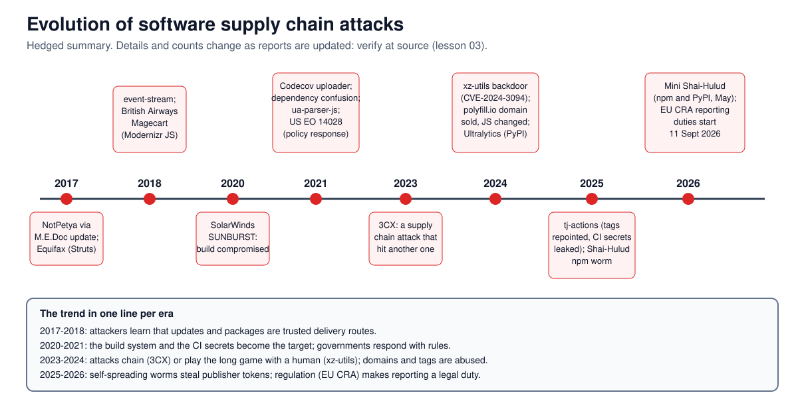

# 03. Evolution of software supply chain security

> **Chapter 1 · Time:** 2 hours · **You will:** place the major incidents on a timeline, say what each one taught the industry, and name the rules and tools that followed.
> **Hedging rule:** counts, dates and attributions below come from public reporting that changes. Treat numbers as "about" and **verify at source** before quoting.

## 1. Why this matters

Each incident changed what defenders do. If you know the *lesson* from each, the control list in chapter 6 (SBOM, signing, provenance, pinning, least privilege) will make sense instead of looking like a shopping list.

## 2. Understand it

### 2.1 Timeline table

| Year | Incident | What happened (short, hedged) | Block | Lesson |
|---|---|---|---|---|
| 2017 | **NotPetya** | Destructive malware spread through a compromised update of the Ukrainian accounting software M.E.Doc; damage spread worldwide | 5 Application / distribution | A trusted update channel is a weapon |
| 2017 | **Equifax** | A known Apache Struts flaw (CVE-2017-5638) had a patch available in March; intrusion began in mid-May; about 147 million people were affected | 3 Inventory | You cannot patch what you do not know you run |
| 2018 | **event-stream** | A maintainer handed an npm package to a stranger, who added malicious code aimed at a specific cryptocurrency wallet app | 3 Inventory / 2 SCM | Maintainer trust is a dependency |
| 2018 | **British Airways (Magecart)** | Modified JavaScript (a Modernizr script) skimmed card details from the website; roughly 380,000 to 429,000 customers were reported affected; the UK ICO fined BA about 20 million pounds in 2020 | 5 Application (third-party script) | Client-side third-party scripts are supply chain too |
| 2020 | **SolarWinds SUNBURST** | Attackers compromised the build system and inserted a backdoor into signed updates shipped to many customers | 4 Build | Trust the build, not only the source; hardened builds and provenance |
| 2021 | **Codecov** | The Bash Uploader script was modified using credentials obtained from a Docker image creation process, and CI environment variables were exfiltrated; found in April 2021 | 4 Build | Never `curl \| bash` in CI; secrets in CI are a target |
| 2021 | **Dependency confusion** | Researcher Alex Birsan (Feb 2021) showed public packages with the same name as internal ones could be pulled by build systems | 3 Inventory | Namespaces and registry rules |
| 2021 | **ua-parser-js** | A maintainer account was hijacked and malicious versions of a popular npm package were published | 3 Inventory | Account security of maintainers |
| 2021 | **US EO 14028** | The US executive order drove SBOM and secure development attestation (NIST SSDF) for software sold to the government | Policy | Regulation arrives |
| 2022 to 2023 | **Stolen code-signing certificates** | Leaked certificates (for example those attributed to NVIDIA in 2022 and MSI keys in 2023) were reported misused to sign malware | 5 Application | A signature proves the key, not the intent: protect and monitor keys |
| 2023 | **3CX** | A trojanized desktop app was distributed; reports described it as itself resulting from an earlier compromise of another software supplier: a cascading supply chain attack | 5 / 3 | Supply chains chain |
| 2024 | **xz-utils (CVE-2024-3094)** | A multi-year social-engineering campaign gave an attacker maintainer trust and a backdoor in release tarballs of a compression library; discovered in March 2024 by a developer who noticed odd performance | 2 SCM / 3 | Open source maintainers are under-resourced targets; review release artifacts versus source |
| 2024 | **polyfill.io** | A domain bought by a new owner in early 2024 served malicious JavaScript to a large number of sites (reports said 100,000 or more); mirrors and takedowns followed; the US sanctioned the company behind it in 2025 | 5 / distribution | A script URL you do not control is a live dependency |
| 2024 | **Ultralytics (PyPI)** | A GitHub Actions injection and cache issue led to releases with a cryptominer | 4 Build | Workflow injection and caches |
| 2025 | **tj-actions/changed-files (CVE-2025-30066)** | Version tags were repointed to malicious code that printed CI secrets into logs | 4 Build / 3 | Pin actions to a full commit SHA |
| 2025 | **Shai-Hulud (npm worm)** | Malware stole tokens and secrets and republished infected versions of other packages the victim could publish; a second wave followed in November 2025 | 3 Inventory / 4 Build | Self-spreading attacks; short-lived publishing tokens and trusted publishing |
| 2026 | **Mini Shai-Hulud** | Reported in May 2026 as spreading across npm and PyPI; details are still evolving | 3 Inventory | Registry-side controls and token hygiene across ecosystems |
| 2026 | **EU Cyber Resilience Act reporting** | From 11 September 2026, manufacturers must report actively exploited vulnerabilities and severe incidents (first notice within 24 hours); most other obligations apply from 11 December 2027 | Policy | Reporting and SBOM-like transparency become law |

Other threats to know: **slopsquatting** (attackers register package names that LLMs tend to hallucinate) and **repojacking** (re-registering a renamed or deleted GitHub organization so old links point to the attacker).

### 2.2 How defenses evolved

| Era | Attack shape | Defense that grew |
|---|---|---|
| Up to 2018 | Vulnerable components, small package takeovers | Vulnerability scanning (SCA), patch SLAs |
| 2020 to 2021 | Build system and CI secrets | SLSA, hardened CI, provenance, SBOM (EO 14028), signing (Sigstore) |
| 2022 to 2024 | Long-game social engineering, domains, actions | OpenSSF Scorecard, pinning, mirrors, trusted publishing |
| 2025 to 2026 | Worms, token theft across registries | Short-lived tokens, registry controls, quarantine of new versions ("cooldown" delays), laws such as the EU CRA |

### 2.3 Tool status notes (verify)

- **Docker Content Trust (Notary v1)** is retired: Docker announced it in July 2025 and the Notary service is scheduled to shut down on 8 December 2026. Use Sigstore cosign or Notation (Notary Project) instead.
- The syllabus may name tools whose maintenance is uncertain. See the "Outdated in the syllabus" box in the [chapter README](README.md#outdated-in-the-syllabus--current).

## 3. Defend it: lesson per incident

| If you learn only this... | ...then apply |
|---|---|
| Equifax | Inventory with owners, advisory matching, patch SLA ([lab](labs/equifax-case-study/README.md)) |
| SolarWinds / Codecov | Hardened builders, provenance, no remote scripts in CI |
| event-stream / xz-utils | Maintainer and release-artifact review, pin and diff updates |
| dependency confusion | Scoped registries, internal namespaces |
| polyfill.io | Do not load third-party scripts live; use SRI or self-host |
| tj-actions | Pin actions to SHA |
| Shai-Hulud | Short-lived publish tokens, no secrets in dev machines, delay new versions |

## 4. Hands-on

1. Redraw the timeline from memory and add one control per incident.
2. For your own project, ask: *which three of these incidents could have hit us, and which control would have stopped each?*
3. Run the [Equifax lab](labs/equifax-case-study/README.md).

## 5. Interview preparation

<b>Q1. Which incident showed that a signed update can still be malicious, and why?</b>

SolarWinds SUNBURST. The malicious code was added during the build, so the vendor signed it. A signature shows who signed, not what the code does. Hence hardened builds and provenance.

<b>Q2. What is special about xz-utils?</b>

It was a patient social-engineering campaign to gain maintainer trust, with a backdoor in release tarballs rather than visible source. It was caught by chance. Lesson: maintainer health, comparing release artifacts to source, and reproducible builds.

<b>Q3. How do Shai-Hulud-style worms spread?</b>

They steal publishing tokens and secrets from developer or CI environments, then publish infected versions of other packages the victim can publish. Defenses: short-lived or trusted-publishing tokens, 2FA on publishing, no long-lived secrets in environments, delaying adoption of brand-new versions.

## 6. Checklist

- [ ] I can place 10 incidents on the timeline and give the lesson of each.
- [ ] I can state the EU CRA dates.
- [ ] I know DCT is retired and what replaces it.

## 7. References

- Search for each incident's public write-ups (vendor post-mortems, CISA alerts, NVD/CVE entries). Examples: CVE-2017-5638, CVE-2024-3094, CVE-2025-30066 at <https://nvd.nist.gov>. EU CRA: Regulation (EU) 2024/2847 on EUR-Lex. Verify all numbers.
