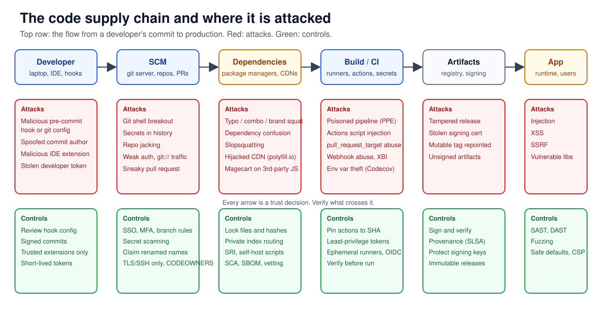

# Lesson 01: Introduction to the Code Supply Chain

> **Chapter:** 2 · Attacking Code and Application Supply Chain · **Time:** ~2.5 hours
> **You will:** draw the path from a developer's idea to running software, name the systems on that path (source control, package managers, build and CI/CD), and say where each can be attacked.

| | |
|---|---|
| **Prerequisites** | Basic git and a package manager (pip or npm). A DBA/DevOps background is enough. |
| **Labs** | none in this lesson; the chapter labs apply the ideas ([lab index](README.md#lab-index)) |
| **Syllabus lines** | Introduction to code supply chain · Code creation process and systems involved · Source code management (git, svn) · Package managers · Build and CI/CD systems |
| **Maps to** | OWASP Top 10 CI/CD Security Risks · SLSA Build track · NIST SSDF (SP 800-218) |

> **Safety.** This lesson is conceptual. All examples in the chapter are simulations with canaries, `.example` domains and FAKE secrets. Never test systems you do not own.

## Why this matters

- Attackers prefer to compromise **one upstream thing that thousands of people trust**. Codecov (2021), SolarWinds SUNBURST (2020), event-stream (2018), polyfill.io (2024), xz-utils (2024) and tj-actions/changed-files (2025) are all examples of that choice. (Details in [lesson 06](06-real-world-case-studies.md); verify numbers at the sources.)
- Most of your running software is **not code you wrote**: dependencies, base images, build tools, CI actions and scripts that CI downloads.
- The build system is a rich target: it holds secrets, can write to production, and often runs with high trust and little monitoring.

## 1. Code creation process and systems involved

A simple path, with the systems involved at each step:

| Step | What happens | Systems | Who can influence it |
|---|---|---|---|
| 1. Write | Developer edits code | IDE, extensions, local git, pre-commit hooks | the developer, extension authors, whoever wrote the repo's hook config |
| 2. Commit and review | Changes go to a shared repo; a pull request is reviewed | git server (GitHub, GitLab, Bitbucket, Gitea), code review tools | every contributor, admins, anyone with a stolen token |
| 3. Pull in dependencies | Libraries, frameworks, scripts from CDNs | package managers, registries, CDNs, mirrors | maintainers of every dependency, and anyone who can squat a name |
| 4. Build and test | Compile, test, package, scan | CI/CD server, runners, build tools, plugins, actions | everyone who can change the pipeline or what it downloads |
| 5. Store and sign | Artifacts are stored and (ideally) signed | artifact registry, container registry, signing keys | pipeline identity, registry admins |
| 6. Deploy and run | Artifact is deployed | CD tool, Kubernetes, cloud, the web server | operators, the pipeline |

**Key idea.** Each arrow is a **trust decision**. The pipeline trusts the repo, the repo trusts contributors, the build trusts its dependencies, production trusts the registry. An attacker needs to break just one decision that nobody verifies.

## 2. Source code management (git, svn)

**Git** is distributed. Every clone has the full history. Commits are identified by a hash that covers the content, the parent and the metadata, so history is tamper-evident **if you already know the right hash**. Authorship fields (name, email) are free text, so they prove nothing ([lesson 02](02-attacks-on-scm-systems.md)). Git runs programs in several places: hooks, filters, aliases, helper commands. Remotes speak `ssh://`, `https://`, the old unauthenticated `git://`, or a local path.

**Subversion (svn)** is centralized. One server holds the repository; clients check out a working copy. Revision numbers are sequential integers, not content hashes. Access control is path-based (authz files, or the web server's rules). It is reached over `svn://` (svnserve), `svn+ssh://` or `https://` (Apache `mod_dav_svn`). Differences that matter for security:

| Topic | git | svn |
|---|---|---|
| Integrity | content hash chain, optional signed commits and tags | revision numbers, no built-in commit signing; trust the server and the transport |
| Access control | by the hosting platform (branches, repos) | path-based rules on the server |
| Secrets in history | in every clone, forever until rewritten | in the server history; admins can dump and filter |
| Pulling code from elsewhere | submodules, subtrees | `svn:externals` (a property that makes checkouts fetch another URL) |
| Unencrypted transport | `git://` and `http://` exist | `svn://` is plain by default |

Both can leak secrets, and both execute server-side hooks. The syllabus names both; most modern attacks are on git hosting platforms.

## 3. Package managers

A package manager downloads and installs dependencies from a **registry** (PyPI, npm, Maven Central, NuGet, crates.io, the Go module proxy, RubyGems) or from a private mirror. Security-relevant facts:

- **Install-time code execution.** npm packages can run `preinstall`/`postinstall` scripts. Python source distributions run `setup.py` or a build backend at install time; wheels are pre-built but still run code when imported. Rust crates can have `build.rs`. Installing a package is often running someone else's code.
- **Name resolution.** The name you type decides what you get. That is the root of typosquatting and dependency confusion ([lesson 03](03-supply-chain-attacks-on-package-managers.md)).
- **Transitive dependencies.** You pick 20 packages and get 800. You trust them all.
- **Lock files and hashes** fix versions (and, if hashes are used, file contents). Without them, "latest" is whatever the registry says today.
- **Namespaces and ownership** differ: npm scopes, Maven group IDs with domain verification, NuGet prefix reservation, PyPI's flat names.

## 4. Build and CI/CD systems

CI/CD turns a commit into an artifact and (often) a deployment. Typical parts: a **trigger** (push, pull request, webhook, schedule), a **pipeline definition** in the repo (`.gitlab-ci.yml`, `.github/workflows/*.yml`, `Jenkinsfile`), **runners** or agents (shared or self-hosted, persistent or ephemeral), **secrets and tokens**, **caches and artifacts**, and **plugins or actions** written by third parties.

The OWASP Top 10 CI/CD Security Risks (verify the current list at owasp.org) names the recurring problems:

| ID | Risk |
|---|---|
| CICD-SEC-1 | Insufficient Flow Control Mechanisms |
| CICD-SEC-2 | Inadequate Identity and Access Management |
| CICD-SEC-3 | Dependency Chain Abuse |
| CICD-SEC-4 | Poisoned Pipeline Execution (PPE) |
| CICD-SEC-5 | Insufficient PBAC (Pipeline-Based Access Controls) |
| CICD-SEC-6 | Insufficient Credential Hygiene |
| CICD-SEC-7 | Insecure System Configuration |
| CICD-SEC-8 | Ungoverned Usage of 3rd Party Services |
| CICD-SEC-9 | Improper Artifact Integrity Validation |
| CICD-SEC-10 | Insufficient Logging and Visibility |

## Defend it: the big picture

| Layer | Control | Type |
|---|---|---|
| SCM | SSO and MFA, branch protection, required reviews, signed commits, secret scanning | Hard / Process |
| Dependencies | lock files with hashes, private index routing, vetting, SCA, SBOM | Hard / Process |
| Build | ephemeral runners, least-privilege tokens, pinned actions, verify before run | Hard |
| Artifacts | sign and verify, provenance (SLSA), protect signing keys | Hard |
| Application | SAST, DAST, fuzzing, secure defaults | Hard / Process |

**What does NOT work on its own:** trusting a famous project's name; scanning only at the end; one shared admin token for all pipelines; "we use a private repo, so we are safe".

## Hands-on

Pick one of your own projects and list, for each of the six steps above, the **three things you download or trust without verifying**. Then compare with the [chapter labs](README.md#lab-index): each lab removes one of those trust assumptions.

## Real-world scenarios

1. **A new hire clones a repo and runs `make setup`.** The target runs a script from the repo that installs hooks and downloads a tool. What did they trust? (Repo authors, the download host.) Fix: review, pin, verify, throwaway environment for unknown repos.
2. **A pipeline runs `curl https://tool.example/install.sh | bash`.** What can go wrong? (Any change on that server runs inside CI with its secrets: the [Codecov pattern](06-real-world-case-studies.md).) Fix: download, verify a signature or hash, then run.
3. **Two teams share one runner.** Team A's job leaves a poisoned cache. What happens to Team B's build? (Cross-build injection, [lesson 04](04-attacks-on-build-and-cicd-systems.md).) Fix: ephemeral runners, isolated caches.

## Common mistakes

- Treating the build server as "internal, so trusted".
- Giving CI a long-lived admin token "to make it work".
- Pinning application dependencies but not build tools, actions and base images.
- Thinking git history is proof of authorship.

## Interview preparation

<b>Q1. Name the main systems in the code supply chain.</b>

Developer machine and IDE, source control, package managers and registries (plus CDNs), build and CI/CD, artifact and container registries, and deployment. Each is a trust boundary with its own attacks.

<b>Q2. Why is "install a package" a code-execution event?</b>

Many ecosystems run code at install time (npm install scripts, Python source-distribution builds, Rust build scripts), and the code runs again when the package is imported. So a malicious or hijacked package gets code execution on developer machines and CI runners.

<b>Q3. What is the main security difference between git and svn?</b>

Git has content-addressed history that is tamper-evident if you know the right hash, and supports signed commits and tags. Svn trusts the central server and transport, with revision numbers and path-based authorization. Both can leak secrets and run server-side hooks.

## Checklist (definition of done)

- [ ] I can draw the six steps and name one attack per step.
- [ ] I can explain why install scripts matter.
- [ ] I can list the OWASP CI/CD risk names that relate to this chapter.

## References

- OWASP Top 10 CI/CD Security Risks: <https://owasp.org/www-project-top-10-ci-cd-security-risks/>
- SLSA: <https://slsa.dev/>
- NIST SSDF, SP 800-218: <https://csrc.nist.gov/pubs/sp/800/218/final>
- Pro Git book, Git internals: <https://git-scm.com/book>
