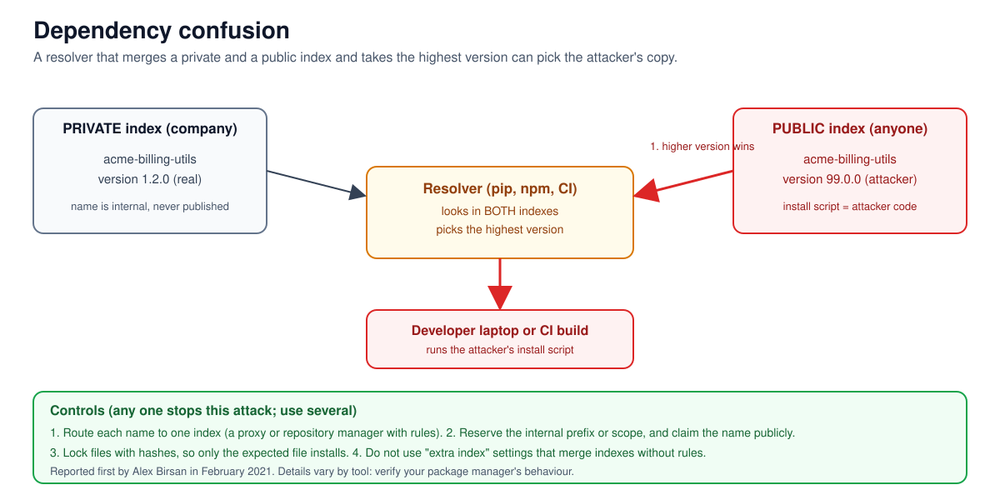

# Lesson 03: Supply Chain Attacks on Package Managers

> **Chapter:** 2 · Attacking Code and Application Supply Chain · **Time:** ~6 hours
> **You will:** explain how attackers abuse names, registries and CDNs (Magecart, polyfill.io, squatting, dependency confusion, masquerading, slopsquatting), how CSP and SRI help and fail, and run three labs.

| | |
|---|---|
| **Prerequisites** | [Lesson 01](01-introduction-to-the-code-supply-chain.md) |
| **Labs** | [dependency-confusion](labs/dependency-confusion/README.md) · [typosquatting-dependency](labs/typosquatting-dependency/README.md) |
| **Related** | [CAISP ch6 package-vetting](../../caisp-course/ch6-supply-chain-attacks-in-ai/labs/package-vetting/vetting.py) · [CAASE ch4 supply-chain injection](../../caase-course/ch4-computer-use-browser-and-coding-agents/02-attacking-coding-agents.md#2-supply-chain-injection-through-packages-or-marketplace-skills) |
| **Syllabus lines** | Supply Chain Attacks on package managers · Magecart attack in an Airways · Supply Chain Attacks on CDNs · Bypassing security mechanisms like CSP · Typo-squatting techniques · Combosquatting · Brandjacking · Dependency confusion · Abusing IDE behaviors through dependency confusion · Package Masquerading · Abusing Generative AI for package masquerading |

> **Safety.** No package is installed anywhere. Names are fixtures, domains are `.example`. **Verify numbers and dates at the sources.**

## Why this matters

- A dependency runs with your application's privileges. One bad package reaches every project that installs it.
- Names are the weak point: the name you type is the only thing between you and the attacker's copy.
- Browsers load third-party JavaScript the same way, so a hijacked CDN script is an attack on every visitor.

## 1. How the package ecosystem is abused

| Technique | Needs | Typical goal |
|---|---|---|
| Typosquatting, combosquatting, brandjacking | a lookalike name | steal env vars and tokens, drop a backdoor |
| Dependency confusion | an internal name leaked or guessed | code execution in CI and on developer machines |
| Account takeover or maintainer handover | a phished or bought maintainer | trojanize a real package (event-stream 2018; ua-parser-js 2021) |
| Masquerading | a convincing fake | trust through look-alike metadata |
| Slopsquatting | an AI-hallucinated name | install by developers and coding agents |
| CDN or domain takeover | an expired or sold domain | run script in every visitor's browser |

## 2. Magecart attack in an Airways (British Airways, 2018)

**Magecart** is the name for groups that inject **card-skimming JavaScript** into payment pages. The British Airways case (2018) is the standard example. Facts, hedged:

- In 2018, attackers got a modified copy of the **Modernizr** JavaScript library onto BA's website and mobile app web views. The modified script captured payment form data and sent it to a **lookalike domain** (reported in analyses as `baways[.]com`; verify) that used a valid TLS certificate.
- About **380,000** payment cards were first reported; the UK regulator later cited about **429,000** affected people (numbers vary by source).
- The UK ICO announced an intention to fine BA about £183M in 2019 and **fined £20M in October 2020** (reduced after the pandemic's effect and BA's representations; verify).
- The code ran in the customer's browser, so server-side controls and the card network never saw an anomaly until fraud appeared.

**Lessons.** The skimmer was a few lines added to a trusted script. Controls: integrity monitoring of first- and third-party scripts (hash or SRI checks and alerts when a script changes), a strict CSP that limits where scripts can send data (`connect-src`, `form-action`), reduced third-party script on payment pages (some sites use hosted payment fields or iframes), and PCI DSS 4.0 requirements for payment-page script inventory and integrity (verify requirement numbers, 6.4.3 and 11.6.1). Other Magecart cases abused **third-party widgets** (a 2018 Ticketmaster incident involved a customer-support script from a vendor; verify).

## 3. Supply Chain Attacks on CDNs

A page that includes `<script src="https://cdn.example/lib.js">` gives that host full control of the page. Attack routes: compromise the CDN or the origin it mirrors, take over an expired domain, **buy** a trusted domain, or push a malicious new version if the URL is "latest".

**Case: polyfill.io (June 2024, hedged).** The domain, which served JavaScript polyfills to browsers, was bought by a company reported as **Funnull** in early 2024. In June 2024 researchers reported that it served **malicious code that redirected some visitors**. Reports counted **100,000+ websites** embedding it (estimates vary). Cloudflare and Fastly created **safe mirrors**, the domain registrar suspended the domain, and the US Treasury (OFAC) **sanctioned Funnull in 2025** (verify). The original open-source author had warned people to stop using the service.

**Why SRI could not save most users.** `polyfill.io` returned a **different file depending on the browser** (User-Agent), so there was no single stable hash to pin. Static, versioned files can use Subresource Integrity; dynamic services cannot.

### Subresource Integrity (SRI)

```html
<script src="https://cdn.example/lib-3.2.1.min.js"
        integrity="sha384-BASE64HASHOFTHEFILE"
        crossorigin="anonymous"></script>
```

The browser downloads the file, hashes it, and refuses to run it if the hash does not match. SRI protects **static** files at a **fixed version URL**. It does not help with dynamic responses, files that change legitimately, or script tags that load other scripts at runtime.

**Defend.** Self-host or vendor the libraries you need (and update them as a normal dependency); use SRI with version-pinned URLs; do not rely on dynamic third-party script endpoints; monitor third-party script changes; remove services you no longer need (and remove dead references, because an expired domain you still point to is a gift); apply a CSP.

## 4. Bypassing security mechanisms like CSP

**Content Security Policy (CSP)** is a response header that tells the browser which sources of script, frames, images and connections are allowed. It is a strong **second line** against XSS and skimmers. It has known weaknesses:

| Weakness | How attackers use it |
|---|---|
| `'unsafe-inline'` or `'unsafe-eval'` in `script-src` | injected inline script runs |
| Allowlisting a **whole CDN** (`script-src cdn.example`) | an attacker uploads or finds a script on that CDN (user-uploaded packages, libraries with "script gadgets") and it is allowed |
| **JSONP endpoints** on an allowlisted host | `<script src="https://allowed.example/jsonp?callback=alert(1)//">` executes attacker-chosen code from an allowed origin |
| Wildcards (`*.example.com`), `data:` or `blob:` sources | too broad |
| Missing `object-src` or `base-uri` | plugin or base tag tricks |
| Allowlisting a host that **becomes malicious** | polyfill.io on your CSP allowlist: CSP would have allowed the malicious script |
| Open redirects on an allowed host | redirect the script load to another origin in some setups |
| Policy only in `Report-Only` mode | nothing is blocked |

Research from Google (the "CSP Is Dead, Long Live CSP" study, 2016) found that most allowlist-based policies could be bypassed. The recommended pattern today is a **strict CSP** using **nonces or hashes** with `'strict-dynamic'`, plus `object-src 'none'` and `base-uri 'none'` (verify in current guidance), instead of long host allowlists.

**Lab link.** The [dynamic-analysis lab](labs/dynamic-analysis/README.md) checks for missing CSP headers; see [lesson 05](05-attacks-on-the-application-side.md) for XSS.

## 5. Typosquatting

Attackers publish a package whose name is **one mistake away** from a popular one and wait for a typo, a bad copy-paste, or a recommendation. Common techniques:

| Technique | Example (fictional) |
|---|---|
| Missing, extra or swapped letter | `reqeusts` for `requests` |
| Repeated character | `numpyy` |
| Look-alike characters | `djang0`, `rnatplotlib` (`rn` looks like `m`) |
| Separator games | `my_package` vs `my-package` vs `mypackage` (registries often treat `-` `_` `.` as equal, so check your registry's rules) |
| Different keyboard-adjacent keys | `reuests` |
| Wrong ecosystem or scope | `@scope/name` lookalike scopes |

Real examples include the npm `crossenv` package (2017, a lookalike of `cross-env`) and Python lookalikes of `colorama` (verify). The payload usually runs at install time and steals environment variables, tokens or SSH keys.

**Lab:** [typosquatting-dependency](labs/typosquatting-dependency/README.md) detects these with edit distance, homoglyph mapping and affix rules.

## 6. Combosquatting and brandjacking

**Combosquatting** appends or prepends believable words to a popular name: `requests-official`, `python-requests`, `pandas-utils`, `secure-lodash`. The term comes from research on domain squatting (a 2017 measurement study; verify). It beats edit-distance rules because the name is far from the original but *sounds* like a first-party add-on.

**Brandjacking** uses a **vendor or brand name** to look official: `azure-auth-helper`, `aws-cli-tools`, a fake `@company/` scope, or an extension named like a popular tool. People trust a brand name. Campaigns reported in recent years used cloud-vendor names and lookalike npm scopes (verify examples). The same trick appears in IDE extension marketplaces and GitHub (fake "releases" and repo clones).

**Defend (for squatting in general).** Check publisher, age, downloads and repository link before adding a dependency; prefer official docs for the exact name; use an **internal allowlist or proxy**; automated typo checks in CI; lock files; scanners that look for suspicious install scripts (GuardDog, Socket-style tools; verify the current tools).

## 7. Dependency confusion



Alex Birsan reported this technique in **February 2021**. Companies use **private** packages with internal names. If the same name does not exist publicly, an attacker registers it on the **public** registry with a **higher version**. A build that checks both sources and picks the highest version installs the attacker's package, whose install script runs inside the company network. Birsan's research reached dozens of large companies (counts vary); the callbacks were harmless proofs.

**Where internal names leak:** `package.json` or `requirements.txt` in public repos, JavaScript bundles and source maps, error messages, job postings and docs.

**Why it works:** the client merges indexes, version comparison favors a huge number, and many clients do not say which index a file came from. Behavior differs: npm uses scopes and registry configuration; pip's `--extra-index-url` merges indexes (so the highest version wins) while `--index-url` replaces the default; some newer resolvers use "first index wins" strategies. **Verify your package manager's behavior.**

**Defend.**

| Control | Note |
|---|---|
| Route names to one source (repository manager rules: Artifactory, Nexus, a private index proxy) | the most reliable fix |
| Scope or reserve internal namespaces (npm org scope, Maven group ID, NuGet prefix reservation) and **claim the names publicly** as placeholders | prevents squatting |
| Lock files with **hashes** | only the expected file installs |
| Avoid "extra index" merging; configure explicit per-package indexes | verify tool docs |
| Monitor for your internal names appearing publicly | early warning |
| Build in network-restricted environments | limits what an install script can reach |

**Lab:** [dependency-confusion](labs/dependency-confusion/README.md) compares four resolver policies. See also [CAISP ch6](../../caisp-course/ch6-supply-chain-attacks-in-ai/labs/package-vetting/depconfusion.py).

## 8. Abusing IDE behaviors through dependency confusion

Developer tools turn **names into installs** automatically. Hedged examples of the pattern; check the behavior of your own tools:

| Behavior | Risk |
|---|---|
| **"Install missing package" quick fixes** (some IDEs and language servers suggest `pip install name` or `npm install name` from an import) | suggests the public name, even if the intended package is internal |
| **Automatic type acquisition** (TypeScript tooling can download `@types/*` packages from npm in the background) | a name-based install the developer never typed |
| **Extension recommendations** in a workspace file (`.vscode/extensions.json`) | opening an untrusted repo prompts to install what the repo author lists |
| **Extension marketplace name gaps** | research reported (2025; verify) that some editors using an alternative marketplace listed recommended extensions that were **not published there**, so an attacker could claim the name and get installed by users who trusted the recommendation |
| **Dev containers, task runners** (`devcontainer.json`, `tasks.json`) | run commands when a folder is opened or trusted |

The shared pattern is **dependency confusion applied to developer tooling**: a name resolves against a public source that the attacker can write to. **Defend:** use workspace trust features and keep untrusted folders in restricted mode, review recommended extensions, use a company extension allowlist or mirror, configure internal indexes for the IDE as well as for CI, and treat the developer laptop as part of the supply chain.

## 9. Package masquerading

**Masquerading** is making a malicious package look legitimate beyond the name: copying the real README and metadata, linking the real project's repository, inflating download counts and stars, or publishing under a believable maintainer persona. Variants:

- **Cloned repositories and "repo confusion"**: copies of popular projects on GitHub with malware added; the copy ranks in search or is linked from a blog (researchers reported large numbers of cloned repos in 2024; verify).
- **Manifest confusion** (2023, npm): the `package.json` shown on the registry could differ from the one inside the tarball, so tools that read the metadata could be fooled (verify the status of mitigations).
- **Source mismatch**: published artifacts built from code that is not in the public repo (or release tarballs that contain extra files). The xz-utils backdoor (2024) used release tarballs with build-time material not visible in the git tree (verify).
- **Fake reviews and stars**, hijacked old accounts, and "abandonware" takeovers.

**Defend.** Compare the published artifact to the source (reproducible builds, provenance such as SLSA/Sigstore attestations: [lesson 07](07-best-practices-for-securing-the-application-supply-chain.md)); check that the repository URL's owner matches the publisher; do not trust popularity signals; use vetting tools (see [CAASE skill-vetting](../../caase-course/ch4-computer-use-browser-and-coding-agents/labs/skill-vetting/README.md) for the same checklist idea).

## 10. Abusing Generative AI for package masquerading (slopsquatting)

Two angles:

1. **Hallucinated package names.** Coding assistants sometimes recommend a package that **does not exist**. A 2024-2025 academic study of code-generating models found that a notable share of recommended packages did not exist (about one in five across the tested models, with open-source models worse than commercial ones; **verify the figures**). An attacker registers the hallucinated name and waits. The term **slopsquatting** (credited to Seth Larson of the Python Software Foundation, 2025; verify) describes this. A researcher (2024) published a package for a name that models kept suggesting, and it was downloaded many times by people and tools (hedged).
2. **Generating convincing masquerades.** GenAI makes it cheap to write realistic READMEs, docs, commit histories, issue threads and maintainer personas at scale, so the "looks legitimate" signals above get less reliable.

**Defend.** Verify every AI-suggested dependency exists, has history and a real repository (a quick lookup before `pip install`); give coding agents an **allowlist or proxy** of approved packages; require human approval to add dependencies (see [CAASE ch4](../../caase-course/ch4-computer-use-browser-and-coding-agents/05-defending-computer-use-and-coding-agents.md)); register your own commonly hallucinated names if they matter to you; run installs in sandboxes without secrets; consider a company registry that only mirrors reviewed packages.

## Hands-on

1. [dependency-confusion](labs/dependency-confusion/README.md) (30 min) then [typosquatting-dependency](labs/typosquatting-dependency/README.md) (30 min).
2. Pick three dependencies from one of your own projects and check publisher, age, repository link and install scripts by hand.
3. Write the three-line `integrity` attribute for a static script of your own (compute the hash with `openssl dgst -sha384 -binary file | openssl base64 -A`).

## Real-world scenarios

1. **CI installs `acme-billing-utils==99.0.0` and the build contacts an unknown host.** Investigate: the pip log shows the public index; the internal package is 1.2.0. Fix: route rules, hash lock, rotate secrets the job could see.
2. **Checkout page script changed overnight.** Diff the script against the stored hash; check for a new outbound domain; compare CSP reports. Fix: restore from source, rotate keys, add change alerts.
3. **An agent adds `huggingface-cli-helper` to requirements.** It exists, created 3 days ago. Fix: block unvetted additions, verify with the official docs, use an allowlist.

## Common mistakes

- Thinking "private package" means "cannot be attacked from the public registry".
- CSP allowlists with big CDNs and no nonce.
- Trusting `latest` or dynamic CDN URLs.
- Assuming popularity (stars, downloads) means safety.
- Using SRI on a URL whose content changes.

## Interview preparation

<details><summary><b>Q1. Explain dependency confusion in three sentences.</b></summary>
Companies use internal package names that the public registry does not have. An attacker publishes the same name with a high version on the public registry. A resolver that merges indexes and takes the highest version installs the attacker's package, which runs code during install in the company's build.
</details>

<details><summary><b>Q2. Why did SRI not stop most polyfill.io victims?</b></summary>
The service returned different content per browser, so there was no single hash to pin. SRI only protects static, versioned files. The fix was to stop using the endpoint and self-host or use a safe mirror.
</details>

<details><summary><b>Q3. Name two ways CSP is bypassed.</b></summary>
Allowlisting a CDN or host that has JSONP endpoints or attacker-controllable scripts, and allowing unsafe-inline or wildcards. Use nonces or hashes with strict-dynamic, object-src none and base-uri none instead.
</details>

<details><summary><b>Q4. Typosquatting versus combosquatting versus brandjacking?</b></summary>
Typosquatting uses a name one mistake away (edit distance). Combosquatting adds believable words to a real name. Brandjacking uses a vendor or brand name to look official. Detection differs: edit distance and homoglyphs, affix patterns, brand lists plus publisher checks.
</details>

<details><summary><b>Q5. What is slopsquatting and how do you defend against it?</b></summary>
An attacker registers a package name that AI assistants hallucinate. Defend by verifying existence, age and repository before installing, allowlisting packages for agents, requiring human approval for new dependencies and sandboxing installs.
</details>

## Checklist (definition of done)

- [ ] I can explain the BA Magecart case with hedged numbers.
- [ ] I can write an SRI tag and say when SRI cannot work.
- [ ] I can name four CSP bypass causes.
- [ ] I ran both labs and can explain which resolver policy stopped confusion and why.

## References

- Alex Birsan, "Dependency Confusion: How I Hacked Into Apple, Microsoft and Dozens of Other Companies" (Feb 2021): <https://medium.com/@alex.birsan/dependency-confusion-4a5d60fec610>
- UK ICO, British Airways penalty notice (2020): <https://ico.org.uk/>
- Sansec and Cloudflare write-ups on polyfill.io (June 2024): <https://sansec.io/>, <https://blog.cloudflare.com/>
- MDN: Subresource Integrity and Content Security Policy: <https://developer.mozilla.org/>
- Weichselbaum et al., "CSP Is Dead, Long Live CSP!" (2016)
- Python Packaging: <https://packaging.python.org/>, npm docs on scopes: <https://docs.npmjs.com/>
- OSV and GuardDog (malicious package detection): <https://osv.dev/>, <https://github.com/DataDog/guarddog>
