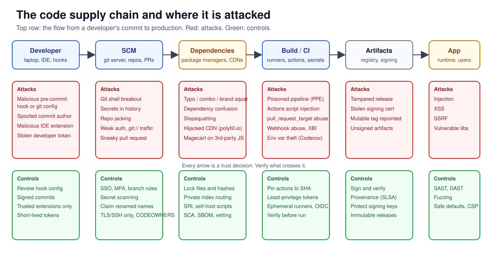

# Chapter 2: Attacking Code and Application Supply Chain

This chapter follows code from the developer's laptop to the running application: **source control** (git servers, hooks, signing), **package managers and CDNs** (squatting, dependency confusion, polyfill.io, Magecart), **build and CI/CD** (poisoned pipelines, GitHub Actions, GitLab), the **application side** (injection, XSS, SSRF), real **case studies**, and the **best practices and tools** that close the gaps. Twelve labs run offline.

> **Safety.** Every lab is a simulation: temp directories and throwaway git repos, in-memory indexes and sinks, canary strings, FAKE secrets, `.example` domains, and one tiny web app bound to `127.0.0.1` on an ephemeral port (the scanner refuses non-local targets). Nothing is downloaded, installed or sent anywhere. Never test systems you do not own.

> **Unofficial companion.** Your course videos and lab environment are the primary source. Incident facts and numbers are hedged: **verify at the source**.

## Syllabus coverage

| Syllabus item | Where to study | Lab |
|---|---|---|
| Introduction to code supply chain | [Lesson 01](01-introduction-to-the-code-supply-chain.md) | n/a |
| Code creation process and systems involved | [01 section 1](01-introduction-to-the-code-supply-chain.md#1-code-creation-process-and-systems-involved) (with SVG) | n/a |
| Source code management (git, svn) | [01 section 2](01-introduction-to-the-code-supply-chain.md#2-source-code-management-git-svn) | [git-commit-spoofing](labs/git-commit-spoofing/README.md) |
| Package managers | [01 section 3](01-introduction-to-the-code-supply-chain.md#3-package-managers) | [dependency-confusion](labs/dependency-confusion/README.md) |
| Build and CI/CD systems | [01 section 4](01-introduction-to-the-code-supply-chain.md#4-build-and-cicd-systems) | [gitlab-privilege-escalation](labs/gitlab-privilege-escalation/README.md) |
| Attacks on SCM systems | [Lesson 02](02-attacks-on-scm-systems.md) | [pre-commit-hooks](labs/pre-commit-hooks/README.md), [git-commit-spoofing](labs/git-commit-spoofing/README.md) |
| Breaking out of restricted Git shells | [02 section 1](02-attacks-on-scm-systems.md#1-breaking-out-of-restricted-git-shells) (conceptual) | n/a |
| Git servers leaking confidential information | [02 section 2](02-attacks-on-scm-systems.md#2-git-servers-leaking-confidential-information) | [gitlab-privilege-escalation](labs/gitlab-privilege-escalation/README.md) |
| Exploiting pre-commit hooks | [02 section 3](02-attacks-on-scm-systems.md#3-exploiting-pre-commit-hooks) | [exploiting-pre-commit-hooks](labs/exploiting-pre-commit-hooks/README.md) |
| Repo Jacking | [02 section 4](02-attacks-on-scm-systems.md#4-repo-jacking) | n/a |
| Executing Arbitrary Code With Git Commands | [02 section 5](02-attacks-on-scm-systems.md#5-executing-arbitrary-code-with-git-commands) | [exploiting-pre-commit-hooks](labs/exploiting-pre-commit-hooks/README.md) (`gitconfig_audit`) |
| Risks of unencrypted Git traffic | [02 section 6](02-attacks-on-scm-systems.md#6-risks-of-unencrypted-git-traffic); repo [networking](../../cybersecurity-track/02-networking/README.md) | [git-commit-signing](labs/git-commit-signing/README.md) (why signed content survives bad transport) |
| Insufficient Authentication In Git Servers | [02 section 7](02-attacks-on-scm-systems.md#7-insufficient-authentication-in-git-servers) | [gitlab-privilege-escalation](labs/gitlab-privilege-escalation/README.md), [git-commit-spoofing](labs/git-commit-spoofing/README.md) |
| Supply Chain Attacks on package managers | [Lesson 03](03-supply-chain-attacks-on-package-managers.md) | [dependency-confusion](labs/dependency-confusion/README.md), [typosquatting-dependency](labs/typosquatting-dependency/README.md) |
| Magecart attack in an Airways | [03 section 2](03-supply-chain-attacks-on-package-managers.md#2-magecart-attack-in-an-airways-british-airways-2018) | n/a |
| Supply Chain Attacks on CDNs | [03 section 3](03-supply-chain-attacks-on-package-managers.md#3-supply-chain-attacks-on-cdns) | n/a |
| Bypassing security mechanisms like CSP | [03 section 4](03-supply-chain-attacks-on-package-managers.md#4-bypassing-security-mechanisms-like-csp) | [dynamic-analysis](labs/dynamic-analysis/README.md) (header checks) |
| Typo-squatting techniques | [03 section 5](03-supply-chain-attacks-on-package-managers.md#5-typosquatting) | [typosquatting-dependency](labs/typosquatting-dependency/README.md) |
| Combosquatting | [03 section 6](03-supply-chain-attacks-on-package-managers.md#6-combosquatting-and-brandjacking) | [typosquatting-dependency](labs/typosquatting-dependency/README.md) |
| Brandjacking | [03 section 6](03-supply-chain-attacks-on-package-managers.md#6-combosquatting-and-brandjacking) | [typosquatting-dependency](labs/typosquatting-dependency/README.md) |
| Dependency confusion | [03 section 7](03-supply-chain-attacks-on-package-managers.md#7-dependency-confusion) (with SVG); [CAISP ch6](../../caisp-course/ch6-supply-chain-attacks-in-ai/labs/package-vetting/depconfusion.py) | [dependency-confusion](labs/dependency-confusion/README.md) |
| Abusing IDE behaviors through dependency confusion | [03 section 8](03-supply-chain-attacks-on-package-managers.md#8-abusing-ide-behaviors-through-dependency-confusion) (hedged) | [dependency-confusion](labs/dependency-confusion/README.md) (`ide_quick_fix`) |
| Package Masquerading | [03 section 9](03-supply-chain-attacks-on-package-managers.md#9-package-masquerading) | n/a |
| Abusing Generative AI for package masquerading | [03 section 10](03-supply-chain-attacks-on-package-managers.md#10-abusing-generative-ai-for-package-masquerading-slopsquatting) | [typosquatting-dependency](labs/typosquatting-dependency/README.md) |
| Attacks on Build and CI/CD Systems | [Lesson 04](04-attacks-on-build-and-cicd-systems.md) | [gitlab-privilege-escalation](labs/gitlab-privilege-escalation/README.md), [codecov-attack](labs/codecov-attack/README.md) |
| Poisoning build pipelines for complete pwnage | [04 section 2](04-attacks-on-build-and-cicd-systems.md#2-poisoning-build-pipelines-for-complete-pwnage-poisoned-pipeline-execution); [CAISP ch4 PPE](../../caisp-course/ch4-ai-attacks-and-defenses-devops/labs/poisoned-pipeline/README.md) | [gitlab-privilege-escalation](labs/gitlab-privilege-escalation/README.md) |
| Manual code reviews and sneaking PR/MR | [04 section 3](04-attacks-on-build-and-cicd-systems.md#3-manual-code-reviews-and-sneaking-prmr) | n/a |
| Abusing webhooks to compromise CI/CD systems | [04 section 4](04-attacks-on-build-and-cicd-systems.md#4-abusing-webhooks-to-compromise-cicd-systems) | n/a |
| Cross Build Injection (XBI) Attacks | [04 section 5](04-attacks-on-build-and-cicd-systems.md#5-cross-build-injection-xbi-attacks) | [codecov-attack](labs/codecov-attack/README.md) |
| Misconfigured Github Actions | [04 section 6](04-attacks-on-build-and-cicd-systems.md#6-misconfigured-github-actions) (with SVG); repo [workflow_lint](../../06-ai-devsecops/cicd/README.md) | [codecov-attack](labs/codecov-attack/README.md) |
| Attacks on Application Side | [Lesson 05](05-attacks-on-the-application-side.md) | [sast](labs/sast/README.md), [dynamic-analysis](labs/dynamic-analysis/README.md) |
| Injection attacks | [05 section 1](05-attacks-on-the-application-side.md#1-injection-attacks); [pentest lessons](../../cybersecurity-track/09-pentesting-fundamentals/README.md) | [sast](labs/sast/README.md), [dynamic-analysis](labs/dynamic-analysis/README.md) |
| Cross Site Scripting (XSS) | [05 section 2](05-attacks-on-the-application-side.md#2-cross-site-scripting-xss) | [dynamic-analysis](labs/dynamic-analysis/README.md) |
| Server Side Request Forgery | [05 section 3](05-attacks-on-the-application-side.md#3-server-side-request-forgery-ssrf) | [dynamic-analysis](labs/dynamic-analysis/README.md) |
| Real-World case studies of code supply chain attack | [Lesson 06](06-real-world-case-studies.md) | [codecov-attack](labs/codecov-attack/README.md) |
| Stealing environment variables from build servers | [06 section 1](06-real-world-case-studies.md#1-stealing-environment-variables-from-build-servers-the-codecov-pattern) | [codecov-attack](labs/codecov-attack/README.md) |
| Exposing private source code on GitHub | [06 section 2](06-real-world-case-studies.md#2-exposing-private-source-code-on-github) | n/a |
| Leaking source code of patented technologies | [06 section 3](06-real-world-case-studies.md#3-leaking-source-code-of-patented-technologies) (generic patterns, hedged) | n/a |
| Stolen code-sign certificates or signed malicious apps | [06 section 4](06-real-world-case-studies.md#4-stolen-code-sign-certificates-or-signed-malicious-apps) | [git-commit-signing](labs/git-commit-signing/README.md) |
| Best practices for securing application supply chain | [Lesson 07](07-best-practices-for-securing-the-application-supply-chain.md) | [git-commit-signing](labs/git-commit-signing/README.md), [dependency-confusion](labs/dependency-confusion/README.md) |
| SBOMs | [07 section 1](07-best-practices-for-securing-the-application-supply-chain.md#1-sboms); [CAISP ch6 SBOM](../../caisp-course/ch6-supply-chain-attacks-in-ai/labs/sbom-and-mlbom/), [CMCPSE ch6 SBOM](../../cmcpse-course/ch6-supply-chain-security-and-governance-of-mcp/labs/sbom-mcp-server/) | [sca](labs/sca/README.md) |
| Code Signing and Commit Signing | [07 section 2](07-best-practices-for-securing-the-application-supply-chain.md#2-code-signing-and-commit-signing) | [git-commit-signing](labs/git-commit-signing/README.md) |
| Artifact Signing | [07 section 3](07-best-practices-for-securing-the-application-supply-chain.md#3-artifact-signing); [CMCPSE sign-verify](../../cmcpse-course/ch6-supply-chain-security-and-governance-of-mcp/labs/sign-verify-mcp-build/) | [git-commit-signing](labs/git-commit-signing/README.md) (concept fallback) |
| Dependency Hashing | [07 section 4](07-best-practices-for-securing-the-application-supply-chain.md#4-dependency-hashing) | [dependency-confusion](labs/dependency-confusion/README.md) (`resolve_with_lock`), [codecov-attack](labs/codecov-attack/README.md) |
| Dependency Pinning | [07 section 5](07-best-practices-for-securing-the-application-supply-chain.md#5-dependency-pinning) | [dependency-confusion](labs/dependency-confusion/README.md) |
| Defending GitHub Actions With Pinning | [07 section 6](07-best-practices-for-securing-the-application-supply-chain.md#6-defending-github-actions-with-pinning); repo [workflow_lint](../../06-ai-devsecops/cicd/README.md) | [exploiting-pre-commit-hooks](labs/exploiting-pre-commit-hooks/README.md) (same pin rule for hooks) |
| Technologies and solutions for securing applications | [Lesson 08](08-technologies-and-solutions-for-securing-applications.md) | [sca](labs/sca/README.md), [sast](labs/sast/README.md), [dynamic-analysis](labs/dynamic-analysis/README.md) |
| SCA | [08 section 1](08-technologies-and-solutions-for-securing-applications.md#1-sca-software-composition-analysis) | [sca](labs/sca/README.md) |
| SAST | [08 section 2](08-technologies-and-solutions-for-securing-applications.md#2-sast) | [sast](labs/sast/README.md) |
| DAST | [08 section 3](08-technologies-and-solutions-for-securing-applications.md#3-dast) | [dynamic-analysis](labs/dynamic-analysis/README.md) |
| Fuzz Testing | [08 section 4](08-technologies-and-solutions-for-securing-applications.md#4-fuzz-testing); [CMCPSE fuzz-mcp-tools](../../cmcpse-course/ch5-devsecops-for-mcp-security/labs/fuzz-mcp-tools/README.md) | [CMCPSE fuzz-mcp-tools](../../cmcpse-course/ch5-devsecops-for-mcp-security/labs/fuzz-mcp-tools/README.md) |
| Hands-On Exercises: | Labs below | [Lab index](#lab-index) |
| Dependency confusion | [03 section 7](03-supply-chain-attacks-on-package-managers.md#7-dependency-confusion) | [dependency-confusion](labs/dependency-confusion/README.md) |
| GitLab privilege escalation | [04 section 7](04-attacks-on-build-and-cicd-systems.md#7-gitlab-ci-and-privilege-escalation-concepts) | [gitlab-privilege-escalation](labs/gitlab-privilege-escalation/README.md); [real-tools/gitlab.md](real-tools/gitlab.md) |
| Git commit spoofing | [02 section 8](02-attacks-on-scm-systems.md#8-commit-spoofing-identity-is-free-text) | [git-commit-spoofing](labs/git-commit-spoofing/README.md) |
| Git commit signing | [07 section 2](07-best-practices-for-securing-the-application-supply-chain.md#2-code-signing-and-commit-signing) | [git-commit-signing](labs/git-commit-signing/README.md) |
| Typosquatting dependency | [03 section 5](03-supply-chain-attacks-on-package-managers.md#5-typosquatting) | [typosquatting-dependency](labs/typosquatting-dependency/README.md) |
| How the Codecov attack happened | [06 section 1](06-real-world-case-studies.md#1-stealing-environment-variables-from-build-servers-the-codecov-pattern) | [codecov-attack](labs/codecov-attack/README.md) |
| Working with pre-commit hooks | [02 section 3](02-attacks-on-scm-systems.md#3-exploiting-pre-commit-hooks), [08 section 5](08-technologies-and-solutions-for-securing-applications.md#5-putting-it-in-the-workflow-pre-commit-and-ci) | [pre-commit-hooks](labs/pre-commit-hooks/README.md); [real-tools/pre-commit.md](real-tools/pre-commit.md) |
| Exploiting pre-commit hooks | [02 section 3](02-attacks-on-scm-systems.md#3-exploiting-pre-commit-hooks) | [exploiting-pre-commit-hooks](labs/exploiting-pre-commit-hooks/README.md) |
| Software Component Analysis (SCA) | [08 section 1](08-technologies-and-solutions-for-securing-applications.md#1-sca-software-composition-analysis) | [sca](labs/sca/README.md); [real-tools/osv-scanner-and-syft.md](real-tools/osv-scanner-and-syft.md) |
| Static Application Security Testing (SAST) | [08 section 2](08-technologies-and-solutions-for-securing-applications.md#2-sast) | [sast](labs/sast/README.md); [real-tools/semgrep-and-bandit.md](real-tools/semgrep-and-bandit.md) |
| SCA/SAST using pre-commit hooks | [08 section 5](08-technologies-and-solutions-for-securing-applications.md#5-putting-it-in-the-workflow-pre-commit-and-ci) | [sca-sast-pre-commit](labs/sca-sast-pre-commit/README.md) |
| Dynamic Analysis | [08 section 3](08-technologies-and-solutions-for-securing-applications.md#3-dast) | [dynamic-analysis](labs/dynamic-analysis/README.md); [real-tools/zap.md](real-tools/zap.md) |

## Outdated in the syllabus → current

| Syllabus wording | What to know now (Nov 2026; verify at source) |
|---|---|
| "Software Component Analysis (SCA)" | The usual term is **Software Composition Analysis**. Same idea: inventory and vulnerability-match your third-party components. Pair it with an **SBOM**, **VEX**, and EPSS/KEV prioritization. |
| "Risks of unencrypted Git traffic" (`git://`) | GitHub removed the unauthenticated `git://` protocol in **March 2022**. The risk remains on self-hosted servers and `svn://`. Use SSH or HTTPS, and sign commits and tags. |
| Commit signing as "GPG" | **SSH signing** (`gpg.format ssh`) is now widely supported and simpler; Sigstore **gitsign** offers keyless signing. Both are taught here; GPG still works. |
| "Bypassing security mechanisms like CSP" with host allowlists | Allowlist-based CSPs are weak (JSONP and CDN gadgets). The recommended style is a **strict, nonce or hash based CSP** with `strict-dynamic`. The 2024 **polyfill.io** takeover is the modern CDN case. |
| "Magecart attack in an Airways" (2018) | Still the textbook case, but newer Magecart-style attacks target third-party widgets and checkout scripts. **PCI DSS 4.0** adds payment-page script inventory and integrity requirements (verify requirement numbers). |
| "Supply Chain Attacks on CDNs" via SRI only | SRI works only for static versioned files. polyfill.io returned browser-specific content, so SRI was impractical. Self-host, or use well-versioned immutable URLs. |
| "Dependency confusion" (2021) | Registries and tools added mitigations (scopes, namespace reservation, tool defaults), but **misconfigured mixed-index setups remain common**. Also see **slopsquatting** (AI-hallucinated names, 2025) and **extension-marketplace** name gaps. |
| "Misconfigured Github Actions" pinned by tag | After **tj-actions/changed-files (CVE-2025-30066, March 2025)**, pinning to a **full commit SHA** is the standard advice. GitHub has been adding org/repo policy to enforce SHA pinning and **immutable releases** (verify). New repos default the token to read-only. |
| Poisoned pipelines and "XBI" | The terms come from CI/CD risk research; OWASP's name is **PPE (CICD-SEC-4)**. Treat "XBI" as a label for cross-build compromise and verify its origin. Newer cases: Ultralytics (Dec 2024, hedged) and the **Shai-Hulud** npm worms (2025-2026) that steal CI and developer tokens. |
| "Exploiting pre-commit hooks" | The pre-commit framework is still current. Key advice has not changed: review config, pin revs to SHAs, and enforce checks in CI. |
| "Stolen code-sign certificates" (older cases) | Newer: NVIDIA (2022) and MSI (2023) leaks (hedged). Industry rules now require **hardware-protected keys** for public code-signing certificates, with validity periods shrinking (verify the CA/Browser Forum baseline). |
| "Artifact Signing" | **Docker Content Trust (Notary v1) is retired** (announced July 2025; the hosted service shuts down Dec 2026). Use **cosign/Sigstore** or **Notation**. |
| "DAST" tools | OWASP ZAP remains the open-source standard; its core team joined Checkmarx in 2024 (still open source; verify). Semgrep's licensing changed (Opengrep fork exists). Check the license of any SAST/DAST tool before adopting. |
| OWASP Top 10 for injection/XSS/SSRF | Based on the 2021 list (A03 Injection, A10 SSRF). A newer edition may exist: check owasp.org. |

## Learning order

1. [Lesson 01](01-introduction-to-the-code-supply-chain.md) (the map). About 2.5 hours.
2. [Lesson 02](02-attacks-on-scm-systems.md), then labs [pre-commit-hooks](labs/pre-commit-hooks/README.md), [exploiting-pre-commit-hooks](labs/exploiting-pre-commit-hooks/README.md), [git-commit-spoofing](labs/git-commit-spoofing/README.md), [git-commit-signing](labs/git-commit-signing/README.md). About 7 hours.
3. [Lesson 03](03-supply-chain-attacks-on-package-managers.md), then [dependency-confusion](labs/dependency-confusion/README.md) and [typosquatting-dependency](labs/typosquatting-dependency/README.md). About 7 hours.
4. [Lesson 04](04-attacks-on-build-and-cicd-systems.md), then [gitlab-privilege-escalation](labs/gitlab-privilege-escalation/README.md) and [codecov-attack](labs/codecov-attack/README.md). Also read [CAISP ch4 PPE](../../caisp-course/ch4-ai-attacks-and-defenses-devops/labs/poisoned-pipeline/README.md). About 7 hours.
5. [Lesson 05](05-attacks-on-the-application-side.md) and [Lesson 06](06-real-world-case-studies.md). About 7 hours.
6. [Lesson 07](07-best-practices-for-securing-the-application-supply-chain.md) and [Lesson 08](08-technologies-and-solutions-for-securing-applications.md), then [sca](labs/sca/README.md), [sast](labs/sast/README.md), [sca-sast-pre-commit](labs/sca-sast-pre-commit/README.md), [dynamic-analysis](labs/dynamic-analysis/README.md). About 10 hours.
7. Skim the hedged [real-tools](real-tools/README.md) guides, then go to Chapter 3.

## Lab index

All labs run offline: `.venv/Scripts/python -m pytest csse-course/ch2-attacking-code-and-application-supply-chain`. Git-based labs skip their git tests if `git` is missing; the SSH signing tests skip without `ssh-keygen`.

| Lab | Course exercise | Tests |
|---|---|---|
| [dependency-confusion](labs/dependency-confusion/README.md) | Dependency confusion | 9 |
| [gitlab-privilege-escalation](labs/gitlab-privilege-escalation/README.md) | GitLab privilege escalation | 10 |
| [git-commit-spoofing](labs/git-commit-spoofing/README.md) | Git commit spoofing (real git, temp repo) | 5 |
| [git-commit-signing](labs/git-commit-signing/README.md) | Git commit signing (SSH signing plus pure-Python fallback) | 7 |
| [typosquatting-dependency](labs/typosquatting-dependency/README.md) | Typosquatting dependency | 10 |
| [codecov-attack](labs/codecov-attack/README.md) | How the Codecov attack happened | 9 |
| [pre-commit-hooks](labs/pre-commit-hooks/README.md) | Working with pre-commit hooks | 12 |
| [exploiting-pre-commit-hooks](labs/exploiting-pre-commit-hooks/README.md) | Exploiting pre-commit hooks | 12 |
| [sca](labs/sca/README.md) | Software Component Analysis (SCA) | 7 |
| [sast](labs/sast/README.md) | Static Application Security Testing (SAST) | 11 |
| [sca-sast-pre-commit](labs/sca-sast-pre-commit/README.md) | SCA/SAST using pre-commit hooks | 9 |
| [dynamic-analysis](labs/dynamic-analysis/README.md) | Dynamic Analysis | 10 |

Hedged real-tool guides (never needed by tests): [real-tools/](real-tools/README.md) for GitLab, pre-commit, Semgrep and Bandit, OWASP ZAP, OSV-Scanner and Syft.

## Exam tips

- **Every attack breaks one trust decision.** Name it (the repo, the registry, the CDN, the runner, the signing key) and the cheap control that verifies it.
- **Tag versus SHA.** Tags and branches move; full commit SHAs and image digests do not. This answers repojacking, tj-actions and floating pre-commit revs.
- **Hash versus signature.** A hash proves "same as the one I recorded"; a signature proves "made by this key". Neither proves the code is safe.
- **Dependency confusion needs two things:** an internal name that is not reserved publicly, and a resolver that merges indexes by highest version. Fix either.
- **CSP allowlists are weak; nonces plus `strict-dynamic` are strong.** SRI needs static, versioned content.
- **`pull_request_target` runs with secrets.** Never check out and run the PR's code there. Never splice `${{ github.event... }}` into `run:`.
- **Client-side hooks can be skipped.** Re-run checks in CI.
- **Removing a secret from history does not un-leak it.** Rotate first.
- **Hedge numbers.** "About 380,000 to 429,000 cards", "100,000+ sites", "Jan to Apr 2021" (as reported).
- **SCA/SAST/DAST/fuzzing:** one line each on what it finds and misses (see the table in lesson 08).

## 15 exam-style questions

1. Why is the code supply chain a "chain of trust decisions"?

Each step trusts the one before it: the build trusts the repo and its dependencies, the registry trusts the pipeline, production trusts the registry. An attacker who breaks one unverified decision (a tag, a name, a script, a key) compromises everything downstream. Controls verify each handoff: signed commits, hashes and lock files, pinned actions, signed artifacts with provenance.

2. A repo's pre-commit config contains a <code>repo: local</code> hook and a hook repo with <code>rev: main</code>. What are the risks and the fixes?

The local hook runs any command stored in the repo, and a branch name as `rev` means the hook code can change after review. Both run on the developer's machine with their credentials. Review the config, pin revs to commit SHAs, allowlist hook repos, protect the file with CODEOWNERS, use throwaway environments for unknown repos, and enforce checks in CI.

3. Name five git settings or features that can execute programs.

Hooks, <code>core.fsmonitor</code>, <code>core.sshCommand</code>, <code>core.hooksPath</code>, aliases starting with <code>!</code>, <code>diff.external</code> or pager/editor settings, and filter drivers (smudge/clean). Plain clone does not copy server config or hooks, but copied `.git` folders, tools that set config, and git bugs can bring them in.

4. What is repojacking?

An owner renames or deletes a GitHub account or repository, an attacker registers the freed name and recreates the repo, so anything referencing <code>owner/repo</code> (Go modules, actions, install URLs) fetches attacker code. Pin to SHAs or digests, mirror dependencies, and audit references. GitHub has added protections for popular names; verify current rules.

5. Why are unencrypted <code>git://</code> and <code>http://</code> transports risky?

There is no confidentiality and no server authentication, so a person on the path can read credentials or serve modified content. Hashes do not help without a trusted hash. Use SSH or HTTPS and verify signed commits and tags.

6. Summarize the British Airways Magecart case.

In 2018 a modified copy of the Modernizr JavaScript library on BA's site skimmed payment card data in customers' browsers and sent it to a lookalike domain; about 380,000 to 429,000 customers were affected (sources vary). The UK ICO fined BA £20M in 2020. Lessons: script integrity monitoring, strict CSP including connect-src and form-action, fewer third-party scripts on payment pages.

7. How did polyfill.io become a supply chain attack and why did SRI not help?

The domain was acquired (reported as Funnull, early 2024) and later served malicious JavaScript to visitors of 100,000+ sites embedding it (counts vary). The service returned different content per browser, so there was no fixed hash for SRI. Fixes: self-host or use safe mirrors, remove the dependency, strict CSP, monitor third-party scripts.

8. Give three ways a CSP is bypassed and a stronger pattern.

<code>unsafe-inline</code>, allowlisting a CDN or host with JSONP endpoints or script gadgets, and wildcards or <code>data:</code> sources; also allowlisting a host that later turns malicious. Use a strict nonce or hash based policy with <code>strict-dynamic</code>, <code>object-src 'none'</code> and <code>base-uri 'none'</code>.

9. Compare typosquatting, combosquatting, brandjacking and slopsquatting.

Typosquatting: a name one mistake away. Combosquatting: a real name plus believable words. Brandjacking: a vendor or brand name used to look official. Slopsquatting: registering a name that AI assistants hallucinate. Detection: edit distance and homoglyphs, affix rules, brand lists, and existence/age/repository checks for AI suggestions.

10. Explain dependency confusion and list four defenses.

An internal package name is registered publicly with a higher version; a resolver that merges private and public indexes picks it and runs its install script. Defenses: route each name to one index, reserve or scope internal namespaces (and claim them publicly), lock files with hashes, avoid unrestricted extra-index settings, build in restricted networks, monitor for your names.

11. What makes <code>pull_request_target</code> dangerous, and what is expression injection?

<code>pull_request_target</code> runs in the base repository's context with secrets and a write-capable token; checking out and running PR code there gives the attacker those privileges. Expression injection is putting <code>${{ github.event... }}</code> inside <code>run:</code>, so attacker text becomes shell code; pass it through <code>env:</code> and quote it.

12. How did the tj-actions/changed-files incident work and what would have limited it?

Version tags of a popular action were repointed to a malicious commit that printed CI secrets into workflow logs (March 2025, CVE-2025-30066). Pinning to a full commit SHA, an actions allowlist, least-privilege tokens, short-lived credentials and rotating secrets after exposure would limit it.

13. What happened in the Codecov attack and which controls would have stopped or limited it?

From January to April 2021 the hosted Bash Uploader was altered to send CI environment variables to an attacker server, found when a customer noticed a hash mismatch. Verifying a checksum or signature before running, minimal job environment, egress allowlists, and rotation limit the damage.

14. How do SBOM, signing, hashing and pinning differ, and what does each not prove?

SBOM lists what is in the software (not that it is safe or accurate). Signing ties content to a signer's key (not that the code is good or the key unstolen). Hashing shows a file equals a recorded one (not that the recorded file was vetted). Pinning fixes versions (not that the pinned version is safe, and it blocks updates unless automated).

15. Where do SCA, SAST, DAST and fuzzing fit in a pipeline?

Pre-commit: fast offline checks (secrets, light SAST). Pull request CI: SAST, SCA, secret scan, short fuzz. Build: SBOM, image scan, signing and provenance. Staging: DAST and API fuzzing. Scheduled: long fuzzing and re-scan of dependencies for new CVEs. Hooks can be skipped, so CI enforces the same checks.

## References

- OWASP Top 10 CI/CD Security Risks: <https://owasp.org/www-project-top-10-ci-cd-security-risks/>
- SLSA: <https://slsa.dev/> · Sigstore: <https://www.sigstore.dev/> · OpenSSF Scorecard: <https://scorecard.dev/>
- GitHub Docs, "Security hardening for GitHub Actions": <https://docs.github.com/actions/security-for-github-actions>
- Alex Birsan, dependency confusion (Feb 2021): <https://medium.com/@alex.birsan/dependency-confusion-4a5d60fec610>
- pre-commit: <https://pre-commit.com/> · Git docs: <https://git-scm.com/docs>
- OSV: <https://osv.dev/> · Semgrep: <https://semgrep.dev/docs/> · OWASP ZAP: <https://www.zaproxy.org/docs/>
- Codecov security update (2021): <https://about.codecov.io/security-update/>
- Repo siblings: [06-ai-devsecops/cicd](../../06-ai-devsecops/cicd/README.md), [CAISP ch4](../../caisp-course/ch4-ai-attacks-and-defenses-devops/README.md), [CAISP ch6](../../caisp-course/ch6-supply-chain-attacks-in-ai/README.md), [CMCPSE ch5](../../cmcpse-course/ch5-devsecops-for-mcp-security/README.md), [CMCPSE ch6](../../cmcpse-course/ch6-supply-chain-security-and-governance-of-mcp/README.md), [cybersecurity-track pentesting](../../cybersecurity-track/09-pentesting-fundamentals/README.md)
