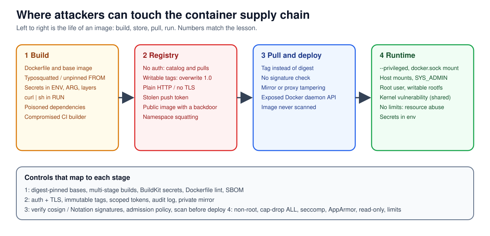
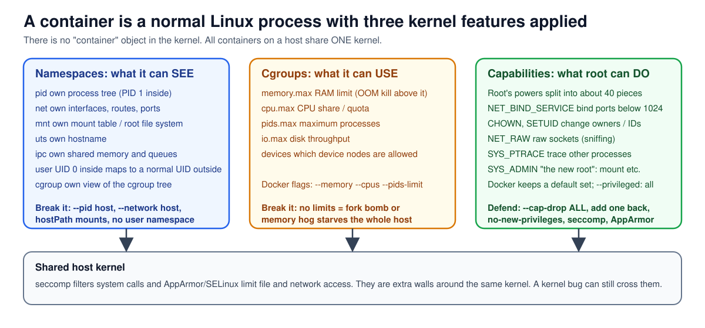

# Lesson 02: Attack Surface of Containers and Attack Surface Analysis

> **Chapter:** 3 · Attacking the Container Supply Chain · **Time:** ~4 hours
> **You will:** map the attack surface of the container ecosystem stage by stage, analyse a container with native tools, and explain namespaces, cgroups and capabilities.

| | |
|---|---|
| **Prerequisites** | [Lesson 01](01-introduction-to-container-technology.md) |
| **Labs** | [docker-commands](labs/docker-commands/README.md) · [exploit-containerized-app](labs/exploit-containerized-app/README.md) |
| **Syllabus lines** | Attack surface of containers and supply chain risks · Overview of container security · Attack surface of the container ecosystem · Attack surface analysis using native and third party tools · Attack surface analysis with native tools · Kernel features: Namespaces, Cgroups, Capabilities |
| **Maps to** | NIST SP 800-190 risk areas · CIS Docker Benchmark · MITRE ATT&CK for Containers (verify current matrix) |

## 1. Why it matters

Containers moved risk, they did not remove it. Before you can attack or defend you need a map of **what is exposed** at each stage.

## 2. Overview of container security

NIST SP 800-190 groups container risks into five areas, a good exam frame:

| Area | Examples |
|---|---|
| **Image risks** | Vulnerable software, embedded secrets, malware, untrusted images, stale images |
| **Registry risks** | Insecure connections, stale or weak auth, no access control |
| **Orchestrator risks** | Over-privileged admin, unbounded network access, mixed-sensitivity workloads |
| **Container (runtime) risks** | App vulnerabilities, rogue containers, runtime flaws |
| **Host OS risks** | Large attack surface, shared kernel, host file system tampering |

Security has **layers**: image (build time), registry (storage), host and daemon, runtime configuration, and orchestration. This chapter covers the first four. Chapter 4 covers orchestration.

## 3. Attack surface of the container ecosystem

| Stage | What an attacker targets | Example (public, hedged) |
|---|---|---|
| **Build** | Base image, dependencies, Dockerfile, CI builder | Codecov (2021): credentials in a Docker image build step let an attacker alter a script ([brief facts](../../caisp-course/ch6-supply-chain-attacks-in-ai/README.md)) |
| **Registry** | Anonymous catalog, overwritable tags, stolen tokens, public typosquats | Researchers have repeatedly reported public images with cryptominers and credential stealers (check current reports) |
| **Pull and deploy** | Tag-based pulls, no signature check, exposed daemon API | Internet-exposed Docker APIs are a long-standing source of cryptomining compromises |
| **Runtime** | Privileged flags, host mounts, kernel bugs | runc CVE-2019-5736 and "Leaky Vessels" CVE-2024-21626 ([06 Docker](../../06-ai-devsecops/docker/README.md)) |

**Supply chain risk specifically:** anything you did not write that ends up running: base images, language packages inside the image, build tools, the registry, and the update mechanism. See [lesson 03](03-attacking-the-container-supply-chain.md).

## 4. Kernel features: Namespaces, Cgroups, Capabilities

### 4.1 Namespaces (what it can see)

Seven you should know: `pid`, `net`, `mnt`, `uts`, `ipc`, `user`, `cgroup` (plus `time` in newer kernels). A process in a new PID namespace sees itself as PID 1 and cannot see host processes. **`--pid=host`, `--network=host` and host mounts remove these walls.** A **user namespace** maps container root to an unprivileged host UID (Docker `userns-remap`, rootless Docker/Podman), so even a breakout lands as nobody.

### 4.2 Cgroups (what it can use)

Control groups cap memory, CPU, PIDs and I/O. Without limits, one container (or an attacker's cryptominer or fork bomb) can starve the host. Check with `docker stats` and set `--memory`, `--cpus`, `--pids-limit`. **cgroup v2** is the modern unified hierarchy.

### 4.3 Capabilities (what root can do)

Linux splits root's power into capabilities. Docker starts containers with a default set and you can change it:

| Capability | Why it matters |
|---|---|
| `NET_BIND_SERVICE` | Bind ports below 1024; usually harmless |
| `NET_RAW` | Raw sockets: sniffing and spoofing (in default set; often dropped) |
| `SYS_PTRACE` | Inspect other processes; dangerous with host PID |
| `SYS_ADMIN` | Mount and many privileged operations; almost root |
| `SYS_MODULE` | Load kernel modules |
| `DAC_READ_SEARCH` | Bypass file read checks (open_by_handle_at style attacks) |

Best practice: `--cap-drop ALL`, then `--cap-add` only what the app proves it needs, plus `--security-opt no-new-privileges`.

### 4.4 The related walls: seccomp and AppArmor/SELinux

- **seccomp** filters system calls (the default Docker profile blocks about 40 to 50 of 300+ calls; verify the number in your version).
- **AppArmor** (Debian, Ubuntu) or **SELinux** (RHEL, Fedora) limits files, network and capabilities by profile.

Both are in [lesson 05](05-technologies-for-securing-containerized-applications.md) with example profiles.

## 5. Attack surface analysis with native tools

"Native" means tools you already have on the host or in the container. Use them to **observe**; they never change the image.

| Question | Native tool | What to look for |
|---|---|---|
| What is running and how was it started? | `docker ps`, `docker inspect <c>` | `HostConfig.Privileged`, `Binds`, `CapAdd`, `PidMode`, `NetworkMode`, `SecurityOpt`, `Config.User`, `Config.Env` |
| What is in the image? | `docker history --no-trunc`, `docker image inspect`, `docker save` + `tar tf` | Secrets in `created_by`, entrypoint, user, layer digests |
| What changed since start? | `docker diff <c>` | Files added (`A`) or changed (`C`) in the writable layer |
| Which ports and processes? | `docker top`, `docker port`, `ss -ltnp` on the host | Unexpected listeners, the Docker API on 2375 |
| Resource limits? | `docker stats`, `docker inspect` | Missing memory and PID limits |
| Inside the container (user, caps, mounts) | `id`, `cat /proc/self/status` (look at `CapEff`), `mount`, `cat /proc/1/cgroup`, `ls /var/run/docker.sock` | Is it root? Is the socket there? Which caps? |
| Host daemon configuration | `docker info`, `/etc/docker/daemon.json` | Rootless? userns? seccomp/AppArmor in security options |

`CapEff` is a bit mask; decode it with `capsh --decode=<mask>` (libcap tools) to see which capabilities are active. A container with `CapEff: 000001ffffffffff` is effectively fully privileged.

**Third-party tools** add depth: Trivy (vulnerabilities, misconfiguration, secrets), Grype and Syft, Dive (layer explorer), docker-bench-security (CIS checks), Falco (runtime). See [real-tools/trivy.md](real-tools/trivy.md). In this repo the offline twins are [run_assess.py](labs/docker-commands/run_assess.py), [escape_paths.py](labs/exploit-containerized-app/escape_paths.py) and the [06 Dockerfile linter](../../06-ai-devsecops/docker/README.md).

## 6. Defend: cut the surface

- Fewer components: [distroless and scratch images](04-securing-container-applications.md).
- Fewer privileges: non-root, drop caps, no host mounts.
- Limits: memory, CPU, PIDs.
- Visibility: runtime detection ([Falco concepts in chapter 4](../ch4-attacking-kubernetes-cluster-supply-chain/05-securing-container-orchestration.md)).

## 7. Hands-on

1. Run `docker-commands` demo and compare three run commands.
2. Run `exploit-containerized-app` demo and read each path's one-line "why".
3. (Optional, real Docker) `docker run --rm alpine sh -c 'grep Cap /proc/self/status'`, then repeat with `--cap-drop ALL`.

## 8. Scenario

You are asked to review a container "running fine in production". List the five commands you would run first and what each answers. (Expected: `docker inspect`, `docker history`, `docker diff`, `docker stats`, `ss -ltnp`.)

## 9. Interview Q&A

Name the five NIST SP 800-190 risk areas.

Images, registries, orchestrators, containers, and the host OS.

What does CAP_SYS_ADMIN allow and why is it called the new root?

It covers a very large set of privileged operations (mounts, namespace changes, many device and kernel interfaces). A container that holds it, especially with AppArmor or seccomp off, has many ways to reach the host.

How can you see if a container is running with all capabilities?

Inside: read `CapEff` in `/proc/self/status` and decode it with `capsh`. From outside: `docker inspect` shows `Privileged: true` or `CapAdd`.

## 10. References

- NIST SP 800-190. CIS Docker Benchmark. Linux man pages: `namespaces(7)`, `cgroups(7)`, `capabilities(7)`, `seccomp(2)`.
- Docker docs: runtime privilege and Linux capabilities (verify at docs.docker.com).
- Repo: [05 sandboxing](../../05-agent-security/sandboxing/README.md).
