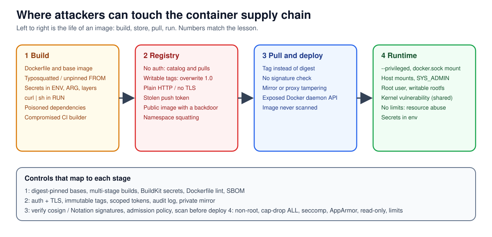

# Lesson 03: Attacking the Container Supply Chain Ecosystem

> **Chapter:** 3 · Attacking the Container Supply Chain · **Time:** ~5 hours
> **You will:** explain malicious images, typosquatting and backdoored layers, abuse and defend an insecure registry, and chain container misconfigurations into a host-escape path, all in offline simulations.

| | |
|---|---|
| **Prerequisites** | [Lesson 02](02-attack-surface-and-analysis-of-containers.md) |
| **Labs** | [malicious-image](labs/malicious-image/README.md) · [backdoor-docker-image](labs/backdoor-docker-image/README.md) · [typosquatting-image](labs/typosquatting-image/README.md) · [attack-docker-registry](labs/attack-docker-registry/README.md) · [exploit-containerized-app](labs/exploit-containerized-app/README.md) · [unsecured-docker-daemon](labs/unsecured-docker-daemon/README.md) |
| **Syllabus lines** | Attacking Container Supply Chain ecosystem · Malicious images · Insecure container registry · Attacking through container misconfigurations |
| **Maps to** | NIST SP 800-190 (image and registry risks) · MITRE ATT&CK for Containers (deploy container, escape to host, resource hijacking) · OWASP CI/CD Top 10 |

> **Safety.** All "malicious" content here is a harmless string or canary. Never pull or run suspicious images on a machine you care about. Use an isolated VM, and never test registries or daemons you do not own.

## 1. Why it matters

- **Cryptomining images on public registries** are a recurring finding from container security research: images that look like useful tools and run a miner at start (public reports exist from several vendors; check current ones).
- **Exposed Docker APIs** on port 2375 have been widely abused to start mining containers.
- **Codecov (2021)** started with credentials found in a Docker image creation process.
- **Registry misconfigurations** (open catalogs, writable tags) let one actor poison what many pull.

## 2. Malicious images

### 2.1 How a malicious image gets to you

1. **Published as bait:** a "free tool" image on a public registry.
2. **Typosquat or namespace squat:** `nqinx`, `nginx/nginx`, `library-nginx` ([typosquatting-image lab](labs/typosquatting-image/README.md)).
3. **Compromised legitimate publisher:** a stolen push token replaces a good image.
4. **Poisoned base image or dependency:** your build inherits the backdoor.
5. **Backdoored layer added later:** same tag, one more layer ([backdoor-docker-image lab](labs/backdoor-docker-image/README.md)).

### 2.2 What is hidden in them (patterns, not recipes)

| Place | Typical sign | Lab detector |
|---|---|---|
| `ENTRYPOINT`/`CMD` | downloads a script and pipes it to a shell; contacts unknown hosts; encoded commands | `IMG-001`, `IMG-002`, `IMG-003` |
| Build history | `wget ... && chmod +x`, mining software names, cron setup | `IMG-007` to `IMG-010` |
| Environment | baked-in secrets | `IMG-005` |
| Files | hidden binaries in `/usr/bin`, cron jobs, authorized SSH keys, mining pool strings | `FS-001` to `FS-004` |
| Ports | unusual listeners (4444, 31337) | `IMG-006` |
| Config | runs as root | `IMG-004` |

### 2.3 Typosquatting and name confusion

Attackers register names that humans mistype or trust: one-letter edits, swapped letters, look-alike characters (`rn` for `m`), trust words (`-official`, `-secure`), and the same image name under another namespace. See [CAISP ch6 package vetting](../../caisp-course/ch6-supply-chain-attacks-in-ai/README.md) for the same idea in PyPI and npm. **Defence:** allowlist registries and namespaces, pin by digest, mirror approved images to an internal registry.

### 2.4 Backdooring an image (concept)

An attacker with push rights, or a compromised build, adds a layer (for example a script under `/etc/profile.d/` or `/docker-entrypoint.d/`) or edits the entrypoint. The tag stays `1.0`; the digest changes. **Detection:** pin digests, diff layers against the last good build, scan for secrets and unexpected binaries, verify signatures and provenance, and compare SBOMs between builds.

### 2.5 Inspecting without running

Use `docker image inspect`, `docker history --no-trunc`, `skopeo inspect`, `docker save | tar t`, `dive`, `trivy image`, `syft`. These read metadata and layers; they do not execute the image.

## 3. Insecure container registry

### 3.1 Registry API in 60 seconds

| Call | Meaning |
|---|---|
| `GET /v2/` | Is this a v2 registry (and does it ask for auth)? |
| `GET /v2/_catalog` | List repositories (should need a special scope) |
| `GET /v2/<name>/tags/list` | List tags |
| `GET /v2/<name>/manifests/<tag or digest>` | Read the manifest (config, layers) |
| `GET /v2/<name>/blobs/<digest>` | Download a layer or config |
| `PUT /v2/<name>/manifests/<tag>` | Push (create or overwrite a tag) |
| `DELETE /v2/<name>/manifests/<digest>` | Delete |

### 3.2 What goes wrong

| Weakness | Attacker gain |
|---|---|
| No authentication | Enumerate every image, read configs and layers (secrets), pull proprietary code |
| Anonymous or shared push | Overwrite a tag with a backdoored image that every deployment then pulls |
| Plain HTTP | Man-in-the-middle can modify layers |
| Mutable tags | "Latest" and version tags can silently change |
| Over-broad tokens | One CI token can push anywhere |
| No delete protection or audit | Evidence and images disappear |
| Registry listed in `insecure-registries` | Docker skips TLS verification |

### 3.3 Hardened registry

Authentication with short-lived, scoped tokens; TLS everywhere; **immutable tags**; separate pull and push identities; vulnerability scanning on push; signature requirements; retention and audit logs; network restriction. Harbor (CNCF graduated) provides many of these. The lab [attack-docker-registry](labs/attack-docker-registry/README.md) shows the open and the hardened versions side by side.

## 4. Attacking through container misconfigurations

Docker runs what you tell it to. The common dangerous settings, why they matter, and the fix:

| Misconfiguration | Why it is dangerous | Fix |
|---|---|---|
| Mounted `/var/run/docker.sock` | The app can ask the daemon to start a privileged container with the host root mounted | Remove it; use rootless builders; use a socket proxy with allowlisted calls |
| `--privileged` | All capabilities and devices; seccomp/AppArmor off | Remove; grant one capability or `--device` |
| `--cap-add SYS_ADMIN` (especially with AppArmor/seccomp off) | Near-root operations | Drop it |
| Host mounts such as `/`, `/etc`, `/proc` | Direct host file access | Narrow, read-only mounts |
| `--pid=host`, `--network=host` | See host processes and localhost services | Remove |
| Running as root, writable root filesystem | Easier for any exploit | `USER`, `--read-only` |
| Secrets in env vars or image layers | Readable by `docker inspect` and image pulls | Secret manager, BuildKit secret mounts |
| Exposed daemon API (2375) | Remote root | TLS (2376) with client certs, or no TCP at all |

**Escape-path analysis** is the skill: take a config, list how code in the container could reach the host, and rank by severity. The offline tool is [escape_paths.py](labs/exploit-containerized-app/escape_paths.py). The daemon side is audited by [daemon_audit.py](labs/unsecured-docker-daemon/daemon_audit.py) against a subset of the CIS Docker Benchmark.

> **Ethics.** The labs analyse and simulate. Real exploitation of a Docker API or registry is only acceptable on systems you own or are explicitly authorised to test.

## 5. Defend (summary)

1. Pull only from approved registries, by digest; mirror approved images.
2. Verify signatures at deploy time ([lesson 05](05-technologies-for-securing-containerized-applications.md)).
3. Scan images and diff layers between builds.
4. Harden the registry and the daemon.
5. Run with least privilege; alert on `docker.sock` mounts and privileged containers in CI and at admission (chapter 4).

## 6. Hands-on

Run, in order: `malicious-image`, `backdoor-docker-image`, `typosquatting-image`, `attack-docker-registry`, `exploit-containerized-app`, `unsecured-docker-daemon`. Each README lists what to change and what to expect.

## 7. Scenario

Your CI pulls `shop/api:1.0` and deploys. Overnight someone with a stolen push token re-pushes `1.0` with an extra layer. Which three controls would have stopped or exposed it? (Digest pin in the deployment; immutable tags or token scopes in the registry; signature verification in admission.)

## 8. Interview Q&A

Why is pulling by tag risky and by digest safer?

Tags are mutable pointers. A digest is a content hash, so a changed image cannot match it.

An open registry's catalog is anonymous. What can an attacker do?

List every repository and tag, read manifests and download layers (finding baked-in secrets and source), and, if pushes are open, overwrite a tag to ship a backdoor.

Why is mounting docker.sock into a container equal to giving it root on the host?

The socket is the daemon's API. A process that can call it can create a new container with any settings (privileged, host root mounted), and the daemon runs as root.

## 9. References

- NIST SP 800-190. CIS Docker Benchmark. OCI Distribution Specification.
- MITRE ATT&CK for Containers (verify current techniques).
- Repo: [06 Docker](../../06-ai-devsecops/docker/README.md), [CAISP ch6](../../caisp-course/ch6-supply-chain-attacks-in-ai/README.md).
