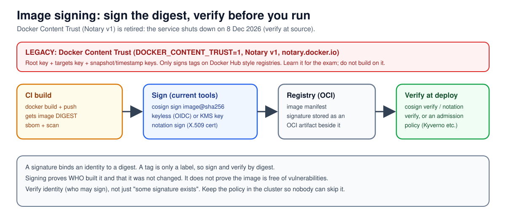

# Lesson 05: Technologies and Solutions for Securing Containerized Applications

> **Chapter:** 3 · Attacking the Container Supply Chain · **Time:** ~5 hours
> **You will:** configure Docker host security, read and write seccomp and AppArmor profiles, and sign and verify images with cosign and Notation (and explain why Docker Content Trust is legacy).

| | |
|---|---|
| **Prerequisites** | [Lesson 02, section 4](02-attack-surface-and-analysis-of-containers.md#4-kernel-features-namespaces-cgroups-capabilities) |
| **Labs** | [minimize-misconfigurations](labs/minimize-misconfigurations/README.md) (profiles) · [backdoor-docker-image](labs/backdoor-docker-image/README.md) (digest pin) · [unsecured-docker-daemon](labs/unsecured-docker-daemon/README.md) |
| **Syllabus lines** | Technologies and solutions for securing containerized applications · Docker host security configurations · Seccomp · Apparmour · Image signing and Content Trust |
| **Maps to** | CIS Docker Benchmark · NIST SP 800-190 · SLSA (provenance) · Sigstore, Notary Project |

## 1. Why it matters

Hardening the image is not enough: a compromised container still runs on a shared kernel. Host settings, syscall filters and mandatory access control **limit the damage** of a bug, and signatures **stop unauthorised images** from running at all.

## 2. Docker host security configurations

| Layer | Configuration |
|---|---|
| **Host OS** | Minimal container-optimised OS (Bottlerocket, Flatcar, Talos) or a hardened Linux; automatic patching; no extra services; separate hosts for different sensitivity levels |
| **Kernel** | Keep updated; enable user namespaces; AppArmor or SELinux enforcing; cgroup v2 |
| **Daemon** | See [lesson 04 section 5](04-securing-container-applications.md#5-securing-the-docker-daemon): TLS or no TCP, rootless or `userns-remap`, `icc=false`, logging |
| **Files and audit** | Permissions on `/etc/docker`, `daemon.json`, the socket; `auditd` rules for `/usr/bin/dockerd`, `/var/lib/docker`, `/etc/docker` |
| **Network** | Firewall rules for published ports; bind to `127.0.0.1`; user-defined networks per app |
| **Benchmarks** | CIS Docker Benchmark with docker-bench-security |
| **Runtime options** | `--read-only`, `--cap-drop ALL`, `--security-opt no-new-privileges`, limits ([hardener lab](labs/minimize-misconfigurations/hardener.py)) |
| **Stronger isolation** | gVisor or Kata Containers for untrusted workloads; one container per VM |

## 3. Seccomp and AppArmor

### 3.1 Seccomp

**seccomp-bpf** filters system calls. A profile lists which calls are allowed, denied, or logged. Docker applies a **default profile** that blocks risky calls (it allows most common ones; verify the exact count in your version). Never run with `--security-opt seccomp=unconfined` unless you can explain why.

A tight **allowlist** profile (default deny, then list the needed calls) is the strongest approach. Example in [seccomp-web-app.json](labs/minimize-misconfigurations/profiles/seccomp-web-app.json):

```json
{
  "defaultAction": "SCMP_ACT_ERRNO",
  "architectures": ["SCMP_ARCH_X86_64", "SCMP_ARCH_AARCH64"],
  "syscalls": [
    { "names": ["read", "write", "openat", "close", "accept4", "epoll_wait", "..."], "action": "SCMP_ACT_ALLOW" }
  ]
}
```

Use: `docker run --security-opt seccomp=profile.json image`. In Kubernetes: `securityContext.seccompProfile: {type: RuntimeDefault}` (good default) or `Localhost` with a profile file on the node.

**How to build one:** run the app in a test environment, record the syscalls it uses (strace, or tools such as the OCI seccomp-recorder or Inspektor Gadget's trace/seccomp, verify availability), review the list, and test under load. Keep a fallback: start with `SCMP_ACT_LOG` to see what would be blocked.

The lab validator [profiles.py](labs/minimize-misconfigurations/profiles.py) rejects an allow-by-default profile and flags dangerous calls like `mount`, `ptrace`, `unshare`, `bpf` and `keyctl`.

### 3.2 AppArmor ("Apparmour" in the syllabus)

**AppArmor** is a Linux Security Module that confines a program by path-based rules: which files it can read or write, which network types it can use, which capabilities it keeps. Docker loads a default profile `docker-default` on AppArmor hosts. SELinux is the equivalent on RHEL-family systems (label-based).

Example [apparmor-web-app](labs/minimize-misconfigurations/profiles/apparmor-web-app):

```text
profile web-app flags=(attach_disconnected,mediate_deleted) {
  #include <abstractions/base>
  network inet tcp,
  deny network raw,
  /app/** r,
  /tmp/** rw,
  deny mount,
  deny ptrace,
  deny /proc/sys/** wklx,
  deny /var/run/docker.sock rwklx,
}
```

Load with `sudo apparmor_parser -r -W <file>`, run with `--security-opt apparmor=web-app`. Start in **complain** mode to learn, then **enforce**. In Kubernetes, AppArmor is set with `securityContext.appArmorProfile` (v1.30+; older versions used an annotation, verify your version).

### 3.3 Comparing the layers

| Control | Limits | Example it stops |
|---|---|---|
| Capabilities | What root can do | Raw sockets, mounts |
| seccomp | Which syscalls | `unshare`, `bpf`, `kexec_load` |
| AppArmor/SELinux | Which files, networks | Writing `/proc/sys`, reading `/etc/shadow` |
| User namespaces | Who root maps to | Breakout lands as a nobody |
| gVisor/Kata | Which kernel is exposed | Whole classes of kernel bugs |

They **stack**. None is a replacement for patching.

## 4. Image signing and Content Trust



> **Outdated → current.** The syllabus teaches **Docker Content Trust (DCT)**. DCT is built on **Notary v1**. Docker announced its retirement on **29 July 2025**, and the notary.docker.io service is scheduled to **shut down on 8 December 2026** (verify at docs.docker.com). Learn DCT so you can read old pipelines and answer exam questions, but **build new work on cosign (Sigstore) or Notation (Notary Project)**.

### 4.1 Docker Content Trust (legacy)

- Switched on by `export DOCKER_CONTENT_TRUST=1`. Then `docker pull`, `push`, `build` and `run` only work with **signed tags**.
- Notary v1 keys: **root key** (offline, trust anchor), **targets key** (signs tags), **snapshot** and **timestamp** keys (freshness, held by the server).
- Weaknesses and reasons for retirement: it signs **tags** not digests of OCI artifacts in a general way, works only with a Notary server, has awkward key management, and was little used.
- You may still meet `docker trust sign`, `docker trust inspect`.

### 4.2 Sigstore cosign (current)

- `cosign sign <image>@sha256:<digest>` stores a signature as an **OCI artifact next to the image in the same registry**.
- **Keyless signing:** a short-lived certificate from **Fulcio** is issued after OIDC login (for example a GitHub Actions workload identity), and the signing event is written to the **Rekor** transparency log. No long-lived private key to steal.
- **Keyed signing:** a key pair or KMS/HSM key (`cosign generate-key-pair`, or `--key awskms://...`).
- **Verify** with identity, not just "a signature exists":

```text
cosign verify \
  --certificate-identity "https://github.com/ORG/REPO/.github/workflows/release.yml@refs/heads/main" \
  --certificate-oidc-issuer "https://token.actions.githubusercontent.com" \
  registry.example/app@sha256:<digest>
```

- **Attestations:** `cosign attest` attaches SBOMs or SLSA provenance as in-toto statements ([CMCPSE provenance lab](../../cmcpse-course/ch6-supply-chain-security-and-governance-of-mcp/labs/provenance-attestations/README.md), [CAISP model-signing](../../caisp-course/ch6-supply-chain-attacks-in-ai/README.md)).

### 4.3 Notation (Notary Project, current)

- CLI `notation sign` / `notation verify`, X.509 certificates and a **trust policy** file that says which identities are trusted for which repositories.
- Fits enterprise PKI and works with ORAS and OCI registries; cloud services (for example Azure and AWS signer products, verify current names) integrate with it.

### 4.4 Choosing

| Need | Pick |
|---|---|
| Open-source pipelines, short-lived identity, transparency log | cosign keyless |
| Enterprise PKI, offline or regulated environments | Notation (or cosign with KMS keys) |
| New projects | Not DCT |

### 4.5 Enforce at deploy time

A signature is only useful if something **checks it before the image runs**. In Kubernetes use an admission controller (Kyverno `verifyImages`, Sigstore policy-controller, Ratify with Gatekeeper, or the cloud's native policy; verify current tools) so unsigned images are rejected cluster-wide ([chapter 4](../ch4-attacking-kubernetes-cluster-supply-chain/03-abusing-the-kubernetes-request-pipeline.md)). Pin digests in manifests; sign the digest.

The offline twin [backdoor-docker-image](labs/backdoor-docker-image/README.md) demonstrates the core logic: a pinned digest refuses a re-pushed tag. Real signing needs the tools in [real-tools/cosign-notation.md](real-tools/cosign-notation.md).

## 5. Hands-on

1. Validate the seccomp and AppArmor example profiles, then break each (add `mount`; set `defaultAction` to allow) and watch the validator fail.
2. Run the backdoor lab and explain how a signature adds identity on top of the digest.
3. Read [real-tools/cosign-notation.md](real-tools/cosign-notation.md) and, if you have a registry, sign a test image with a throwaway key.

## 6. Scenario

Your pipeline uses `DOCKER_CONTENT_TRUST=1`. The security team says it must change before December 2026. Write the migration plan in five bullets: inventory images signed with DCT, choose cosign or Notation, sign the digests in CI, add verification at admission, then remove the DCT variable and decommission the keys.

## 7. Interview Q&A

<details>
<summary>What is the status of Docker Content Trust?</summary>

It is retired. Docker announced the retirement in July 2025 and the Notary v1 service shuts down on 8 December 2026 (verify at source). Use cosign or Notation instead.
</details>

<details>
<summary>What is the difference between seccomp and AppArmor?</summary>

seccomp filters which system calls a process may make. AppArmor (or SELinux) restricts which files, networks and capabilities it may use. They complement each other.
</details>

<details>
<summary>Why must you verify the signer identity and not only that a signature exists?</summary>

Anyone can sign an image with their own key. The policy must say which identity (workflow, certificate subject, key) is allowed to sign for this repository.
</details>

<details>
<summary>What does keyless signing remove?</summary>

The long-lived private key. A short-lived certificate tied to an OIDC identity is used once and the event is logged in a transparency log.
</details>

## 8. References

- Docker docs: Content Trust and the retirement notice (verify the current page).
- Sigstore docs (cosign, Fulcio, Rekor). Notary Project docs (notation).
- Kubernetes docs: seccomp and AppArmor tutorials. Docker docs: seccomp and AppArmor profiles.
- Repo: [CMCPSE sign-verify](../../cmcpse-course/ch6-supply-chain-security-and-governance-of-mcp/README.md), [CAASE sign-verify harness](../../caase-course/ch6-operationalizing-agentic-ai-security/README.md).
