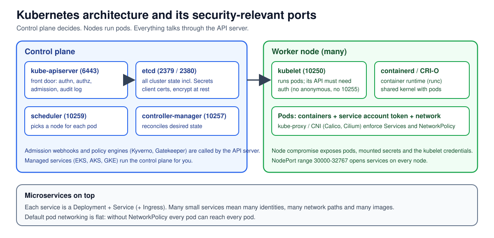

# Lesson 01: Microservices and Kubernetes

> **Chapter:** 4 · Attacking the Kubernetes Cluster Supply Chain · **Time:** ~4 hours
> **You will:** explain microservices and why they change the attack surface, draw the Kubernetes architecture, and describe each core component with its security role.

| | |
|---|---|
| **Prerequisites** | [Chapter 3 lesson 01](../ch3-attacking-container-supply-chain/01-introduction-to-container-technology.md) |
| **Labs** | [k8s-basic-commands](labs/k8s-basic-commands/README.md) · [working-with-kubernetes](labs/working-with-kubernetes/README.md) · [k8s-secrets](labs/k8s-secrets/README.md) · [service-accounts](labs/service-accounts/README.md) · [calico-networking](labs/calico-networking/README.md) |
| **Syllabus lines** | Microservices and Kubernetes · Introduction to Microservices Architecture · Introduction to Kubernetes Architecture · Core Components of Kubernetes |
| **Maps to** | NSA/CISA Kubernetes Hardening Guide (verify current edition) · CIS Kubernetes Benchmark · OWASP Kubernetes Top 10 (verify current list) |

## 1. Why it matters

A cluster is where your supply chain **lands**: images from chapter 3, Helm charts from third parties, CI credentials that deploy. If an attacker controls one pod, the cluster's defaults (flat network, automounted tokens, wide RBAC) decide how far they get.

## 2. Introduction to microservices architecture

A **monolith** is one deployable unit. A **microservices** architecture splits an application into small services, each owning one business capability and talking to the others over the network (HTTP/gRPC, queues). Typical shop example: `web`, `api`, `payments`, `inventory`, `db`.

| Property | Benefit | Security consequence |
|---|---|---|
| Many small services | Independent deploys and scaling | Many images, many dependencies, many places for a vulnerable library |
| Network calls instead of function calls | Language and team independence | Internal traffic must be authenticated and encrypted (zero trust inside the cluster) |
| Each service has an identity | Fine-grained access | Many service-account tokens and secrets to manage |
| Containers and orchestration | Fast, repeatable deploys | Pipeline compromise reaches production quickly |
| API gateway / ingress at the edge | One public entrance | The edge becomes the main target; internal services often trust each other too much |

Related patterns: **sidecars** (a helper container in each pod, for example a proxy), **service mesh** (mTLS and policy between services, for example Istio or Linkerd), **API gateway**, **event bus**. Microservices do not fix security by themselves; they move many in-process calls onto a network that must be defended.

## 3. Introduction to Kubernetes architecture

Kubernetes (K8s) is a declarative orchestrator: you describe the **desired state** in YAML and controllers make reality match.

- **Control plane:** `kube-apiserver`, `etcd`, `kube-scheduler`, `kube-controller-manager` (and the cloud-controller-manager on cloud clusters).
- **Nodes:** each runs a `kubelet`, a container runtime (containerd or CRI-O), and networking (`kube-proxy` or a CNI that replaces it).
- **Managed Kubernetes** (EKS, AKS, GKE) hosts the control plane for you. You still own workload, RBAC, network and image security (see [chapter 5](../ch5-attacking-cloud-supply-chain/README.md) for the cloud side).

## 4. Core components of Kubernetes

### 4.1 Control plane

| Component | Role | Security notes |
|---|---|---|
| **kube-apiserver** (6443) | The only door to the cluster state; runs authentication, authorization, admission, audit | Disable anonymous access where not needed; enable audit logging; restrict network access |
| **etcd** (2379/2380) | Key-value store of all objects including Secrets | Client-cert auth, private network, **encryption at rest** ([k8s-secrets lab](labs/k8s-secrets/README.md)), backup protection |
| **kube-scheduler** | Assigns pods to nodes | Compromise can steer sensitive pods to attacker nodes |
| **kube-controller-manager** | Runs controllers (deployments, jobs, service accounts) | Holds powerful credentials |

### 4.2 Node components

| Component | Role | Security notes |
|---|---|---|
| **kubelet** (10250) | Starts containers, reports status, serves an API | `anonymous-auth=false`, `authorization-mode=Webhook`, no read-only port 10255 ([kubelet-api lab](labs/kubelet-api/README.md)) |
| **Container runtime** | Runs containers | Patch runc and containerd; the kernel is shared |
| **kube-proxy / CNI** | Service routing and pod networking | CNI must support NetworkPolicy ([calico-networking lab](labs/calico-networking/README.md)) |

### 4.3 Objects you will see

| Object | Meaning | Security angle |
|---|---|---|
| **Pod** | One or more containers sharing network and storage | Unit of isolation; `securityContext` lives here |
| **Deployment / ReplicaSet / StatefulSet / DaemonSet / Job / CronJob** | Controllers that create pods | A user who can edit them can change what runs |
| **Service** (ClusterIP, NodePort, LoadBalancer) | Stable name and virtual IP for pods | NodePort and LoadBalancer expose things outside |
| **Ingress / Gateway API** | HTTP routing from outside | TLS, auth, and WAF live here |
| **Namespace** | Name scope; a boundary for RBAC, quotas, policy | Not a security boundary by itself |
| **ConfigMap / Secret** | Configuration / sensitive data | Secrets are base64, not encrypted, unless etcd encryption is on |
| **ServiceAccount** | Identity for pods | Bound tokens; avoid automount ([service-accounts lab](labs/service-accounts/README.md)) |
| **Role / ClusterRole / bindings** | RBAC | See [lesson 03](03-abusing-the-kubernetes-request-pipeline.md) |
| **NetworkPolicy** | Pod-level firewall rules | Default allow-all unless you write default-deny |
| **CRDs and operators** | Extend the API | Operators often run with high privileges |

## 5. Defend: baseline

1. Managed control plane or hardened self-managed one; keep versions supported (verify current Kubernetes release and end-of-life dates).
2. RBAC least privilege; no anonymous access; bound service-account tokens.
3. Pod Security Admission `restricted` where possible; default-deny NetworkPolicy.
4. Encrypt Secrets at rest, prefer an external secrets manager.
5. Scan images and manifests; admission policy for signatures.
6. Audit logs and runtime detection ([lesson 05](05-securing-container-orchestration.md)).

## 6. Hands-on

Work through the first five labs in order: commands and YAML parsing, wiring a Deployment/Service/Ingress, secrets, service accounts, and NetworkPolicy reachability.

## 7. Scenario

A new microservice "reports" needs to read one ConfigMap and call the `api` service. List the objects you create and the security settings on each (ServiceAccount with automount off, Role with `get` on one ConfigMap by name, NetworkPolicy allowing only `reports -> api:8080`, pod `securityContext` restricted, image by digest).

## 8. Interview Q&A

What are the main components of the Kubernetes control plane?

kube-apiserver, etcd, kube-scheduler and kube-controller-manager (plus the cloud controller manager on cloud-hosted clusters).

Why is etcd so sensitive?

It stores all cluster state, including Secrets. Anyone with etcd access can read or change the whole cluster, so it needs client-certificate auth, network isolation and encryption at rest.

Is a namespace a security boundary?

Not by itself. It scopes names and RBAC, but pods in different namespaces can reach each other unless NetworkPolicy blocks it, and cluster-wide roles cross namespaces.

## 9. References

- Kubernetes documentation: Components, Security (verify at kubernetes.io). NSA/CISA Kubernetes Hardening Guide. CIS Kubernetes Benchmark.
- Repo: [06 Kubernetes](../../06-ai-devsecops/kubernetes/README.md), [09 enterprise architecture](../../09-enterprise-architecture/README.md).
