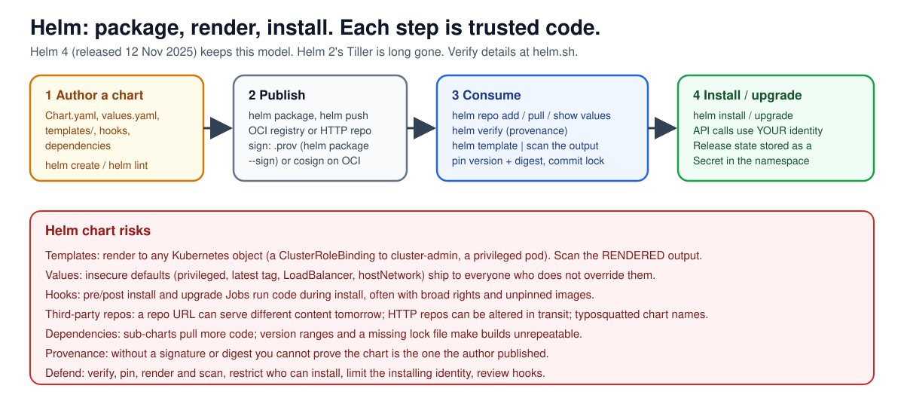

# Lesson 02: Supply Chain Threats for a Cluster: Helm

> **Chapter:** 4 · Attacking the Kubernetes Cluster Supply Chain · **Time:** ~4 hours
> **You will:** explain what a Kubernetes package manager is, follow the Helm chart workflow, create a chart, and assess Helm chart risks (templates, values, hooks, third-party repos, provenance).

| | |
|---|---|
| **Prerequisites** | [Lesson 01](01-microservices-and-kubernetes.md) |
| **Labs** | [static-analysis-manifests](labs/static-analysis-manifests/README.md) (chart render and checks) |
| **Syllabus lines** | Supply Chain Threats for a cluster · Kubernetes Package Manager · Helm and its security · Understanding Helm charts workflow · Creating Helm Charts |
| **Maps to** | OWASP Kubernetes Top 10 (supply chain items, verify) · SLSA · CNCF Software Supply Chain Best Practices |

> **Outdated → current.** The syllabus-era material often mentions **Helm 2 and Tiller** (a cluster-side server with broad rights). Tiller is gone (removed in Helm 3, 2019). **Helm 4** was released on 12 Nov 2025 (new WASM-based plugin system, server-side apply used by default for installs, other changes; verify details at helm.sh/docs). Helm 3 continues for a time with security fixes (the project announced an end date around early 2027; verify).

## 1. Why it matters

Most clusters run software installed from **charts written by someone else**: ingress controllers, databases, monitoring, service meshes. A chart is code that **creates cluster objects with your credentials**. A hostile or careless chart can add a cluster-admin binding or a privileged pod in one `helm install`.

## 2. Kubernetes package manager

Kubernetes YAML for one app can be dozens of files. A package manager bundles them, adds templating and tracks releases.

| Tool | Idea |
|---|---|
| **Helm** | Charts (packages), templates, values, releases. The de facto standard |
| **Kustomize** | Overlays and patches on plain YAML; built into `kubectl -k` |
| **Operators / OLM** | Controllers that manage an app's lifecycle |
| **Carvel (kapp, ytt, imgpkg)**, **Jsonnet/CUE**, **Timoni** | Alternatives (check current status) |
| **GitOps (Argo CD, Flux)** | Pull manifests or charts from Git/OCI and apply them continuously |

## 3. Helm and its security

**Helm 3 and 4 have no Tiller.** The `helm` client talks to the API server **with your kubeconfig identity**, so a chart can do anything **you** can do. Release history is stored as Secrets in the release's namespace.

Security properties to know:

- A chart is **untrusted code** until verified: templates (render logic), values, hooks, dependencies.
- Charts come from **repositories**: classic HTTP(S) repos (an `index.yaml` plus `.tgz` files), or **OCI registries** (`helm push chart oci://...`). OCI is the direction of travel.
- **Provenance:** `helm package --sign` produces a `.prov` file (a PGP clearsigned record with the chart's SHA-256). `helm verify` and `helm install --verify` check it. For OCI charts, many teams sign with **cosign** instead ([chapter 3 lesson 05](../ch3-attacking-container-supply-chain/05-technologies-for-securing-containerized-applications.md#4-image-signing-and-content-trust)).

## 4. Understanding the Helm chart workflow



```text
chart source  --helm package-->  chart.tgz  --helm push-->  repo / OCI registry
                                                              |
helm repo add / pull / show values  <-------------------------+
helm template (render only)  ->  scan the YAML  ->  helm install / upgrade  ->  release (Secret)
```

1. **Author** the chart.
2. **Package** (`helm package`), optionally **sign**.
3. **Publish** to a repo or OCI registry.
4. **Consume:** add the repo, inspect (`helm show chart/values`), **render** (`helm template`), **scan** the output, then install or upgrade with values.
5. **Operate:** `helm list`, `helm history`, `helm rollback`, `helm uninstall`.

## 5. Creating Helm charts

`helm create shop-web` scaffolds a chart:

```text
shop-web/
  Chart.yaml        # name, version, appVersion, dependencies
  values.yaml       # default configuration (users override with -f or --set)
  templates/
    deployment.yaml
    service.yaml
    _helpers.tpl    # named templates
    NOTES.txt
  charts/           # packaged dependencies
```

Template basics (Go templates with Sprig functions):

```yaml
spec:
  replicas: {{ .Values.replicas | default 1 }}
  containers:
    - name: web
      image: "{{ .Values.image.repository }}@{{ .Values.image.digest }}"
{{- if .Values.rbac.create }}
  # ... only rendered when the value is true
{{- end }}
```

**Secure-by-default chart checklist** (for authors):

- Secure defaults in `values.yaml`: non-root, `readOnlyRootFilesystem`, drop ALL capabilities, no privilege escalation, resource limits, default seccomp, `ClusterIP`, image pinned by tag and digest.
- Do not create cluster-wide RBAC unless essential; scope Roles to the namespace.
- Make hooks optional, minimal and non-privileged; pin hook images.
- Document every value; validate with `values.schema.json`.
- Pin dependency versions, commit `Chart.lock`, prefer OCI or trusted repos over HTTP.
- `helm lint`, `helm template | kubeconform`, `trivy config`/Kubescape in CI.
- Sign the chart (`.prov` or cosign) and publish provenance.

The [lab chart](labs/static-analysis-manifests/fixtures/chart/) shows the opposite on purpose: insecure defaults, an HTTP dependency repository, a privileged hook and a cluster-admin binding.

## 6. Helm chart risks (attack view)

| Risk | How it is abused | Check |
|---|---|---|
| **Templates** | Render ClusterRoleBindings, privileged pods, hostPath volumes, extra containers. `lookup` reads live cluster objects at render time | Render and scan the output (lab `HELM-008`, K8S rules) |
| **Values and defaults** | Insecure defaults reach everyone who does not override them | Review `values.yaml` (lab `HELM-005`, `HELM-006`) |
| **Hooks** (`helm.sh/hook`) | Jobs run during install or upgrade, often privileged, with unpinned images, outside the normal Deployment review | Search rendered output for hook annotations (lab `HELM-007`) |
| **Third-party repos** | Repo content can change; HTTP can be tampered with in transit; typosquatted or abandoned charts; compromised publishers | Trusted repo list, HTTPS or OCI, mirror internally (lab `HELM-001`) |
| **Dependencies** | Sub-charts pull more code; version ranges are unrepeatable | Pin, lock, review (`HELM-002`, `HELM-003`) |
| **Provenance** | No proof the chart is the author's | `helm verify` / cosign (`HELM-004`) |
| **Images inside the chart** | A chart references images by tag; a tag can change | Digests, image signature policy |
| **The installer's identity** | Whoever runs `helm install` lends their rights to the chart | Install through CI or GitOps with a scoped identity |
| **Release Secrets** | Release history holds rendered values, possibly secrets | RBAC on Secrets in the namespace |

Reported incidents are mostly about related supply chain paths (malicious images, compromised repositories); specific Helm chart compromises are less documented, so treat this list as risk analysis rather than incident history.

## 7. Defend

1. Install only from internal, reviewed charts; mirror public ones.
2. Verify provenance; pin chart version and digest.
3. **Render and scan** before install; fail CI on high findings.
4. Admission policy (Pod Security, Kyverno, Gatekeeper) catches bad objects even from good-looking charts.
5. Install through GitOps or CI with a namespace-scoped identity, not a personal cluster-admin kubeconfig.
6. Review hooks and RBAC in every chart upgrade (diff the rendered output).

## 8. Hands-on

Run the [static-analysis-manifests lab](labs/static-analysis-manifests/README.md): render the chart with default and secure values, read the `HELM-*` findings, then add a `Chart.lock` and a fake `.prov` file in a temp copy and watch two findings disappear.

## 9. Scenario

A teammate wants to `helm install` a popular chart straight from a blog post's repo URL. Write the five checks you ask for before approving (trusted source, pinned version and digest, provenance, rendered-output scan, scoped installing identity).

## 10. Interview Q&A

<details>
<summary>What happened to Tiller and why does it matter?</summary>

Helm 2's cluster-side component ran with broad rights and was a security risk. Helm 3 removed it, so the client uses the caller's own identity. Helm 4 (Nov 2025) continues that model.
</details>

<details>
<summary>Why scan the rendered output, not only the chart source?</summary>

Values and conditionals decide what objects exist. The same chart can render a safe Deployment or a privileged pod plus a cluster-admin binding depending on values.
</details>

<details>
<summary>What are Helm hooks and why are they risky?</summary>

Annotated resources (usually Jobs) that run at lifecycle points like pre-install. They execute code during install or upgrade, often with broad privileges, and are easy to overlook in reviews.
</details>

<details>
<summary>How do you establish chart provenance?</summary>

Sign the package (`helm package --sign` makes a `.prov`, verified with `helm verify`) or sign the OCI artifact with cosign, pin the version and digest, and fetch only from trusted repositories over HTTPS or OCI.
</details>

## 11. References

- helm.sh documentation: charts, provenance, hooks, Helm 4 release notes (verify).
- CNCF Software Supply Chain Best Practices; SLSA.
- Repo: [06 Kubernetes](../../06-ai-devsecops/kubernetes/README.md), [chapter 3 signing](../ch3-attacking-container-supply-chain/05-technologies-for-securing-containerized-applications.md).
