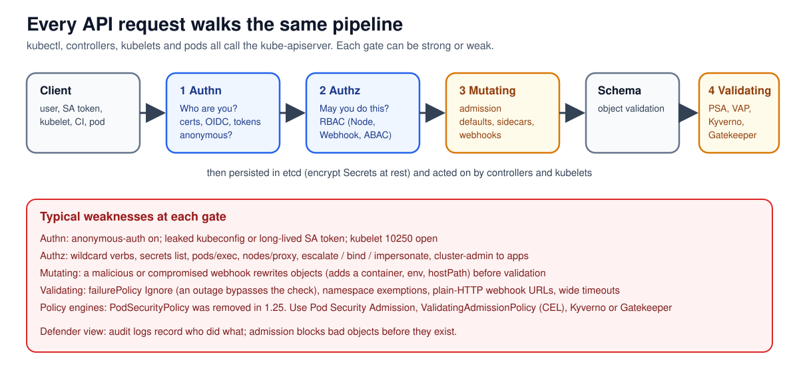

# Lesson 03: Abusing the Kubernetes Request Pipeline

> **Chapter:** 4 · Attacking the Kubernetes Cluster Supply Chain · **Time:** ~5 hours
> **You will:** trace a request through authentication, authorization and admission, explain how admission webhooks and RBAC are attacked, and name the modern replacements for PodSecurityPolicy.

| | |
|---|---|
| **Prerequisites** | [Lesson 01](01-microservices-and-kubernetes.md) |
| **Labs** | [static-analysis-manifests](labs/static-analysis-manifests/README.md) (webhook audit) · [stealing-k8s-secrets](labs/stealing-k8s-secrets/README.md) (RBAC) · [privileged-pods](labs/privileged-pods/README.md) (Pod Security) · [kubelet-api](labs/kubelet-api/README.md) |
| **Syllabus lines** | Abusing Kubernetes Request Pipeline · Authentication, Authorization, and Admission Controllers · Attacks on Admission Controllers and webhooks · Insecure RBAC rules |
| **Maps to** | OWASP Kubernetes Top 10 (insecure workload config, overly permissive authorization, verify) · CIS Kubernetes Benchmark (API server, RBAC) · MITRE ATT&CK for Containers |

## 1. Why it matters

Every change in a cluster is an API request. If an attacker can pass the three gates (who are you, may you, is the object acceptable) with something harmful, the cluster does the rest: schedules the pod, mounts the secret, opens the port.

## 2. Authentication, authorization and admission controllers



```text
request -> 1 authentication -> 2 authorization -> 3 mutating admission -> schema validation -> 4 validating admission -> etcd
```

### 2.1 Authentication (who are you?)

| Method | Notes |
|---|---|
| **Client certificates** | Common for components and admin kubeconfigs. Hard to revoke; keep them short-lived |
| **Bearer tokens: ServiceAccount (bound, projected) tokens** | Pods use these. Prefer **bound** tokens with audience and expiry ([service-accounts lab](labs/service-accounts/README.md)) |
| **OIDC** | Human users via an identity provider; the usual best practice |
| **Webhook token authentication**, **static token files**, **basic auth** | Static token files are discouraged; basic auth was removed |
| **Anonymous** | Requests with no credentials become `system:anonymous`. Check what RBAC grants to it |

### 2.2 Authorization (may you?)

The API server evaluates modes in order (commonly `Node,RBAC`). **RBAC** is the standard: Roles (namespace) and ClusterRoles (cluster) hold rules (apiGroups, resources, verbs, resourceNames); bindings attach them to users, groups or service accounts. Others: **Node** authorizer (kubelets), **Webhook** (external), **ABAC** (legacy, avoid).

### 2.3 Admission control (is this object acceptable?)

After authz, the object passes **admission controllers**:

| Type | Examples | When |
|---|---|---|
| **Built-in** | `NamespaceLifecycle`, `LimitRanger`, `ResourceQuota`, `ServiceAccount`, **`PodSecurity`** (Pod Security Admission) | Always on or configured on the API server |
| **Mutating** | Defaulting, sidecar injection (service mesh), webhooks you add | Can change the object. Runs first |
| **Validating** | Policy checks: Pod Security Admission, **ValidatingAdmissionPolicy** (CEL, in-process, GA in v1.30), Kyverno, OPA Gatekeeper, validating webhooks | Can accept or reject. Runs last |

> **Outdated → current: PodSecurityPolicy (PSP) was removed in Kubernetes 1.25 (2022).** Use **Pod Security Admission** (namespace labels `pod-security.kubernetes.io/enforce=restricted`, modes enforce/audit/warn), **ValidatingAdmissionPolicy** (CEL expressions without running a webhook server) and policy engines (**Kyverno**, **OPA Gatekeeper**). Old tutorials that start with a PSP will not work on current clusters. (Mutating admission policies are newer and may still be beta or recently GA depending on your version: verify.)

Examples of namespace labels:

```yaml
metadata:
  name: shop
  labels:
    pod-security.kubernetes.io/enforce: restricted
    pod-security.kubernetes.io/audit: restricted
    pod-security.kubernetes.io/warn: restricted
```

The [privileged-pods lab](labs/privileged-pods/README.md) classifies pods as privileged, baseline or restricted.

## 3. Attacks on admission controllers and webhooks

A validating webhook is a web service the API server calls. That makes the webhook (and its configuration) part of your security boundary.

| Attack or weakness | Why it works | Defence |
|---|---|---|
| **`failurePolicy: Ignore`** | If the webhook is down, slow or crashed, the API server admits the request unchecked. An attacker who can overload or crash the webhook, or just wait for an outage, gets a bypass | `failurePolicy: Fail` for security policy; run webhooks highly available; keep timeouts short |
| **Webhook outage bypass** | Same effect for any "fail-open" setup: a node drain, a bad rollout, or a DoS on the webhook service | HA replicas, PodDisruptionBudgets, health alerts, canary changes |
| **Exempt namespaces by label** | `namespaceSelector` like "skip namespaces labelled `policy-exempt`" lets anyone who can label a namespace opt out | Exclude only fixed system namespaces by name (`kubernetes.io/metadata.name`); restrict who can label namespaces |
| **Rules that miss resources or operations** | Policy covers `CREATE` of Pods but not `UPDATE`, or not Deployments, or not `pods/ephemeralcontainers` | Match all relevant operations and resources; test with variants |
| **Malicious or compromised mutating webhook** | It can rewrite objects (add a container, env var, hostPath, or change an image) before validating policies see them. Whoever controls the webhook service, or can create webhook configurations, controls the cluster | Restrict `create/update` on `mutatingwebhookconfigurations`; pin `caBundle`; review webhooks; use `reinvocationPolicy` carefully; audit changes |
| **Plain-HTTP or unpinned webhook URL** | The API server sends full objects (including Secrets) to whoever answers | `https` only; `caBundle` pinned; use in-cluster `service` references |
| **Long `timeoutSeconds`** | Slows the API server; with Ignore it is also a wait-out bypass | Short timeouts (a few seconds) |
| **Webhook creation as persistence** | An attacker with rights to create webhook configurations can install a backdoor that approves or modifies things silently | RBAC on admission configuration objects; alert on changes |
| **Skipping admission entirely** | Static pods and direct kubelet access are not subject to the API server's admission; node access bypasses policy | Protect nodes and the kubelet; audit static pod directories |

The offline [webhook audit](labs/static-analysis-manifests/webhook_audit.py) reports `WH-001` to `WH-008` and simulates the bypass: `admits(...)` shows that an Ignore webhook admits during an outage and that a Fail webhook rejects.

## 4. Insecure RBAC rules

Think of RBAC findings as **paths**: what can this identity reach if it gets there?

| Risky rule | What it enables |
|---|---|
| `verbs: ["*"]`, `resources: ["*"]`, or `cluster-admin` for apps | Full cluster control |
| `get/list/watch` on `secrets` | Read secrets. **`list` and `watch` return the contents of every Secret in scope**, not just names |
| `create` on `pods` (or `deployments`, `jobs`) | Run any pod: mount any Secret or ServiceAccount token, use hostPath if admission allows it |
| `create` on `pods/exec` (and `pods/attach`, `pods/portforward`) | Run commands in a pod; read its env, files, token |
| `nodes/proxy` | Reach the kubelet API on every node (pods list; on some setups command execution). A well-known over-grant in monitoring roles |
| `create` on `serviceaccounts/token` | Mint a token for any service account in scope |
| `impersonate` on users, groups or serviceaccounts | Act as someone stronger |
| `escalate`, `bind` on roles/clusterroles, or `create` on rolebindings/clusterrolebindings | Grant yourself more rights, bypassing the normal "you cannot grant what you do not have" rule |
| `patch`/`update` on workloads | Add a container or volume that exposes secrets |
| `create`/`patch` on `mutatingwebhookconfigurations` | Backdoor admission |
| Bindings to `system:authenticated`, `system:unauthenticated` or `system:anonymous` | Everyone, or no-one-in-particular, gets the rights |
| ClusterRoleBinding where a RoleBinding would do | Namespace rights become cluster rights |
| Default ServiceAccount with extra rights | Every pod in the namespace inherits them |

**Defences:** least privilege and `resourceNames`; avoid wildcards; separate human and workload roles; no standing `pods/exec` or `secrets` access; review with `kubectl auth can-i --list`, **rbac-tool**, **kubectl-who-can**, **Kubescape**; short-lived credentials; audit logs. (KubiScan is a known RBAC-risk tool whose maintenance status you should check before relying on it.)

The [stealing-k8s-secrets lab](labs/stealing-k8s-secrets/README.md) builds these paths from a fixture and also lists **pods whose service-account token carries the risky rights**, because a bug in that app becomes a secrets breach.

## 5. Defend (summary)

1. Authentication: OIDC for humans, bound tokens for workloads, anonymous off where possible.
2. Authorization: least-privilege RBAC, reviewed regularly.
3. Admission: Pod Security Admission `restricted`; ValidatingAdmissionPolicy or Kyverno/Gatekeeper for custom rules; `failurePolicy: Fail`; signed-image verification.
4. Protect the control plane: etcd, kubelet and API server ports.
5. Audit logging on, alerts on changes to RBAC and webhook configuration.

## 6. Hands-on

1. Run `stealing-k8s-secrets`, then remove the `secrets` rule from the `metrics-reader` ClusterRole and re-run.
2. Run the webhook audit and the bypass simulation, then fix `webhooks.yaml` until only the `good-policy` pattern remains.
3. Run `privileged-pods` and make the `web-baseline` pod restricted.

## 7. Scenario

Security policy is enforced by a Kyverno webhook with `failurePolicy: Ignore` "so deployments never get blocked". An attacker with pod-create rights floods the webhook service. Explain the outcome and the fix (Fail, replicas, PDB, resource limits, alert on webhook errors, and a second layer with ValidatingAdmissionPolicy or PSA that does not depend on a network call).

## 8. Interview Q&A

<details>
<summary>Describe the order of the API request pipeline.</summary>

Authentication, authorization, mutating admission, object schema validation, validating admission, then persistence in etcd.
</details>

<details>
<summary>PodSecurityPolicy was removed. What do you use now?</summary>

Pod Security Admission (namespace labels for privileged, baseline, restricted), ValidatingAdmissionPolicy with CEL, and policy engines like Kyverno or OPA Gatekeeper. PSP was removed in Kubernetes 1.25.
</details>

<details>
<summary>Why is failurePolicy: Ignore dangerous?</summary>

If the webhook cannot answer (outage, crash, DoS), the request is admitted without the check, so an availability problem becomes a security bypass.
</details>

<details>
<summary>Why is "list secrets" worse than "get a named secret"?</summary>

`list` and `watch` return the full contents of all Secrets in the scope. `get` with `resourceNames` limits access to the named objects.
</details>

<details>
<summary>Which RBAC verbs allow privilege escalation?</summary>

`escalate`, `bind`, and `impersonate`, plus creating role bindings or cluster role bindings, and anything that lets you run a pod as a more privileged service account.
</details>

## 9. References

- Kubernetes docs: Controlling Access to the API, Admission Controllers, Dynamic Admission Control, RBAC Good Practices, Pod Security Admission, ValidatingAdmissionPolicy (verify at kubernetes.io).
- OWASP Kubernetes Top 10; CIS Kubernetes Benchmark.
- Repo: [06 Kubernetes admission policy](../../06-ai-devsecops/kubernetes/README.md), [cybersecurity-track IAM analyser](../../cybersecurity-track/10-cloud-security/README.md).
