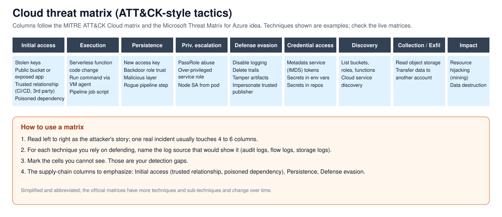
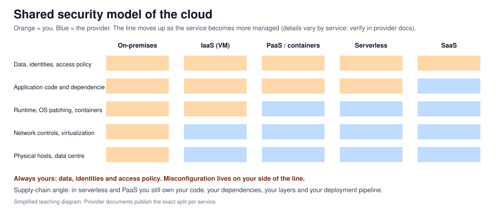

# Lesson 01: The Cloud Ecosystem, Its Attack Surface and the Shared Security Model

> **Chapter:** 5 · Attacking the Cloud Supply Chain · **Time:** ~4 hours
> **You will:** compare public cloud and on-premises, place an attack on the ATT&CK Cloud matrix and the Microsoft Threat Matrix for Azure, and say who is responsible for what in IaaS, PaaS and serverless.

| | |
|---|---|
| **Prerequisites** | [Chapter 1 intro to supply chain](../ch1-introduction-to-supply-chain-security/README.md); basic IAM, networking ([02 networking](../../cybersecurity-track/02-networking/README.md)) |
| **Related repo lessons** | [Cloud security fundamentals](../../cybersecurity-track/10-cloud-security/01-cloud-security-fundamentals.md) · [multi-cloud control matrix and shared responsibility](../../09-enterprise-architecture/05-multi-cloud-control-matrix-and-shared-responsibility.md) |
| **Labs** | [cloud-metadata-ssrf](labs/cloud-metadata-ssrf/README.md) (reading) · all five labs use the matrix as a map |
| **Syllabus lines** | Introduction to Cloud Ecosystem (Public, On-Premise) · Cloud Attack Surface and Threat Matrix · Shared Security Model of the Cloud |

> **Hedging.** Service names, defaults and numbers change often. Statements about specific cloud features are written to the best of our knowledge; **verify in the provider documentation** before you rely on them.

## 1. Introduction to Cloud Ecosystem (Public, On-Premise)

### 1.1 What "the cloud" means for a supply chain

Your software no longer ships only as a file. It runs on **someone else's platform**, is built by **managed pipelines**, stored in **managed registries and buckets**, and deployed with **roles and tokens**. Every one of those pieces is a supplier. An attacker who controls one of them can change what you run.

| Model | Who owns the hardware | Typical supply-chain exposure |
|---|---|---|
| **On-premises** | You | Your own patching, build servers, internal registries. You see everything but you must do everything. |
| **Public cloud** (AWS, Azure, GCP and others) | The provider | Account and identity sprawl, public-by-mistake storage, shared control plane APIs, managed CI/CD, marketplace images. |
| **Private cloud** | You (cloud-style software on your hardware) | Mix: cloud-style APIs plus on-prem operations. |
| **Hybrid** | Both | Identity links between worlds (federation, VPNs, connectors) become the attack path. |
| **Multi-cloud** | Several providers | Different IAM models, different defaults, more places to misconfigure. See the [multi-cloud control matrix](../../09-enterprise-architecture/05-multi-cloud-control-matrix-and-shared-responsibility.md). |

### 1.2 Service models you must name

- **IaaS** (virtual machines, networks, disks). You manage the guest OS and everything above.
- **PaaS / containers** (managed databases, app platforms, managed Kubernetes). The provider runs the platform; you manage code, configuration and identities.
- **Serverless / FaaS** (Lambda, Azure Functions, Cloud Functions). You write only the function and its permissions. See [serverless-supply-chain](labs/serverless-supply-chain/README.md).
- **SaaS**. You mostly manage identities and data sharing.

### 1.3 The cloud-specific parts of the supply chain

1. **Control plane**: the API that creates everything. Stolen credentials here equal "admin by script".
2. **Identity**: roles, service principals, service accounts, federated tokens from CI.
3. **Storage and CDN**: buckets serve code, updates, model files and web assets ([bucket-misconfig](labs/bucket-misconfig/README.md)).
4. **Compute images and marketplace**: base images, machine images, extensions.
5. **Deployment services**: pipelines, build services, deploy agents ([deployment-services](labs/deployment-services/README.md)).
6. **Managed Kubernetes** ([gke-misconfig](labs/gke-misconfig/README.md), and [chapter 4](../ch4-attacking-kubernetes-cluster-supply-chain/README.md)).

## 2. Cloud Attack Surface and Threat Matrix

### 2.1 Attack surface in five layers

| Layer | Examples |
|---|---|
| **Identity and access** | long-lived access keys in repos, over-broad roles, stale federation trust, consent grants |
| **Network exposure** | public IPs, open management ports, public storage endpoints, SSRF reachable internal endpoints (metadata) |
| **Data plane** | buckets, blobs, queues, secrets stores, database snapshots |
| **Compute and workloads** | VMs, containers, functions, their images and dependencies |
| **Delivery path** | source control, build service, artifact store, deploy role, DNS and CDN in front of it all |

### 2.2 Cloud threat matrices

A **threat matrix** lists attacker **tactics** (the goal at each step, as columns) and **techniques** (the how, as cells). It gives defenders a shared vocabulary and a coverage checklist.

**MITRE ATT&CK Cloud matrix.** ATT&CK for Enterprise has a platform filter for cloud (IaaS, SaaS, identity providers, containers and others). Tactic columns in the Enterprise matrix, in order (verify the live list): Reconnaissance, Resource Development, Initial Access, Execution, Persistence, Privilege Escalation, Defense Evasion, Credential Access, Discovery, Lateral Movement, Collection, Command and Control, Exfiltration, Impact. Cloud-flavoured techniques include valid cloud accounts, trusted relationship, unsecured credentials (for example the instance metadata API), cloud infrastructure discovery, data from cloud storage, modify cloud compute infrastructure, and resource hijacking. Browse it at attack.mitre.org and filter by platform.

**Microsoft Threat Matrix for Azure.** Microsoft's security team published an ATT&CK-style matrix for Azure resources (and sister matrices for Kubernetes and for storage services). It has fewer columns than Enterprise ATT&CK: roughly Initial Access, Execution, Persistence, Privilege Escalation, Defense Evasion, Credential Access, Discovery, Lateral Movement, Collection and Impact. Example cells: exposed sensitive interfaces, application exploit, valid accounts, SSRF to the instance metadata service, access to storage keys, and resource hijacking. These matrices are community and vendor work that evolves; **check the current published version** and treat the lists above as a study aid.

**Other matrices you may meet:** the Kubernetes threat matrix (see [chapter 4](../ch4-attacking-kubernetes-cluster-supply-chain/README.md)), and cloud-vendor and CSA guidance. Pick one matrix and use it consistently.

### 2.3 Using a matrix on a supply-chain incident

Take one story and walk the columns:

| Tactic | Example in a cloud supply-chain case |
|---|---|
| Initial access | Attacker poisons a dependency or steals a CI secret (trusted relationship) |
| Execution | Poisoned build step runs; or a function's code is replaced |
| Persistence | New access key, new role trust policy, backdoored layer or image |
| Privilege escalation | Deploy role is admin; role-passing abuse |
| Defense evasion | Logging disabled; artifact swapped after the scan |
| Credential access | Metadata tokens, secrets in environment variables |
| Impact | Backdoored release shipped to customers; crypto mining on your account |

## 3. Shared Security Model of the Cloud

The provider secures **the cloud** (facilities, hardware, the virtualization layer, the managed control plane). You secure **what you put in the cloud** (data, identities, configuration, your code, your dependencies). The line moves with the service model.

| You always own | Why it matters here |
|---|---|
| Identity and access policy | Over-privileged roles are the number one cause of cloud incidents |
| Data classification and public/private choice | A public bucket is a customer decision |
| Your code and its dependencies | The provider does not patch your npm packages |
| Your pipeline and deployment roles | See [deployment-services](labs/deployment-services/README.md) |
| Logging that you turn on and review | Provider logs exist; reading them is your job |

**Typical failure.** "The cloud is secure, so my storage is secure." The provider keeps the storage *service* secure. Whether anyone on the internet can read *your bucket* is your configuration.

**Provider-side supply-chain risk is real but different.** Researchers have shown cross-tenant issues in managed services (for example the SAPwned findings reported by Wiz in 2024 for SAP AI Core, fixed by the vendor, and Hugging Face tenancy research in 2024). You cannot fix those yourself. You limit blast radius: least privilege, segmentation, no long-lived secrets, logging, and quick patching.

## Defend

- Keep an **account structure** (organization, separate accounts or subscriptions or projects per environment).
- **No long-lived keys** for humans or CI: use federation and short-lived tokens.
- **Guardrails** at the organization level (service control policies, Azure Policy, organization policies) so one mistake cannot expose data.
- **Map your detections to a matrix** and list the gaps. The [cloud logging lesson](../../cybersecurity-track/10-cloud-security/03-cloud-logging-and-detection.md) and its CloudTrail detector lab are the starting point.

## Hands-on

1. Open the ATT&CK Cloud view and the Microsoft Azure matrix side by side. Choose five techniques that relate to storage or CI/CD and write which log shows each one.
2. Draw the shared responsibility line for a function that reads a bucket. List three things you still own.
3. Run the [cloud-metadata-ssrf](labs/cloud-metadata-ssrf/README.md) demo and place the attack in the matrix (credential access via unsecured credentials).

## Scenarios

- **Capital One (2019, reported):** an SSRF bug reached the metadata service; the instance role could read many buckets. Matrix path: initial access (exploit public app) → credential access (metadata) → collection (cloud storage). See also [AWS lesson in 09](../../09-enterprise-architecture/02-aws-ai-security.md).
- **A deleted bucket still in a download script:** the name becomes available to anyone. See [bucket-misconfig](labs/bucket-misconfig/README.md).

## Interview Q&A

Who patches the guest OS in IaaS, PaaS and serverless?

IaaS: you. PaaS: the provider patches the platform; you patch your code and dependencies. Serverless: the provider handles the runtime and host; you still own function code, dependencies and permissions.

What is the value of a threat matrix for a defender?

A common vocabulary and a checklist: for each technique decide if you can prevent it, detect it, and which log proves it. The empty cells are your gaps.

Name two ways a trusted relationship becomes an initial access path in the cloud.

A CI/CD system with a deploy role into your account (compromise the CI, get the role), and a third-party vendor or marketplace integration with cross-account access.

## References

- MITRE ATT&CK for Enterprise, cloud platforms (attack.mitre.org). Verify the current tactic list.
- Microsoft Security blog: Threat matrix for Azure resources (and for Kubernetes and storage). Verify the latest version.
- Provider shared responsibility pages (AWS, Azure, GCP).
- Repo: [cloud security fundamentals](../../cybersecurity-track/10-cloud-security/01-cloud-security-fundamentals.md), [multi-cloud matrix](../../09-enterprise-architecture/05-multi-cloud-control-matrix-and-shared-responsibility.md).
