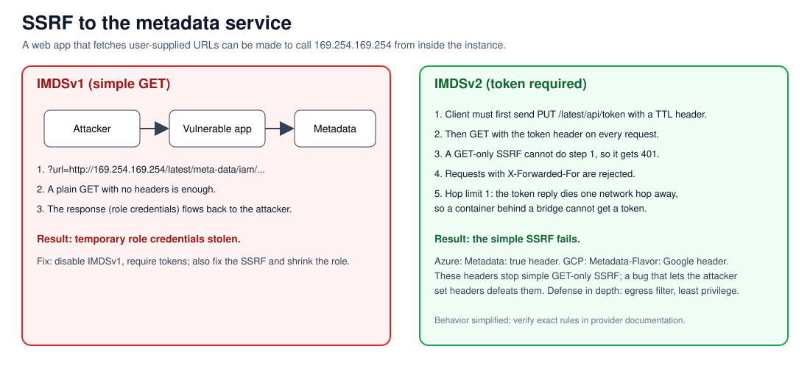

# Lesson 02: Attack Vectors in AWS

> **Chapter:** 5 · Attacking the Cloud Supply Chain · **Time:** ~5 hours
> **You will:** explain how misconfigurations, the metadata service, S3 and CloudFront, Lambda and the deployment services (CodePipeline, CodeBuild, CodeDeploy) are attacked, and pick the control for each.

| | |
|---|---|
| **Prerequisites** | [Lesson 01](01-cloud-ecosystem-attack-surface-and-shared-responsibility.md); [AWS in 09](../../09-enterprise-architecture/02-aws-ai-security.md); [cloud identity](../../cybersecurity-track/10-cloud-security/02-cloud-identity.md) |
| **Labs** | [cloud-metadata-ssrf](labs/cloud-metadata-ssrf/README.md) · [bucket-misconfig](labs/bucket-misconfig/README.md) · [serverless-supply-chain](labs/serverless-supply-chain/README.md) · [deployment-services](labs/deployment-services/README.md) |
| **Syllabus lines** | Attack Vectors in AWS · Misconfigurations (exposed secrets, metadata service, etc.) · Attacking Managed Services Like S3, CloudFront CDN · Attacking Serverless Computing · Attacking Application Deployment Services |

> **Safety and hedging.** Everything here is for learning and for testing **your own** accounts. Do not probe other people's buckets or services. Service behavior is described to the best of our knowledge: **verify in AWS documentation**.

## 1. Misconfigurations (exposed secrets, metadata service, etc.)

### 1.1 Exposed secrets

| Where secrets leak | Why |
|---|---|
| Git history and public repos | access keys committed once stay in history ([trufflehog lab](../ch6-common-defenses-against-supply-chain-attacks/labs/trufflehog-secrets-scan/README.md)) |
| Lambda environment variables, task definitions | visible to anyone with read access to the function configuration |
| Build logs and CI variables | secrets printed by debug output or by a hijacked action (see tj-actions, 2025, in [chapter 2](../ch2-attacking-code-and-application-supply-chain/README.md)) |
| AMIs, snapshots, container images | credentials baked in a layer |
| User data scripts | readable from the instance |

Defense: no long-lived keys (use roles and short-lived credentials), a secrets manager, secret scanning on push, and a rotate-on-leak runbook.

### 1.2 The instance metadata service (IMDS)

Every EC2 instance can read **role credentials** from a link-local address, `169.254.169.254`. If an application can be tricked into fetching a URL the attacker chooses (SSRF), the attacker can ask for those credentials. The 2019 Capital One breach is the classic reported example.

| Version | How it works | SSRF resistance |
|---|---|---|
| **IMDSv1** | plain GET | weak: any GET-capable SSRF works |
| **IMDSv2** | first a `PUT` to create a session token (with a TTL header), then every `GET` carries the token. Requests with a forwarded-for header are rejected. The token response has a small IP TTL (hop limit, default 1), so a container one hop away cannot receive it unless you raise the limit | strong against simple SSRF and open proxies |

Controls: require IMDSv2 on every instance and launch template (and as an organization policy), keep the hop limit at 1 unless containers truly need the node role (then prefer pod-level identity), restrict egress, and give instance roles the least privilege. Newer features and defaults change, so check the docs.

**Lab:** [cloud-metadata-ssrf](labs/cloud-metadata-ssrf/README.md). Also see the SSRF discussion in [AWS in 09](../../09-enterprise-architecture/02-aws-ai-security.md).

### 1.3 IAM misconfigurations

Over-broad policies (`"Action": "*"`), `iam:PassRole` on `*`, trust policies that allow any principal, access keys for humans, no MFA. Use the [IAM analyzer lab](../../cybersecurity-track/10-cloud-security/README.md) to practise finding these.

## 2. Attacking Managed Services Like S3, CloudFront CDN

### 2.1 S3

| Attack | What happens | Control |
|---|---|---|
| **Public read** | bucket policy or ACL grants everyone read; data or code exposed | Block Public Access on account and bucket, policy review |
| **Public write** | anyone can upload or overwrite; an attacker replaces a script or model that other systems download | never allow anonymous write; bucket versioning; object integrity checks |
| **Bucket takeover** | a deleted bucket name still referenced by code, DNS or update URLs is re-registered by an attacker who then serves their own content (reported research in 2025 showed many abandoned buckets still receiving requests) | inventory references; keep the bucket (empty, private) instead of deleting; no references to buckets you do not own |
| **Static website hosting** | website endpoints are HTTP-only and public | put a CDN with HTTPS in front; prefer private origin |
| **Subdomain takeover** | `docs.example.com` CNAME points at a website endpoint that no longer exists; attacker creates it and serves content on your domain (cookies, phishing, supply-chain scripts) | remove DNS records when you delete resources; monitor dangling records |
| **Unsigned artifacts** | deploy script downloads a zip from a bucket without checking a digest | sign or hash artifacts and verify before use |

### 2.2 CloudFront (CDN)

- **Origin exposure.** If the S3 origin is publicly readable, attackers can bypass CDN controls (WAF, geo, signed URLs). Use **Origin Access Control** (the newer mechanism, replacing Origin Access Identity; verify current guidance) so only the distribution can read the bucket.
- **Dangling origin or alias.** A distribution whose origin bucket was deleted, or an alternate domain name no longer in your DNS control, is a takeover path.
- **Mutable cache poisoning and header trust.** Mis-keyed caches can serve one user's content to another; set cache keys deliberately.
- **Third-party scripts via CDN.** The polyfill.io case (2024) shows that a CDN-hosted script from a domain you do not control can be turned malicious. Pin with Subresource Integrity, or self-host.

**Lab:** [bucket-misconfig](labs/bucket-misconfig/README.md): fixtures for S3 policies, ACLs, website hosting, CDN origins without OAC and dangling DNS, with an auditor.

## 3. Attacking Serverless Computing

Lambda removes servers but not supply chain:

| Vector | Detail | Control |
|---|---|---|
| **Dependencies** | function zip includes vulnerable or malicious packages | lockfile, SCA, hash pinning ([ch2 SCA](../ch2-attacking-code-and-application-supply-chain/README.md)) |
| **Layers** | a layer from another account (or an unpinned "latest" version) runs inside your function with your role | use only trusted accounts, pin the layer version ARN, sign or verify |
| **Environment secrets** | keys in environment variables | secrets manager references |
| **Over-permissive execution role** | one code bug becomes broad data access or role escalation | one role per function, least privilege, permission boundaries |
| **Event injection** | the event source (queue, S3 object key, API body) carries attacker data into code that shells out or builds SQL | validate input; treat events as untrusted |
| **Function URLs without auth** | public invocation | require IAM or a gateway with authorization |
| **Code replacement** | an attacker with `lambda:UpdateFunctionCode` swaps the code (persistence) | restrict, alert on `UpdateFunctionCode` (see [CloudTrail lab](../../cybersecurity-track/10-cloud-security/README.md)) |

**Lab:** [serverless-supply-chain](labs/serverless-supply-chain/README.md).

## 4. Attacking Application Deployment Services

The pipeline holds the keys to production, so it is a prime target.

| Service (AWS) | Typical weaknesses |
|---|---|
| **CodePipeline** | one shared service role with admin rights; artifact bucket writable by developers or contractors; no approval before production |
| **CodeBuild** | privileged mode, build role too broad, secrets as plain variables, buildspec edited from a pull request (poisoned pipeline execution, see [CAISP ch4](../../caisp-course/ch4-ai-attacks-and-defenses-devops/README.md)) |
| **CodeDeploy** | deploy to everything with one role; deploy scripts pulled from mutable locations |
| **Artifact stores (S3, ECR)** | tampering between build and deploy; mutable tags |

**Attack story.** A contractor role can write to the pipeline artifact bucket. The build finishes, the attacker swaps `app.zip`, the deploy stage ships the swapped file with the pipeline's admin role. No source code was touched, so code review saw nothing.

**Controls.** One least-privilege role per pipeline; artifact bucket writable only by the build role; record the artifact digest at build and verify it at deploy (and sign it, see [chapter 6 lesson 01](../ch6-common-defenses-against-supply-chain-attacks/01-proving-integrity-with-cryptography.md)); manual approval for production; no secrets in plain variables; protect pipeline definitions with branch rules and [CODEOWNERS](../ch6-common-defenses-against-supply-chain-attacks/03-change-control-and-licensed-code.md).

**Lab:** [deployment-services](labs/deployment-services/README.md) (also covers Azure DevOps and Cloud Build shapes). Terraform guardrails for these settings: [06 terraform](../../06-ai-devsecops/terraform/README.md). Pipeline linting: [06 cicd](../../06-ai-devsecops/cicd/README.md).

## Defend (summary)

IMDSv2 everywhere · Block Public Access · OAC on CloudFront · dangling-DNS monitoring · one least-privilege role per function and per pipeline · secrets in a manager · pin and verify artifacts · CloudTrail alerts on key creation, policy changes and function code updates.

## Hands-on

1. Run the four AWS-related lab demos (metadata, buckets, serverless, deployment).
2. In your own sandbox account (optional, not required): check that new instances require IMDSv2 and that account-level Block Public Access is on. Use only your own account.
3. Write one detection (query idea) for `UpdateFunctionCode` by an unexpected principal.

## Scenarios

- **Uploads bucket with public PutObject** is later read by a nightly job that unzips and runs a file. Where are the two failures? (Public write; trusting data from a writable place.)
- **CloudFront origin is `acme-retired-bucket`**, deleted last year. What can an attacker do? (Register the name and serve content under your domain.)

## Interview Q&A

Why does IMDSv2 stop most SSRF attacks?

It needs a PUT to get a token and a custom header on later requests. A typical SSRF that can only make a GET with no headers cannot complete that. The hop limit also blocks a container that is one network hop from the instance. It does not fix the SSRF itself or an over-privileged role.

How do you stop a CDN from being bypassed?

Make the origin private and allow only the distribution to read it (Origin Access Control), then apply WAF and signed URL rules at the CDN.

Why are Lambda layers a supply-chain risk?

A layer is code that runs inside your function with your role. A layer from an untrusted account, or one referenced by a floating version, can change what your function does.

## References

- AWS documentation: instance metadata service (IMDSv2), S3 Block Public Access, CloudFront origin access control, Lambda layers and permissions (verify current pages).
- Repo: [AWS in 09](../../09-enterprise-architecture/02-aws-ai-security.md), [CloudTrail detections and IAM analyzer](../../cybersecurity-track/10-cloud-security/README.md).
