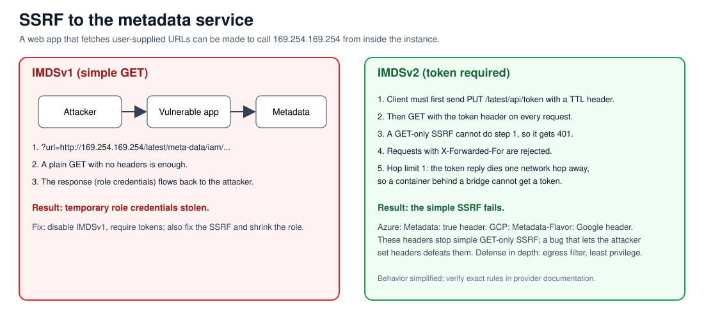

# Lesson 04: Attack Vectors in GCP

> **Chapter:** 5 · Attacking the Cloud Supply Chain · **Time:** ~4 hours
> **You will:** explain how GCP misconfigurations, the metadata server, Cloud Storage and Cloud CDN, Cloud Functions and Google Kubernetes Engine are attacked, and choose the control for each.

| | |
|---|---|
| **Prerequisites** | [Lesson 01](01-cloud-ecosystem-attack-surface-and-shared-responsibility.md); [GCP in 09](../../09-enterprise-architecture/04-gcp-ai-security.md); [Chapter 4 Kubernetes](../ch4-attacking-kubernetes-cluster-supply-chain/README.md) |
| **Labs** | [cloud-metadata-ssrf](labs/cloud-metadata-ssrf/README.md) (GCP metadata) · [bucket-misconfig](labs/bucket-misconfig/README.md) (GCS) · [serverless-supply-chain](labs/serverless-supply-chain/README.md) (Cloud Functions) · [gke-misconfig](labs/gke-misconfig/README.md) |
| **Syllabus lines** | Attack Vectors in GCP · Misconfigurations (exposed secrets, metadata services, etc.) · Attacking Google Cloud Storage GCS, Cloud CDN · Attacking Google Cloud Functions · Attacking Google Kubernetes Engine |

> **Hedging.** GCP names and defaults change. Statements are to the best of our knowledge: **verify in Google Cloud documentation**. Test only projects you own.

## 1. Misconfigurations (exposed secrets, metadata services, etc.)

### 1.1 Exposed secrets and keys

- **Service account keys** (JSON files) in repositories, images and CI variables. They are long-lived and powerful. Prefer **Workload Identity Federation** (for CI and other clouds) and attached service accounts; organization policy can block key creation.
- **Default service accounts** (the default Compute Engine service account has had broad roles such as Editor by default in older projects; newer organization defaults differ, so verify). Workloads that use it inherit too much.
- **Secrets in environment variables and startup scripts**. Use Secret Manager.
- **Public API keys** without restrictions.

### 1.2 The metadata server

Compute resources reach a metadata server at `metadata.google.internal` (also `169.254.169.254`). Requests must carry the header **`Metadata-Flavor: Google`**; requests with an `X-Forwarded-For` header are rejected. The server returns the **access token of the attached service account**. Two points:

- The required header stops simple GET-only SSRF. A bug that lets the attacker set headers defeats it.
- **Legacy metadata endpoints** (`/0.1/` and `/computeMetadata/v1beta1/`) did not require the header. They were turned off by default in new setups over time; on old clusters and VMs check that they are disabled. This is also a GKE topic ([section 5](#5-attacking-google-kubernetes-engine)).

**Lab:** [cloud-metadata-ssrf](labs/cloud-metadata-ssrf/README.md) (GCP simulator: no header gets a 403; attacker-set header gets the token).

## 2. Attacking Google Cloud Storage GCS, Cloud CDN

### 2.1 Cloud Storage (GCS)

| Attack | Detail | Control |
|---|---|---|
| **allUsers / allAuthenticatedUsers** | bucket or object granted to everyone, or to **any Google account** (which is almost everyone) | **public access prevention** enforced at the organization or bucket |
| **Public write** | `objectCreator` or `objectAdmin` to public members lets anyone upload or overwrite | never grant; use signed URLs for controlled uploads |
| **Fine-grained ACLs** | object-level ACLs hide exposure from bucket-level IAM review | **uniform bucket-level access** |
| **Signed URLs with long expiry** | a leaked link works until it expires | short expiry, scoped objects |
| **Bucket name takeover** | deleted bucket names can be reclaimed by others; code or DNS referencing them is hijackable | keep references inventoried; do not reference buckets you do not own |
| **Dangling CNAME to `c.storage.googleapis.com`** | static site hosting with a custom domain whose bucket was deleted | remove DNS first; monitor |
| **Tampered artifacts and models** | build or ML artifacts in a writable bucket | restrict writers, enable object versioning, verify digests |

### 2.2 Cloud CDN

- Cloud CDN sits on a load balancer in front of a backend bucket or service. A **public backend bucket** means the CDN can be bypassed; use signed requests / signed cookies where content must be private, and restrict origin access.
- **Cache key mistakes** can serve private content to others; review which headers and query strings are in the cache key.
- **Third-party hosted scripts** (polyfill-style takeover, 2024): pin integrity or self-host.
- **Dangling DNS** pointing at released load balancer addresses.

**Lab:** [bucket-misconfig](labs/bucket-misconfig/README.md): GCS fixtures with `allUsers`, `allAuthenticatedUsers` writer, public access prevention and uniform access.

## 3. Attacking Google Cloud Functions

| Vector | Detail | Control |
|---|---|---|
| **Unauthenticated invocation** | `allUsers` granted the invoker role | require authentication; restrict ingress to internal and the load balancer |
| **Default service account** | functions run as a broad default identity | a dedicated least-privilege service account per function |
| **Dependencies** | `requirements.txt` or `package.json` deployed via Cloud Build | SCA, pinned versions with hashes |
| **Build-time exposure** | source uploaded to a staging bucket, built by Cloud Build with its own service account | restrict the bucket and build identity; see [deployment-services](labs/deployment-services/README.md) |
| **Secrets in env vars** | visible in the console to viewers | Secret Manager references |
| **Event injection** | Pub/Sub or storage events with attacker-controlled fields | validate |

**Lab:** [serverless-supply-chain](labs/serverless-supply-chain/README.md) has a Cloud Functions fixture (public trigger, Editor role, token in env).

## 4. Deployment services in GCP (Cloud Build and Artifact Registry)

Cloud Build's service account historically had broad permissions by default (verify current defaults); a poisoned `cloudbuild.yaml` runs with it. Artifact Registry repositories readable or writable too broadly allow image or package tampering. Use a dedicated build service account, least privilege, **Binary Authorization** to require signed images, and pin images by digest.

## 5. Attacking Google Kubernetes Engine

GKE adds Google-specific paths on top of the general [chapter 4 Kubernetes lessons](../ch4-attacking-kubernetes-cluster-supply-chain/README.md):

| Vector | Detail | Control |
|---|---|---|
| **Legacy metadata exposure** | pods can reach the node's metadata server and take the **node service account token** | enable **Workload Identity Federation for GKE** (metadata server in GKE_METADATA mode); block legacy endpoints |
| **Node service account** | default Compute SA with Editor, or the `cloud-platform` OAuth scope on nodes | dedicated minimal node SA; narrow scopes |
| **Legacy ABAC** | attribute-based authorization (old) gives broad rights to service accounts | disable ABAC, use RBAC only |
| **Open control plane** | API server reachable from anywhere | authorized networks, private cluster/endpoint |
| **Client certificate authentication** | legacy credential method | disable |
| **No network policy** | flat pod network | enable network policy (Dataplane V2 or Calico) |
| **Image trust** | pulling unsigned or mutable images from any registry | Binary Authorization, private Artifact Registry, digests |
| **Stale versions** | no patching | release channels, auto-upgrade |

**Workload Identity in one paragraph.** Without it, a compromised pod asks the metadata server for a token and receives the **node's** identity, which may be powerful and is shared by every pod on the node. With it, the pod receives a token only for its Kubernetes service account's mapped identity, and only if you created that binding. Enabling it at the cluster level is not enough: **node pools must use the GKE metadata server mode** too (the lab shows this trap).

**Lab:** [gke-misconfig](labs/gke-misconfig/README.md) (fixture audit plus what a pod receives from metadata). See also the Kubernetes manifest checker in [06 kubernetes](../../06-ai-devsecops/kubernetes/README.md), the Kubescape-style labs in [chapter 6](../ch6-common-defenses-against-supply-chain-attacks/labs/kubescape-manifest-scan/README.md), and `trivy k8s` / Kubescape as maintained scanners (kube-hunter is no longer actively developed).

## Defend (summary)

Workload Identity Federation for CI and GKE · no service account keys · public access prevention and uniform bucket access · dedicated least-privilege service accounts (never the default) · RBAC only · private cluster with authorized networks · Binary Authorization · Secret Manager · Cloud Audit Logs reviewed.

## Hands-on

1. Run [gke-misconfig](labs/gke-misconfig/README.md). Explain why the "workload identity on, pool metadata mode wrong" case is still unsafe.
2. Run [bucket-misconfig](labs/bucket-misconfig/README.md) and fix the GCS findings in the fixture. Re-run to confirm.
3. Compare the AWS, Azure and GCP metadata protections in a three-row table.

## Scenarios

- **A GKE pod is compromised through a web bug.** It calls the metadata server. On a legacy cluster it gets the node SA with Editor. What limited the damage on the hardened cluster? (Workload Identity, a minimal identity bound to the pod's account.)
- **A bucket grants `allAuthenticatedUsers` objectCreator.** Who can write? (Anyone with any Google account.)

## Interview Q&A

What is the difference between allUsers and allAuthenticatedUsers?

`allUsers` means anyone on the internet. `allAuthenticatedUsers` means anyone signed in with any Google account, which is effectively everyone. Both are public for security purposes.

Why is the default Compute Engine service account risky on GKE nodes?

It is shared by every pod on the node unless Workload Identity is in place, and it may hold a broad role. A pod compromise becomes project-level access.

What does Binary Authorization add?

An admission-time policy that only lets images with required attestations (such as a signature from your build) run on the cluster.

## References

- Google Cloud documentation: metadata server, Workload Identity Federation for GKE, GKE hardening guide, Cloud Storage public access prevention, Binary Authorization (verify current pages).
- Repo: [GCP in 09](../../09-enterprise-architecture/04-gcp-ai-security.md), [06 kubernetes](../../06-ai-devsecops/kubernetes/README.md).
