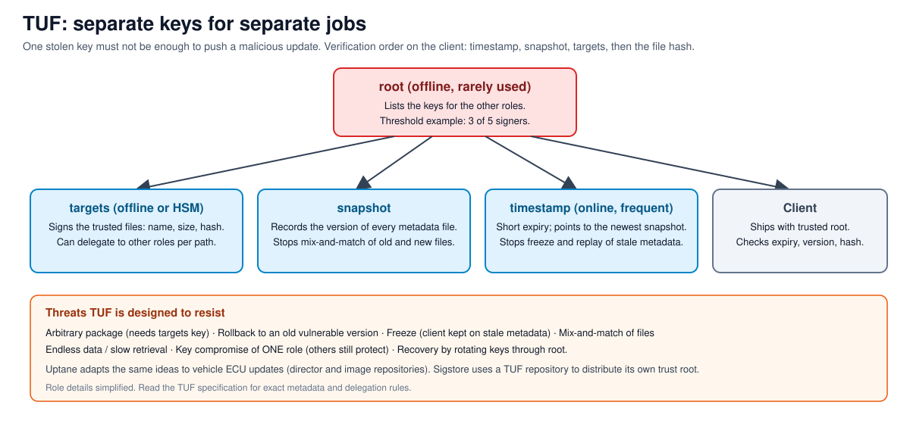

# Lesson 01: Proving the Sanity of Software Components with Cryptography

> **Chapter:** 6 · Common Defenses Against Supply Chain Attacks · **Time:** ~6 hours
> **You will:** explain hashes, signatures and attestations; tell code signing, component signing and artifact signing apart; sign and verify an image in an offline twin; and describe The Update Framework (TUF) roles and thresholds.

| | |
|---|---|
| **Prerequisites** | [Chapter 1](../ch1-introduction-to-supply-chain-security/README.md); public-key basics ([security foundations](../../cybersecurity-track/03-security-foundations/README.md)) |
| **Related repo labs** | [CAISP model-signing](../../caisp-course/ch6-supply-chain-attacks-in-ai/labs/model-signing) · [CMCPSE sign-verify-mcp-build](../../cmcpse-course/ch6-supply-chain-security-and-governance-of-mcp/labs/sign-verify-mcp-build) · [CMCPSE provenance-attestations](../../cmcpse-course/ch6-supply-chain-security-and-governance-of-mcp/labs/provenance-attestations) · [CAASE sign-verify-harness](../../caase-course/ch6-operationalizing-agentic-ai-security/labs/sign-verify-harness) · [06 cicd](../../06-ai-devsecops/cicd/README.md) |
| **Labs** | [cosign-container-signing](labs/cosign-container-signing/README.md) |
| **Syllabus lines** | Prove the sanity of the software components using Cryptography · Code Signing · Component Signing · Artifact Signing · The Update Framework |

> **Hedging.** Tool flags and defaults change. Commands are examples to check against current docs.

## 1. Prove the sanity of the software components using Cryptography

Three questions decide whether you can trust a piece of software:

1. **Integrity:** are these the exact bytes the publisher released? A **hash** answers this *if you got the hash from a trusted place*.
2. **Authenticity:** who released them? A **digital signature** binds the bytes to a key.
3. **Provenance:** how were they built, from which source, by which builder? An **attestation** (a signed statement) answers this.

| Tool | What it gives | What it does not give |
|---|---|---|
| Hash (SHA-256) | detects change | does not say who made it; an attacker who changes the file can change the hash next to it |
| Signature | integrity plus signer identity | does not say the signer was honest or uncompromised |
| Attestation (in-toto statement, SLSA provenance) | claims about build inputs/process | only as good as the builder that produced and signed it |
| Transparency log (for example Rekor) | public record that a signature existed at a time | not a judgement of safety |

**Key point.** Signing proves *who*, not *safe*. The xz-utils backdoor (2024) was signed by a legitimate maintainer. Signing also fails when keys are stolen: stolen code-signing certificates were used to sign malware in reported incidents (for example NVIDIA certificates leaked in 2022 and MSI keys leaked in 2023; details hedged, check the sources). So signing is combined with **key protection, short-lived credentials, transparency and policy**.

## 2. Code Signing

**Code signing** signs executables, installers, scripts and drivers so an operating system or a user can check the publisher.

| Platform | Mechanism (examples) |
|---|---|
| Windows | Authenticode signatures; SmartScreen and driver signing policies |
| macOS | Developer ID signing plus notarization |
| Java | `jarsigner`; Maven Central requires signatures for published artifacts |
| Linux packages | GPG-signed repository metadata (apt, rpm) |
| Mobile | store signing keys |

How it works: the publisher hashes the file, signs the hash with a private key; the file carries a **certificate chain** to a CA the platform trusts; a **timestamp** shows the signature was made while the certificate was valid.

**Weak points and defenses**

- *Key theft.* Keep keys in an **HSM or cloud KMS**, never on a developer laptop or a CI variable; restrict who can request a signature.
- *Signing malicious builds.* A compromised build server signs whatever it builds. Sign only from the **trusted, hardened pipeline** and log every signing request.
- *Revocation is slow.* Plan certificate rotation and incident steps.
- *Unsigned is not always bad; signed is not always good.* Combine with other checks (reputation, scanning).

## 3. Component Signing

**Component signing** protects the third-party libraries and packages you consume.

- **Maven Central** requires GPG signatures on published artifacts (consumers rarely verify them, which is the gap).
- **npm** offers **provenance** statements: a package published from a supported CI can carry a signed link back to its source repository and build (Sigstore-based). Check current docs and registry support.
- **PyPI** supports **Trusted Publishing** (OIDC from CI instead of a stored token) and **attestations** (PEP 740; verify rollout status). Packages can carry publish attestations that tools may verify.
- **Go** uses a checksum database (`sum.golang.org`) and module proxy so everyone sees the same hash for a version.
- **Linux distros** sign repository metadata; the package manager checks it.

**Defend by verifying.** Pin versions and hashes ([pip `--require-hashes`, npm lockfile integrity](02-evaluating-dependencies-before-use.md#22-implement-integrity-checks-or-policies)), and where the ecosystem offers provenance, require it for critical dependencies.

## 4. Artifact Signing

**Artifact signing** covers what *you* produce: container images, binaries, Helm charts, SBOMs, ML models.

| Approach | Notes |
|---|---|
| **Sigstore cosign** | signs an image **digest** (not a tag). Key-based or **keyless**: a short-lived certificate is issued after an OIDC login (for example from your CI), and the event is written to a public transparency log (Rekor). Verification pins the **identity** (who) and **issuer** (which identity provider). |
| **Notation (Notary Project)** | signs OCI artifacts with certificates and trust policies; widely used in cloud registries. |
| **Docker Content Trust (Notary v1)** | **Retired.** Docker announced in July 2025 that the Notary v1 service shuts down on **8 Dec 2026**. Teach it as legacy. Move to cosign or Notation. |
| **GPG** | still used for tarballs and packages; weak key distribution story. |
| **in-toto attestations / SLSA provenance** | signed statements about how the artifact was built (see [provenance lab](../../cmcpse-course/ch6-supply-chain-security-and-governance-of-mcp/labs/provenance-attestations)). SLSA v1.0 Build track: L1 provenance exists, L2 signed provenance from a hosted build platform, L3 hardened builds (verify the latest spec). |

**Rules that prevent most mistakes**

1. **Sign the digest, verify the digest.** Tags move. If an attacker repoints `app:1.0`, a tag-based check passes; a digest-based check fails ([lab test: tag repointed after signing](labs/cosign-container-signing/README.md)).
2. **Verify at the point of use** (admission controller, deploy step), not only at build.
3. **Pin the signer identity**, not just "any valid signature".
4. **Sign the SBOM and provenance too** (attestations) and attach them to the image.
5. **Protect the signing identity**: only the release pipeline on protected branches may sign.

**Lab:** [cosign-container-signing](labs/cosign-container-signing/README.md) (an HMAC twin with replay, tag-move and attestation tests, plus a hedged real cosign/Notation guide).

## 5. The Update Framework

**TUF** (The Update Framework, a CNCF graduated project) is a design for secure **software update** systems that stays safe even when some keys or servers are compromised. It is the answer to "what if the update server or one signing key is stolen?"

### 5.1 The roles

| Role | Signs | Key handling |
|---|---|---|
| **root** | the list of keys and thresholds for all other roles | kept **offline**, used rarely, several holders |
| **targets** | which files are trusted (name, length, hashes); may **delegate** parts of the namespace to other keys | offline or HSM; delegations limit blast radius (one team = one path) |
| **snapshot** | the versions of all targets metadata, so an attacker cannot mix old and new files | online |
| **timestamp** | the current snapshot, with a **short expiry** | online, signs often |

**Threshold signatures.** A role can require *t of n* keys (for example 3 of 5 for root). One stolen key is not enough to forge the role.

### 5.2 What the client does

The client ships with a **trusted root**. On each update it fetches the timestamp, then the snapshot, then the targets metadata; checks signatures, thresholds, **expiry dates** and that **version numbers never go backwards**; then downloads the target and checks its length and hash. Any failure aborts.

### 5.3 Attacks TUF resists

- **Arbitrary package**: needs the targets key.
- **Rollback**: version numbers must not decrease.
- **Freeze**: the timestamp expires quickly, so an attacker cannot keep a client on stale metadata.
- **Mix-and-match**: the snapshot ties file versions together.
- **Key compromise**: roles are separate; **root** can rotate compromised keys.

### 5.4 Where you meet it

- **Sigstore** distributes its trust root using TUF (cosign fetches it).
- **PyPI** has worked on TUF adoption (PEP 458; verify the status).
- **Notary v1**, the base of retired Docker Content Trust, was built on TUF; the Notary Project's newer Notation uses a different design.
- **Uptane** adapts TUF to **automotive ECU updates**: a *director* repository decides which images a given vehicle gets, an *image* repository holds the signed images, and vehicles check both. Mention it when asked "TUF beyond software repositories".
- **go-tuf, python-tuf, rust-tuf** are libraries you can use.

**Mini exercise (no code needed).** For a package index, decide: which role keys live offline? Who gets a delegation for `/org-a/*`? What expiry for timestamp (hours) and for targets (months)? What happens when the targets key leaks (root revokes and re-signs)?

## Defend (summary)

Sign digests · verify at deploy · pin signer identity · keep keys in KMS/HSM or use keyless · short-lived credentials · transparency logs · sign SBOMs and provenance · protect the release pipeline · prefer TUF-style designs when you operate an update channel.

## Hands-on

1. Run the [cosign-container-signing](labs/cosign-container-signing/README.md) demo; then change the registry tag in the test and see which test catches it.
2. Read the [CAISP model-signing lab](../../caisp-course/ch6-supply-chain-attacks-in-ai/labs/model-signing) and compare: same idea, different artifact.
3. Draw the TUF diagram from memory with thresholds, then check against the SVG.

## Scenarios

- **A mirror serves yesterday's metadata for a month.** Which TUF role prevents this? (Timestamp.)
- **The CI signing key is leaked.** What do you do first? (Revoke or rotate, find what was signed since, re-sign trusted artifacts, move to keyless or KMS.)
- **A release is signed but contains a backdoor from a trusted maintainer.** What other control helps? (Review, reproducible builds, behavior analysis; signing alone cannot.)

## Interview Q&A

Code signing, component signing and artifact signing: how do they differ?

Code signing proves the publisher of executables to an OS or user. Component signing is about third-party libraries you consume (verify what you pull). Artifact signing is about what you produce and deploy (images, charts, SBOMs). The same cryptography, different trust direction and verification point.

Why sign by digest and not by tag?

A tag is a movable pointer. A signature on the digest binds to exact content; if the tag is repointed, the new digest has no valid signature.

What does a threshold on the TUF root achieve?

It requires several key holders to agree, so one stolen or coerced key cannot change trust for the system.

Why is Docker Content Trust no longer the answer?

Docker retired the Notary v1 service (shutdown announced for 8 Dec 2026). Use cosign or Notation instead.

## References

- The Update Framework specification and Uptane standard (theupdateframework.io, uptane.org).
- Sigstore documentation (cosign, Rekor, Fulcio); Notary Project (Notation); SLSA (slsa.dev); in-toto (in-toto.io).
- Docker announcement on Docker Content Trust retirement (July 2025); verify dates.
- Repo: [06 cicd](../../06-ai-devsecops/cicd/README.md), [CMCPSE chapter 6](../../cmcpse-course/ch6-supply-chain-security-and-governance-of-mcp/README.md).
