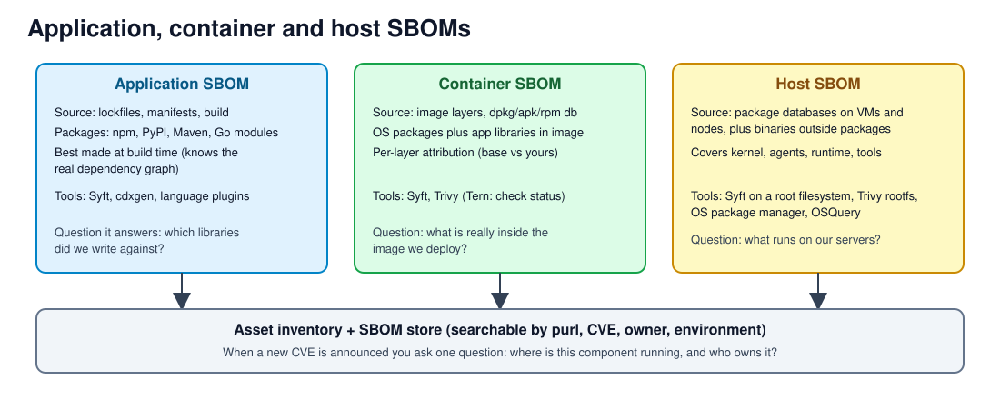

# Lesson 04: Asset Inventory and Software Bills of Materials

> **Chapter:** 6 · Common Defenses Against Supply Chain Attacks · **Time:** ~6 hours
> **You will:** build an asset inventory for the software supply chain; generate application, container and host SBOMs; understand layer-level SBOMs; and use SBOMs to answer "where is this vulnerable component?".

| | |
|---|---|
| **Prerequisites** | [Chapter 1](../ch1-introduction-to-supply-chain-security/README.md) (what a supply chain is); package URLs and lockfiles |
| **Related repo labs** | [CAISP sbom-and-mlbom](../../caisp-course/ch6-supply-chain-attacks-in-ai/labs/sbom-and-mlbom) · [CMCPSE sbom-mcp-server](../../cmcpse-course/ch6-supply-chain-security-and-governance-of-mcp/labs/sbom-mcp-server) · [CAASE aibom-harness](../../caase-course/ch6-operationalizing-agentic-ai-security/labs/aibom-harness) · [06 docker](../../06-ai-devsecops/docker/README.md) |
| **Labs** | [syft-app-sbom](labs/syft-app-sbom/README.md) · [syft-container-sbom](labs/syft-container-sbom/README.md) · [tern-layer-sbom](labs/tern-layer-sbom/README.md) · [syft-in-cicd](labs/syft-in-cicd/README.md) · [bomber-sbom-scan](labs/bomber-sbom-scan/README.md) |
| **Syllabus lines** | Create Asset Inventory · Generate a Software Bill Of Materials · Application SBOM · Container SBOM · Hosts SBOM |



## 1. Create Asset Inventory

You cannot defend what you cannot list. When a new critical vulnerability is announced, the first question is: **where do we run it, and who owns it?** An asset inventory is the answer store.

### 1.1 What belongs in a supply-chain asset inventory

| Asset class | Examples | Key fields |
|---|---|---|
| **Source** | repositories, forks, submodules, vendored code | owner, visibility, branch protection, languages |
| **Build and CI** | pipelines, runners, build images, plugins, actions | owner, privileges, secrets exposed, where they run |
| **Dependencies** | direct and transitive packages, base images, GitHub Actions, Terraform modules, Helm charts | name, version, purl, license, source registry |
| **Artifacts** | images, binaries, charts, models, SBOMs | digest, signature, provenance, build ID |
| **Registries and stores** | container registry, package proxy, artifact bucket | access, retention, immutability |
| **Runtime** | clusters, namespaces, VMs, functions, apps | environment, owner, data class, internet exposure |
| **Identities and secrets** | service accounts, deploy roles, tokens | scope, expiry, last used |
| **Third parties** | SaaS tools with access to code or cloud | data shared, access level, contract |

### 1.2 How to build it

1. **Discover automatically** from sources of truth: Git host API, CI configuration, cloud asset inventory APIs, Kubernetes API, registry catalogs, and the SBOMs themselves. Manual spreadsheets go stale.
2. **Normalize identifiers**: use **package URLs (purl)** for components, **image digests** for artifacts, and consistent service names for owners.
3. **Link the layers**: repo → pipeline → artifact digest → deployment → owner. This chain is what makes incident response fast.
4. **Assign an owner** to every asset (a team, not a person) and a criticality.
5. **Keep it fresh**: events from CI (a new artifact) and from deployment (what is running) update it.
6. **Use it**: vulnerability triage, license review, incident scoping, "shadow" asset detection (things running that CI never built).

Tools: a CMDB or service catalog, cloud-native asset inventories, SBOM stores such as **OWASP Dependency-Track**, and vulnerability management platforms such as **DefectDojo** (see [chapter 7](../ch7-managing-a-secure-software-supply-chain-program/README.md) and [real-tools](real-tools/README.md)). The [vulnerability management track](../../cybersecurity-track/08-vulnerability-management/README.md) covers prioritization (CVSS, EPSS, KEV).

## 2. Generate a Software Bill Of Materials

An **SBOM** is a machine-readable inventory of the components inside a piece of software, with versions, identifiers, and optionally hashes, licenses and relationships.

### 2.1 Formats and fields

| Format | Notes (verify the latest versions) |
|---|---|
| **CycloneDX** | OWASP; JSON/XML; strong for security use; also standardized as Ecma-424; 1.5/1.6 widely used, check the newest |
| **SPDX** | Linux Foundation; ISO/IEC 5962 for 2.x; **SPDX 3.0** adds profiles (security, AI, build) |
| **Minimum elements** | NTIA (2021) listed: supplier name, component name, version, other unique identifiers, dependency relationship, SBOM author, timestamp. CISA proposed an updated set in 2025 (verify the final text). |
| **VEX** | a companion statement saying whether a vulnerability *affects* a product ("not affected", "fixed", ...), which cuts noise |
| **purl** | `pkg:pypi/flask@3.0.3`, `pkg:deb/debian/openssl@3.0.13?distro=debian-12`, the key for matching vulnerabilities |

### 2.2 Application SBOM

Generated from **lockfiles and manifests** (best at build time, when the real resolved tree is known). Tools: **Syft**, **cdxgen**, language plugins (CycloneDX plugins for Maven/Gradle/npm/pip), and **Trivy** (`trivy fs --format cyclonedx`).

Good practice: generate from the lockfile, include hashes and licenses, include dev vs runtime scope, generate for each release, sign and attach it, store it (and see a vulnerability scan against it, [bomber twin](labs/bomber-sbom-scan/README.md)).

```text
# real tool examples (verify current flags)
syft dir:. -o cyclonedx-json=sbom.cdx.json
cdxgen -o sbom.cdx.json .
```

**Labs:** [syft-app-sbom](labs/syft-app-sbom/README.md) (CycloneDX from a requirements file and an npm lockfile).

### 2.3 Container SBOM

A container image holds **OS packages** (from `dpkg`, `apk`, `rpm` databases) and **application libraries** found in the filesystem. The container SBOM lists both, with the **distro** in each purl (so the right advisory feed is used). Tools: **Syft** (`syft <image>`), **Trivy** (`trivy image --format cyclonedx`).

Good practice: scan the **built image**, not only the Dockerfile; attribute packages to **layers** to know what comes from the base image and what you added; remember that deleting a file in a later layer leaves it in the earlier layer.

**Tern** was a layer-by-layer analyzer that tied packages to Dockerfile commands. **Check its maintenance status before relying on it**; Syft and cdxgen are the maintained alternatives, and the [tern-layer-sbom](labs/tern-layer-sbom/README.md) twin teaches the layer idea offline.

**Labs:** [syft-container-sbom](labs/syft-container-sbom/README.md), [tern-layer-sbom](labs/tern-layer-sbom/README.md). Dockerfile hygiene: [06 docker](../../06-ai-devsecops/docker/README.md).

### 2.4 Hosts SBOM

Servers and Kubernetes nodes run software that is neither in your app nor in your containers: the kernel, system libraries, container runtime, agents, and manually installed binaries. A **host SBOM** comes from the OS package database and filesystem scan (Syft or Trivy on a root filesystem, `trivy rootfs`), your configuration management inventory, or OSQuery. Include **machine images** (golden AMIs/VM images) so the base is tracked, not only running instances. For clusters, remember node OS images are managed by your team or by the provider (verify who patches what, see [chapter 5 shared responsibility](../ch5-attacking-cloud-supply-chain/01-cloud-ecosystem-attack-surface-and-shared-responsibility.md#3-shared-security-model-of-the-cloud)).

### 2.5 Operating SBOMs

1. **Generate in CI** on every build and release ([syft-in-cicd](labs/syft-in-cicd/README.md)).
2. **Sign and attach** to the artifact (an attestation, [lesson 01](01-proving-integrity-with-cryptography.md#4-artifact-signing)).
3. **Store and index** by purl and digest, so you can search across products.
4. **Re-scan continuously**: new CVEs appear after release. A stored SBOM lets you re-check without rebuilding.
5. **Share** with customers where required; publish VEX to reduce false alarms.
6. **Know the limits**: SBOMs list what tools can see. They can miss vendored code, statically linked libraries, or components downloaded at runtime. Quality varies by tool, so compare two generators on your key artifacts.

## Defend (summary)

Automated inventory with owners · purls and digests as keys · SBOM per build for app, container and host · signed and stored · continuous re-scan · VEX for noise · compare tools for gaps.

## Hands-on

1. Run [syft-app-sbom](labs/syft-app-sbom/README.md) and [syft-container-sbom](labs/syft-container-sbom/README.md). Compare the purls: which fields differ?
2. In [tern-layer-sbom](labs/tern-layer-sbom/README.md), find the package that is removed in a later layer but exists in history. Why does that matter for scanning?
3. Feed the app SBOM into [bomber-sbom-scan](labs/bomber-sbom-scan/README.md) (adapt the sample) and list the fixed versions.

## Scenarios

- **A critical library CVE is announced on a Friday.** With an inventory and SBOM store you query by purl and get 14 services, owners and environments in minutes. Without it you grep repositories for a day.
- **The SBOM says OpenSSL 3.0.13 but the host has a newer vendor-patched build with the same version string.** What is the lesson? (Version matching can mislead: distro backports, VEX and vendor advisories matter.)

## Interview Q&A

<details><summary>Application, container and host SBOM: what does each cover?</summary>

Application: libraries your code depends on, from lockfiles. Container: OS packages and app libraries inside an image, with layer information. Host: OS packages, agents and binaries on servers and nodes. You need all three to answer "where is component X".
</details>

<details><summary>CycloneDX or SPDX?</summary>

Both are accepted. CycloneDX is common in security workflows; SPDX is strong for license compliance and has an ISO standard. Choose by consumer requirement and tool support, and be able to produce either.
</details>

<details><summary>What is VEX?</summary>

A statement about whether a given vulnerability actually affects a product (for example not affected because the vulnerable function is never reached), used to suppress noise from SBOM-based scans.
</details>

## References

- CycloneDX (cyclonedx.org), SPDX (spdx.dev), NTIA minimum elements (2021), CISA SBOM resources (verify updates), purl specification.
- Syft, cdxgen, Trivy, OWASP Dependency-Track documentation.
- Repo: [CAISP sbom-and-mlbom](../../caisp-course/ch6-supply-chain-attacks-in-ai/labs/sbom-and-mlbom), [CMCPSE sbom-mcp-server](../../cmcpse-course/ch6-supply-chain-security-and-governance-of-mcp/labs/sbom-mcp-server).
