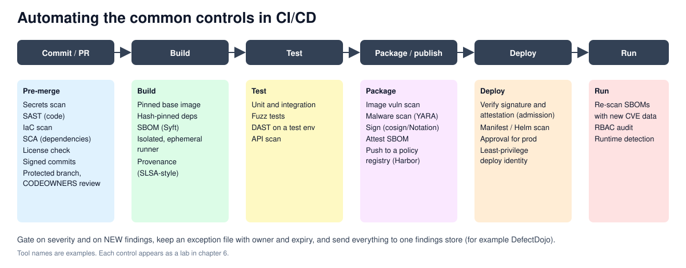

# Lesson 06: Automating Common Controls in CI/CD

> **Chapter:** 6 · Common Defenses Against Supply Chain Attacks · **Time:** ~7 hours
> **You will:** place software composition analysis, static analysis (code and IaC), dynamic analysis (apps, APIs, containers, clusters) and fuzzing in a GitLab-style pipeline, gate on the right things, and manage findings and false positives.

| | |
|---|---|
| **Prerequisites** | [Chapter 1 CI/CD](../ch1-introduction-to-supply-chain-security/README.md); lessons [02](02-evaluating-dependencies-before-use.md) and [04](04-asset-inventory-and-sboms.md) of this chapter |
| **Related repo labs** | [CAISP third-party-vulns](../../caisp-course/ch4-ai-attacks-and-defenses-devops/README.md) · [CAISP ai-code-weaknesses](../../caisp-course/ch4-ai-attacks-and-defenses-devops/README.md) · [CMCPSE sast-vulnerable-mcp-server, fuzz-mcp-tools, mcp-cicd-pipeline](../../cmcpse-course/ch5-devsecops-for-mcp-security/README.md) · [06 cicd](../../06-ai-devsecops/cicd/README.md) · [06 terraform](../../06-ai-devsecops/terraform/README.md) · [pentesting track](../../cybersecurity-track/09-pentesting-fundamentals/README.md) |
| **Labs** | [trivy-docker-scan](labs/trivy-docker-scan/README.md) · [snyk-container-scan](labs/snyk-container-scan/README.md) · [trivy-secrets-scan](labs/trivy-secrets-scan/README.md) · [trufflehog-secrets-scan](labs/trufflehog-secrets-scan/README.md) · [kubescape-manifest-scan](labs/kubescape-manifest-scan/README.md) · [kubescape-helm-scan](labs/kubescape-helm-scan/README.md) · [kubiscan-rbac](labs/kubiscan-rbac/README.md) · [sast-in-pipeline](labs/sast-in-pipeline/README.md) · [dast-in-pipeline](labs/dast-in-pipeline/README.md) · [syft-in-cicd](labs/syft-in-cicd/README.md) · [false-positive-analysis](labs/false-positive-analysis/README.md) |
| **Syllabus lines** | Automation of Common Controls in CI/CD · Software Component Analysis of Code, and Containers · Static Security Analysis of Application Code, Infrastructure as Code · Dynamic Security Analysis of Applications, APIs, Containers, and Clusters · Detecting Unexpected Behaviors Through Fuzz Testing |



## 1. Automation of Common Controls in CI/CD

**Principle:** a control that depends on someone remembering to run it will be skipped. Put controls in the pipeline, make them **fast on pull requests** and **thorough on schedule**, and make results **visible and owned**.

### 1.1 A GitLab-style layout

```yaml
# .gitlab-ci.yml (shape only; tool versions pinned by digest in real use)
stages: [pre, build, test, package, deploy]

secrets_scan:        # pre-merge, fast
  stage: pre
  script: [trufflehog git file://. --since-commit HEAD~1 --only-verified]
sca_fs:
  stage: pre
  script: [trivy fs --scanners vuln,license --severity HIGH,CRITICAL --exit-code 1 .]
sast:
  stage: test
  script: [semgrep scan --config auto --error]
iac_scan:
  stage: test
  script: [trivy config --exit-code 1 infra/]
sbom:
  stage: package
  script: [syft dir:. -o cyclonedx-json=sbom.cdx.json]
  artifacts: {paths: [sbom.cdx.json], expire_in: 90 days}
image_scan:
  stage: package
  script: [trivy image --exit-code 1 --severity CRITICAL --ignore-unfixed "$IMAGE"]
sign:
  stage: package
  rules: [{if: '$CI_COMMIT_BRANCH == "main"'}]
  script: [cosign sign --yes "$IMAGE@$DIGEST"]
dast:
  stage: deploy      # against a test environment, never production without approval
  script: [zap-baseline.py -t "$TEST_URL"]
```

Real flags change; this shows **where** each control sits. The runnable twin is [syft-in-cicd](labs/syft-in-cicd/README.md), and [06 cicd](../../06-ai-devsecops/cicd/README.md) lints workflows.

### 1.2 Gating rules that work

- **Block on new, serious findings**; report the rest. Use a **baseline** so legacy issues do not stop every build ([sast-in-pipeline](labs/sast-in-pipeline/README.md) shows baseline diff).
- **Severity plus exploitability.** Combine CVSS with EPSS and the CISA KEV list ([prioritizer](../../cybersecurity-track/08-vulnerability-management/README.md)).
- **Exceptions are data**, not comments: owner, reason, expiry ([false-positive-analysis](labs/false-positive-analysis/README.md)).
- **Speed budget.** If a PR check takes 40 minutes, people bypass it. Scan diffs on PRs, run deep scans nightly.
- **One findings store.** Send all results (SARIF, JSON) to a platform such as DefectDojo for de-duplication and tracking ([real-tools](real-tools/README.md)).
- **Protect the pipeline itself** ([lesson 03](03-change-control-and-licensed-code.md)): a scan that a pull request can disable is not a control.

## 2. Software Component Analysis of Code, and Containers

**SCA** finds known-vulnerable and risky components.

| Target | What is analysed | Tools |
|---|---|---|
| **Code** | lockfiles and manifests (npm, pip, Maven, Go, Cargo) | OSV-Scanner, Trivy fs, Grype, Dependabot/Renovate (updates), Snyk |
| **Containers** | OS packages and app libraries in the image | Trivy image, Grype, Snyk Container, Clair |
| **SBOM** | a stored inventory, re-checked later | Grype/osv-scanner on SBOM, [bomber twin](labs/bomber-sbom-scan/README.md), Dependency-Track |

Also check **licenses** and **malicious packages** here ([lesson 02](02-evaluating-dependencies-before-use.md)). Reduce noise with **reachability** where tools support it, VEX, and base-image upgrades.

**Labs:** [trivy-docker-scan](labs/trivy-docker-scan/README.md), [snyk-container-scan](labs/snyk-container-scan/README.md). Also repo [CAISP third-party-vulns](../../caisp-course/ch4-ai-attacks-and-defenses-devops/README.md).

## 3. Static Security Analysis of Application Code, Infrastructure as Code

### 3.1 Application code (SAST) and secrets

- **SAST** reads source or its AST for dangerous patterns (injection, unsafe deserialization, weak crypto, hard-coded credentials). Tools: Semgrep, CodeQL, Bandit (Python), SpotBugs, gosec, SonarQube.
- **Secrets scanning** in code and **history**: Trivy, TruffleHog (with verification), Gitleaks. Add pre-commit hooks and push protection on the Git host. Labs: [trivy-secrets-scan](labs/trivy-secrets-scan/README.md), [trufflehog-secrets-scan](labs/trufflehog-secrets-scan/README.md).
- **AI-generated code** deserves the same gates ([CAISP ai-code-weaknesses](../../caisp-course/ch4-ai-attacks-and-defenses-devops/README.md)).

Lab: [sast-in-pipeline](labs/sast-in-pipeline/README.md) (AST rules, SARIF-like output, severity gate, baseline).

### 3.2 Infrastructure as Code (IaC), Kubernetes and Helm

IaC scanning catches misconfigurations **before** they exist: public buckets, open security groups, privileged pods. Tools: Trivy config, Checkov, KICS, Kubescape, Conftest/OPA, Kyverno policies (see [06 terraform](../../06-ai-devsecops/terraform/README.md) and [06 kubernetes](../../06-ai-devsecops/kubernetes/README.md)). Render Helm charts first, because the dangerous values are often in `values.yaml`. Labs: [kubescape-manifest-scan](labs/kubescape-manifest-scan/README.md), [kubescape-helm-scan](labs/kubescape-helm-scan/README.md), [kubiscan-rbac](labs/kubiscan-rbac/README.md) (RBAC risk). Chapter 5 labs such as [bucket-misconfig](../ch5-attacking-cloud-supply-chain/labs/bucket-misconfig/README.md) show what these scanners look for.

## 4. Dynamic Security Analysis of Applications, APIs, Containers, and Clusters

**DAST** tests a **running** system from the outside.

| Target | Approach | Tools (examples) |
|---|---|---|
| **Web applications** | crawl and attack a test environment (headers, XSS, injection, exposed files) | OWASP ZAP (baseline and full scans), Nuclei |
| **APIs** | import an OpenAPI/GraphQL schema; test auth, input handling, schema conformance | ZAP API scan, Schemathesis, RESTler, Postman/Newman tests |
| **Containers** | run the image in isolation, observe behavior, scan the running container; runtime detection | Trivy on running images, Falco-style rules ([06 runtime](../../06-ai-devsecops/runtime-security/README.md)) |
| **Clusters** | configuration and compliance of the live cluster | kube-bench (CIS), Kubescape, `trivy k8s` (kube-hunter is no longer actively developed) |

**Rules:** run DAST against **test environments you own** with **written scope**; run authenticated scans with a test account; never run active scans against production or third parties without approval. The lab server is bound to `127.0.0.1` and the scanner has a **scope guard**. Lab: [dast-in-pipeline](labs/dast-in-pipeline/README.md). Manual web techniques: [pentesting fundamentals](../../cybersecurity-track/09-pentesting-fundamentals/README.md).

## 5. Detecting Unexpected Behaviors Through Fuzz Testing

**Fuzzing** feeds a program large amounts of unexpected input to find crashes, hangs and memory-safety bugs. It finds bugs static tools and unit tests miss, especially in parsers and protocol code.

| Kind | Notes |
|---|---|
| **Coverage-guided fuzzing** | the fuzzer mutates inputs and keeps those that reach new code (AFL++, libFuzzer, Go's native fuzzing, Jazzer for JVM, Atheris for Python, cargo-fuzz) |
| **Property-based testing** | random inputs checked against properties (Hypothesis, fast-check); cheaper, not coverage-guided |
| **API / protocol fuzzing** | fuzz request fields and sequences (RESTler, Schemathesis) |
| **Continuous fuzzing** | OSS-Fuzz for open-source projects; ClusterFuzzLite in your CI for short PR runs |

**In CI:** run **short fuzz runs on pull requests** (minutes, with a saved **corpus**) and **long runs nightly**. Turn every crash into a regression test. Scorecard has a Fuzzing check, so fuzzing also helps others trust your project. Repo example for tools and servers: [CMCPSE fuzz-mcp-tools](../../cmcpse-course/ch5-devsecops-for-mcp-security/README.md).

## Defend (summary)

Controls in the pipeline, fast on PRs · block on new serious findings · baselines and expiring exceptions · one findings store · protect the pipeline definition · DAST only on owned test environments · fuzz parsers and treat crashes as tests.

## Hands-on

1. Run the sast-in-pipeline demo; add a new `eval` to the legacy code and watch the gate fail only for the new finding.
2. Run the dast-in-pipeline demo; change the hardened handler so it drops one header and confirm the scanner notices.
3. Sketch the pipeline for a Python service with a Helm chart: list each stage and the lab twin that teaches it.

## Scenarios

- **The security scan takes 35 minutes and developers start merging with "skip CI".** Fix? (Diff scans on PRs, nightly full scans, protected branches that require the fast checks, caching.)
- **A scanner reports 400 findings on first run.** Fix? (Baseline, triage by severity and reachability, suppression file with expiry, fix the top classes in bulk.)

## Interview Q&A

<details><summary>SAST, SCA, DAST, IAST and fuzzing: one line each?</summary>

SAST reads your source. SCA checks your dependencies. DAST attacks the running app from outside. IAST instruments the app during tests. Fuzzing throws malformed input at code to find crashes and unexpected behavior.
</details>

<details><summary>How do you avoid blocking developers on legacy findings?</summary>

Use a baseline: fail only on new findings of high severity, track legacy findings in a backlog with owners and dates.
</details>

<details><summary>Why scan Helm charts after rendering?</summary>

The security-relevant values often come from `values.yaml` and overrides, so only the rendered manifests show what will be applied.
</details>

## References

- OWASP ZAP, Semgrep, CodeQL, Trivy, Grype, OSV-Scanner, Checkov, Kubescape, kube-bench, AFL++, libFuzzer, OSS-Fuzz documentation (verify current pages).
- OWASP DevSecOps Guideline; OWASP Top 10 CI/CD Security Risks.
- Repo: [06 cicd](../../06-ai-devsecops/cicd/README.md), [CAISP chapter 4](../../caisp-course/ch4-ai-attacks-and-defenses-devops/README.md), [CMCPSE chapter 5](../../cmcpse-course/ch5-devsecops-for-mcp-security/README.md).
