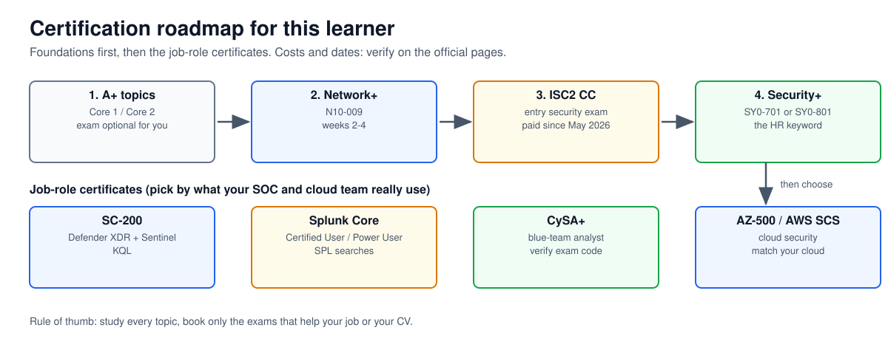

# Certification Roadmap

> **Module:** 00 Career Plan · **Week:** 1 (read now, update every month) · **Time:** ~2 hours to read and plan
> **You will:** know which certificates to study for, in which order, how to study each one, and which track module covers which exam objective.

**All prices, durations, exam codes and dates below are estimates from late 2026. Mark each one "verify" and check the official page before you pay.** Prices change by country and by year.

---

## 1. Why a roadmap

You are an experienced Oracle DBA and DevOps engineer. Your job just changed to cloud security and SOC. Three things are true:

1. You need **real skill** for the job, first.
2. Recruiters and HR filters look for **keywords**: Security+, SC-200, Splunk, CySA+, AZ-500.
3. Exams are **a way to organise learning**, not the goal. You may study a topic and skip the exam.

The order below follows your list, but every step has a "do I need the exam?" answer.

## 2. The order for you

| Step | Certificate | Study the topics? | Take the exam? | Why |
|---|---|---|---|---|
| 1 | CompTIA **A+** (Core 1 220-1201, Core 2 220-1202) | Yes (weeks 1-2) | **Optional, usually skip** | See section 3 |
| 2 | CompTIA **Network+** (N10-009) | Yes (weeks 2-4) | Optional (nice to have) | Networking is vital; the exam is less useful than the skill |
| 3 | **ISC2 CC** (Certified in Cybersecurity) | Yes (weeks 5-8) | Optional | Entry level; now paid; useful as a first security badge |
| 4 | CompTIA **Security+** | Yes (weeks 5-21) | **Yes** | The most common HR keyword for security jobs |
| 5a | **SC-200** (Microsoft Security Operations Analyst) | Yes (weeks 9-14) | **Yes, high priority** if your SOC uses Defender/Sentinel | Direct match for the job |
| 5b | **Splunk** certificate | Yes (week 12) | If your SOC uses Splunk | Skills + keyword |
| 5c | **CySA+** (CompTIA Cybersecurity Analyst) | After the above | Later | Broad SOC analyst credential. Verify the current exam code (it was CS0-003; a newer version may exist) |
| 5d | **AZ-500** *or* **AWS Certified Security - Specialty** | Weeks 15-17 | Pick **one**, matching your employer's cloud | Cloud security job proof |

**A practical tweak:** if your team is already asking for SC-200 skills, do the SC-200 exam *before* ISC2 CC. The job gain is bigger. The 24-week plan keeps your listed order but puts SOC/SIEM learning early, so the skills come before the exams anyway.

## 3. A+: study it, probably skip the exam

**What it covers:** hardware, mobile devices, networking basics, virtualization and cloud, Windows, Linux, macOS, operating system troubleshooting, basic security, scripting and operational procedures.

**Why the exam is optional for you:**

- You already administer servers and Unix systems for years. About two thirds of the content (OS, command line, troubleshooting) is familiar.
- The exam has two parts (Core 1 and Core 2), and two fees (verify; roughly US$250 each, so about US$500 in total).
- Security jobs rarely require A+ for someone with your experience. Security+ and role certs count more.

**Why still study the topics:** hardware, boot, Windows internals (event logs, registry, services), Linux logs and troubleshooting are the daily language of a SOC analyst. Module 01 covers them in two weeks, using the A+ objectives as a map. Read the objective list and mark what you can already do.

**Take the exam if:** an employer or a client requires it, or a voucher is free. Otherwise save the money for Security+ and SC-200.

## 4. Network+ (N10-009)

- **Covers:** networking concepts, implementation, operations, security, troubleshooting.
- **Cost (verify):** about US$390 for one exam. **Time to prepare:** 3-4 weeks for you (module 02) if you add 10-20 practice tests.
- **How to study:** read the official objectives; do module 02 lessons; build subnetting speed with the lab trainer every day for 10 minutes; do Packet Tracer or Wireshark for one evening; take a full practice test and review each wrong answer.
- **Exam?** Optional. The skill is essential, the paper is not. A good plan: take a practice exam in week 4. If you score above 80%, you are ready, and you can decide later.

## 5. ISC2 CC (Certified in Cybersecurity)

- **What:** entry-level security certificate (security principles, business continuity, incident response, access control, network security, security operations).
- **Status (verify):** the free "One Million Certified in Cybersecurity" programme **closed to new participants on 20 May 2026**. The exam is now a paid exam, about US$199, plus an **annual maintenance fee** (verify the amount) and continuing education.
- **Time:** 2-3 weeks on top of module 03, because it overlaps with Security+.
- **Exam?** Optional. It is a cheap first "security" line on the CV and a warm-up for Security+. If you cannot spend the money, go straight to Security+. CC alone rarely opens doors, but helps for HR keywords at entry level.
- **How to study:** the ISC2 official self-paced course (check for access and price), the exam outline, and practice questions. Concept overlap with Security+ is high.

## 6. Security+ (SY0-701 vs SY0-801)

- **What:** the standard first security certificate. Five domains in SY0-701: general security concepts, threats and vulnerabilities, security architecture, security operations, and security programme management and oversight.
- **Versions (verify):**
  - **SY0-701** has been the current exam for the last few years.
  - **SY0-801 (version 8) launched on 17 November 2026.**
  - SY0-701 stays available for a while after that (CompTIA said roughly June 2027; verify the retirement date on the official page).
- **Which to take?** The core ideas (threats, cryptography, IAM, network security, incident response, risk) are the same. The new version changes domain weights and adds or updates topics. Decision rule:
  1. Open both objective lists and compare. Note the new items (module 03 will mark them).
  2. If your exam date will be before the retirement date and you want mature practice materials, SY0-701 is fine.
  3. If you will test close to or after the retirement date, or want the longest-lived credential, study for SY0-801. Expect fewer practice tests right after launch.
  4. Your plan puts the exam at about week 21, which is roughly April 2027 if you start in late 2026 (verify the date against the retirement notice).
- **Cost (verify):** about US$425. **Time:** 8-12 weeks for most beginners. You have a DBA background and 24 weeks of other learning in parallel, so budget 3-4 weeks of focused review at the end.
- **How to study:** the official objectives (the one rule: study the objectives list line by line), one video course, one practice-test bank (do 3-4 full exams), and performance-based question practice (simulations: firewall rules, log reading, matching). The module 03 lessons and labs cover the domains with a SOC view.
- **Exam?** **Yes.** It is the most-requested keyword for security roles and many government-related roles (DoD 8140 listings; verify).

## 7. Job-role certificates

### 7.1 SC-200: Microsoft Security Operations Analyst

- **Covers:** Microsoft Defender XDR, Microsoft Defender for Endpoint, Defender for Cloud, **Microsoft Sentinel** (KQL queries, analytics rules, incidents, hunting, workbooks, automation).
- **Cost (verify):** about US$165, varies by country. **Renewal:** Microsoft role-based certificates are valid for 1 year and renew with a free online assessment (verify the current rule).
- **Time:** 5-6 weeks with the SIEM and EDR modules (06, 07). Needs a **free Microsoft 365 developer or Azure trial** for labs.
- **How to study:** Microsoft Learn learning path for SC-200 (free), the exam skills outline (read it fully), hands-on in a Sentinel trial workspace, practice assessment on Microsoft Learn, and KQL practice daily (10 queries a day).
- **Priority:** high. It is job-direct and builds real skills.

### 7.2 Splunk certificate

- **Covers:** searching and reporting with SPL (Search Processing Language), fields, lookups, dashboards. Entry-level names have been **Splunk Core Certified User** and **Splunk Core Certified Power User**. Splunk has changed its programme before, so **verify the current names and prices** on the Splunk education site.
- **Time:** 2-3 weeks. **How to study:** free Splunk training courses on the Splunk website, **Splunk Free** or a trial instance with sample data, and daily SPL practice. Module 06 covers the ideas.
- **Take it if:** your SOC uses Splunk. If it uses Sentinel only, spend the time on SC-200 first.

### 7.3 CySA+

- **Covers:** security operations, vulnerability management, incident response and reporting. Often compared with blue team analyst roles.
- **Verify the exam code** before booking (CS0-003 was the version in recent years; CompTIA may have a newer one). Cost about US$425 (verify).
- **Time:** 6-8 weeks. Best after Security+ and some real SOC time. **Take it if** a job description or promotion asks for it. Otherwise HTB CDSA or TryHackMe SAL1/SAL2 are practical alternatives that train hands-on skills (see section 9).

### 7.4 Cloud security: AZ-500 or AWS Certified Security - Specialty

- **Pick one** based on your company's main cloud.
- **AZ-500** (Azure Security Engineer): identity, platform protection, data and applications, security operations (verify the exam page; Microsoft updates the skills outline often). About US$165 (verify). Do AZ-900 content first if you are new to Azure.
- **AWS Certified Security - Specialty:** IAM, logging and monitoring, infrastructure security, data protection, incident response. About US$300 (verify). AWS suggests prior experience, and you have DevOps experience.
- **Time:** 6-8 weeks each, with free-tier hands-on. Module 10 is your core.

## 8. How to study each one (the same loop)

1. **Objectives first.** Download the official objectives. Make a checklist. Colour each line red, amber, green.
2. **One main source** (course or book) and the official docs. Avoid collecting ten courses.
3. **Hands-on within 24 hours** of each concept. A free tool, a lab, or the track labs.
4. **Notes in your own words** (short sentences). Make flash cards for ports, event IDs, terms.
5. **Practice questions** weekly from week 3 of the study block. Read *why* the wrong options are wrong.
6. **Full mock exams** in the last 2 weeks (timed). Move to the exam when you score 80-85% consistently (a rule of thumb, not an official figure).
7. **Book the exam date early** (it makes you work), and keep a one-week buffer.

## 9. Which certificate maps to which track module

| Certificate | Track modules | What the module gives you |
|---|---|---|
| A+ | [01 IT fundamentals](../01-it-fundamentals/README.md) | Hardware, OS, Windows, Linux, troubleshooting, virtualization |
| Network+ | [02 Networking](../02-networking/README.md) | OSI, subnetting, ports, DNS, routing, firewalls, wireless, cloud networking |
| ISC2 CC | 03 Security foundations, 04 Risk, 05 SOC fundamentals | Principles, BC/DR, access control, IR, network security |
| Security+ | 03, 04, 05, 08, 09, 10 | All five domains, with labs |
| SC-200 | 05 SOC, 06 SIEM, 07 EDR/XDR | Sentinel, KQL, Defender, incidents, hunting |
| Splunk | 06 SIEM (Splunk part) | SPL, dashboards, alerts |
| CySA+ | 05, 06, 07, 08 | Analyst skills, vulnerability management, IR |
| AZ-500 | 10 Cloud security, 11 Database security | Azure identity, network, data protection, Defender for Cloud |
| AWS Security Specialty | 10 Cloud security | IAM, logging, VPC security, KMS |

**Practice platform alignment (verified Nov 2026):**

- **TryHackMe:** *Cyber Security 101* -> *SOC Level 1* (SAL1 certificate) -> *SOC Level 2* (SAL2).
- **HTB Academy:** *SOC Analyst* job-role path -> **HTB CDSA** certification.
- **HTB Labs:** *Sherlocks* (defensive investigations). LetsDefend content is moving into HTB.

## 10. Budget view (verify everything)

| Item | Estimate (US$) | Priority |
|---|---|---|
| Security+ exam | ~425 | High |
| SC-200 exam | ~165 | High |
| AZ-500 or AWS Security Specialty | ~165 / ~300 | Medium-high |
| Network+ | ~390 | Medium (optional) |
| ISC2 CC | ~199 + annual fee | Low-medium (optional) |
| A+ (two exams) | ~500 | Low (skip) |
| CySA+ | ~425 | Later |
| Splunk Core cert | ~130 | If used at work |
| Practice tests and courses | 100-250 total | Medium |
| TryHackMe / HTB Academy subscriptions | ~10-20 per month each (verify) | Medium |

Ask your employer for a **training budget and exam vouchers**. Many companies pay for role-related certificates, and vendors run discounts and "second chance" offers (verify).

## 11. Common mistakes

- Collecting certificates instead of building skills and a portfolio.
- Studying only for the exam and not doing labs.
- Booking the exam without a date for review time.
- Buying the old version of a course (always check the exam code).
- Ignoring the employer's actual tools. The best cert is the one for the tools you use on Monday.

## 12. Checklist

- [ ] I decided my own order and wrote the target week for each exam.
- [ ] I checked every exam code, price and retirement date on the official pages.
- [ ] I asked my employer about a training budget.
- [ ] I downloaded the official objectives for Network+, Security+ and SC-200.
- [ ] I know what my SOC and cloud team use (Sentinel or Splunk, Azure or AWS).

## 13. Interview questions

<b>Q1. Why did you choose Security+ and SC-200?</b>

Security+ shows broad security knowledge that employers recognise. SC-200 matches the tools of my SOC (Defender and Sentinel). Together they give breadth and job-direct depth.

<b>Q2. Do certificates replace experience?</b>

No. They show structured knowledge. I also build labs and a portfolio, and I bring 10+ years of database and systems experience.

<b>Q3. How do you study for an exam while working full time?</b>

A fixed weekly plan of 10-12 hours, objectives as a checklist, labs for each topic, weekly practice questions, and mock exams in the last two weeks.

<b>Q4. Which certificate would you take after Security+ and why?</b>

It depends on the job. For a Sentinel SOC: SC-200. For Splunk: the Splunk certificate. For cloud security: AZ-500 or AWS Security Specialty.

<b>Q5. What is the difference between Security+ and CySA+?</b>

Security+ is broad and foundational. CySA+ focuses on analyst work: monitoring, vulnerability management, incident response.

<b>Q6. What is a practical alternative to a certificate that proves skill?</b>

Hands-on platforms and labs: TryHackMe SAL1/SAL2, HTB CDSA, a public portfolio of detection rules and write-ups.

<b>Q7. How do you keep certificates valid?</b>

CompTIA: continuing education units or a higher exam (3 years). ISC2: annual fee and CPE credits. Microsoft: free renewal assessment. Verify the current rules for each.

<b>Q8. Why take A+ topics if you skip the exam?</b>

OS, hardware and troubleshooting knowledge is the base for reading alerts. I use it as a map, and spend exam money on Security+.

<b>Q9. SY0-701 or SY0-801?</b>

Core concepts are the same. I compare objectives, and choose by my exam date and the availability of practice material. After the retirement date only SY0-801 is available.

<b>Q10. How do you decide if you are ready for the exam?</b>

Consistent 80-85% on full timed practice exams from different sources, and green on every objective in my checklist.

## 14. References

- CompTIA certifications and exam objectives: https://www.comptia.org/certifications
- ISC2 Certified in Cybersecurity: https://www.isc2.org/certifications/cc
- Microsoft Learn: SC-200, AZ-500 exam pages and free learning paths: https://learn.microsoft.com/credentials/
- AWS Certified Security - Specialty: https://aws.amazon.com/certification/
- Splunk training and certification: https://www.splunk.com/en_us/training.html
- HTB Academy and CDSA: https://academy.hackthebox.com · TryHackMe SOC Level 1 / 2: https://tryhackme.com
- Course-library notes used (paraphrased): Security+ SY0-601 notes (concepts only, old version), SOC Analyst End-to-End (2026)
- Next: [From DBA to security](02-from-dba-to-security.md)
