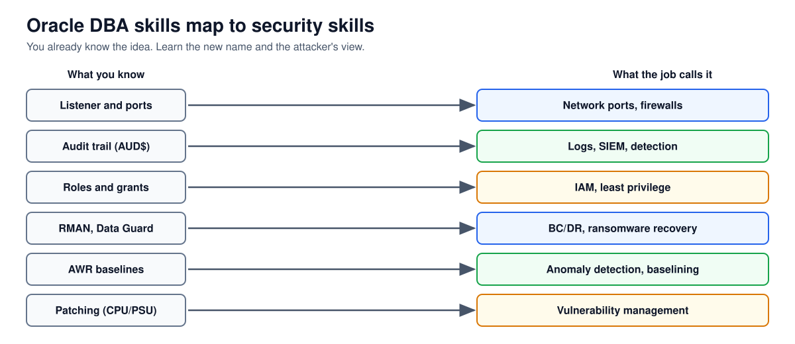

# From Oracle DBA to Security: What Transfers and What Is Missing

> **Module:** 00 Career Plan · **Week:** 1 · **Time:** ~2 hours
> **You will:** see your own skills as security skills, find the real gaps, and tell your story in an interview.

---

## 1. Why this matters

You may feel like a beginner. You are not. You have 10+ years of work with the most security-critical system in a company: **the database**. Attackers want the data. You know where it lives, who can touch it, how it is backed up and how it fails. Security teams often lack that depth. The task is to **translate** your skills and fill a few gaps.



## 2. What transfers (with the new name)

| Your skill | Security name | Where it appears in this track |
|---|---|---|
| Oracle listener, ports, `sqlnet.ora` rules | Network ports, allow lists, firewalls | Module 02 |
| Oracle audit trail, unified auditing, `listener.log` | Logging, SIEM data sources, detection | Modules 05, 06, 11 |
| Users, roles, profiles, grants, least privilege | IAM, RBAC, privilege management | Modules 03, 10, 11 |
| Password profiles, wallets, TDE, encryption | Cryptography, key management, data protection | Modules 03, 11 |
| RMAN backups, Data Guard, RTO/RPO | Business continuity, disaster recovery, ransomware recovery | Modules 03, 04 |
| AWR/ASH baselines, performance anomalies | Baselining, anomaly detection, threat hunting | Modules 05, 06 |
| CPU/PSU patching, change control | Vulnerability and patch management | Module 08 |
| Linux/Unix administration | Host investigation, hardening | Module 01 |
| Shell and SQL scripting | Automation, KQL/SPL queries, SOAR playbooks | Modules 06, 07 |
| CI/CD and DevOps | DevSecOps, secure pipelines, IaC security | Module 10 |
| Cloud (OCI/AWS/Azure) VMs and DB services | Cloud security posture, shared responsibility | Module 10 |
| Incident handling: a production outage at 3 a.m. | Incident response under pressure | Module 05 |
| Working with auditors on SOX/PCI/ISO evidence | GRC, compliance evidence | Module 04 |

**Very strong overlap:** a DBA who can write SQL can learn **KQL** (Sentinel) and **SPL** (Splunk) quickly. Both are query languages over log tables. `SELECT ... WHERE ... GROUP BY` becomes `where ... | summarize ... by ...`.

Example of the same thought in three languages:

```sql
-- SQL: failed logins per user in the last hour
SELECT username, COUNT(*) FROM audit_log
WHERE action = 'LOGON' AND returncode = 1017 AND ts > SYSDATE - 1/24 GROUP BY username;
```

```text
// KQL (Sentinel)
SecurityEvent | where EventID == 4625 and TimeGenerated > ago(1h) | summarize count() by TargetUserName
```

```text
SPL (Splunk)
index=wineventlog EventCode=4625 earliest=-1h | stats count by TargetUserName
```

(Syntax shown for orientation. You will learn the exact forms in module 06.)

## 3. What is missing (the honest gaps)

| Gap | Why it matters | How to close it | Module |
|---|---|---|---|
| **Attacker thinking** (MITRE ATT&CK, kill chain) | SOC alerts are about adversary behaviour | ATT&CK matrices, TryHackMe SOC Level 1 | 05, 09 |
| **Windows and Active Directory** | Most attacks happen there; DBAs often live on Linux/Unix | Module 01 Windows lesson; AD basics in module 03 | 01, 03 |
| **Networking beyond ports** | Packet reading, DNS, VLANs, firewalls | Module 02 | 02 |
| **SIEM/EDR tools** | Daily work in the SOC | Sentinel trial, Splunk Free, Defender | 06, 07 |
| **Cloud IAM and posture management** | Cloud incidents are mostly identity and configuration | AZ-500/AWS paths, free tier labs | 10 |
| **Malware and phishing basics** | Common alert types | Phishing analysis, sandbox basics | 05 |
| **Triage speed and judgement** | SOC means many alerts and few minutes each | Practice rooms, Sherlocks, timed drills | 05, 12 |
| **Communication and reporting** | Tickets, shift handover, executive summaries | Soft skills module | 12 |
| **Security vocabulary** | Interviews and certs use specific words | Key-term tables in each module | all |

## 4. Mindset changes

| DBA mindset | Security mindset |
|---|---|
| "Keep it up and fast" | "Keep it safe, then up and fast" (CIA: confidentiality, integrity, availability) |
| Trust the application tier | Assume any layer can be compromised (zero trust) |
| Fix the root cause once | Detect, contain first, then root cause, with evidence kept |
| Change windows and stability | Emergency changes may be needed to contain a threat |
| One good config is enough | Defence in depth and monitoring of drift |
| Errors are bugs | Some errors are **signals** (ORA-01017 spikes = guessing) |

## 5. Your CV and interview story

**Headline:** "Oracle DBA and DevOps engineer moving into cloud security and SOC. I know where the data lives, who can reach it and how it recovers."

**Strengths to say out loud:**

1. "I have audited database access and investigated odd behaviour, so I can read logs and baselines."
2. "I understand privileges and least privilege in depth, which is the base of IAM."
3. "I have run backup and recovery and planned RTO/RPO, so I understand ransomware impact."
4. "I script and automate, so I can write detections and playbooks."

**How to talk about gaps:** "I am strengthening X with Y (a lab, a certificate, a platform). Here is what I did last week." Always point to **evidence**: a lab repo, a TryHackMe badge, a blog post.

## 6. Hands-on

1. Make your own mapping table with **5 real tasks** from your DBA past (what you did, what a security analyst would call it).
2. Write the SQL and KQL for the same question, "who failed to log in more than 5 times today?". You will learn KQL in module 06, so first write it in SQL only and keep it.
3. Run the module 01 lab and note which output lines you could explain with DBA knowledge.

## 7. Three realistic scenarios

1. **Interview question: "You have no SOC experience. Why should we hire you?"** Answer with the mapping: audit and baselines, privileges, recovery, scripting, plus a lab you built. Show the repo.
2. **A suspicious DBA account.** An analyst alerts on a DBA account logging in at 3 a.m. and exporting a large table. Your DBA view helps: you know a Data Pump export looks like that, and who may run it. You check the change ticket, then the source IP, then the volume. You explain business context to the SOC. That is real value.
3. **Ransomware on file servers.** Leaders ask about recovery. You explain backup immutability, offline copies, RTO/RPO and test restores from your RMAN experience. You become the person who helps with recovery planning.

## 8. Common mistakes

- Hiding your DBA background, as if it were not "real" security. It is a strength.
- Over-claiming SOC experience you do not have.
- Learning tools without learning attacker behaviour.
- Ignoring Windows and Active Directory because "I am a Unix person".
- Studying alone with no hands-on work.

## 9. Interview questions

<details><summary><b>Q1. How does your DBA experience help in security?</b></summary>
I understand data stores, access control, auditing, backups and recovery, performance baselines and scripting. Those map to IAM, logging, BC/DR, anomaly detection and automation.
</details>

<details><summary><b>Q2. What is the difference between a DBA's audit trail and a SIEM?</b></summary>
An audit trail records events in one system. A SIEM collects logs from many systems, normalises, correlates and alerts on them, and keeps them for investigation.
</details>

<details><summary><b>Q3. How would you use baselining from your DBA work in a SOC?</b></summary>
Compare current behaviour to normal: logins per hour, data volume, query patterns, outbound traffic. Large deviations become alerts or hunting leads.
</details>

<details><summary><b>Q4. Which database security controls would you recommend for an Oracle estate?</b></summary>
Least privilege roles, no default accounts, strong password profiles, network encryption and allow lists, TDE for data at rest, unified auditing sent to a SIEM, patching, and tested backups. (Module 11 expands these.)
</details>

<details><summary><b>Q5. What is your biggest gap and how do you close it?</b></summary>
Adversary tradecraft and Windows/AD. I study MITRE ATT&CK, do TryHackMe SOC Level 1 and run Windows event labs weekly.
</details>

<details><summary><b>Q6. Why is a DBA account a high-value target?</b></summary>
It can read and change business-critical data and often has broad privileges and direct access paths. Stealing it can skip application controls.
</details>

<details><summary><b>Q7. How do RTO and RPO relate to ransomware planning?</b></summary>
RTO is how fast you must recover and RPO is how much data loss is acceptable. They set backup frequency, immutability and the restore plan after an attack.
</details>

<details><summary><b>Q8. Scenario: you see a DBA run an unusual export at night. What do you check?</b></summary>
Change ticket or approval, the account's normal pattern, source host and IP, size and destination of the export, and any other signs of compromise (new logons, privilege changes). Then decide to close or escalate.
</details>

<details><summary><b>Q9. How would you move your SQL knowledge to KQL?</b></summary>
The ideas are the same: filter, group, join, sort. KQL uses pipes: `Table | where ... | summarize ... by ...`. I practise with sample logs daily.
</details>

<details><summary><b>Q10. Why do you want to leave pure DBA work?</b></summary>
Security is where my data and operations knowledge has the most impact now, and my company needs it. I want to protect the systems I know best. (Give your own honest reason.)
</details>

## 10. Checklist

- [ ] I wrote my 5-task mapping and can say it aloud in 90 seconds.
- [ ] I listed my top 3 gaps and a plan for each.
- [ ] I updated my CV headline.
- [ ] I did not hide or shrink my DBA background.

## 11. References

- MITRE ATT&CK: https://attack.mitre.org
- NIST Cybersecurity Framework 2.0: https://www.nist.gov/cyberframework
- Oracle Database Security Guide and Unified Auditing documentation (docs.oracle.com)
- Course-library notes: *Database security audit checklist*, *SOC Analyst End-to-End (2026)* (paraphrased)
- Next: [Weekly study system](03-weekly-study-system.md)
