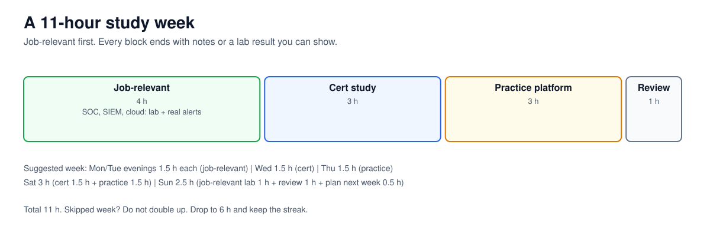

# Weekly Study System (10-12 hours per week)

> **Module:** 00 Career Plan · **Week:** 1 · **Time:** ~1 hour to set up, then every week
> **You will:** run a simple weekly routine that puts the job first, builds certificate knowledge, and keeps a steady practice habit.

---

## 1. The idea

You work full time. You have about 10-12 hours a week. Do not try to do more. A steady 11 hours beats a heroic 25 hours followed by two weeks of rest. The system has four blocks.



| Block | Hours | Goal | Examples |
|---|---|---|---|
| **A. Job-relevant** (SOC, SIEM, cloud) | 4 | Skills you can use on Monday | Read a real alert and explain it; Sentinel/KQL queries; Splunk searches; cloud console review; the track labs |
| **B. Certificate study** | 3 | Objectives and exam knowledge | Lesson reading, a video course, flash cards, 20-30 practice questions |
| **C. Practice platform** | 3 | Hands-on muscle memory | TryHackMe rooms (Cyber Security 101, SOC Level 1), HTB Academy modules, Sherlocks |
| **D. Review and notes** | 1 | Remember and show | Flash cards, journal entry, blog draft, plan next week |

Total 11 hours. Extra week? Add 1 hour to block C.

**Why job-relevant first (block A):** your employer pays for skills you can use now. It also makes learning stick, because you meet the same ideas at work. For example, in week 9 you study Sentinel in the lessons *and* open your company's Sentinel workspace to read three real incidents (read-only, and follow your company's rules).

## 2. A sample week

| Day | Time | Block | Task |
|---|---|---|---|
| Mon | 1.5 h evening | A | Lesson and lab of the week's main module |
| Tue | 1.5 h | A | Apply it to work: one alert, one query, one console review |
| Wed | 1.5 h | B | Certificate objectives: read and write flash cards |
| Thu | 1.5 h | C | One TryHackMe room or HTB module section |
| Fri | rest | | |
| Sat | 3 h (morning) | B 1.5 + C 1.5 | Practice questions, then a bigger lab or room |
| Sun | 2.5 h | A 1 + D 1 + 0.5 plan | Break-it-yourself lab change, notes and journal, next-week plan |

Move blocks around, but protect the four totals. If you can, use the **same times each week**. Habit beats willpower.

## 3. How to run each block

### Block A: job-relevant (4 h)

1. Read the week's lesson (1 h).
2. Run the lab, then **break it on purpose** (1 h). Add one detection or one test.
3. Use it at work (1 h): for example, take one alert type your team sees, and write down what logs prove or disprove it.
4. Write a "what I did" note: 5 lines (1 h with the lab wrap-up on Sunday).

### Block B: certificate study (3 h)

- Use the official **objective list** as the table of contents. After each lesson tick the lines you can explain.
- Flash cards (paper or Anki): ports, event IDs, acronyms, cloud service names.
- Practice questions: start with 10 per week, grow to 30. For each wrong answer write *why* the right one is right.
- In the last 2 weeks before an exam: 2 full timed mock exams.

### Block C: practice platforms (3 h)

| Phase | Platform | What |
|---|---|---|
| Weeks 1-8 | TryHackMe | *Cyber Security 101* path (verified Nov 2026): Linux, Windows, networking, basic security |
| Weeks 8-16 | TryHackMe | *SOC Level 1* path (SAL1 certificate), then *SOC Level 2* later (SAL2) |
| Weeks 9-24 | HTB Academy | *SOC Analyst* job-role path (leads to the HTB CDSA certificate); pick one module at a time |
| Weeks 12-24 | HTB Labs | *Sherlocks* for defensive investigation (LetsDefend content is moving into HTB) |

Rules: finish rooms by *doing*, not by copying walk-throughs. Take notes on each room (3 lines: tool, technique, one lesson). Do not scan or attack anything outside the platforms' own targets.

### Block D: review (1 h)

- 20 minutes: flash cards.
- 20 minutes: the journal (below).
- 20 minutes: plan next week (pick the lesson, the room, the work task).

## 4. Journal and proof of progress

Keep a short weekly note in your repo or notes app:

```text
Week 9 (Nov 2026)
Done: SIEM concepts lesson, 8 KQL queries, TryHackMe "Splunk: Basics" room
Learned: summarize count() by ... is like GROUP BY
Stuck on: join syntax
Work link: read 3 Sentinel incidents; noted 2 false positives
Next week: Sentinel analytics rules + 10 practice questions
Hours: 11 (A4 B3 C3 D1)
```

Use `PROGRESS.md` at the track root to tick off lessons. Turn the best weekly note each month into a **blog post** (module 13). This is your public proof.

## 5. Rules that keep you going

1. **Start small on bad days.** 30 minutes counts. Do the shortest task, not nothing.
2. **Never double up** to catch up. If you miss a week, drop to 6 hours the next week, and move the plan 1 week.
3. **Review often.** Weeks 4, 8, 12, 18, 20 and 24 have a lighter new-content load (see the 24-week plan).
4. **Sleep and breaks first.** Tired learning is slow learning.
5. **Learn in public** (small notes, no secrets). Never publish company data, IPs, ticket numbers or real log lines from work.
6. **Ask for help.** Join a study community or find a mentor in your SOC.
7. **Check your plan monthly.** Is the job asking for something different (new tool, new alert type)? Change block A to match.

## 6. From DBA to security

As a DBA you ran a maintenance calendar: backups daily, statistics weekly, patching quarterly. Treat your study plan the same way: a **fixed schedule**, **tracked metrics** (hours, questions, labs), a **review cycle**, and a **post-incident review** when you fall behind (what blocked me? what will I change?).

## 7. Three realistic scenarios

1. **A busy week at work.** You have only 5 hours. *Do:* keep block A (2 h, as work-linked tasks), cut block C to 1 h, keep 1 h of flash cards and 1 h of D. Next week returns to 11 hours.
2. **Plateau before an exam.** Scores stay at 70% for two weeks. *Do:* sort wrong answers by objective. Study the two weakest objectives with hands-on labs, then retest. Do not take another full test until you fixed those.
3. **Platform fatigue.** You finished 12 rooms and do not remember them. *Do:* stop new rooms for one week. Redo two rooms without hints and write a one-page summary of each.

## 8. Common mistakes

- Planning 20 hours a week and giving up in week 3.
- Watching videos only. Hands-on is half of every block.
- Switching resources every week.
- Doing only the fun block (rooms) and skipping notes and review.
- Ignoring sleep, exercise and family time.

## 9. Interview questions

<details><summary><b>Q1. How do you keep your skills current?</b></summary>
A fixed weekly routine: labs, certificate study, hands-on platforms, and a short review. I follow vendor and ATT&CK updates and write notes in public.
</details>

<details><summary><b>Q2. Tell me about a recent lab you did.</b></summary>
Pick a real one: for example, a log analyzer that detects failed-login bursts and new services. Say the problem, your approach, the result and one thing you improved. Show the repo.
</details>

<details><summary><b>Q3. How do you prioritise learning when many tools exist?</b></summary>
Job needs first (the tools my SOC uses), then foundations that apply everywhere (networking, OS, ATT&CK), then optional tools.
</details>

<details><summary><b>Q4. How do you learn a new query language fast?</b></summary>
Map it to what I know (SQL to KQL/SPL), practise 10 queries a day on sample data, and rewrite real questions in the new language.
</details>

<details><summary><b>Q5. How do you track your progress?</b></summary>
A weekly note, a progress file with ticked lessons, practice-test scores over time, and public write-ups.
</details>

<details><summary><b>Q6. What do you do when you do not understand a topic?</b></summary>
Reduce it to a small lab, read the official documentation, explain it in my own words, ask in a community, and test with a question set.
</details>

<details><summary><b>Q7. Why practise on platforms like TryHackMe and HTB?</b></summary>
They give safe, legal targets and realistic investigations. They build habits for triage and analysis, and give badges and certificates (SAL1/SAL2, CDSA).
</details>

<details><summary><b>Q8. How do you balance work, study and life?</b></summary>
A realistic 11-hour plan, fixed time slots, rest days, and a rule not to double up after missed weeks.
</details>

## 10. Checklist

- [ ] I set my fixed study slots for next week in the calendar.
- [ ] I created the weekly note template.
- [ ] I created accounts on TryHackMe and HTB Academy.
- [ ] I installed a flash-card app or made a paper deck.
- [ ] I know the first week's plan (see the [24-week plan](04-24-week-plan.md)).

## 11. References

- TryHackMe: https://tryhackme.com (paths: Cyber Security 101, SOC Level 1, SOC Level 2)
- Hack The Box Academy: https://academy.hackthebox.com (SOC Analyst job-role path, CDSA)
- Anki (free flash cards): https://apps.ankiweb.net
- Next: [24-week plan](04-24-week-plan.md)
