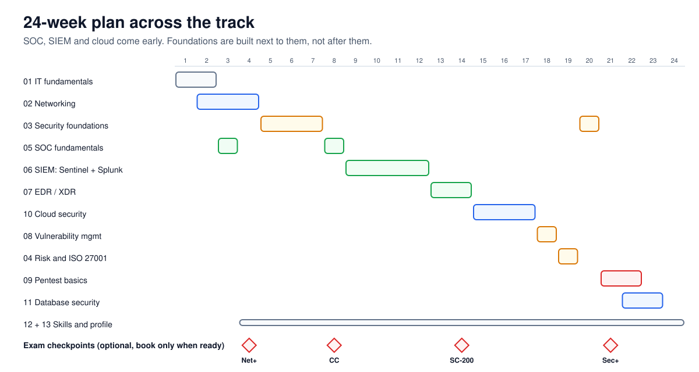

# 24-Week Plan

> **Module:** 00 Career Plan · **Weeks:** 1-24 · **Time:** ~11 hours per week (see the [weekly study system](03-weekly-study-system.md))
> **You will:** follow a week-by-week plan across the whole track, with the job's needs (SOC, SIEM, cloud) first and foundations built next to them.

---

## 1. Design rules

1. **Job first.** SOC alert handling starts in week 3, SIEM in week 9, cloud in week 15. Foundations (A+ and Network+ topics, then Security+) run just before and next to them.
2. **Foundations are short.** You are an experienced DBA, so A+ topics take two weeks and Network+ topics three weeks.
3. **Exams are checkpoints.** Optional exams are marked. The three that matter most: Security+ (week 21), SC-200 (week 14, buffer to 16) and one cloud exam (after week 24; study in weeks 15-17).
4. **Every fourth week is lighter** for review, labs and catch-up.
5. **Each week ends with an artifact**: a lab result, a note, a query, a write-up.
6. The plan assumes starting in late November 2026. If you start later, shift the dates, not the order, and re-check exam versions (especially Security+ SY0-701/801).

## 2. The plan

Hours: A job-relevant 4, B certificate 3, C practice platform 3, D review 1.

| Week | Main module and lessons | Job practice (block A) | Practice platform (block C) | Exam checkpoint / output |
|---|---|---|---|---|
| 1 | **01** hardware and OS basics, Windows for analysts | Read your team's alert list; learn 12 Windows event IDs; run the log lab | THM *Cyber Security 101*: Windows and Linux basics | Baseline of your laptop; weekly note #1 |
| 2 | **01** Linux, virtualization/containers/cloud, troubleshooting; **02** OSI and TCP/IP | Follow one real alert with the six-step method | THM networking basics; Docker lab | A+ topics done (exam optional). Cheat sheet "normal vs suspicious" |
| 3 | **02** IP addressing and subnetting, ports, DNS and DHCP; **05** SOC overview (read the README) | Identify the ports and subnets in your own environment; shadow an analyst for an hour | THM *Network Fundamentals* style rooms | Subnetting: 20 questions at 90% |
| 4 | **02** HTTP/TLS, routing/VLANs, firewalls/NAT/VPN, wireless, cloud networking, packet analysis (lighter week: review) | Read firewall and DNS alerts; run the network lab; Wireshark on your laptop | THM Wireshark rooms | **Network+ practice test** (optional exam). Network detection mini-project |
| 5 | **03** security concepts: CIA, threats, attacks, social engineering | Phishing report handling at work | THM *Cyber Security 101* security basics | Flash cards: 40 terms |
| 6 | **03** cryptography, PKI, IAM and authentication, Active Directory basics | Review your company's MFA and privileged access policy | THM IAM/crypto rooms | Weekly note: IAM in my company |
| 7 | **03** network and application security, vulnerabilities, secure architecture, zero trust | Read your last vulnerability scan report | THM web basics | **CC practice test** |
| 8 | **05** SOC fundamentals: alert triage, tiers, incident lifecycle, playbooks (lighter week: review) | Triage 10 historic alerts using a template | THM *SOC Level 1* start | ISC2 CC exam (optional). Triage template |
| 9 | **06** SIEM concepts, log sources, KQL basics | Open your SIEM read-only; write 10 KQL queries | THM *SOC Level 1*: SIEM rooms | 10 saved queries |
| 10 | **06** Microsoft Sentinel: workspace, connectors, analytics rules | Review 3 existing analytics rules and their false-positive rate | HTB Academy *SOC Analyst* path: first module | One new rule in a trial workspace |
| 11 | **06** Sentinel incidents, hunting, workbooks, automation basics | Tune one noisy rule (with your lead's approval) | THM *SOC Level 1* | Hunting query pack (5 queries) |
| 12 | **06** Splunk: SPL, dashboards, alerts (lighter week: review) | Convert 5 KQL queries to SPL (or the reverse) | HTB *Sherlocks* (easy) | Splunk certificate prep (if used at work) |
| 13 | **07** EDR/XDR: Defender for Endpoint, process trees, isolation, response actions | Read 5 endpoint alerts; practise the investigation steps | THM *SOC Level 1* endpoint rooms | Investigation write-up #1 |
| 14 | SC-200 review and mock exams (**buffer: weeks 15-16 if needed**) | Review gaps | HTB Academy module | **SC-200 exam** (aim week 14, latest week 16) |
| 15 | **10** cloud security basics: shared responsibility, IAM, key services | Review your cloud IAM roles, one subscription/account | THM cloud rooms | Cloud account map |
| 16 | **10** cloud networking security, logging (CloudTrail/Activity Log, flow logs), storage security | Check security groups and public exposure; send findings to the owner | HTB Academy cloud module | Misconfiguration checklist |
| 17 | **10** posture management and detection: Defender for Cloud, GuardDuty/Security Hub; incident response in the cloud | Triage a posture finding end to end | HTB *Sherlocks* (cloud or log-based) | Choose **AZ-500 or AWS Security Specialty** and book a date (after week 24) |
| 18 | **08** vulnerability management: scanning, CVSS v4.0, EPSS, CISA KEV, prioritisation (lighter week) | Rank your last scan's top 10 findings with context | THM vulnerability rooms | Prioritisation sheet |
| 19 | **04** risk management and ISO/IEC 27001; compliance, audits | Join one audit evidence request | THM GRC rooms (if any) | Risk register of 10 items |
| 20 | **03** Security+ review: weak objectives, SY0-701/801 differences | Apply weak topics to work | Practice-exam work | 2 full practice exams |
| 21 | Security+ final prep; **09** pentest basics intro | Light work tasks only | THM *Jr Penetration Tester* style rooms | **Security+ exam** |
| 22 | **09** pentest fundamentals (offline labs); **11** database security start | Run an Oracle security checklist on a test DB | HTB Academy module | Findings report from a lab |
| 23 | **11** database security: auditing to SIEM, encryption, privileges; **13** profile and portfolio | Send Oracle unified audit logs into a SIEM (test) | Sherlocks | Portfolio repo, first blog post |
| 24 | **12** soft skills, **13** interview preparation, next 12-month plan (lighter week: review) | Present one lesson to your team | THM SAL1 attempt (if ready) | CV update, mock interview, plan for cert 5b/5c/5d |

**Soft skills (module 12)** and **profile (module 13)** run lightly from week 4: one report, one note or one blog draft per month.

## 3. Cert timeline at a glance (all dates "verify")

| Exam | Optional? | Target week |
|---|---|---|
| A+ Core 1/2 | Skip unless required | Not planned |
| Network+ | Optional | After week 4 (practice test), exam any time up to week 8 |
| ISC2 CC | Optional | Week 8 |
| **SC-200** | **High priority** | Week 14 (buffer to 16) |
| **Security+** | **Yes** | Week 21 |
| AZ-500 or AWS Security Specialty | Yes, one | Weeks 25-30 (study started in weeks 15-17) |
| Splunk certificate | If your SOC uses Splunk | After week 12 |
| CySA+ | Later | Months 8-12 |

## 4. How to adjust the plan

| Situation | Change |
|---|---|
| Your SOC uses **Splunk** more than Sentinel | Swap weeks 10-11 (Sentinel) with weeks 12 and extra Splunk; skip SC-200 until later, take the Splunk certificate first |
| Your employer is **AWS-first** | In weeks 15-17 use AWS (CloudTrail, GuardDuty, Security Hub) and choose AWS Security Specialty |
| You fall behind | Stretch the plan by one week; never skip block A |
| You are ahead | Add TryHackMe SOC Level 2 rooms, or an extra Sherlocks case each week |
| Security+ SY0-701 retires before your date | Study the SY0-801 objectives from week 20, and book SY0-801 |
| An incident at work takes your time | Count it as block A (real work), write it up, and reduce block C |

## 5. From DBA to security

Your plan mirrors how you would roll out a database platform: first the foundations (OS, network), then the access and audit layer (security foundations), then monitoring (SIEM, EDR), then the cloud estate, then governance. Only the order is bent so that **monitoring comes before governance**, because the job needs monitoring first.

## 6. Three realistic scenarios

1. **Week 9 and a real incident.** The team has a phishing campaign. You pause the lesson, help triage using the six-step method from module 01 and note what KQL you needed. You then write the queries in your lab. The plan stays on track because you counted the hours as block A.
2. **You fail a practice test (60%) in week 20.** Do not panic. Sort wrong answers by objective, spend a week on the two weakest areas with labs, retest, then book the exam. Move the exam by one or two weeks.
3. **A new exam version appears.** In week 20 you see that your resource is for the old version. Download the new objective list, mark what changed, and fill only the differences. Do not restart.

## 7. Common mistakes

- Following the table rigidly when work needs change. Adjust.
- Skipping the lighter review weeks. They make the rest stick.
- Booking too many exams in a row. Space them at least 6-8 weeks apart.
- Leaving portfolio work to the end. Do small public notes from week 4.

## 8. Interview questions

<b>Q1. Describe your learning plan for the next six months.</b>

Weeks 1-8: IT, networking and security foundations. Weeks 8-14: SOC, SIEM (Sentinel/Splunk), EDR, then SC-200. Weeks 15-17: cloud security. Then vulnerability management, risk, Security+, pentest basics, database security and a portfolio.

<b>Q2. Why start SIEM before finishing every foundation?</b>

The job needs it now, and SIEM practice also reinforces networking and OS knowledge through real logs.

<b>Q3. Which exam would you take first and why?</b>

SC-200 (if the SOC uses Sentinel) for job impact, then Security+ for broad recognition.

<b>Q4. How do you decide when a topic is "done"?</b>

I can explain it without notes, I have run a lab or query on it, and I score well on its practice questions.

<b>Q5. How do you handle falling behind?</b>

Drop to a smaller plan for a week, never double up, keep the job-relevant block, and shift the dates.

<b>Q6. What would you show in a portfolio after 24 weeks?</b>

Labs with tests (log and network analyzers), KQL/SPL query packs, an incident write-up, a risk register, an Oracle audit-to-SIEM design and blog posts.

## 9. Checklist

- [ ] I put the 24 weeks in my calendar with real dates.
- [ ] I booked nothing yet, but wrote target weeks for the exams.
- [ ] I read week 1 and prepared the tools (VM, accounts, Python venv).
- [ ] I will review the plan on the first Sunday of every month.

## 10. References

- Module README links: [01](../01-it-fundamentals/README.md), [02](../02-networking/README.md), and the other track modules at the [track README](../README.md)
- Official exam pages (verify codes and dates): https://www.comptia.org/certifications, https://learn.microsoft.com/credentials/
- Progress tracker: [`../PROGRESS.md`](../PROGRESS.md)
