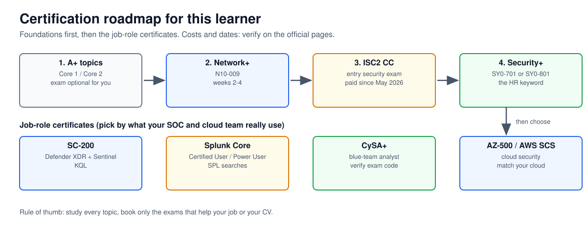

# Module 00: Career Plan and Certifications

> **Week:** 1 (read now, revisit monthly) · **Time:** ~7 hours to read and set up · **Lab:** none. This module has templates and checklists instead.
> **You will:** have a clear certificate order, a map from your Oracle DBA and DevOps skills to security work, a weekly study routine and a 24-week plan.

## Learning path

| # | Document | What you get | Time |
|---|---|---|---|
| 1 | [Certification roadmap](01-certification-roadmap.md) | Order: A+ topics, Network+, ISC2 CC, Security+, then SC-200, Splunk, CySA+, AZ-500 or AWS Security Specialty. Cost and time estimates (all "verify"), study methods, mapping to track modules | 2 h |
| 2 | [From DBA to security](02-from-dba-to-security.md) | What transfers, the real gaps, your interview story | 2 h |
| 3 | [Weekly study system](03-weekly-study-system.md) | An 11-hour week: job-relevant, certificate, practice platform, review | 1 h + weekly |
| 4 | [24-week plan](04-24-week-plan.md) | Week-by-week plan across all track modules | 2 h |



## Key terms

| Term | Short meaning |
|---|---|
| SOC | Security Operations Center: the team that watches, triages and responds to alerts |
| SIEM | Tool that collects and correlates logs and raises alerts (Sentinel, Splunk) |
| EDR / XDR | Endpoint (and cross-domain) detection and response |
| Cloud security | Protecting identities, data and configuration in AWS/Azure/GCP |
| CompTIA A+ / Network+ / Security+ | Foundation certificates for IT, networking, security |
| ISC2 CC | Entry-level security certificate (now a paid exam) |
| SC-200 | Microsoft Security Operations Analyst (Defender XDR, Sentinel, KQL) |
| KQL / SPL | Query languages of Sentinel / Splunk |
| SAL1 / SAL2 | TryHackMe SOC Level 1 / 2 certificates |
| CDSA | HTB Certified Defensive Security Analyst |
| Objectives | The official list of exam topics. Your study checklist |

## How this connects to your job

Your role changed to **cloud security and SOC**. This module answers three questions:

1. **What should I learn first?** The job's needs (SOC, SIEM, cloud), with foundations built in parallel.
2. **Which exams matter?** Security+ for recognition, SC-200 for the job, one cloud exam for cloud security. A+ and Network+ are best studied but optional to sit.
3. **How do I fit it into a normal week?** 10-12 hours with a fixed routine.

## Templates and checklists (instead of a lab)

### Certification tracker (copy into your notes)

| Certificate | Exam code (verify) | Target week | Study start | Objectives green (%) | Practice score | Exam booked? | Cost paid |
|---|---|---|---|---|---|---|---|
| Network+ | N10-009 | 4-8 | | | | | |
| ISC2 CC | CC | 8 | | | | | |
| SC-200 | SC-200 | 14 | | | | | |
| Security+ | SY0-701 or SY0-801 | 21 | | | | | |
| Cloud (AZ-500 / AWS SCS) | | 25+ | | | | | |

### Monthly review checklist

- [ ] Did the job ask for a new tool or alert type? Update block A.
- [ ] Hours per block for the last four weeks: A __ B __ C __ D __
- [ ] Practice-test scores trend (up, flat, down)?
- [ ] New exam versions or price changes? (check official pages)
- [ ] One public note or blog draft written?
- [ ] Next month's plan written?

### Study-week template

```text
Week N   Main module:            Lessons:
A (4h):  ___________________     B (3h): ___________________
C (3h):  ___________________     D (1h): ___________________
Output this week (lab, query, note): ______________________
Blocked by: _____________________  Hours done: ____
```

## Mini-project (2 hours)

Create your **personal plan page**: (1) your target role and date (for example "SOC analyst with cloud focus, 12 months"), (2) the certificate order with target weeks, (3) your weekly time slots in a calendar, (4) the top three gaps from lesson 2 with one action each, (5) a one-paragraph interview story. Save it in your notes or repo and re-read it on the first Sunday of every month.

## Interview questions (module level)

<details><summary><b>Q1. Why are you moving from DBA to security?</b></summary>
Give your honest reason. A strong version: the data I protected is the main target of attackers, and my skills in access control, auditing, backup and scripting fit security. My company's needs changed, and I want to grow where I add value.
</details>

<details><summary><b>Q2. Which certificates do you have or plan?</b></summary>
Security+ for foundations, SC-200 for SOC tools, one cloud security certificate (AZ-500 or AWS Security Specialty). I studied A+ and Network+ topics for the base.
</details>

<details><summary><b>Q3. How do you learn security hands-on?</b></summary>
Lab code with tests, TryHackMe SOC paths, HTB Academy and Sherlocks, a trial Sentinel workspace and Splunk Free. Everything legal and in labs.
</details>

<details><summary><b>Q4. What do you know about the SOC analyst role?</b></summary>
Monitor alerts, triage (true or false positive), investigate with logs and tools, escalate or contain, and document. Tiers: L1 triage, L2 investigation, L3 hunting and engineering.
</details>

<details><summary><b>Q5. Which SOC tools have you used?</b></summary>
Be honest. List what you really used, then what you practised in labs: Sentinel trial, Splunk Free, Sysmon, Wireshark, and the log analyzers you wrote.
</details>

<details><summary><b>Q6. What is your 12-month goal?</b></summary>
Pass Security+ and SC-200, hold a cloud-security certificate, own a set of detections or a cloud review at work, and have a public portfolio.
</details>

<details><summary><b>Q7. How do you stay up to date?</b></summary>
Weekly routine, vendor blogs, MITRE ATT&CK updates, platform labs and notes.
</details>

<details><summary><b>Q8. What are the new items in Security+ SY0-801?</b></summary>
Say only what you verified on the official objectives. A safe approach: "the five domains' core stays; I compared the objective lists and studied the differences." Do not guess details.
</details>

<details><summary><b>Q9. How do you prioritise certificates?</b></summary>
By job impact first, recognition second, cost third.
</details>

<details><summary><b>Q10. What is one thing you built recently?</b></summary>
Describe a lab from this track: for example the log analyzer that finds brute force then success, new users and risky new services, with tests.
</details>

## Practice on TryHackMe / HTB

- **TryHackMe:** *Cyber Security 101* -> *SOC Level 1* (SAL1) -> *SOC Level 2* (SAL2). Verified November 2026.
- **HTB Academy:** *SOC Analyst* job-role path -> **CDSA** certification.
- **HTB Labs:** *Sherlocks*. LetsDefend content is moving into HTB.

## References

- CompTIA: https://www.comptia.org/certifications · ISC2: https://www.isc2.org/certifications/cc
- Microsoft credentials: https://learn.microsoft.com/credentials/ · AWS Certification: https://aws.amazon.com/certification/
- NIST NICE Workforce Framework (roles and skills): https://www.nist.gov/itl/applied-cybersecurity/nice
- Back to the [track README](../README.md) · Next module: [01 IT fundamentals](../01-it-fundamentals/README.md)
