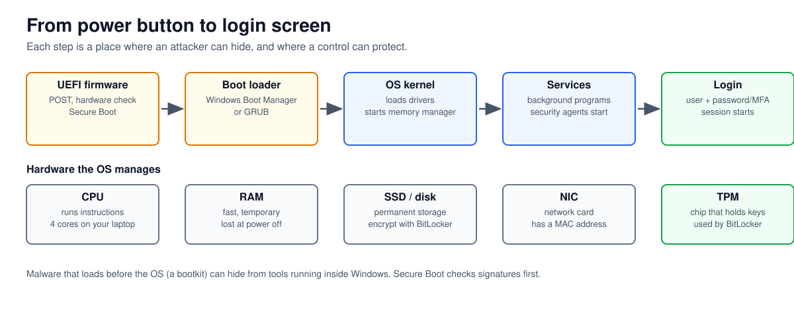

# Lesson 1: Hardware and OS Basics

> **Module:** 01 IT Fundamentals · **Week:** 1 · **Time:** ~4 hours
> **You will:** explain what a computer does from power-on to login, and name the parts an attacker or a defender cares about.
> **Maps to:** CompTIA A+ Core 1 (220-1201) hardware, Core 2 (220-1202) operating systems · Security+ SY0-701/801 domain 3 (security architecture: secure boot, encryption)

*Check the official CompTIA pages for the current objectives before you book an exam.*

---

## 1. Why it matters in a SOC / cloud-security job

- An analyst reads an alert like "process started from a temp folder". You need to know what a process, memory and a disk are to judge it.
- A laptop is stolen. The first question is "was the disk encrypted?" That is a hardware and OS question (TPM, BitLocker).
- A malware report says "persistence through a boot loader". You need to know the boot order to follow it.
- In the cloud, a VM is a computer made of software. The same parts exist (CPU, memory, disk, network card), but you rent them. Sizing, snapshots and disk encryption are the same ideas.

## 2. Understand it

### 2.1 The parts

| Part | What it does | Security angle |
|---|---|---|
| **CPU** (processor) | Runs instructions. Your laptop has 4 cores, so 4 tasks truly run at once. | CPU spikes can mean crypto-mining malware |
| **RAM** (memory) | Fast, temporary storage for running programs. Lost at power off. | Passwords and keys sit in RAM; memory forensics reads it |
| **Storage** (HDD, SSD, NVMe) | Permanent storage for files and the OS. | Encrypt it. Deleted does not mean gone |
| **Motherboard + chipset** | Connects everything | Firmware lives here |
| **NIC** (network card) | Connects to the network. Has a MAC address. | Packet capture, MAC spoofing |
| **TPM** | A small chip that stores keys safely | BitLocker and Windows Hello use it |
| **GPU** | Draws graphics, also fast at maths | Used for password cracking and AI |

**Memory, in one sentence:** the CPU can only work on data that is in RAM, so the OS copies programs from disk to RAM to run them. Hence *"a process is a program that is running in memory"*.

### 2.2 Boot process



1. **UEFI / BIOS firmware** starts first. It does POST (power-on self test), finds the hardware, and picks a boot device. *BIOS* is the old firmware. *UEFI* is the modern one. It supports big disks, a graphical menu and **Secure Boot**.
2. **Boot loader** (Windows Boot Manager, or GRUB on Linux) loads the OS kernel.
3. **Kernel** starts. It loads **drivers** (small programs that let the OS talk to hardware), sets up memory and starts the first process.
4. **Services** start in the background (network, security agent, logging).
5. **Login.** A user session begins.

**Secure Boot** checks that each boot component is signed by a trusted party. It blocks many bootkits (malware that loads before the OS). **Measured boot** with the TPM records what was loaded, so a remote system can check it.

### 2.3 Operating system jobs

| Job | Explanation | Example |
|---|---|---|
| Process management | Starts and stops programs, shares the CPU | Task Manager, `ps` |
| Memory management | Gives each process its own memory space | One program cannot read another's memory by default |
| File system | Organises files, owners and permissions | NTFS, ext4 |
| Device drivers | Talk to hardware | A bad driver can crash or compromise the kernel |
| Security | Users, permissions, logs | Windows security log, `auth.log` |

**User space vs kernel space.** Normal programs run in *user space* with limited rights. The *kernel* has full power. Rootkits try to run in the kernel, so they are hard to see.

### 2.4 File systems and permissions in one table

| | Windows | Linux |
|---|---|---|
| File system | NTFS | ext4, xfs |
| Path | `C:\Users\alice\file.txt` | `/home/alice/file.txt` |
| Admin account | Administrator | root |
| Permissions | ACLs (allow/deny per user or group) | owner / group / other: read, write, execute |
| Encryption | BitLocker, EFS | LUKS, dm-crypt |

### 2.5 Types of OS and devices you will meet

Windows (desktops and servers), Linux (servers, cloud, containers), macOS (laptops), Android and iOS (phones), and embedded systems (printers, cameras, "IoT"). Old, unpatched embedded devices are common weak spots.

## 3. From DBA to security

| You know (Oracle / DevOps) | Same idea in security |
|---|---|
| SGA and PGA memory, `V$SESSION` | Process memory, what is running now |
| Datafiles on ASM or disk, RAID | Storage, encryption at rest, backups |
| Tuning CPU, I/O and memory | Spotting abnormal CPU, disk or memory use (baseline first) |
| Server BIOS settings, firmware patches | Firmware security, Secure Boot |
| Startup order of listener, instance, services | Boot chain and service startup, a persistence location |

**Gap:** you looked at hardware to make things fast. A security analyst looks at the same signals to decide "is this normal?" Start learning the *normal* of your own laptop.

## 4. Hands-on

Free and local. Everything is optional except the lab.

1. **See your own boot and hardware** (PowerShell):
   ```powershell
   Get-CimInstance Win32_Processor | Select Name, NumberOfCores
   Get-CimInstance Win32_ComputerSystem | Select TotalPhysicalMemory
   Get-Disk | Select Number, Size, PartitionStyle     # GPT = UEFI, MBR = legacy BIOS
   Confirm-SecureBootUEFI                              # True / False (needs admin)
   manage-bde -status C:                               # is BitLocker on? (needs admin)
   ```
2. **Make a baseline.** Open Task Manager, write down normal CPU, memory and the 10 biggest processes when your laptop is idle. This is your "AWR snapshot".
3. **Lab:** the log-analyzer lab for this module, see [Lesson 2](02-windows-for-security-analysts.md#4-hands-on).

## 5. Practice platforms

- **TryHackMe:** the *Cyber Security 101* path includes introductory modules on Windows and Linux fundamentals. Search for "Windows Fundamentals" and "Linux Fundamentals".
- **HTB Academy:** search for "Windows Fundamentals" and "Linux Fundamentals" modules (check the current catalogue).
- **Professor Messer** (free videos) and the official CompTIA A+ objectives PDF cover hardware in depth.

## 6. Three realistic scenarios

1. **Stolen laptop.** A salesperson reports a lost laptop. *Investigate:* ask the asset system if BitLocker was on and if the key is escrowed in Entra ID or Active Directory. *Do:* if encrypted, record it as a low-risk loss and rotate sessions and tokens; if not, treat it as a data breach and start the notification process.
2. **Slow server and fans screaming.** A VM runs at 100% CPU. *Investigate:* find the top process, its path, its parent, and when it started. A process called `svchost.exe` in a user folder is wrong. *Do:* isolate the host, collect evidence, then rebuild.
3. **Unexpected USB boot.** A technician boots a server from a USB stick. *Investigate:* check firmware settings, the boot order and whether Secure Boot was disabled. *Do:* lock the firmware with a password, restrict the boot order, and review who had physical access.

## 7. Common mistakes

- Thinking "deleted" means gone. Without encryption or wiping, data is recoverable.
- Confusing RAM and storage. A reboot clears RAM; the disk keeps its data.
- Ignoring firmware updates. Firmware flaws survive OS reinstalls.
- Judging a process only by its name. Check path, parent process and signature.

## 8. Interview questions

<details><summary><b>Q1. What happens when you press the power button?</b></summary>
Firmware (UEFI) runs POST and finds the boot device. The boot loader loads the kernel. The kernel loads drivers and starts services. Then the login screen appears.
</details>

<details><summary><b>Q2. BIOS or UEFI: what is the difference?</b></summary>
UEFI is the modern replacement for BIOS. It supports large disks (GPT), faster boot and Secure Boot. BIOS is legacy and uses MBR.
</details>

<details><summary><b>Q3. What is Secure Boot?</b></summary>
A UEFI feature that only lets signed boot software run. It stops many bootkits and rootkits that start before the OS.
</details>

<details><summary><b>Q4. What does a TPM do?</b></summary>
It stores cryptographic keys in hardware. BitLocker uses it to unlock the disk only if the boot chain is not changed.
</details>

<details><summary><b>Q5. What is the difference between RAM and storage?</b></summary>
RAM is fast, temporary working memory. Storage is slower, permanent. Running programs and their secrets sit in RAM.
</details>

<details><summary><b>Q6. What is a driver and why is it a security risk?</b></summary>
A driver lets the OS use hardware and runs with high privilege. A vulnerable or malicious driver can give an attacker kernel-level control.
</details>

<details><summary><b>Q7. What is the difference between user mode and kernel mode?</b></summary>
User mode programs have limited rights and cannot touch hardware directly. Kernel mode has full access. Attackers want to reach kernel mode.
</details>

<details><summary><b>Q8. A laptop is lost. What do you ask first?</b></summary>
Was the disk encrypted, and is the recovery key safely stored? Also: what data was on it, and is the device managed (can we wipe it remotely)?
</details>

<details><summary><b>Q9. Scenario: a server shows 100% CPU. How do you start?</b></summary>
Identify the process using the CPU. Check its path, owner, parent process, start time and signature. Compare with a baseline. If it looks wrong, isolate and collect evidence.
</details>

<details><summary><b>Q10. Why are firmware updates part of security?</b></summary>
Firmware runs below the OS. A flaw there can survive reinstalling the OS, and security tools inside the OS cannot see it. Patching removes the flaw.
</details>

## 9. Checklist

- [ ] I can list the main hardware parts and say what each stores or does.
- [ ] I can describe the five boot steps.
- [ ] I know what Secure Boot, TPM and BitLocker do.
- [ ] I wrote a baseline (CPU, memory, top processes) for my own laptop.
- [ ] I answered the 10 questions without looking.

## 10. References

- CompTIA A+ exam objectives (220-1201 and 220-1202): https://www.comptia.org/certifications/a
- Microsoft Learn: BitLocker overview, Secure Boot overview (search the title on learn.microsoft.com)
- NIST SP 800-147 BIOS Protection Guidelines: https://csrc.nist.gov/publications
- Next lesson: [Windows for security analysts](02-windows-for-security-analysts.md)
