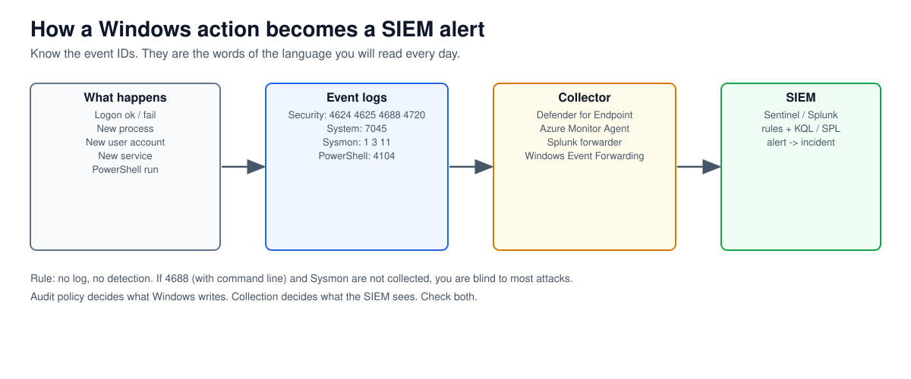

# Lesson 2: Windows for Security Analysts

> **Module:** 01 IT Fundamentals · **Week:** 1 · **Time:** ~6 hours
> **You will:** read Windows processes, services, registry, users and event logs the way a SOC analyst does, and run a lab that finds brute force, new users and new services in synthetic logs.
> **Maps to:** CompTIA A+ Core 2 (220-1202) Windows · Security+ SY0-701/801 log and monitoring objectives · Microsoft SC-200 (Windows events in Defender and Sentinel)

---

## 1. Why it matters in a SOC / cloud-security job

Most company laptops and many servers run Windows. Most alerts you see in a SOC come from Windows endpoints. Examples of what you will triage:

- "Multiple failed logons followed by a success" (event 4625 then 4624).
- "New service installed" (event 7045). Attackers use services to stay on a machine.
- "PowerShell with an encoded command" (event 4688 or Sysmon event 1).
- "A new local administrator account" (event 4720 then 4732).

If you can read these events, you can decide fast if an alert is real.

## 2. Understand it

### 2.1 Processes and services

- A **process** is a running program. Each has a **PID** (process ID), a **parent** (who started it), a **path**, and a **user**.
- A **service** is a process that runs in the background, often at boot, often as `SYSTEM` (the most powerful local account).
- **Normal parent/child pairs** matter. `explorer.exe` starting `winword.exe` is normal. `winword.exe` starting `powershell.exe` is suspicious (a macro may be running).

| Process | Normal location | Red flag |
|---|---|---|
| `svchost.exe` | `C:\Windows\System32` | Runs from a user folder; no `-k` argument |
| `lsass.exe` | `C:\Windows\System32` | Many handles from other tools (credential theft) |
| `explorer.exe` | `C:\Windows` | Wrong path, odd parent |
| `powershell.exe` | `...\WindowsPowerShell\v1.0` | `-enc`, `-nop`, `-w hidden`, started by Office |

### 2.2 The registry

The **registry** is a database of settings. Hives: `HKLM` (machine) and `HKCU` (current user). Attackers use **Run keys** for persistence:

```text
HKCU\Software\Microsoft\Windows\CurrentVersion\Run
HKLM\Software\Microsoft\Windows\CurrentVersion\Run
HKLM\SYSTEM\CurrentControlSet\Services      (services live here)
```

### 2.3 Users, groups and logon types

Local users and groups live on the machine. In a company, **Active Directory** (AD) holds domain users and groups. Key groups: *Administrators*, *Domain Admins*, *Remote Desktop Users*.

**Logon types** (field in 4624/4625):

| Type | Meaning | Note |
|---|---|---|
| 2 | Interactive (keyboard) | Someone at the machine |
| 3 | Network (file share, many tools) | Common for lateral movement |
| 4 | Batch | Scheduled task |
| 5 | Service | Service account |
| 7 | Unlock | |
| 10 | RemoteInteractive (RDP) | Check source IP |

### 2.4 Event logs and the IDs you must know



| Event ID | Log | Meaning | Why you care |
|---|---|---|---|
| **4624** | Security | Successful logon | Who logged in, from where, which type |
| **4625** | Security | Failed logon | Brute force, password spraying |
| **4634 / 4647** | Security | Logoff | Session length |
| **4648** | Security | Logon with explicit credentials | `runas`, lateral movement |
| **4672** | Security | Special privileges assigned | An admin logged in |
| **4688** | Security | Process created | Needs command-line auditing turned on |
| **4697 / 7045** | Security / System | Service installed | Persistence |
| **4698** | Security | Scheduled task created | Persistence |
| **4720** | Security | User account created | Backdoor account |
| **4722 / 4725 / 4726** | Security | Account enabled / disabled / deleted | |
| **4732** | Security | Member added to a local security group | Added to Administrators |
| **4740** | Security | Account locked out | Spraying or a user with an old password |
| **1102** | Security | Audit log cleared | Almost always bad |
| **4104** | PowerShell | Script block logged | See what the script really did |

### 2.5 Sysmon in 5 minutes

**Sysmon** (System Monitor, free from Microsoft Sysinternals) is a driver and service that writes richer events than the default log. You choose what to log with an XML config file. Key events:

| Sysmon ID | Meaning |
|---|---|
| 1 | Process creation, with hashes and the full command line and parent |
| 3 | Network connection by a process |
| 7 | Image (DLL) loaded |
| 11 | File created |
| 13 | Registry value set |
| 22 | DNS query by a process |

Most SIEM detections for endpoints are built on 4688/Sysmon 1, 4624/4625 and 7045.

### 2.6 PowerShell basics for an analyst

```powershell
Get-Process | Sort CPU -desc | Select -First 10 Name, Id, Path     # top CPU processes
Get-Service | Where Status -eq Running                           # running services
Get-LocalUser; Get-LocalGroupMember Administrators               # who is admin?
Get-WinEvent -FilterHashtable @{LogName='Security'; Id=4625} -MaxEvents 20
Get-WinEvent -FilterHashtable @{LogName='System'; Id=7045}       # new services
```

Attackers also use PowerShell, so **PowerShell logging** (script block logging, event 4104) is a core control.

## 3. From DBA to security

| DBA habit | Security version |
|---|---|
| `V$SESSION` shows who is connected | 4624 / `query user` show who is logged on |
| Failed login attempts in the audit trail (ORA-01017) | Event 4625 failures |
| `DBA_USERS`, `DBA_ROLE_PRIVS` review | Local and AD users, admin group membership review |
| `CREATE USER` auditing | Event 4720 (new account) |
| `DBA_SCHEDULER_JOBS` review for odd jobs | Services, scheduled tasks and Run keys |

**Gap:** you audited *inside* the database. Now you audit the *host that runs it*. A DBA with strong audit habits learns this fast.

## 4. Hands-on

### 4.1 The lab (offline, synthetic data)

Folder: [`lab/`](lab/). Files: `sample_data.py` (fake Windows JSON events and a Linux auth.log), `log_analyzer.py` (parsers and detections), `demo.py`, `test_it_fundamentals.py`.

From the repo root:

```bash
.venv/Scripts/python cybersecurity-track/01-it-fundamentals/lab/demo.py
```

Real output:

```text
parsed 25 events (15 windows, 10 linux)

severity  rule                 host                 summary
--------------------------------------------------------------------------------------------------------------
critical  success_after_burst  web01                198.51.100.77 logged in as 'root' right after the burst: assume compromise
critical  success_after_burst  srv01.corp.example   203.0.113.50 logged in as 'administrator' right after the burst: assume compromise
high      failed_login_burst   web01                6 failed logins from 198.51.100.77 in 60s (users tried: admin, oracle, root)
high      failed_login_burst   srv01.corp.example   6 failed logins from 203.0.113.50 in 60s (users tried: admin, administrator, backup)
high      encoded_powershell   srv01.corp.example   PowerShell with encoded command by administrator
high      new_service          srv01.corp.example   service installed: WinUpdateHelper -> C:\Users\Public\updater.exe [risky path]
medium    new_user             web01                account 'support9' created (useradd)
medium    new_user             srv01.corp.example   account 'svc_backup2' created (created_by=administrator)
low       new_service          ws01.corp.example    service installed: ExampleAgent -> C:\Program Files\Example Agent\agent.exe
```

How to read it:

- `failed_login_burst` needs 5 or more failures from one IP within 60 seconds. `bob` on `ws02` made 2 typos, so no alert. This is the false-positive control.
- `success_after_burst` is the dangerous one. It means the password guessing may have worked.
- `new_service`: the one in `C:\Users\Public` is `high`. The one in `Program Files` is only `low`. Path matters.

Run the tests:

```bash
.venv/Scripts/python -m pytest cybersecurity-track/01-it-fundamentals
```

**Break it yourself (predict, then run):** (a) set `threshold=3` in `failed_login_bursts`. Which extra alert appears? (b) Add a 7045 event with `ImagePath` `C:\Windows\Temp\x.exe` to `sample_data.py`. What severity? (c) Add a 4732 handler (member added to Administrators) and a test for it.

### 4.2 Free tools (optional)

- **Event Viewer** (built in): open *Windows Logs > Security* and filter by 4624/4625.
- **Sysmon** with a community config (for example the SwiftOnSecurity config on GitHub): install in a VM only, not your work laptop.
- **Autoruns** (Sysinternals): lists everything that starts at boot. **Process Explorer**: shows the process tree and signatures.
- **Splunk Free** or the **Microsoft Sentinel free trial** to ingest the same events later (module 06).

## 5. Practice platforms

- **TryHackMe:** *Cyber Security 101* (Windows fundamentals, Windows event logs content) and then *SOC Level 1*. Search for rooms on "Windows Event Logs" and "Sysmon".
- **HTB Academy:** the *SOC Analyst* job-role path includes Windows event log and Sysmon material. **HTB Sherlocks** are small defensive investigations to practise on.

## 6. Three realistic scenarios

1. **Brute force then success.** Alert: 40 events 4625 from one external IP, then a 4624 type 3 for `administrator`. *Investigate:* is the IP external? Is RDP or SMB exposed? What did the account do after logon (4688, 7045, 4720)? *Do:* disable and reset the account, block the IP, close the exposed port, hunt for persistence.
2. **New service named like Windows.** Alert: 7045 `WinUpdateHelper` with image in `C:\Users\Public`. *Investigate:* who installed it (the 4697 or the session around it), file hash in a reputation service, the parent process. *Do:* isolate the host, stop and remove the service, collect the file, hunt the hash fleet-wide.
3. **Audit log cleared.** Alert: event 1102 on a server. *Investigate:* who cleared it and what happened just before (other copies of the logs exist in the SIEM). *Do:* treat as hands-on-keyboard attacker activity until proven otherwise. This is why logs are forwarded off the host in real time.

## 7. Common mistakes

- Not turning on command-line capture for 4688, then having no idea what ran.
- Reading only the Security log. Services appear in *System* (7045), PowerShell in its own log.
- Treating every 4625 as an attack. Count them per IP over time, and watch for a following 4624.
- Trusting a process by its name only. Check path, parent, signer and hash.
- Running Sysmon with no tuned config and drowning in noise.

## 8. Interview questions

<details><summary><b>Q1. Which event IDs show successful and failed logons?</b></summary>
4624 is a successful logon and 4625 is a failed logon. Look at the logon type and the source IP.
</details>

<details><summary><b>Q2. What is logon type 10?</b></summary>
RemoteInteractive, so an RDP session. Type 3 is a network logon and type 2 is local keyboard.
</details>

<details><summary><b>Q3. How do you detect persistence by a new service?</b></summary>
Alert on 7045 (System log) and 4697 (Security log), and check the image path, the account and who installed it. Paths in user-writable folders are high risk.
</details>

<details><summary><b>Q4. What is Sysmon and why use it?</b></summary>
A free Microsoft Sysinternals tool that logs process creation (with hashes and parents), network connections, file and registry changes. It gives far more detail than default logs.
</details>

<details><summary><b>Q5. What does event 1102 mean?</b></summary>
The audit (Security) log was cleared. Attackers do this to hide. Treat it as suspicious unless a known admin task explains it.
</details>

<details><summary><b>Q6. Where do attackers hide persistence on Windows?</b></summary>
Run keys in the registry, services, scheduled tasks, startup folders, WMI subscriptions, and new accounts.
</details>

<details><summary><b>Q7. Why is `winword.exe` starting `powershell.exe` suspicious?</b></summary>
Word does not normally launch a shell. It often means a malicious macro or document exploit. Check the command line and what the child did next.
</details>

<details><summary><b>Q8. What is the difference between a user and a service account?</b></summary>
A user account is for a person. A service account is for software, often with no interactive logon. Both need least privilege, and service accounts need strong, rotated secrets.
</details>

<details><summary><b>Q9. Scenario: 200 failed logons from one IP, then one success. What now?</b></summary>
Treat as likely compromise. Confirm the success, check post-logon activity, disable or reset the account, block the IP, and look for the same IP elsewhere.
</details>

<details><summary><b>Q10. How is password spraying different from brute force, in the logs?</b></summary>
Brute force tries many passwords against one account. Spraying tries one or two passwords against many accounts. In the logs: many different user names from one source, few attempts each (watch for 4740 lockouts as well).
</details>

<details><summary><b>Q11. Why forward logs to a SIEM instead of only keeping them on the host?</b></summary>
An attacker with admin rights can clear local logs. A copy in the SIEM survives, and the SIEM can correlate many hosts.
</details>

<details><summary><b>Q12. What does 4672 tell you?</b></summary>
A logon with special privileges (an administrator-type token). It marks admin sessions and is useful for tracking privileged use.
</details>

## 9. Checklist

- [ ] I know 4624, 4625, 4688, 4720, 7045, 1102 by heart.
- [ ] I can open Event Viewer and filter by ID.
- [ ] I ran the lab, read the output, and did one "break it yourself" change.
- [ ] I can explain a normal vs suspicious parent/child process.
- [ ] I answered the questions without looking.

## 10. References

- Microsoft Learn: *Advanced security audit policy settings*, *Windows security events reference*, *Sysmon* (Sysinternals): https://learn.microsoft.com
- MITRE ATT&CK, Persistence tactic (TA0003): https://attack.mitre.org/tactics/TA0003/
- CompTIA A+ objectives: https://www.comptia.org/certifications/a
- Next: [Linux for security analysts](03-linux-for-security-analysts.md)
