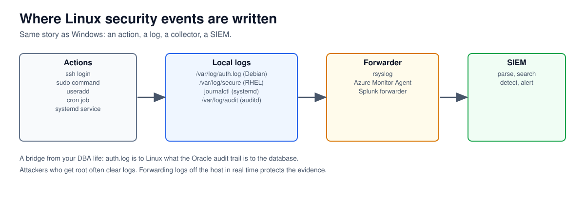

# Lesson 3: Linux for Security Analysts

> **Module:** 01 IT Fundamentals · **Week:** 2 · **Time:** ~5 hours
> **You will:** find your way around a Linux host as an investigator: users, permissions, processes, logs, cron and systemd. You will read an `auth.log` and spot an attack.
> **Maps to:** CompTIA A+ Core 2 (220-1202) Linux basics · Security+ SY0-701/801 hardening and logging · Splunk and Sentinel Linux data sources

---

## 1. Why it matters in a SOC / cloud-security job

Cloud servers, containers, Oracle database hosts and security tools run on Linux. Typical alerts:

- "SSH brute force then successful login" on an internet-facing host.
- "New user created" or "user added to sudo".
- "New cron job in /etc/cron.d" (persistence).
- "Binary run from /tmp".

You are a DBA with Unix skills, so you start ahead. The new part is the *attacker's view*.

## 2. Understand it

### 2.1 Users and permissions

- `/etc/passwd` lists users. `/etc/shadow` holds password hashes (root only). `/etc/group` lists groups.
- **UID 0 = root.** Any account with UID 0 is root, whatever its name. Check: `awk -F: '$3==0' /etc/passwd`.
- **sudo** lets a user run commands as root and logs it. Check `/etc/sudoers` and `/etc/sudoers.d/`.

Permission string `-rwxr-x---`: owner `rwx`, group `r-x`, others none. Numbers: r=4, w=2, x=1, so `750`.

| Risky setting | Why |
|---|---|
| `chmod 777` on a file or folder | Anyone can write |
| SUID bit (`-rwsr-xr-x`) on odd binaries | Runs as the owner (often root); privilege escalation |
| World-readable private keys or `.env` files | Credential theft |
| Empty password, or shared accounts | No accountability |

Find SUID files: `find / -perm -4000 -type f 2>/dev/null`.

### 2.2 Processes

```bash
ps aux --sort=-%cpu | head       # busiest processes
ps -ef --forest                  # parent/child tree
ss -tulpn                        # listening ports and the process behind each (like the Oracle listener view)
lsof -i -P -n | head             # open network files
```

Suspicious: processes running from `/tmp`, `/dev/shm` or a deleted binary, or a `bash -i` with an outbound connection.

### 2.3 Logs



| Location | What it holds |
|---|---|
| `/var/log/auth.log` (Debian, Ubuntu) or `/var/log/secure` (RHEL family) | SSH, sudo, su, useradd, PAM |
| `/var/log/syslog` or `/var/log/messages` | General system messages |
| `/var/log/audit/audit.log` | auditd: file and syscall auditing, if enabled |
| `journalctl` | systemd journal (binary; query with the tool) |
| `/var/log/wtmp`, `btmp`, `lastlog` | Logins (`last`), failed logins (`lastb`) |

Typical `auth.log` lines (these are from the lab sample):

```text
Nov  2 09:00:05 web01 sshd[2101]: Failed password for root from 198.51.100.77 port 50003 ssh2
Nov  2 09:00:14 web01 sshd[2101]: Accepted password for root from 198.51.100.77 port 50007 ssh2
Nov  2 09:01:02 web01 useradd[2150]: new user: name=support9, UID=1005, GID=1005, home=/home/support9, shell=/bin/bash
Nov  2 09:01:20 web01 sudo:     root : TTY=pts/0 ; ... COMMAND=/usr/sbin/usermod -aG sudo support9
```

Read this as a story: guessing, success as root, new user, user given sudo. That is an intrusion.

Useful one-liners:

```bash
grep "Failed password" /var/log/auth.log | awk '{print $(NF-3)}' | sort | uniq -c | sort -rn | head   # top attacking IPs
journalctl -u ssh --since "1 hour ago"
journalctl -p err -b            # errors since boot
last -a | head ; lastb | head
```

### 2.4 Cron and systemd (persistence places)

- **cron** runs jobs on a schedule: `crontab -l`, `/etc/crontab`, `/etc/cron.d/`, `/etc/cron.hourly/`. Attackers add a line that downloads and runs a script.
- **systemd** manages services. Units live in `/etc/systemd/system/` and `/lib/systemd/system/`. List: `systemctl list-units --type=service`. A new unit pointing at `/tmp/x` is a red flag.
- Other places: `~/.ssh/authorized_keys` (an attacker's key), `~/.bashrc`, `/etc/rc.local`, LD_PRELOAD files.

### 2.5 Hardening in short

Use SSH keys, turn off root login and password login, patch regularly, remove unused services, enable auditd, forward logs, and use a host firewall (`ufw`, `firewalld`, `nftables`).

## 3. From DBA to security

| You know | Security use |
|---|---|
| `oracle` OS user, `dba` group, file permissions on datafiles | Least privilege on the OS; who can read datafiles and backups |
| `cron` backup jobs, `systemctl` for listener | Persistence places; same tools, attacker view |
| `tail -f alert.log`, `listener.log` | `tail -f auth.log`, same instinct |
| `netstat -tulpn` to see the listener | `ss -tulpn` to see unexpected listeners |
| `top`, `iostat`, `vmstat` for tuning | Spot miners and abnormal load |

**Gap:** DBAs rarely look at SSH keys, SUID files or other people's cron jobs. Add those to your checklist.

## 4. Hands-on

The same lab as Lesson 2 parses a Linux `auth.log`. Run it (real output in [Lesson 2](02-windows-for-security-analysts.md#4-hands-on)):

```bash
.venv/Scripts/python cybersecurity-track/01-it-fundamentals/lab/demo.py
```

Rows with host `web01` come from the Linux log: a 6-failure burst from `198.51.100.77`, a success as `root` right after it, and a new user `support9`.

**Try in WSL (Ubuntu) or a VM, optional:**

```bash
sudo useradd -m trainee1        # then:
sudo grep useradd /var/log/auth.log | tail -3    # or: journalctl _COMM=useradd
ssh invaliduser@localhost       # fail on purpose, then find it in the log
```

On WSL, `systemd` and `auth.log` may be missing by default. If so, use a small Ubuntu VM or a free cloud trial.

## 5. Practice platforms

- **TryHackMe:** *Cyber Security 101* includes Linux fundamentals. Search for "Linux Fundamentals" and "Linux Privilege Escalation" (the second one is later, in pentest basics).
- **OverTheWire Bandit** (free wargame) builds command-line skill.
- **HTB Academy:** search for the "Linux Fundamentals" module.

## 6. Three realistic scenarios

1. **SSH brute force that worked.** `auth.log` shows 6 failures then `Accepted password for root`. *Investigate:* commands run after login (`history`, auditd, `/var/log/auth.log`), new users, new keys, cron. *Do:* isolate, rotate credentials, rebuild from a known good image, disable root and password SSH.
2. **Crypto-miner.** Cloud VM CPU is at 100%. `ps` shows `./kworker` in `/tmp`. *Investigate:* parent process, network connections (`ss`), the cron entry that restarted it. *Do:* kill, remove persistence, find the entry point (weak password, exposed service), rebuild.
3. **Odd sudoers change.** A file appears in `/etc/sudoers.d/` with `ALL=(ALL) NOPASSWD:ALL` for a service account. *Investigate:* who created it and when (file time, auth.log). *Do:* remove it and review change control and who has root.

## 7. Common mistakes

- Reading only `auth.log` on a host that uses journald only. Know your distribution.
- Forgetting log rotation: older events are in `auth.log.1` and `.gz` files (`zgrep`).
- Using `chmod -R 777` to "fix" a permission issue.
- Not noticing time zones. Logs are often in UTC. Syslog lines have no year.
- Deleting evidence while cleaning up. Copy first, then act.

## 8. Interview questions

<details><summary><b>Q1. Where do you look for SSH logins on Ubuntu and on RHEL?</b></summary>
`/var/log/auth.log` on Ubuntu/Debian and `/var/log/secure` on RHEL family. Also `journalctl -u ssh` (or `sshd`).
</details>

<details><summary><b>Q2. What does permission 750 mean?</b></summary>
Owner read/write/execute (7), group read/execute (5), others nothing (0).
</details>

<details><summary><b>Q3. How do you find accounts with root power?</b></summary>
Look for UID 0 in `/etc/passwd`, and for users in the `sudo` or `wheel` group and entries in `/etc/sudoers` and `/etc/sudoers.d/`.
</details>

<details><summary><b>Q4. What is the SUID bit and why does it matter?</b></summary>
It makes a program run with its owner's rights, often root. A wrong SUID binary can give privilege escalation. Audit with `find / -perm -4000`.
</details>

<details><summary><b>Q5. Name four Linux persistence methods.</b></summary>
Cron jobs, systemd units, SSH `authorized_keys`, shell startup files (`.bashrc`). Also new users and LD_PRELOAD.
</details>

<details><summary><b>Q6. How do you see which process listens on a port?</b></summary>
`ss -tulpn` (or `netstat -tulpn`, `lsof -i`). Compare to what should be running.
</details>

<details><summary><b>Q7. What is journalctl?</b></summary>
The tool to query the systemd journal. Example: `journalctl -u ssh --since yesterday` or `journalctl -p err -b`.
</details>

<details><summary><b>Q8. How would you list the top source IPs of failed SSH logins?</b></summary>
Grep "Failed password" in auth.log, extract the IP field, then `sort | uniq -c | sort -rn`.
</details>

<details><summary><b>Q9. Scenario: root logged in over SSH from an unknown IP at 03:00. Steps?</b></summary>
Check for earlier failures from the same IP, review commands and file changes, look for new users, keys and cron jobs, isolate the host, rotate secrets, and plan a rebuild.
</details>

<details><summary><b>Q10. Why disable SSH password login?</b></summary>
Passwords can be guessed or sprayed. Keys are far harder to brute force. Combine with MFA or a bastion host.
</details>

<details><summary><b>Q11. What is auditd?</b></summary>
The Linux audit framework. It records system calls, file access and changes by rules you set. It is the closest match to an Oracle audit policy at OS level.
</details>

## 9. Checklist

- [ ] I can read an `auth.log` line and name the user, IP and result.
- [ ] I know the five persistence places on Linux.
- [ ] I can use `ss`, `ps`, `journalctl`, `last` and `lastb`.
- [ ] I ran the lab and found the `web01` findings.
- [ ] I answered the questions without looking.

## 10. References

- Ubuntu and RHEL documentation on logging; `man sshd_config`, `man journalctl`
- CIS Benchmarks for Linux: https://www.cisecurity.org/cis-benchmarks
- MITRE ATT&CK Linux techniques: https://attack.mitre.org/matrices/enterprise/linux/
- Next: [Virtualization, containers and cloud](04-virtualization-containers-cloud-basics.md)
