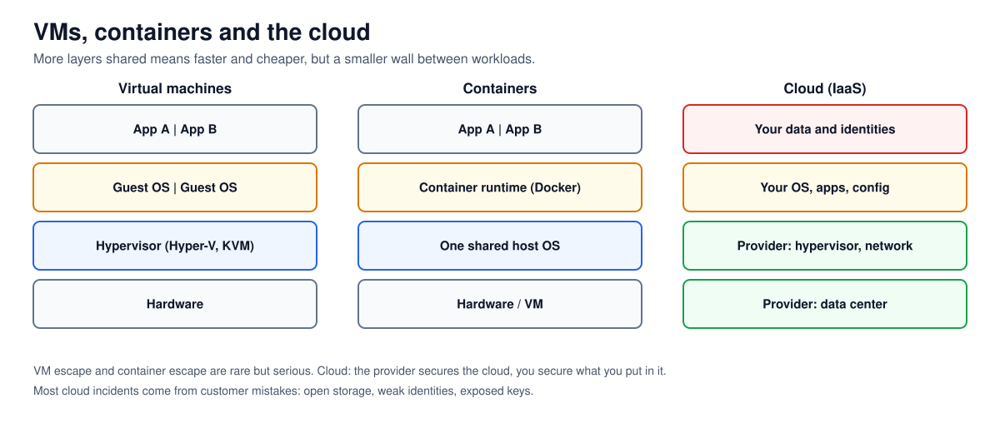

# Lesson 4: Virtualization, Containers and Cloud Basics

> **Module:** 01 IT Fundamentals · **Week:** 2 · **Time:** ~4 hours
> **You will:** tell VMs, containers and cloud services apart, and say who is responsible for which security task.
> **Maps to:** CompTIA A+ Core 1 (220-1201) virtualization and cloud concepts · Security+ SY0-701/801 cloud and virtualization · AZ-500 / AWS Security Specialty (shared responsibility)

---

## 1. Why it matters in a SOC / cloud-security job

Your job is now **cloud security + SOC**. Almost every system you monitor is a VM, a container or a managed service. Typical findings:

- A storage bucket is public by mistake.
- A VM has port 22 open to the whole internet.
- A container image has a known vulnerability or a secret inside.
- A SOC analyst tests malware in a VM, because a VM can be reset in minutes.

## 2. Understand it



### 2.1 Virtual machines

A **hypervisor** shares one physical machine between several **virtual machines** (VMs). Each VM has its own full OS.

- **Type 1** (bare metal): runs directly on hardware. Examples: VMware ESXi, Hyper-V, KVM. Used in data centers and clouds.
- **Type 2** (hosted): runs as an app on your OS. Examples: VirtualBox, VMware Workstation. Good for labs.
- **Snapshot:** a saved state you can return to. Perfect for malware labs and for safe changes.

Security points: VM isolation is strong but not perfect (VM escape is rare). **VM sprawl** (forgotten VMs) is a real risk: they miss patches and nobody watches them.

### 2.2 Containers

A **container** packages an app with its libraries. All containers on a host **share the host kernel**. They start in seconds and use little memory. **Docker** builds and runs them. **Kubernetes** manages many of them.

| | VM | Container |
|---|---|---|
| Isolation | Strong (own OS and kernel) | Lighter (shared kernel) |
| Start time | Minutes | Seconds |
| Size | GBs | MBs |
| Typical risk | Unpatched guest OS | Vulnerable image, secrets in image, running as root, mounting the Docker socket |

Quick container hygiene: use small trusted base images, scan images, run as non-root, do not put secrets in images, use read-only file systems where possible.

### 2.3 Cloud service models and shared responsibility

| Model | You get | Examples | You secure |
|---|---|---|---|
| **IaaS** | Virtual machines, networks, disks | EC2, Azure VMs | OS patches, firewall rules, identities, data |
| **PaaS** | A platform to run code or a database | Azure App Service, RDS, Azure SQL | Identities, data, config, network access |
| **SaaS** | A finished app | Microsoft 365, Salesforce | Users, MFA, data sharing settings |

**Shared responsibility:** the provider secures the cloud (buildings, hardware, hypervisor). **You** secure what you put in it (identities, data, configuration). Most cloud breaches come from the customer side, mostly misconfiguration and weak identity security.

Deployment models: public cloud, private cloud, hybrid (both), multi-cloud (several providers).

### 2.4 Cloud words you must know

| Term | Meaning |
|---|---|
| Region / availability zone | A geographic area / separate data centers inside it |
| Tenant / account / subscription | Your billing and security boundary |
| IAM | Identity and access management: who can do what |
| Object storage | Files in buckets (S3, Azure Blob) |
| Serverless | Run code without managing a server (Lambda, Azure Functions) |
| IaC | Infrastructure as code: Terraform, ARM, CloudFormation |

## 3. From DBA to security

| You know | Security use |
|---|---|
| Oracle on VMware or OCI, snapshots and cloning | Snapshots for forensics and malware labs; evidence preservation |
| DBaaS vs self-managed Oracle | PaaS vs IaaS responsibility split (who patches, who encrypts) |
| Docker / CI/CD from your DevOps work | Image scanning, secrets handling, pipeline security |
| Backups and DR across regions | Cloud resilience, ransomware recovery |

**Gap:** DevOps taught you to deploy fast. Security asks "what is exposed, who can reach it, and who sees the logs?"

## 4. Hands-on

Free, optional, light on a 16 GB laptop:

1. **Docker Desktop (WSL 2):**
   ```bash
   docker run --rm -it alpine:3.20 sh -c "id; hostname; ps"
   docker run --rm -d -p 8080:80 nginx:stable   # then open http://localhost:8080, then: docker ps; docker stop <id>
   ```
   Notice that `id` inside shows root. That is why "run as non-root" is a rule.
2. **A VM:** install VirtualBox or use Hyper-V, create one Ubuntu VM (2 GB RAM, 20 GB disk), take a snapshot, break something, restore.
3. **Cloud:** open a free-tier account (AWS) or an Azure free account **with spending alerts on**. Do not create or deploy anything public yet. Just look at IAM and the network pages. Module 10 covers real work.
4. **Lab:** the module lab in [`lab/`](lab/) parses logs that such hosts produce, see [Lesson 2](02-windows-for-security-analysts.md#4-hands-on).

## 5. Practice platforms

- **TryHackMe:** search for rooms on "Docker" and "Intro to Cloud". The *Cyber Security 101* path has introductory material you can use alongside this lesson.
- **HTB Academy:** search for "Docker" and cloud fundamentals modules. Check the current catalogue for names.
- **Provider free training:** AWS Skill Builder, Microsoft Learn (AZ-900 content for cloud basics).

## 6. Three realistic scenarios

1. **Public bucket.** An alert says a storage account allows anonymous read. *Investigate:* what is inside, access logs, who changed the setting and when. *Do:* block public access, check if data was read by unknown IPs, notify the data owner and the privacy team if personal data is involved.
2. **Container running as root with the Docker socket mounted.** A scan finds this. *Risk:* a break-in to the container gives control of the host. *Do:* change the deployment to non-root and remove the socket mount, then rescan.
3. **Forgotten test VM.** A VM from a project two years ago is internet-facing with old software. *Investigate:* owner tags, last login, outbound traffic. *Do:* snapshot, shut down, delete after owner approval, add a tagging policy.

## 7. Common mistakes

- Thinking "the cloud provider handles security". They handle their part only.
- Putting secrets (keys, passwords) into images, Git or environment files.
- Skipping snapshots before risky changes or malware tests.
- Using the default VPC, default passwords or "allow all" rules to "just make it work".
- Leaving free-trial resources running (cost and exposure).

## 8. Interview questions

<details><summary><b>Q1. Type 1 vs type 2 hypervisor?</b></summary>
Type 1 runs directly on hardware (ESXi, Hyper-V, KVM) and is used in production. Type 2 runs on top of an OS (VirtualBox, Workstation) and is used for desktops and labs.
</details>

<details><summary><b>Q2. VM vs container?</b></summary>
A VM has its own OS and kernel, so isolation is stronger. Containers share the host kernel, so they are lighter and faster but isolation is weaker.
</details>

<details><summary><b>Q3. What is the shared responsibility model?</b></summary>
The provider secures the underlying cloud. The customer secures what they build or store in it. The split changes with IaaS, PaaS and SaaS.
</details>

<details><summary><b>Q4. In IaaS, who patches the OS?</b></summary>
The customer. In PaaS the provider patches the platform; in SaaS the provider does almost everything except your users and data settings.
</details>

<details><summary><b>Q5. Name two container security risks.</b></summary>
Vulnerable or untrusted images, and secrets in images. Also running as root, and exposed management sockets or APIs.
</details>

<details><summary><b>Q6. Why use snapshots in security work?</b></summary>
To return a lab VM to a clean state after malware tests, and to preserve the state of a compromised VM as evidence.
</details>

<details><summary><b>Q7. What is VM sprawl?</b></summary>
Too many VMs created and forgotten. They are often unpatched and unmonitored, so attackers like them.
</details>

<details><summary><b>Q8. What is the most common cause of cloud data breaches?</b></summary>
Customer misconfiguration and weak identity security, such as public storage, over-permissive roles and leaked access keys, more than flaws in the provider's platform.
</details>

<details><summary><b>Q9. Scenario: a developer committed a cloud access key to a public repo. What do you do?</b></summary>
Revoke or rotate the key now. Review cloud logs for use of that key. Remove it from Git history, scan for other secrets, and add secret scanning to the pipeline.
</details>

<details><summary><b>Q10. What does "hybrid cloud" mean?</b></summary>
A mix of on-premises systems and public cloud, connected together. The security team must cover both and the links between them.
</details>

## 9. Checklist

- [ ] I can draw VM, container and cloud stacks and mark who secures each layer.
- [ ] I ran one container and noticed it ran as root.
- [ ] I know IaaS, PaaS, SaaS and an example of each.
- [ ] I answered the questions without looking.

## 10. References

- NIST SP 800-145: *The NIST Definition of Cloud Computing*: https://csrc.nist.gov/publications/detail/sp/800-145/final
- AWS Shared Responsibility Model and Microsoft shared responsibility in the cloud (search on the vendor docs sites)
- CIS Docker Benchmark: https://www.cisecurity.org/benchmark/docker
- Next: [Troubleshooting methodology](05-troubleshooting-methodology.md)
