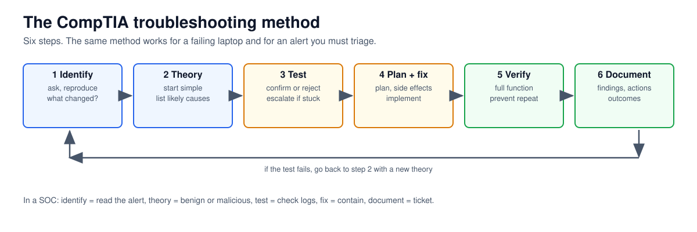

# Lesson 5: Troubleshooting Methodology

> **Module:** 01 IT Fundamentals · **Week:** 2 · **Time:** ~3 hours
> **You will:** use a six-step method to solve any IT problem, and reuse the same steps to triage a security alert.
> **Maps to:** CompTIA A+ Core 1 (220-1201) and Core 2 (220-1202) troubleshooting methodology · NIST SP 800-61 (incident handling steps follow the same logic)

---

## 1. Why it matters in a SOC / cloud-security job

Alerts are problems with unknown causes. A good analyst does not guess. They ask questions, form a theory, test it and write it down. The same method also protects you in an interview: it shows you think in a clear order.

## 2. Understand it



| Step | In IT support | In a SOC alert |
|---|---|---|
| 1. **Identify the problem** | Ask the user, gather info, reproduce, check recent changes, back up first | Read the alert fully. What fired? Which host, user, time? What changed? Is it still happening? |
| 2. **Establish a theory** | Start with the simple causes. Question the obvious | Benign (patching, admin task) or malicious? List both |
| 3. **Test the theory** | Confirm or reject. If rejected, make a new theory or escalate | Check logs, process tree, threat intel, ask the user |
| 4. **Plan and implement the fix** | Plan, think about side effects, get approval, do it | Contain (isolate host, disable account), eradicate, with approval from the incident process |
| 5. **Verify full function** | Test the system, add preventive steps | Is the threat gone? Is the service working? Add a detection or control |
| 6. **Document** | Findings, actions, outcomes | The ticket: timeline, evidence, decision, lessons learned |

Good habits:

- **Change one thing at a time**, so you know what worked.
- **Start simple.** Is it plugged in? Is the service started? Is it DNS?
- **Check what changed recently.** Most problems follow a change.
- **Keep notes while you work**, not after.
- **Escalate** when you reach your limit. It is a skill, not a failure.

Useful network and system "first checks":

```text
ping, tracert/traceroute, nslookup/dig, ipconfig /all or ip a, netstat/ss, Task Manager/top, Event Viewer/journalctl
```

## 3. From DBA to security

You already do this: a slow query or ORA- error is solved by identifying, testing a theory (a bad plan? locks?), fixing and documenting. Add the security question to the theory step: *"Could this be caused by someone, not something?"* A sudden spike in failed logins, a new job or unexpected data export all deserve that question.

## 4. Hands-on

1. Pick a small failure you can create in a VM or on your laptop (disable the network adapter, stop the DNS client service, set a wrong DNS server).
2. Walk through all six steps and write the notes in a text file.
3. Do the same on a security alert. Run the lab (`demo.py`, see [Lesson 2](02-windows-for-security-analysts.md#4-hands-on)), pick the `success_after_burst` row and write a six-step ticket:

```text
1 Identify : critical alert on srv01, 203.0.113.50 logged in as administrator after 6 failures in 15 s
2 Theory   : (a) real attacker guessed the password, (b) admin mistyped many times from a new IP
3 Test     : 4 failures used 'administrator', the others tried 'admin' and 'backup' -> guessing pattern. IP is external.
4 Fix      : disable the account, reset the password, block the IP, collect evidence from srv01
5 Verify   : no new logons from the IP; hunt for 4720/7045 on srv01 (found: svc_backup2, WinUpdateHelper)
6 Document : ticket with timeline, evidence and recommendations (close exposed RDP/SMB, enforce MFA)
```

## 5. Practice platforms

- **TryHackMe:** *SOC Level 1* rooms train this method on real alert types. Start with *Cyber Security 101* if you are new.
- **HTB Sherlocks:** small investigations where you must follow evidence in order.

## 6. Three realistic scenarios

1. **"The internet is down" for one user.** Identify (only one user? only web?), theory (cable, Wi-Fi, DNS), test (`ping 192.0.2.1`, `ping` a public IP, `nslookup`), fix (DNS setting), verify, document.
2. **An application cannot reach the Oracle listener after a firewall change.** Check what changed, test the port from the client (`Test-NetConnection host -Port 1521`), review the firewall log, roll back or add the rule, document.
3. **A phishing report.** Identify (who got it, who clicked), theory (credential theft), test (sign-in logs, mailbox rules), fix (reset password, revoke sessions, remove mails), verify, document.

## 7. Common mistakes

- Jumping to the fix without a theory.
- Changing several things at once, then not knowing what worked.
- Not backing up or taking a snapshot before a change.
- Forgetting to document, then repeating the work next month.
- Closing an alert as "false positive" without writing *why*.

## 8. Interview questions

<details><summary><b>Q1. What are the CompTIA troubleshooting steps?</b></summary>
Identify the problem, establish a theory of probable cause, test the theory, establish a plan of action and implement it, verify full system functionality (and add preventive measures), document findings, actions and outcomes.
</details>

<details><summary><b>Q2. Why start with the simplest cause?</b></summary>
Simple causes are the most common and the fastest to check. It saves time and avoids needless changes.
</details>

<details><summary><b>Q3. What do you do if your theory is wrong?</b></summary>
Make a new theory, or escalate to someone with more knowledge or access.
</details>

<details><summary><b>Q4. Why change only one thing at a time?</b></summary>
So you can tell which change fixed (or broke) the system, and undo it easily.
</details>

<details><summary><b>Q5. Why document?</b></summary>
For the next person, for audit, for repeat problems, and for lessons learned. In security it is also evidence.
</details>

<details><summary><b>Q6. Scenario: a user says "my PC is slow". First steps?</b></summary>
Ask when it started and what changed. Check CPU, memory, disk and network in Task Manager. Look at top processes and recent installs. Also ask, "could this be malware?" and check the process paths.
</details>

<details><summary><b>Q7. How is alert triage like troubleshooting?</b></summary>
Same loop: identify the alert facts, theorise benign vs malicious, test with logs, act (contain), verify, document.
</details>

<details><summary><b>Q8. What does "identify the problem" include before you touch anything?</b></summary>
Gather information, question users, identify symptoms, check what changed, replicate the problem if possible, and back up before changes.
</details>

<details><summary><b>Q9. Scenario: you cannot reach a server by name, but you can by IP. Theory?</b></summary>
Likely a DNS problem. Test with `nslookup`, check the configured DNS server and the DNS record. If DNS logs show odd behaviour, consider DNS tampering.
</details>

<details><summary><b>Q10. When should you escalate?</b></summary>
When the issue is beyond your access or skill, when it affects many users, when you suspect a security incident, or when your time limit (SLA) is near.
</details>

## 9. Checklist

- [ ] I can recite the six steps.
- [ ] I solved one practice failure with written notes.
- [ ] I wrote a six-step ticket for a lab alert.
- [ ] I answered the questions without looking.

## 10. References

- CompTIA A+ objectives (troubleshooting methodology): https://www.comptia.org/certifications/a
- NIST SP 800-61 Rev. 3, *Incident Response Recommendations and Considerations for Cybersecurity Risk Management*: https://csrc.nist.gov/publications
- Back to the [module README](README.md)
