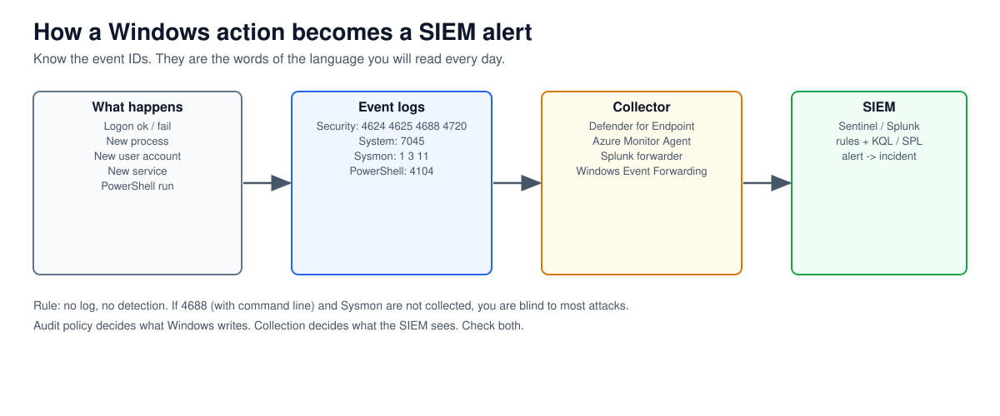

# Module 01: IT Fundamentals (CompTIA A+ level)

> **Weeks:** 1-2 · **Time:** ~22 hours (lessons + lab) · **Level:** beginner, fast for an experienced DBA
> **You will:** learn how computers, Windows, Linux, virtual machines and the cloud work, from a security analyst's point of view, and run a lab that finds attacks in Windows and Linux logs.

## Learning path

| # | Lesson | Week | Certification objective |
|---|---|---|---|
| 1 | [Hardware and OS basics](01-hardware-and-os-basics.md) | 1 | A+ Core 1 hardware; Core 2 OS |
| 2 | [Windows for security analysts](02-windows-for-security-analysts.md) | 1 | A+ Core 2 Windows; SC-200 prerequisites |
| 3 | [Linux for security analysts](03-linux-for-security-analysts.md) | 2 | A+ Core 2 Linux; Security+ hardening |
| 4 | [Virtualization, containers and cloud](04-virtualization-containers-cloud-basics.md) | 2 | A+ Core 1 virtualization/cloud; Security+ cloud |
| 5 | [Troubleshooting methodology](05-troubleshooting-methodology.md) | 2 | A+ troubleshooting steps |
| Lab | [`lab/`](lab/) log analyzer | 1-2 | Windows 4624/4625/4720/7045, Linux auth.log |

*Exam codes and objectives change. Check the official CompTIA page before booking (A+ is Core 1 220-1201 and Core 2 220-1202).*

## Key terms

| Term | Short meaning |
|---|---|
| Process | A running program |
| Service | A background process, often started at boot |
| Kernel | The core of the OS with full power |
| Registry | Windows settings database |
| Event ID | Number that names a type of Windows event |
| Sysmon | Free tool that logs detailed endpoint activity |
| auth.log | Linux log for logins, sudo and user changes |
| Hypervisor | Software that runs virtual machines |
| Container | Packaged app sharing the host kernel |
| Shared responsibility | Provider and customer each secure their own layers |
| Persistence | A way for an attacker to stay after a reboot |
| Baseline | What "normal" looks like |

## How this connects to your job

- SOC alerts in Defender, Sentinel and Splunk are mostly Windows and Linux events. This module teaches the words used in those alerts.
- Cloud-security findings start with VMs, containers and shared responsibility.
- The six-step method gives you a calm way to work every alert.

## Mini-project (3 hours)

Write a one-page **"Normal vs suspicious" cheat sheet** for Windows and Linux. Include 10 normal parent/child process pairs, 10 persistence locations, the 12 event IDs from Lesson 2, and the 10 Linux log commands from Lesson 3. Then run the lab, add one new detection (for example event 4732 "member added to Administrators"), write its test, and put the sheet and the code in your portfolio (module 13).

## Interview questions (module level)

<b>Q1. Explain the difference between a process and a service.</b>

A process is any running program. A service is a process that runs in the background, usually started by the OS at boot and often without a user logged in.

<b>Q2. Which Windows events would you look at to investigate a suspected compromise of a server?</b>

4624/4625 for logons, 4688 (and Sysmon 1) for processes, 7045/4697 for services, 4720/4732 for accounts and groups, 4698 for scheduled tasks, 1102 for log clearing.

<b>Q3. What would you check first on a Linux host that a user says is "hacked"?</b>

Who is logged in (`w`, `last`), listening ports (`ss -tulpn`), top processes (`ps`), new users and sudoers, cron and systemd units, SSH keys, then `auth.log` and journald.

<b>Q4. Why do SOC teams love Sysmon?</b>

It logs process creation with the full command line, hashes and parent, plus network and file events. Default logs often miss this.

<b>Q5. How is a container different from a VM and what is the security trade-off?</b>

Containers share the host kernel, so they are lighter and faster but the isolation is weaker. A kernel flaw or a risky mount can affect the host.

<b>Q6. Who is responsible for patching a VM in the cloud?</b>

The customer, for IaaS. The provider patches the hypervisor and hardware.

<b>Q7. How do your Oracle DBA skills help in a SOC?</b>

Auditing, baselining, user and privilege review, backups and DR, Linux administration. Those map to logs, anomaly detection, IAM, recovery and host investigation.

<b>Q8. What is the first thing to do when you get an unclear alert?</b>

Read it fully and gather facts: host, user, time, what changed. Then make theories (benign and malicious), test them with logs, and document.

<b>Q9. What is Secure Boot and why does it matter?</b>

It allows only signed boot software to run. It stops many malware types that load before the OS and hide from security tools.

<b>Q10. Why must logs leave the host quickly?</b>

Attackers with admin rights clear local logs. A forwarded copy in the SIEM keeps evidence and enables correlation.

## Practice on TryHackMe / HTB

- **TryHackMe:** *Cyber Security 101* path (Windows and Linux fundamentals first), then *SOC Level 1*. Certification: SAL1 after SOC Level 1.
- **HTB Academy:** *SOC Analyst* job-role path, which leads to the HTB CDSA certification. Search the catalogue for Windows and Linux fundamentals modules.
- **HTB Labs:** *Sherlocks* (defensive investigations). LetsDefend content is moving into HTB.

## References

- CompTIA A+: https://www.comptia.org/certifications/a
- Microsoft Learn (Windows security auditing, Sysmon): https://learn.microsoft.com
- MITRE ATT&CK: https://attack.mitre.org
- Back to the [track README](../README.md) · Next module: [02 Networking](../02-networking/README.md)
