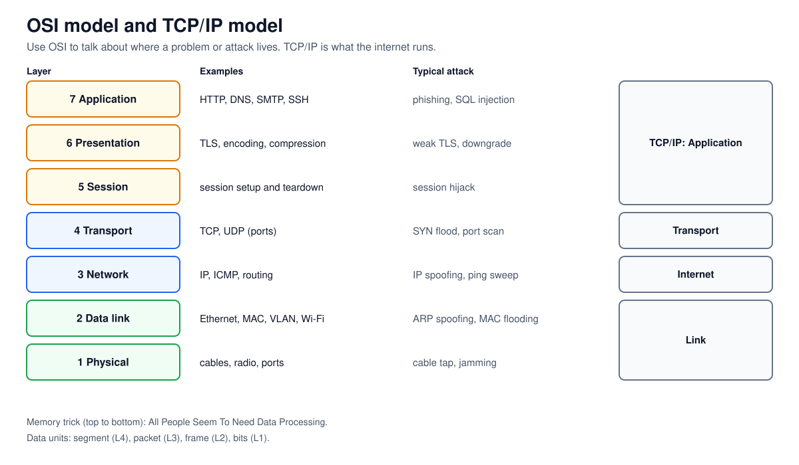

# Lesson 1: OSI and TCP/IP

> **Module:** 02 Networking · **Week:** 2 · **Time:** ~3 hours
> **You will:** use the OSI and TCP/IP models to say where a problem or an attack lives, and follow one web request from your browser to a server.
> **Maps to:** CompTIA Network+ N10-009 domain 1 (networking concepts) · Security+ SY0-701/801 (network concepts in domain 3)

*Check the official CompTIA page for the current Network+ objectives before booking.*

---

## 1. Why it matters in a SOC / cloud-security job

When an alert says "SYN flood", "ARP spoofing" or "TLS downgrade", the name already tells you the layer. Layers also tell you which tool sees the problem: a firewall sees layers 3 and 4, a web application firewall sees layer 7, a switch sees layer 2. Interviewers ask about OSI in almost every entry-level security interview.

## 2. Understand it



### 2.1 The OSI model

| Layer | Name | Data unit | Job | Examples | Device |
|---|---|---|---|---|---|
| 7 | Application | data | What the user's program speaks | HTTP, DNS, SMTP, SSH, SMB | WAF, proxy |
| 6 | Presentation | data | Format, encryption, compression | TLS, JSON, JPEG | |
| 5 | Session | data | Start, keep and end conversations | RPC, NetBIOS sessions | |
| 4 | Transport | segment (TCP) / datagram (UDP) | End-to-end delivery, ports | TCP, UDP | Stateful firewall |
| 3 | Network | packet | Addressing and routing between networks | IP, ICMP | Router, L3 switch |
| 2 | Data link | frame | Delivery on the local network, MAC addresses | Ethernet, Wi-Fi, ARP, VLAN | Switch |
| 1 | Physical | bits | Signals on cable or radio | Copper, fibre, radio | Hub, cables, access point |

Memory trick, top to bottom: **A**ll **P**eople **S**eem **T**o **N**eed **D**ata **P**rocessing.

### 2.2 TCP/IP model (what the internet really uses)

| TCP/IP layer | Covers OSI | Examples |
|---|---|---|
| Application | 5-7 | HTTP, DNS, SSH |
| Transport | 4 | TCP, UDP |
| Internet | 3 | IP, ICMP |
| Link (network access) | 1-2 | Ethernet, Wi-Fi |

### 2.3 Encapsulation: how data is wrapped

Sending data goes **down** the stack. Each layer adds its own header (and layer 2 adds a trailer):

```text
App data  ->  [TCP header | data]  ->  [IP header | TCP | data]  ->  [Ethernet | IP | TCP | data | FCS]
              segment                  packet                          frame
```

The receiver removes headers going **up**. Security tools read these headers. A firewall reads the IP and TCP headers. A packet analyser shows all of them.

### 2.4 TCP vs UDP

| | TCP | UDP |
|---|---|---|
| Connection | Yes (three-way handshake) | No |
| Reliable and ordered | Yes | No |
| Speed | Slower | Faster |
| Used for | Web, SSH, email, databases | DNS queries, DHCP, streaming, VoIP, NTP |
| Attack examples | SYN flood, port scan | UDP flood, DNS amplification |

TCP handshake: client sends **SYN**, server answers **SYN-ACK**, client sends **ACK**. Teardown uses **FIN** or **RST**. Flags you will meet in logs: SYN, ACK, FIN, RST, PSH.

### 2.5 Addresses at each layer

| Layer | Address | Example | Changes on each hop? |
|---|---|---|---|
| 2 | MAC | `00:1A:2B:3C:4D:5E` | Yes |
| 3 | IP | `192.0.2.10` | No (unless NAT) |
| 4 | Port | `443` | No |

**ARP** (Address Resolution Protocol) maps an IP address to a MAC address on the local network. It has no authentication, so **ARP spoofing** lets an attacker pretend to be the gateway.

### 2.6 One web request, end to end

1. The browser asks DNS for `www.example` (UDP 53).
2. The OS builds a TCP connection to the server IP on port 443 (handshake).
3. TLS runs on top: certificate check, keys agreed (see [Lesson 4](04-dns-dhcp-http-tls.md)).
4. The browser sends `GET /` over HTTP inside the TLS tunnel.
5. Each router on the path looks at the destination IP and forwards the packet. The MAC address is replaced at every hop.

## 3. From DBA to security

| You know | Same idea |
|---|---|
| Oracle Net: client -> listener (port 1521) -> server process | A TCP connection to a port, then application protocol (TNS) on top |
| `tnsping`, `lsnrctl status` | `ping`, `Test-NetConnection -Port`, `nc -vz` |
| TNS listener log shows client IPs | Layer 3/4 source and destination in logs |
| SQL*Net encryption | Layer 6 encryption (TLS) |
| "ORA-12170 connect timeout" | A layer 3/4 problem, often a firewall |

**Gap:** you used the network as a user of it. You now read it as evidence: which layer did the failure or the attack happen in?

## 4. Hands-on

1. In PowerShell: `ipconfig /all` (IP, mask, gateway, DNS, MAC), `arp -a`, `tracert www.example` (use any real site you like), `Test-NetConnection 192.0.2.1 -Port 443`.
2. Optional: install **Wireshark**, capture on your Wi-Fi for 30 seconds, open a web page, and stop. Find one DNS query, one TCP SYN, one TLS "Client Hello". Label each with an OSI layer.
3. Lab: the networking lab starts in [Lesson 2](02-ip-addressing-and-subnetting.md#4-hands-on) (subnetting).

## 5. Practice platforms

- **TryHackMe:** *Cyber Security 101* has networking modules (search "Network Fundamentals", "OSI model", "Packets and Frames"). Then *Wireshark* rooms.
- **HTB Academy:** search for "Network Fundamentals" and "Introduction to Networking".
- **Professor Messer** Network+ videos (free) and Cisco Packet Tracer (free account) for virtual networks.

## 6. Three realistic scenarios

1. **"Cannot connect to the database."** Ping works, port 1521 times out. *Layer:* 4 (or a firewall in between). *Do:* `Test-NetConnection` the port, check the host and network firewall rules, review recent changes.
2. **Users get strange certificate warnings on internal sites.** *Layer:* 6/7 or a man-in-the-middle at layer 2 (ARP spoofing) or an interception proxy. *Investigate:* the certificate issuer, the gateway MAC with `arp -a`, switch logs. *Do:* isolate the switch port, enable dynamic ARP inspection.
3. **SYN flood alert.** Thousands of SYNs, almost no ACKs, one target. *Layer:* 4. *Do:* confirm with a capture or flow logs, enable SYN cookies or rate limiting, use the cloud DDoS service, block abusive sources.

## 7. Common mistakes

- Memorising layers without linking them to real protocols and attacks.
- Saying "a router works at layer 2". It is layer 3 (a layer 3 switch does both).
- Thinking the port number proves the protocol. Any program can use any port.
- Forgetting that MAC addresses only matter on the local network.

## 8. Interview questions

<details><summary><b>Q1. Name the seven OSI layers.</b></summary>
Physical, Data link, Network, Transport, Session, Presentation, Application (bottom to top).
</details>

<details><summary><b>Q2. At which layer do switches, routers and firewalls work?</b></summary>
Switches: layer 2 (MAC). Routers: layer 3 (IP). Stateful firewalls: layers 3 and 4. Next-generation firewalls and WAFs: up to layer 7.
</details>

<details><summary><b>Q3. TCP vs UDP?</b></summary>
TCP is connection-oriented and reliable. UDP is connectionless and faster with no delivery guarantee. DNS queries and VoIP use UDP; web and SSH use TCP.
</details>

<details><summary><b>Q4. Explain the TCP three-way handshake.</b></summary>
SYN from the client, SYN-ACK from the server, ACK from the client. Then data flows.
</details>

<details><summary><b>Q5. What is encapsulation?</b></summary>
Each layer adds its own header around the data from the layer above: segment, packet, frame.
</details>

<details><summary><b>Q6. What is ARP and how can it be abused?</b></summary>
It maps IP to MAC on a LAN. It has no authentication, so an attacker can send fake replies (ARP spoofing) and sit in the middle. Fix with dynamic ARP inspection and segmentation.
</details>

<details><summary><b>Q7. Which layer is a SYN flood? Which is a SQL injection?</b></summary>
SYN flood: layer 4 (transport). SQL injection: layer 7 (application).
</details>

<details><summary><b>Q8. Does the MAC address stay the same across the internet?</b></summary>
No. It changes at every hop. The IP address stays the same end to end (except for NAT).
</details>

<details><summary><b>Q9. Scenario: ping works but the web page does not load. Where do you look?</b></summary>
Ping proves layer 3 works. Check layer 4 (is port 443 open?), the firewall, DNS (does the name resolve?), then TLS and the application.
</details>

<details><summary><b>Q10. Why do security people care about the models?</b></summary>
They give a shared language to say where something broke or was attacked, which tool can see it, and which control fits.
</details>

<details><summary><b>Q11. Which TCP flags mean "connection refused" and "end of connection"?</b></summary>
RST usually means refused or abrupt reset. FIN is a normal close.
</details>

## 9. Checklist

- [ ] I can list the OSI layers and give one protocol and one attack for each.
- [ ] I can draw encapsulation and the TCP handshake.
- [ ] I traced one web request through all layers.
- [ ] I answered the questions without looking.

## 10. References

- CompTIA Network+ objectives: https://www.comptia.org/certifications/network
- RFC 9293 (TCP) and RFC 768 (UDP): https://www.rfc-editor.org
- Next: [IP addressing and subnetting](02-ip-addressing-and-subnetting.md)
