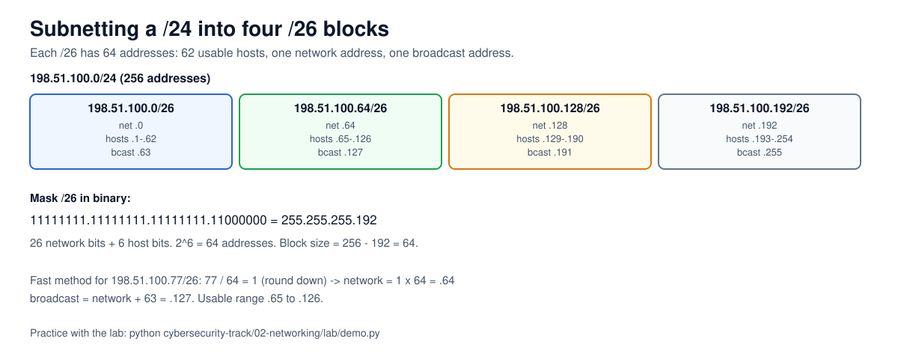

# Lesson 2: IP Addressing and Subnetting

> **Module:** 02 Networking · **Week:** 3 · **Time:** ~6 hours
> **You will:** read a CIDR block, find its network, broadcast and usable range, plan subnets, and recognise private, public and special addresses.
> **Maps to:** CompTIA Network+ N10-009 domain 1 (IP addressing, subnetting) · Security+ SY0-701/801 (segmentation) · AZ-500 / AWS Security Specialty (VPC/VNet design)

---

## 1. Why it matters in a SOC / cloud-security job

Every alert has IP addresses. You must tell in seconds: is it internal or external? Which subnet? Which cloud network? Cloud security also needs subnetting every day: a VPC is a CIDR block, and security group rules say things like `10.0.2.0/24`. A rule with `0.0.0.0/0` means "the whole internet". One wrong prefix opens a database to the world.

## 2. Understand it



### 2.1 IPv4 in one page

- An IPv4 address has 32 bits, written as four numbers (octets) 0 to 255: `192.0.2.10`.
- A **mask** says which bits are the network and which are the host. `/26` means the first 26 bits are the network. `255.255.255.192` is the same thing in dotted form.
- **Network address:** all host bits 0 (cannot be given to a host). **Broadcast address:** all host bits 1. **Usable hosts** = 2^(host bits) - 2.

| Prefix | Mask | Addresses | Usable hosts |
|---|---|---|---|
| /24 | 255.255.255.0 | 256 | 254 |
| /25 | 255.255.255.128 | 128 | 126 |
| /26 | 255.255.255.192 | 64 | 62 |
| /27 | 255.255.255.224 | 32 | 30 |
| /28 | 255.255.255.240 | 16 | 14 |
| /29 | 255.255.255.248 | 8 | 6 |
| /30 | 255.255.255.252 | 4 | 2 |
| /31 | 255.255.255.254 | 2 | 2 (point-to-point links) |
| /32 | 255.255.255.255 | 1 | 1 (a single host) |

Cloud note: AWS and Azure reserve extra addresses in each subnet (AWS reserves 5, Azure reserves 5). Verify in the provider documentation when you size subnets.

### 2.2 The fast method (no binary needed)

1. Find the **block size** = 256 minus the mask's interesting octet. For /26 the octet is 192, so block = 64.
2. The network address is the largest multiple of the block size that is **at or below** the host's number.
3. Broadcast = next network address minus 1.

Example: `198.51.100.77/26`. Block 64. Multiples: 0, 64, 128, 192. 77 is in 64-127. Network `.64`, broadcast `.127`, usable `.65` to `.126`. (The lab trainer prints exactly this.)

### 2.3 Special and private ranges

| Range | Use |
|---|---|
| `10.0.0.0/8`, `172.16.0.0/12` (172.16.0.0-172.31.255.255), `192.168.0.0/16` | **Private** (RFC 1918). Not routed on the internet |
| `127.0.0.0/8` | Loopback (this machine) |
| `169.254.0.0/16` | **APIPA / link-local**: the host failed to get DHCP |
| `100.64.0.0/10` | Carrier-grade NAT (not RFC 1918, not normal public) |
| `192.0.2.0/24`, `198.51.100.0/24`, `203.0.113.0/24` | **Documentation** only. Used in this repo's labs |
| `224.0.0.0/4` | Multicast |

A common trap: `172.32.0.1` is **not** private. The private block ends at 172.31.255.255.

### 2.4 IPv6 quick facts

128-bit addresses in hex, like `2001:db8::1` (`2001:db8::/32` is the documentation range). `::1` is loopback. `fe80::/10` is link-local. `fc00::/7` is unique local (private). No broadcast in IPv6 (multicast is used). Dual-stack hosts run both. Security teams must watch IPv6 too, or attackers use it where only IPv4 is monitored.

### 2.5 VLSM: different sizes inside one block

**Variable-length subnet masking** means giving each segment only what it needs. Plan the biggest first.

Example: from `192.0.2.0/24` you need 100 hosts, 50 hosts, 20 hosts and one link of 2 hosts.

| Need | Prefix | Block |
|---|---|---|
| 100 hosts | /25 | `192.0.2.0/25` |
| 50 hosts | /26 | `192.0.2.128/26` |
| 20 hosts | /27 | `192.0.2.192/27` |
| Link (2 hosts) | /30 | `192.0.2.224/30` |

### 2.6 Security use of subnets

- **Segmentation:** put servers, users and guests in different subnets and limit traffic between them.
- **Rules by CIDR:** firewall and security-group rules use prefixes. Narrow is safer.
- **Triage:** a source IP inside your own ranges at an odd time may be a compromised host; one outside is an internet source.

## 3. From DBA to security

| You know | Same idea |
|---|---|
| `sqlnet.ora` TCP.INVITED_NODES / valid node checking | Allow-lists by IP or CIDR |
| Oracle listener on one NIC or all (`0.0.0.0`) | Binding to `0.0.0.0` means all interfaces and all networks: exposure |
| DB servers in their own VLAN | Segmentation, a subnet per tier |
| Connection from app server IP | Source IP in logs, firewall rules |

## 4. Hands-on

### 4.1 The lab: subnet trainer

File [`lab/subnet_trainer.py`](lab/subnet_trainer.py) builds questions and checks answers with Python's `ipaddress` module. Functions: `subnet_info(cidr)`, `split_subnet(cidr, prefix)`, `smallest_prefix_for_hosts(n)`, `generate_question(rng, kind)`, `check_answer(q, text)`.

```bash
.venv/Scripts/python cybersecurity-track/02-networking/lab/demo.py
```

The first part of the real output is the quiz (seed 42, so you get the same questions):

```text
=== 1. Subnet trainer (seed 42) ===
Q1. How many usable host addresses are in 10.0.0.0/23?
    answer: 510
Q2. What is the network address of 192.0.2.71/30?
    answer: 192.0.2.68
Q3. What is the broadcast address of 192.0.2.36/26?
    answer: 192.0.2.63
Q4. With mask /25, are 203.0.113.223 and 203.0.114.0 in the same subnet? (yes/no)
    answer: no
Q5. What is the longest prefix length that gives at least 120 usable hosts?
    answer: /25
Q6. Is 100.64.1.1 an RFC 1918 private address? (yes/no)
    answer: no

198.51.100.77/26 -> {'network': '198.51.100.64', 'broadcast': '198.51.100.127', 'netmask': '255.255.255.192', 'usable_hosts': 62}
wrong answer check: False
```

**Practice for real:** cover the "answer" lines, solve each question on paper, then check. To get your own quiz, run in a Python shell:

```python
import random, sys
sys.path.insert(0, "cybersecurity-track/02-networking/lab")
import subnet_trainer as st
rng = random.Random()                     # no seed = new questions every time
for _ in range(10):
    q = st.generate_question(rng)
    print(q.prompt)
    print("  correct!" if st.check_answer(q, input("  your answer: ")) else f"  no, it is {q.answer}")
```

### 4.2 Written practice (answers below)

1. Network, broadcast and usable hosts of `192.0.2.130/25`.
2. Same for `203.0.113.45/28`.
3. Same for `198.51.100.200/27`.
4. Mask, network and broadcast for `10.1.2.3/20`.
5. Which smallest subnet holds 50 hosts?
6. Split `192.0.2.0/24` into 8 equal subnets. How many hosts in each?
7. With `/26`, are `192.0.2.62` and `192.0.2.65` in the same subnet?

<details><summary><b>Answers (checked with the lab code)</b></summary>

1. Network `192.0.2.128`, broadcast `192.0.2.255`, 126 hosts (`.129`-`.254`).
2. Network `203.0.113.32`, broadcast `203.0.113.47`, 14 hosts.
3. Network `198.51.100.192`, broadcast `198.51.100.223`, 30 hosts.
4. Mask `255.255.240.0`, network `10.1.0.0`, broadcast `10.1.15.255` (4094 hosts).
5. `/26` (62 hosts). `/27` has only 30.
6. 8 subnets means `/27`. Each has 30 usable hosts: `.0`, `.32`, `.64`, `.96`, `.128`, `.160`, `.192`, `.224`.
7. No. `.62` is in `.0-.63`. `.65` is in `.64-.127`.
</details>

Run the tests: `.venv/Scripts/python -m pytest cybersecurity-track/02-networking` (31 tests for the whole module, all offline).

**Break it yourself:** (a) add a `wildcard` question kind (the inverse mask, used in Cisco ACLs), with a test; (b) what does `subnet_info("192.0.2.0/31")` return and why?

### 4.3 Free tools (optional)

- `ipcalc` (Linux) or any online CIDR calculator, only to *check* your answers.
- **Cisco Packet Tracer** (free account) to build a two-subnet network.

## 5. Practice platforms

- **TryHackMe:** *Cyber Security 101* networking modules; search for "Networking Concepts" and "Subnetting".
- **HTB Academy:** "Introduction to Networking" module covers addressing (check the catalogue).
- Free subnet drills: **subnetting.net**-style trainers and Professor Messer's subnetting videos.

## 6. Three realistic scenarios

1. **Security group too wide.** A cloud scan shows the database SG allows `0.0.0.0/0` on 1521. *Investigate:* VPC flow logs for outside IPs that connected. *Do:* restrict to the app subnet (`10.0.2.0/24`), review access logs, rotate credentials if there was external contact.
2. **Wrong subnet math causes an outage.** Two sites both use `10.0.0.0/24`. VPN traffic fails. *Do:* renumber one site (plan CIDRs centrally to avoid overlap).
3. **Alert from `169.254.x.x`.** A host has an APIPA address. *Meaning:* DHCP failed. Check the DHCP server, the VLAN, and for a rogue DHCP service.

## 7. Common mistakes

- Forgetting the -2 (network and broadcast) for usable hosts.
- Treating `172.32.x.x` as private.
- Using `/24` everywhere. It wastes space and hides segmentation.
- Overlapping CIDRs between clouds and on-premises, which breaks VPN and peering.
- Rules with `0.0.0.0/0` "just for testing", and then they stay.

## 8. Interview questions

<details><summary><b>Q1. How many usable hosts are in a /27?</b></summary>
2^5 = 32 addresses, minus network and broadcast = 30 usable.
</details>

<details><summary><b>Q2. What is the network address of 198.51.100.77/26?</b></summary>
`198.51.100.64`. Block size 64, and 77 lies in 64-127. Broadcast is `.127`.
</details>

<details><summary><b>Q3. Name the RFC 1918 ranges.</b></summary>
`10.0.0.0/8`, `172.16.0.0/12` and `192.168.0.0/16`.
</details>

<details><summary><b>Q4. What does 0.0.0.0/0 mean in a security group?</b></summary>
Any IPv4 address, so the whole internet. For inbound rules it is dangerous on ports like 22, 3389 and database ports.
</details>

<details><summary><b>Q5. What is an APIPA address?</b></summary>
A link-local `169.254.x.x` address a host gives itself when DHCP fails. It signals a DHCP or connectivity problem.
</details>

<details><summary><b>Q6. What is CIDR?</b></summary>
Classless Inter-Domain Routing: writing a network with a prefix length (`/26`) instead of fixed classes A, B and C.
</details>

<details><summary><b>Q7. Why subnet at all?</b></summary>
Less broadcast traffic, easier management, and above all security: separate zones with rules between them.
</details>

<details><summary><b>Q8. What is VLSM?</b></summary>
Using different mask lengths inside one address block, so each subnet is sized to its need.
</details>

<details><summary><b>Q9. Scenario: you see traffic from 10.20.30.40 to an internet IP on port 4444. Is the source internal?</b></summary>
Yes, `10.x.x.x` is private. An internal host connects out to an unusual port, which could be malware calling out. Identify the host and check its processes and DNS history.
</details>

<details><summary><b>Q10. How is IPv6 different for a defender?</b></summary>
Much bigger address space (scanning is harder), no broadcast, link-local addresses everywhere, and often forgotten in monitoring and firewall rules.
</details>

<details><summary><b>Q11. How many addresses does a /22 hold?</b></summary>
2^10 = 1024 addresses, 1022 usable.
</details>

## 9. Checklist

- [ ] I solve a "network/broadcast/hosts" question in under a minute.
- [ ] I know the RFC 1918 ranges and the documentation ranges.
- [ ] I ran the trainer and answered 20 random questions correctly.
- [ ] I can plan a VLSM split on paper.
- [ ] I answered the questions without looking.

## 10. References

- CompTIA Network+ objectives: https://www.comptia.org/certifications/network
- RFC 1918 (private addresses), RFC 4632 (CIDR), RFC 5737 (documentation ranges): https://www.rfc-editor.org
- AWS VPC and Azure VNet documentation on subnet sizing and reserved addresses
- Next: [Ports and protocols](03-ports-and-protocols.md)
