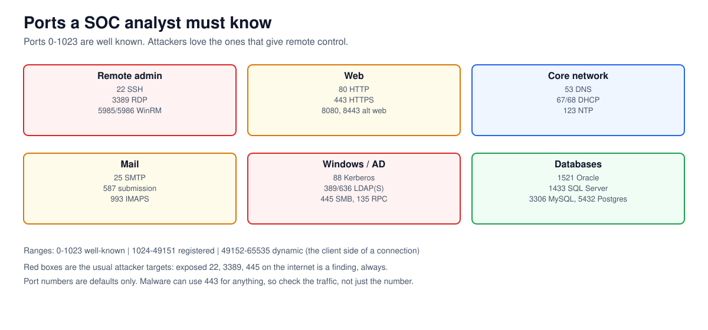

# Lesson 3: Ports and Protocols

> **Module:** 02 Networking · **Week:** 3 · **Time:** ~3 hours
> **You will:** know the ports and protocols that a SOC analyst sees every day, and say if a connection is normal, risky or suspicious.
> **Maps to:** CompTIA Network+ N10-009 domain 1 (ports and protocols) · Security+ SY0-701/801 (secure protocols, objective in domain 4 and 3)

---

## 1. Why it matters in a SOC / cloud-security job

A firewall log line is mostly *source, destination, port, action*. The port is your first clue to the service and the risk. "Allowed inbound 3389 from the internet" is a finding. "Outbound 53 to many random names" is a clue to tunneling. You will use this table every week.

## 2. Understand it



A **port** (0-65535) tells the OS which program should get the traffic. An IP address finds the host. The port finds the application. **Socket** = IP + port. Ranges: 0-1023 well-known, 1024-49151 registered, 49152-65535 dynamic (client side).

### 2.1 Table: ports to know by heart

| Port | Protocol | Transport | Secure? | What it is | SOC note |
|---|---|---|---|---|---|
| 20/21 | FTP | TCP | No | File transfer | Cleartext passwords. Replace with SFTP |
| 22 | SSH / SFTP | TCP | Yes | Remote shell, file copy | Brute force target; also tunnels |
| 23 | Telnet | TCP | No | Old remote shell | Should not exist. Finding if seen |
| 25 | SMTP | TCP | Weak | Mail between servers | Spam, phishing relay |
| 53 | DNS | UDP and TCP | No (use DoT/DoH) | Name lookup | Tunneling, DGA, exfiltration |
| 67/68 | DHCP | UDP | No | Address assignment | Rogue DHCP |
| 69 | TFTP | UDP | No | Simple file transfer (device configs) | Cleartext, no login |
| 80 | HTTP | TCP | No | Web | Cleartext web; web attacks |
| 88 | Kerberos | TCP/UDP | Yes | AD authentication | Kerberoasting, golden ticket |
| 110 / 143 | POP3 / IMAP | TCP | No | Mail download | Cleartext versions |
| 123 | NTP | UDP | No | Time sync | Amplification abuse; wrong time breaks log correlation |
| 135 | RPC endpoint mapper | TCP | - | Windows services | Lateral movement |
| 137-139 | NetBIOS | UDP/TCP | No | Old Windows names | Legacy; disable |
| 161/162 | SNMP | UDP | v3 only | Device monitoring | Default community strings |
| 389 | LDAP | TCP/UDP | No | Directory | Use LDAPS (636) |
| 443 | HTTPS | TCP (and UDP for QUIC) | Yes | Secure web | Most traffic. Malware hides here |
| 445 | SMB | TCP | Depends | Windows file shares | Ransomware spread, lateral movement |
| 465 / 587 | SMTPS / submission | TCP | Yes | Mail sending by clients | Normal |
| 514 | Syslog | UDP (6514 TLS) | No | Log shipping | Forward over TLS |
| 636 | LDAPS | TCP | Yes | Secure directory | |
| 993 / 995 | IMAPS / POP3S | TCP | Yes | Secure mail download | |
| 1433 | Microsoft SQL Server | TCP | - | Database | Never expose to the internet |
| **1521** | **Oracle listener** | TCP | - | Oracle Net | Your world. Restrict by source |
| 3306 | MySQL | TCP | - | Database | |
| 3389 | RDP | TCP | Yes (with NLA) | Windows remote desktop | Top ransomware entry point |
| 5432 | PostgreSQL | TCP | - | Database | |
| 5985 / 5986 | WinRM (HTTP / HTTPS) | TCP | - | Remote PowerShell | Lateral movement |
| 8080 / 8443 | Alternate web | TCP | - | Proxies, app servers | |

Version notes: ports are defaults from the IANA registry. Verify uncommon ones in the IANA list.

### 2.2 Secure vs insecure pairs

| Insecure | Secure replacement |
|---|---|
| Telnet 23 | SSH 22 |
| FTP 21 | SFTP (22) or FTPS |
| HTTP 80 | HTTPS 443 |
| LDAP 389 | LDAPS 636 / StartTLS |
| POP3/IMAP/SMTP clear | The TLS versions |
| SNMP v1/v2c | SNMP v3 |
| Syslog 514/UDP | Syslog over TLS 6514 |

### 2.3 What the SOC does with ports

- **Exposure review:** which ports face the internet? Anything in the "Never" rows (23, 445, 1433, 1521, 3389, 3306, 5432) open to the world is a finding.
- **Baseline:** most internal hosts talk to a small set of ports. A host suddenly using 4444, 1337 or 31337 deserves a look. (The lab's "rare ports" detection does this.)
- **Direction:** inbound from the internet is exposure. Outbound to unusual ports is possible command-and-control (C2).
- **Do not trust ports alone:** malware often uses 443 or 53. Check volume, timing, destination reputation and the process (EDR).

### 2.4 Other protocols to recognise

| Protocol | Layer | Job | Note |
|---|---|---|---|
| ICMP | 3 | Ping, errors, traceroute | Ping sweeps, ICMP tunneling, ping of death (old) |
| ARP | 2 | IP to MAC | Spoofing |
| BGP | 3/4 | Internet routing between providers | Route hijacks (concept only) |
| 802.1X / RADIUS (1812/1813) | 2/7 | Network access control | Enterprise Wi-Fi |
| IPsec (ESP, IKE UDP 500/4500) | 3 | VPN | |
| TLS | 6 | Encryption | See [Lesson 4](04-dns-dhcp-http-tls.md) |

## 3. From DBA to security

| You know | Security use |
|---|---|
| Listener on 1521, extra services on 1522 or 5500 (EM Express) | Know every database-related port to close or restrict |
| `lsnrctl services`, `netstat -an` | Inventory of listening ports (`ss -tulpn`, `Get-NetTCPConnection -State Listen`) |
| Data Guard / RMAN traffic over specific ports | Allowed flows must be documented in firewall rules |
| Port 22 for DBA admin sessions | Admin access via a bastion/jump host and MFA, not open SSH |

## 4. Hands-on

1. List what your laptop listens on:
   ```powershell
   Get-NetTCPConnection -State Listen | Select LocalAddress, LocalPort, OwningProcess |
       Sort LocalPort | Format-Table
   Get-Process -Id <OwningProcess>
   ```
2. Optional, only on your own machine or lab VM: `nmap -sT 127.0.0.1` shows open ports (**never scan systems you do not own or have permission to test**).
3. Lab: the **rare ports** detection in the firewall analyzer uses a port allow-list. See [Lesson 6](06-firewalls-nat-vpn-proxies-ids-ips.md#4-hands-on) for the output.
4. Make flash cards for the table above. Aim to recall 25 ports in 2 minutes.

## 5. Practice platforms

- **TryHackMe:** search "Nmap" and "Network Services" rooms (an introduction to common services and their risks).
- **HTB Academy:** "Network Enumeration with Nmap" module (check the catalogue).

## 6. Three realistic scenarios

1. **RDP exposed.** Firewall allows 3389 from the internet to a server. Thousands of failed logons follow. *Do:* close it, require VPN or a gateway with MFA, check logs for successful logons (4624 type 10), hunt for persistence.
2. **Allowed traffic to port 4444.** A workstation sends traffic to an external IP on 4444, a port often used by default in pentest frameworks. *Investigate:* which process (EDR), when it started, what else the host did. *Do:* isolate, collect, reset credentials used on the host.
3. **Cleartext FTP found.** A vendor transfer uses FTP. Credentials are visible in a capture. *Do:* move to SFTP, rotate the password, review who else used it.

## 7. Common mistakes

- Treating "port 443 open" as "safe".
- Forgetting UDP. DNS, NTP, SNMP, syslog and DHCP are UDP.
- Learning ports without the *direction* (inbound or outbound) and the *risk*.
- Memorising default ports only; apps can run anywhere.
- Scanning without permission.

## 8. Interview questions

<details><summary><b>Q1. What are the ports for SSH, HTTP, HTTPS, DNS, RDP and SMB?</b></summary>
22, 80, 443, 53, 3389 and 445.
</details>

<details><summary><b>Q2. Which ports should never face the internet?</b></summary>
Database ports (1433, 1521, 3306, 5432), SMB 445, RDP 3389 (unless behind a secure gateway), Telnet 23, and management interfaces.
</details>

<details><summary><b>Q3. Why is DNS port 53 a security concern?</b></summary>
It is almost always allowed out, so attackers use it for tunneling and command-and-control. Many NXDOMAIN answers can mean DGA malware.
</details>

<details><summary><b>Q4. TCP or UDP for DNS?</b></summary>
Both. UDP for normal small queries, TCP for large answers and zone transfers.
</details>

<details><summary><b>Q5. Name the secure replacements for Telnet, FTP and HTTP.</b></summary>
SSH, SFTP or FTPS, and HTTPS.
</details>

<details><summary><b>Q6. What is the default port of the Oracle listener?</b></summary>
1521 (TCP). Restrict who can reach it and consider TCPS (TLS) for encryption.
</details>

<details><summary><b>Q7. Which ports does Active Directory depend on?</b></summary>
Kerberos 88, LDAP 389 and LDAPS 636, SMB 445, RPC 135 and DNS 53. Many are lateral movement paths too.
</details>

<details><summary><b>Q8. An internal host connects out to an external IP on port 8443 every 60 seconds. What is that?</b></summary>
A regular "beacon" pattern. It may be a normal app or C2. Check the process, destination reputation and payload size.
</details>

<details><summary><b>Q9. Which port ranges exist and who uses the dynamic range?</b></summary>
Well-known 0-1023, registered 1024-49151, dynamic 49152-65535. Clients use dynamic (ephemeral) source ports.
</details>

<details><summary><b>Q10. Why can a wrong NTP time hurt a SOC?</b></summary>
Logs from different systems will not line up in time, so correlation and timelines break. Keep all hosts on trusted NTP and store logs in UTC.
</details>

<details><summary><b>Q11. How do you list listening ports on Windows and Linux?</b></summary>
Windows: `Get-NetTCPConnection -State Listen` or `netstat -ano`. Linux: `ss -tulpn`.
</details>

## 9. Checklist

- [ ] I recall 25 ports and their protocol in two minutes.
- [ ] I can say which are insecure and what replaces them.
- [ ] I listed the ports my own laptop listens on.
- [ ] I answered the questions without looking.

## 10. References

- IANA Service Name and Port Number Registry: https://www.iana.org/assignments/service-names-port-numbers
- CompTIA Network+ objectives: https://www.comptia.org/certifications/network
- NSA/CISA *Network Infrastructure Security Guidance* (public PDF; replace insecure management protocols, segment, log)
- Next: [DNS, DHCP, HTTP/HTTPS and TLS](04-dns-dhcp-http-tls.md)
