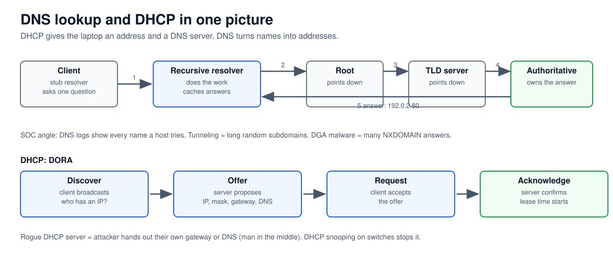

# Lesson 4: DNS, DHCP, HTTP/HTTPS and TLS

> **Module:** 02 Networking · **Week:** 3-4 · **Time:** ~5 hours
> **You will:** explain how a host gets an address (DHCP), finds a server (DNS) and talks securely (HTTP over TLS), and use a DNS log analyzer to find tunneling and DGA behaviour.
> **Maps to:** CompTIA Network+ N10-009 domain 1 (DNS, DHCP) and domain 4 (security) · Security+ SY0-701/801 (cryptography basics, secure protocols) · SC-200 / Splunk (DNS log hunting)

---

## 1. Why it matters in a SOC / cloud-security job

- **DNS logs** are among the best data sources for threat hunting. Every malware download, command-and-control (C2) contact and phishing click needs a name lookup.
- **TLS** hides content. Defenders must know what they *can* still see: the certificate, the server name, timing and volume.
- **DHCP logs** map an IP address to a device at a given time. Without them you cannot say "which laptop was `192.0.2.57` at 09:14?".

## 2. Understand it



### 2.1 DHCP (Dynamic Host Configuration Protocol)

A client with no address runs **DORA**: **D**iscover (broadcast), **O**ffer, **R**equest, **A**cknowledge. The server gives IP, mask, default gateway, DNS servers and a **lease** time. UDP ports 67 (server) and 68 (client).

Attacks: **rogue DHCP server** (hands out an attacker gateway or DNS), **DHCP starvation** (exhaust the pool). Defences: **DHCP snooping** on switches (only trusted ports may offer), port security, and logging leases into the SIEM.

### 2.2 DNS (Domain Name System)

| Record | Meaning | Security use |
|---|---|---|
| A / AAAA | Name to IPv4 / IPv6 | Resolve C2 domains |
| CNAME | Alias | Subdomain takeover when it points to a deleted cloud resource |
| MX | Mail servers | Mail routing, phishing setups |
| TXT | Free text | SPF, DKIM, DMARC mail policies; also abused for tunneling |
| NS | Name servers | |
| PTR | IP to name (reverse) | Investigation |
| SOA | Zone info | |

Resolution path: client -> **recursive resolver** (your ISP, company or cloud DNS) -> **root** -> **TLD** (`.example`) -> **authoritative** server -> answer is cached for its **TTL**. Response codes: `NOERROR`, **`NXDOMAIN`** (name does not exist), `SERVFAIL`.

**Attacks to know**

| Attack | What happens | Log sign |
|---|---|---|
| **DNS tunneling** | Data hidden in query names (`<encoded data>.t.badzone.example`) so DNS carries stolen data or C2 | Many unique, long subdomains of one domain from one host |
| **DGA** (domain generation algorithm) | Malware generates many random names to find its C2 | Lots of NXDOMAIN, random-looking names |
| **DNS spoofing / cache poisoning** | Fake answers | Changed answers, unexpected IPs |
| **Amplification (DDoS)** | Small spoofed UDP query gives a large reply to the victim | Large responses, open resolvers |
| **Typosquatting / phishing domains** | Look-alike names | New, similar domains in proxy logs |

Defences: use trusted resolvers, **DNSSEC** (signs records; proves authenticity), DNS filtering (block known bad and newly registered domains), log all queries, restrict outbound 53 to your own resolvers.

### 2.3 HTTP and HTTPS

- **HTTP** is the web request/response protocol. A request has a **method** (`GET`, `POST`), a **path**, **headers** and sometimes a body. A response has a **status code**:

| Code | Meaning | SOC note |
|---|---|---|
| 200 | OK | |
| 301/302 | Redirect | Phishing chains |
| 401/403 | Unauthorised / forbidden | Many 401s: brute force |
| 404 | Not found | Many 404s: scanning |
| 500 | Server error | Possible injection |

- **Headers** that help security: `Strict-Transport-Security`, `Content-Security-Policy`, `X-Content-Type-Options`; cookies with `Secure` and `HttpOnly`.
- **User-Agent** strings like `sqlmap` or `curl` from the internet hint at tools.

### 2.4 TLS in plain words

**TLS** (Transport Layer Security) gives **encryption**, **integrity** and **server authentication**. HTTPS = HTTP inside TLS. Simplified handshake (TLS 1.3):

1. Client Hello: supported versions and ciphers, and the server name (SNI).
2. Server Hello: chosen cipher, **certificate**.
3. Client checks the certificate: signed by a trusted **CA** (certificate authority)? Name matches? Not expired or revoked?
4. Both sides agree on session keys (key exchange). Data is then encrypted with a fast symmetric cipher.

| Item | Why it matters |
|---|---|
| Versions | TLS 1.2 and 1.3 are current. SSL and TLS 1.0/1.1 are obsolete |
| Certificate | Subject name, issuer, validity dates. Self-signed or expired certificates are warnings |
| Cipher suite | Weak ones (RC4, 3DES, export) must be disabled |
| Perfect forward secrecy | Past traffic stays safe if the server key leaks later |
| mTLS | Both sides present certificates (service to service) |

**What a defender sees in encrypted traffic:** source and destination IP, port, SNI, certificate fields, JA3/JA4 fingerprints, timing and volume. Not the content (unless you decrypt at a proxy you control, with legal and privacy approval).

## 3. From DBA to security

| You know | Security use |
|---|---|
| `tnsnames.ora` / SCAN names resolved by DNS | DNS is a dependency, and a log source and an attack path |
| Oracle Net encryption (native or TCPS with wallets and certificates) | Same TLS concepts: certificates, CA trust, wallets |
| Expired wallet certificate causes outage | Certificate expiry monitoring (a classic outage and a security issue) |
| Fixed IPs for DB servers, DHCP for clients | DHCP logs map IP to device |

## 4. Hands-on

### 4.1 The lab: DNS log analyzer

File [`lab/dns_analyzer.py`](lab/dns_analyzer.py). Input: CSV `timestamp,client_ip,query_name,rcode`. Detections:

| Function | Idea | Defaults |
|---|---|---|
| `detect_tunneling` | Many unique, long subdomains under one domain from one client | >= 10 unique, average length >= 25 |
| `detect_dga_names` | Long, random-looking domain labels (Shannon entropy) | length >= 12, entropy >= 3.3 |
| `detect_nxdomain_rate` | Client whose lookups mostly fail | >= 10 queries, >= 50% NXDOMAIN |

```bash
.venv/Scripts/python cybersecurity-track/02-networking/lab/demo.py
```

The DNS part of the real output:

```text
=== 3. DNS log ===
88 queries parsed
high    dns_tunneling       192.0.2.50    25 unique subdomains of badzone.example, average length 42 characters
high    dga_like_names      192.0.2.60    16 random-looking domains, e.g. 0b8sg6uxe3ygkp.example
medium  high_nxdomain_rate  192.0.2.60    20 of 20 lookups failed (100% NXDOMAIN)
```

Reading it: `192.0.2.21` and `192.0.2.22` (normal clients) are clean. `.22` had one typo (`wwww.example`) but too few queries to alert. `.50` is the tunneling host. `.60` is the DGA-like host, and *two* detections agree, which raises confidence.

**Why entropy?** Entropy measures how random a string is. `mailserver` scores about 2.9 bits per character and a random 14-character string about 3.7 to 3.8 (the test `test_entropy_random_higher_than_words` checks this). Short strings are noisy, so we also need a minimum length. Real tools add allow-lists (CDNs use random-looking names too), a dictionary-word score and domain age.

**Break it yourself:** (a) lower `min_entropy` to 2.5 and run again. Which false positives appear? (b) Add `cdn.example` style names to a CDN allow-list. (c) Add detection for TXT queries over 100 bytes (you will need a new column).

### 4.2 Free tools (optional)

- `nslookup`, `dig` (WSL), `Resolve-DnsName www.example -Type MX`.
- **Wireshark** filter `dns`, and `dns.flags.rcode == 3` for NXDOMAIN.
- **Browser developer tools** > Security tab shows the certificate. `openssl s_client -connect host:443` (WSL) shows the handshake. Use any site you are allowed to test, such as your own.
- **SSL Labs** online test for public sites you own.

## 5. Practice platforms

- **TryHackMe:** search "DNS in Detail", "HTTP in Detail", "Wireshark" and later *SOC Level 1* DNS/phishing rooms.
- **HTB Academy:** SOC Analyst path modules on network traffic analysis (check the catalogue). **Sherlocks** that include DNS or proxy logs.

## 6. Three realistic scenarios

1. **Tunneling.** A server sends 3,000 TXT lookups per hour for `<random>.t.badzone.example`. *Investigate:* the process (EDR/Sysmon 22), data volume, when it started, what data the host holds. *Do:* block the domain at the resolver, isolate the host, estimate what left, start the incident process.
2. **DGA malware.** One laptop shows 400 NXDOMAINs in 10 minutes, then one name resolves and the host connects to it. *Investigate:* the first successful domain and the process that asked. *Do:* block, isolate, hunt for other hosts querying the same names.
3. **Expired certificate on a payment API.** Connections fail. *Investigate:* certificate dates, the renewal job. *Do:* renew, add expiry monitoring (30/14/7 day alerts), document the owner. Also a reminder that an unknown new certificate for your domain is worth checking in Certificate Transparency logs.

## 7. Common mistakes

- Alerting on every NXDOMAIN. Typos and misconfigured apps cause many.
- Ignoring DNS over HTTPS (DoH) or DoT. Clients that bypass your resolver hide from your logs.
- Believing "HTTPS means safe". Phishing sites use valid certificates too.
- Not logging DHCP leases, so IP addresses cannot be tied to devices later.
- Allowing outbound 53 from every host to any server.

## 8. Interview questions

<details><summary><b>Q1. Describe DHCP DORA.</b></summary>
Discover (client broadcast), Offer (server proposes an address), Request (client accepts), Acknowledge (server confirms the lease).
</details>

<details><summary><b>Q2. What happens when you type a URL?</b></summary>
DNS resolves the name, TCP connects, TLS negotiates, the browser sends an HTTP request, and the server answers. (Also ARP/gateway at layer 2 and routing at layer 3.)
</details>

<details><summary><b>Q3. What is NXDOMAIN?</b></summary>
A DNS answer saying the name does not exist. High rates from one host can mean DGA malware, a scanner or a misconfiguration.
</details>

<details><summary><b>Q4. What is DNS tunneling and how do you detect it?</b></summary>
Hiding data in DNS queries. Detect: many unique, long, high-entropy subdomains of one domain, unusual record types (TXT, NULL), high query volume from one host.
</details>

<details><summary><b>Q5. What is a DGA?</b></summary>
A domain generation algorithm: malware creates many pseudo-random domain names so that blocking one is not enough. Signs are random names and many NXDOMAINs.
</details>

<details><summary><b>Q6. What does DNSSEC do?</b></summary>
It signs DNS records so a resolver can check they are authentic and unchanged. It does not encrypt queries.
</details>

<details><summary><b>Q7. What does TLS give you?</b></summary>
Encryption, integrity and server authentication (and optional client authentication).
</details>

<details><summary><b>Q8. What can you still see in encrypted HTTPS traffic?</b></summary>
IPs, ports, SNI (server name), certificate details, JA3/JA4 fingerprints, sizes and timing. Not the content.
</details>

<details><summary><b>Q9. Scenario: an HTTPS site shows a certificate warning for your own internal app. Causes?</b></summary>
Expired certificate, name mismatch, untrusted or self-signed issuer, or a man-in-the-middle. Check issuer and dates, and compare from another network.
</details>

<details><summary><b>Q10. What are SPF, DKIM and DMARC?</b></summary>
DNS-based mail controls. SPF lists servers allowed to send for a domain, DKIM signs messages, DMARC tells receivers what to do when checks fail. They reduce spoofed email.
</details>

<details><summary><b>Q11. What is a rogue DHCP server and how do you stop it?</b></summary>
An unauthorised device handing out addresses or gateways, often for a man-in-the-middle. Use DHCP snooping on switches and monitor for unknown offers.
</details>

<details><summary><b>Q12. HTTP 401 spikes and many 404s from one IP. What is it?</b></summary>
401s suggest password guessing. Many 404s suggest directory scanning. Both suggest automated probing. Block or rate-limit the source and review for any 200 after the burst.
</details>

## 9. Checklist

- [ ] I can explain DORA and the DNS resolution path.
- [ ] I know the DNS attacks and the log signs of each.
- [ ] I ran the DNS analyzer and explained each of the three alerts.
- [ ] I can describe the TLS handshake in four steps.
- [ ] I answered the questions without looking.

## 10. References

- RFC 1035 (DNS), RFC 2131 (DHCP), RFC 8446 (TLS 1.3): https://www.rfc-editor.org
- MITRE ATT&CK T1071.004 (DNS as C2), T1568.002 (DGA): https://attack.mitre.org
- OWASP Transport Layer Security Cheat Sheet: https://cheatsheetseries.owasp.org
- Next: [Routing, switching and VLANs](05-routing-switching-vlans.md)
