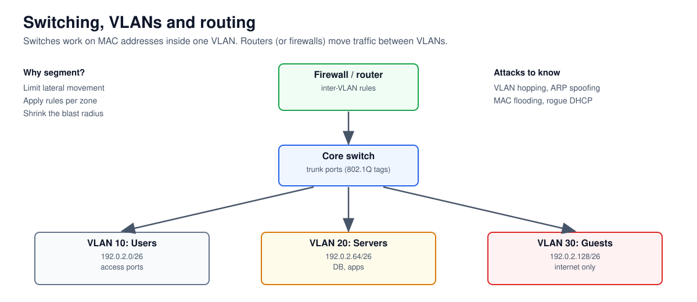

# Lesson 5: Routing, Switching and VLANs

> **Module:** 02 Networking · **Week:** 4 · **Time:** ~3 hours
> **You will:** explain how switches and routers move traffic, how VLANs split a network, and which attacks target layers 2 and 3.
> **Maps to:** CompTIA Network+ N10-009 domain 2 (network implementations) · Security+ SY0-701/801 (segmentation, network hardening)

---

## 1. Why it matters in a SOC / cloud-security job

Attackers who get into one laptop try to move sideways. A flat network lets them reach every server. VLANs and routing rules decide how far they get. In cloud, route tables and subnets do the same job. You also need this to read alerts such as "ARP spoofing detected" or "VLAN hopping attempt".

## 2. Understand it

### 2.1 Switching (layer 2)

A **switch** keeps a **MAC address table**: which MAC is behind which port. It forwards a frame only to the right port. Unknown destination: it **floods** the frame to all ports in the VLAN.

| Switch feature | Purpose | Security note |
|---|---|---|
| MAC table (CAM) | Learn who is where | **MAC flooding** fills the table, so the switch acts like a hub and attackers can sniff |
| Port security | Limit MACs per port | Stops flooding and rogue devices |
| STP (spanning tree) | Prevent loops | BPDU guard blocks rogue switches |
| DHCP snooping | Only trusted ports can offer addresses | Stops rogue DHCP |
| Dynamic ARP inspection | Check ARP against the snooping table | Stops ARP spoofing |
| 802.1X | Authenticate a device before it gets a port | Stops unknown devices on the wall socket |

### 2.2 VLANs

A **VLAN** (virtual LAN) splits one physical switch into separate logical networks. Each VLAN is its own broadcast domain and normally its own IP subnet.

- **Access port:** carries one VLAN, for an end device.
- **Trunk port:** carries many VLANs between switches or to a router, tagged with **802.1Q**.
- **Native VLAN:** the untagged one on a trunk. Set it to an unused VLAN.
- **Inter-VLAN routing:** needs a router or layer 3 switch (or a firewall) so traffic can cross, and so rules can apply.

**VLAN hopping:** *switch spoofing* (the attacker's port negotiates a trunk) and *double tagging* (two 802.1Q tags). Defences: turn off DTP/auto-trunking, set access ports explicitly, use an unused native VLAN.

### 2.3 Routing (layer 3)

A **router** reads the destination IP, looks it up in its **routing table**, and picks the **longest prefix match**. The **default route** `0.0.0.0/0` is used when nothing else matches. The **default gateway** is the router a host uses to leave its subnet.

| Type | Meaning | Notes |
|---|---|---|
| Static | You enter routes by hand | Simple, small networks, cloud route tables |
| Dynamic: OSPF | Link-state, inside a company | Authenticate neighbours |
| Dynamic: EIGRP | Cisco, inside a company | |
| Dynamic: BGP | Between organisations and clouds | Route hijacking is possible without safeguards |

**TTL** (time to live) falls by one at each router. At 0 the packet is dropped and an ICMP message returns. `traceroute` uses this to show each hop.

### 2.4 Network access control and segmentation ideas

- **Segment by risk:** users, servers, databases, guests, IoT, management. Allow only needed flows between them. This is part of **zero trust**: never trust a flow because of its location.
- **Management network:** keep device admin interfaces in their own VLAN.
- **Private VLANs, microsegmentation:** isolate hosts inside the same subnet.

## 3. From DBA to security

| You know | Security use |
|---|---|
| Database servers in their own subnet, only app servers allowed in | VLAN + ACL segmentation, "default deny between zones" |
| RAC interconnect on a private VLAN | Private/management networks for sensitive traffic |
| Data Guard traffic across sites via routing | Route tables and path control; VPN between sites |
| A cluster VIP and ARP failover | ARP is used (and abused) the same way |

## 4. Hands-on

1. On your machine: `route print` (Windows) or `ip route` (Linux). Find your default route and gateway. `arp -a` shows the ARP cache. Compare the gateway's MAC to your router label.
2. `tracert` to any site and count hops.
3. **Optional, Cisco Packet Tracer (free):** build two VLANs on one switch, put a PC in each, and watch that they cannot ping each other until a router interface (router-on-a-stick) is added.
4. **Lab link:** the firewall analyzer in [Lesson 6](06-firewalls-nat-vpn-proxies-ids-ips.md#4-hands-on) shows what a security boundary logs between zones.

## 5. Practice platforms

- **TryHackMe:** search for rooms on "Networking Core Protocols" and "Traffic Analysis". For layer 2 attacks, search for "ARP" or "MITM" in a Wireshark room.
- **HTB Academy:** "Introduction to Networking" and later network traffic analysis modules (check the catalogue).
- **Cisco Packet Tracer** and the free *Networking Basics* courses at Cisco Networking Academy (verify current offers).

## 6. Three realistic scenarios

1. **Flat network ransomware.** One workstation is infected and SMB spreads to 40 hosts. *Why:* no segmentation between user VLANs and no host firewall. *Do:* isolate affected hosts, block 445 between user subnets, redesign with VLANs and ACLs.
2. **ARP spoofing alert.** The switch logs two MACs claiming the gateway IP. *Investigate:* which port owns the second MAC. *Do:* shut the port, find the device, enable dynamic ARP inspection and DHCP snooping.
3. **Guest Wi-Fi reaches servers.** A test shows the guest VLAN can ping a database. *Do:* add ACLs or firewall rules (guests: internet only), review the trunk configuration for a mistaken VLAN allowance.

## 7. Common mistakes

- "VLANs are a security boundary on their own." They are only a boundary if traffic between them is filtered.
- Leaving trunk ports on automatic negotiation.
- Leaving the default VLAN 1 for user traffic.
- Using the same native VLAN as a user VLAN.
- Forgetting that switches and routers also need patching and hardened management (SSH only, no default passwords).

## 8. Interview questions

<b>Q1. What is the difference between a switch and a router?</b>

A switch forwards frames by MAC address inside a network (layer 2). A router forwards packets by IP address between networks (layer 3).

<b>Q2. What is a VLAN and why use it?</b>

A logical network on shared switches. It reduces broadcast traffic and separates groups so you can apply security rules between them.

<b>Q3. Access port vs trunk port?</b>

An access port carries one VLAN to an end device. A trunk carries multiple VLANs (802.1Q tagged) between network devices.

<b>Q4. What is MAC flooding?</b>

An attacker sends many frames with fake MACs to fill the switch table. The switch then floods traffic, letting the attacker sniff. Port security limits it.

<b>Q5. What is ARP spoofing and how do you prevent it?</b>

Sending false ARP replies so traffic goes through the attacker. Prevent it with dynamic ARP inspection, DHCP snooping, static entries for critical hosts and segmentation.

<b>Q6. What is VLAN hopping?</b>

Getting traffic into another VLAN by switch spoofing or double tagging. Prevent it by disabling auto-trunking and using an unused native VLAN.

<b>Q7. What is a default gateway?</b>

The router address a host sends traffic to when the destination is outside its subnet.

<b>Q8. How does a router choose between routes?</b>

The longest matching prefix wins (`/26` beats `/24`). Then administrative distance and metric decide between protocols and paths.

<b>Q9. Scenario: a user in the guest VLAN can reach the finance server. How do you investigate?</b>

Check the inter-VLAN routing device and its ACLs, the trunk allowed VLAN list, the host's IP and gateway, and firewall logs for the flow. Then fix the rule and add a test.

<b>Q10. Why is segmentation important in ransomware defence?</b>

It limits how far the malware can spread and gives you choke points to block and log.

## 9. Checklist

- [ ] I can explain MAC tables, VLANs, trunks and routing tables.
- [ ] I can name three layer 2 attacks and their defences.
- [ ] I found my default route and gateway MAC.
- [ ] I answered the questions without looking.

## 10. References

- CompTIA Network+ objectives: https://www.comptia.org/certifications/network
- NSA/CISA *Network Infrastructure Security Guidance* (segmentation, hardening of routers and switches)
- Cisco documentation on port security, DHCP snooping, DAI (search the vendor site)
- Next: [Firewalls, NAT, VPN, proxies and IDS/IPS](06-firewalls-nat-vpn-proxies-ids-ips.md)
