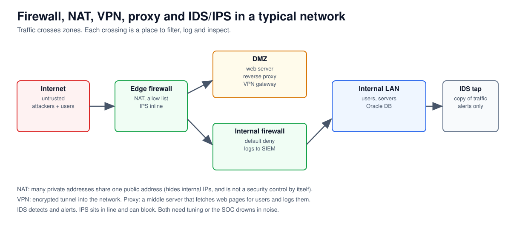

# Lesson 6: Firewalls, NAT, VPN, Proxies and IDS/IPS

> **Module:** 02 Networking · **Week:** 4 · **Time:** ~5 hours
> **You will:** explain the main network security devices, and use a firewall-log analyzer to find port scans, denied-traffic spikes and traffic to rare ports.
> **Maps to:** CompTIA Network+ N10-009 domain 4 (network security) · Security+ SY0-701/801 (network security appliances) · SC-200 and Splunk (firewall log detections)

---

## 1. Why it matters in a SOC / cloud-security job

Firewall and proxy logs are the largest log source in many SOCs. Typical first alerts: a port scan, a spike of denied traffic, an allowed connection to a strange port. You also meet VPN logs (who connected from where) and IDS/IPS alerts. Understanding what each device can and cannot see lets you judge an alert quickly.

## 2. Understand it



### 2.1 Firewalls

| Type | Looks at | Example | Limit |
|---|---|---|---|
| Packet filter (stateless) | IP, port, protocol per packet | Simple ACL | No memory of connections |
| **Stateful** | Tracks connections: lets replies in for allowed outbound traffic | Most firewalls, cloud security groups | Does not read application content |
| **Next-generation (NGFW)** | App awareness, user identity, IPS, TLS inspection | Palo Alto, Fortinet, Check Point | Cost and tuning; decryption needs approval |
| **WAF** (web application firewall) | HTTP requests (layer 7) | Azure WAF, AWS WAF | Protects web apps against injection and bots |
| Host firewall | One computer | Windows Defender Firewall, `ufw` | Needs central management |

**Rule design:**

- **Default deny**, then allow what is needed. Rules are read top to bottom. First match wins.
- A rule is: source, destination, port/protocol, action (allow/deny), logging on or off.
- Log **denies** and also **allows** on sensitive zones. Review old rules (rule bloat is a risk).
- A **DMZ** holds public-facing servers, separated from the internal network.

### 2.2 NAT (Network Address Translation)

NAT rewrites addresses at the edge.

| Type | What it does |
|---|---|
| **SNAT / PAT** (overload) | Many private hosts share one public IP; ports tell them apart |
| **DNAT** (port forwarding) | Outside address:port maps to an inside server |
| Static NAT | One-to-one mapping |

NAT is **not a security control by itself**. It hides internal addressing, but a stateful firewall does the real work. For analysts, NAT means the *source IP in an external log is the firewall's public IP*. To find the real host, use the firewall's NAT logs or the proxy logs.

### 2.3 VPN

A **VPN** builds an encrypted tunnel.

| Type | Use | Protocols |
|---|---|---|
| Remote-access | A person to the company | SSL/TLS VPN, IPsec/IKEv2, WireGuard |
| Site-to-site | Office to office, on-prem to cloud | IPsec |
| **Split tunnel** | Only company traffic goes through the VPN | Faster, but the user's other traffic is unprotected |
| Full tunnel | Everything goes through the VPN | Easier to monitor |

Detections: impossible travel (a login from two far places in a short time), logins at odd hours, MFA fatigue, a VPN login followed at once by admin tools. Vulnerable VPN gateways are a favourite attacker entry: patch quickly.

### 2.4 Proxies

- **Forward proxy:** users go through it to reach the internet. It filters, caches and *logs URLs*. Great for SOC work.
- **Reverse proxy:** sits in front of servers (load balancing, TLS termination, WAF).
- Transparent vs explicit proxy: transparent needs no browser setting.
- Proxy logs show user, URL, category, bytes. A host uploading gigabytes to a new file-sharing site is a data-theft clue.

### 2.5 IDS and IPS

| | IDS | IPS |
|---|---|---|
| Position | Out of band (a copy of traffic via TAP/SPAN) | In line |
| Action | Alert | Alert and **block** |
| Risk | Missed attacks if no one reads alerts | A false positive can block real traffic |
| Examples | Snort, Suricata, Zeek (network analysis) | Suricata inline, NGFW IPS |

Detection methods: **signature** (known patterns), **anomaly** (unusual behaviour), **heuristic**. Terms: **true positive** (real attack, alert), **false positive** (alert, no attack), **false negative** (attack, no alert; the dangerous one), **true negative**.

### 2.6 Related controls

NAC (network access control, 802.1X), DLP (data loss prevention), NDR (network detection and response), SASE/SSE (cloud-delivered security, ZTNA). Zero trust: verify each request, least privilege, assume breach.

## 3. From DBA to security

| You know | Security use |
|---|---|
| `TCP.INVITED_NODES` in `sqlnet.ora` | A host allow-list, like a firewall rule in the database |
| Oracle Connection Manager (CMAN) as a gateway | A proxy/firewall for database traffic |
| Auditing failed logins (ORA-01017) and failed connections | Denied-traffic logs; spikes = attack or misconfiguration |
| Baselining in AWR: "is this load normal?" | Baselining denied traffic per minute (the lab does exactly this) |

## 4. Hands-on

### 4.1 The lab: firewall log analyzer

File [`lab/firewall_analyzer.py`](lab/firewall_analyzer.py). Log format (one line per event):

```text
2026-11-02T09:00:01Z DENY TCP 203.0.113.9:44012 -> 192.0.2.10:22
```

| Function | Idea | Defaults |
|---|---|---|
| `detect_port_scans` | One source touches many different ports on one target within a short time | >= 15 ports in 60 s |
| `detect_denied_spikes` | Per-minute DENY count compared with the median (a baseline) | >= 3x median and >= 20 |
| `detect_rare_ports` | ALLOWED traffic to a port not on the known list, seen only a few times | <= 3 hits |

```bash
.venv/Scripts/python cybersecurity-track/02-networking/lab/demo.py
```

The firewall part of the real output:

```text
=== 2. Firewall log ===
215 events parsed
high    port_scan     203.0.113.9    203.0.113.9 probed 30 different ports on 198.51.100.10 within 60s
medium  denied_spike  09:03          33 denied connections in one minute (median is 3)
medium  denied_spike  09:06          23 denied connections in one minute (median is 3)
medium  denied_spike  09:07          25 denied connections in one minute (median is 3)
medium  rare_port     port 4444      2 allowed connection(s) to uncommon port 4444 from 192.0.2.33
```

Reading it:

- `203.0.113.9` swept 30 ports in 30 seconds: a scan. The `09:03` spike is the *same* scan (33 denies in that minute), so the two alerts are one story.
- `09:06` and `09:07`: 45 denied connections to port 3389 from five sources. Looks like an RDP attack from several IPs: a distributed attempt.
- `192.0.2.33` was **allowed** to reach port 4444 twice. The firewall did not stop it, so this needs a human look. It is the most important line, because it was a *permit*.
- Normal clients to 443, 80, 53 and 1521 produce no alerts. The parser also skipped a comment line and a garbage line.

The tests cover the parser, a normal client that must not trigger a scan alert, a slow scan outside the time window, a denied-only port that must not appear in "rare", and known ports that must not be rare.

```bash
.venv/Scripts/python -m pytest cybersecurity-track/02-networking
```

**Break it yourself:** (a) set `min_ports=40`. Does the scan disappear? What does that teach you about thresholds? (b) Add a rule that flags an *allowed* connection from the internet to port 1521. (c) Add `detect_beaconing`: the same source and destination at regular intervals (hint: standard deviation of the gaps).

### 4.2 Free tools (optional)

- **Windows Defender Firewall** > Advanced > turn on logging; **`ufw`** in WSL.
- **Suricata** or **Zeek** in a VM, with the free Emerging Threats rules, on a pcap you have. Heavy, so use a VM with 2 GB.
- **pfSense** or **OPNsense** in a VM to see a real firewall UI.

## 5. Practice platforms

- **TryHackMe:** search "Firewalls", "Snort", "Zeek", "Suricata", and the SOC Level 1 network analysis rooms.
- **HTB Academy:** modules on network traffic analysis and IDS/IPS in the SOC Analyst path (check names in the catalogue).

## 6. Three realistic scenarios

1. **Port scan from the internet.** A single IP hits 1,000 ports. *Meaning:* reconnaissance, usually automated. *Do:* confirm nothing was allowed through, check if the IP appears elsewhere (other hosts, other days), block or rate-limit, and look for follow-up attempts. A scan alone is rarely an incident, but a scan then a successful login is.
2. **VPN login from two countries.** The same user connects from two places 20 minutes apart. *Investigate:* IPs, device IDs, MFA events. *Do:* revoke sessions, reset the password and MFA, check mail rules and data access.
3. **Allowed outbound to a rare port.** As in the lab: the host `192.0.2.33` reached `198.51.100.10:4444`. *Investigate:* what process (EDR), what else happened, destination reputation. *Do:* isolate if suspicious, add an egress rule so only needed ports leave.

## 7. Common mistakes

- Only logging denies. Allowed traffic to sensitive ports is just as important.
- "Any-any" allow rules that stay forever.
- Treating NAT as security.
- Putting an IPS inline without tuning, then blocking business traffic.
- Not controlling *outbound* traffic (egress). Attackers use it for C2.
- Trusting thresholds blindly. A busy vulnerability scanner will look like an attacker. Maintain an allow-list for your own scanners.

## 8. Interview questions

<details><summary><b>Q1. Stateful vs stateless firewall?</b></summary>
A stateful firewall tracks connections and allows replies automatically. A stateless one checks each packet alone against rules.
</details>

<details><summary><b>Q2. What is a DMZ?</b></summary>
A separate network zone for public-facing servers, between the internet and the internal network, so a hacked web server does not sit directly in the internal network.
</details>

<details><summary><b>Q3. What is NAT, and is it a security control?</b></summary>
It rewrites addresses so many private hosts can share public IPs. It hides internal addressing but is not a real security control. The firewall rules do the protecting.
</details>

<details><summary><b>Q4. IDS vs IPS?</b></summary>
An IDS watches a copy of traffic and alerts. An IPS sits in line and can also block.
</details>

<details><summary><b>Q5. Explain true positive, false positive, false negative.</b></summary>
True positive: a real attack was alerted. False positive: an alert with no attack. False negative: a real attack without an alert (most dangerous).
</details>

<details><summary><b>Q6. Forward proxy vs reverse proxy?</b></summary>
A forward proxy represents users going out. A reverse proxy represents servers receiving requests (load balancing, TLS, WAF).
</details>

<details><summary><b>Q7. What is a WAF and what does it protect against?</b></summary>
A web application firewall filters HTTP traffic. It helps against SQL injection, cross-site scripting and bot abuse. It does not replace secure code.
</details>

<details><summary><b>Q8. Site-to-site VPN vs remote-access VPN?</b></summary>
Site-to-site connects two networks (often IPsec). Remote-access connects one user device to the network.
</details>

<details><summary><b>Q9. Scenario: the firewall shows 50 denied packets to 50 different ports from one IP in 20 seconds. What is it and what next?</b></summary>
A port scan. Check if anything was allowed from that IP, whether it targeted other hosts, its reputation, and block it. Watch for later logons or exploit traffic.
</details>

<details><summary><b>Q10. Why is egress filtering important?</b></summary>
Malware must call out to be controlled and to steal data. Allowing only needed outbound ports and destinations limits that.
</details>

<details><summary><b>Q11. What is "default deny"?</b></summary>
Block everything except what is explicitly allowed. It is the safest base for firewall policy.
</details>

<details><summary><b>Q12. A denied-traffic spike appears at 03:00. Attack or noise?</b></summary>
Compare to the baseline for that hour, check sources and targets (one target or many), look for a new misconfigured app or scanner, and check whether anything was allowed. Document the reasoning either way.
</details>

## 9. Checklist

- [ ] I can compare packet filter, stateful, NGFW and WAF.
- [ ] I can explain NAT types and why NAT is not security.
- [ ] I ran the firewall analyzer and explained each alert, including why the `rare_port` line matters most.
- [ ] I did one "break it yourself" change with a test.
- [ ] I answered the questions without looking.

## 10. References

- NIST SP 800-41 Rev. 1 *Guidelines on Firewalls and Firewall Policy*: https://csrc.nist.gov/publications
- NSA/CISA *Network Infrastructure Security Guidance*
- CompTIA Network+ objectives: https://www.comptia.org/certifications/network
- Suricata and Zeek documentation: https://docs.suricata.io, https://docs.zeek.org
- Next: [Wireless basics](07-wireless-basics.md)
