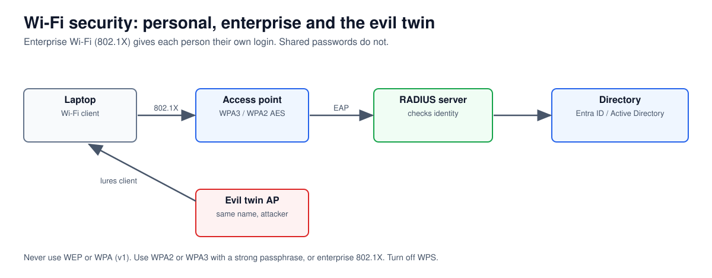

# Lesson 7: Wireless Basics

> **Module:** 02 Networking · **Week:** 4 · **Time:** ~2 hours
> **You will:** explain how Wi-Fi works, which security modes to use, and the attacks that matter for a SOC.
> **Maps to:** CompTIA Network+ N10-009 domain 2 (wireless) and domain 4 (wireless security) · Security+ SY0-701/801 (wireless security settings)

---

## 1. Why it matters in a SOC / cloud-security job

Wi-Fi is the way most employees reach company systems. A weak wireless setup gives an attacker a path *inside* the firewall without touching it. SOC alerts include "rogue access point detected", "deauthentication flood" and "user connected to unknown SSID". Remote employees at cafes and airports are exposed to evil twin attacks.

## 2. Understand it

### 2.1 Basics

| Term | Meaning |
|---|---|
| SSID | The network name |
| BSSID | The access point's MAC address |
| Access point (AP) | Device that connects wireless clients to the wired network |
| Bands | 2.4 GHz (longer range, crowded), 5 GHz (faster), 6 GHz (Wi-Fi 6E/7) |
| Standards | 802.11n = Wi-Fi 4, ac = Wi-Fi 5, ax = Wi-Fi 6/6E, be = Wi-Fi 7 |
| Channel | A slice of the band. Neighbours on the same channel interfere |
| Controller | Manages many APs centrally |

### 2.2 Security modes

| Mode | Status | Note |
|---|---|---|
| Open | Bad | No encryption (some use OWE to add it) |
| WEP | **Broken** | Cracked in minutes. Never use |
| WPA (v1, TKIP) | Obsolete | |
| WPA2-Personal (AES-CCMP, shared passphrase) | Acceptable with a long passphrase | Offline passphrase guessing is possible after capturing a handshake |
| WPA2/WPA3-Enterprise (802.1X + RADIUS) | **Best for companies** | Each user has own credentials or certificate |
| WPA3-Personal (SAE) | Better | Resists offline guessing of the passphrase |

**802.1X** has three parts: the *supplicant* (client), the *authenticator* (AP or switch), and the *authentication server* (RADIUS). **EAP** types: EAP-TLS (certificates, the strongest), PEAP (password inside a tunnel). Check that clients verify the server certificate, or an evil twin can steal credentials.

**WPS** (push-button/PIN setup) has known flaws. Turn it off.

### 2.3 Attacks to know

| Attack | What | Defence |
|---|---|---|
| **Evil twin / rogue AP** | Fake AP with a real name or an unauthorised AP on your network | WPA-Enterprise with server cert validation; rogue AP detection; wired port security |
| **Deauthentication** | Forged frames kick clients off | 802.11w (management frame protection), included in WPA3 |
| **Handshake capture and cracking** | Capture the 4-way handshake, guess the passphrase offline | Long random passphrase, WPA3-SAE, Enterprise |
| **WPS PIN attack** | Brute force the WPS PIN | Disable WPS |
| **Eavesdropping on open Wi-Fi** | Sniff unencrypted traffic | VPN, HTTPS, WPA3 or OWE |
| **Bluetooth attacks** | Bluesnarfing, pairing abuse | Turn it off when not used, patch |

Wireless intrusion detection (WIDS/WIPS) in the controller can alert on rogue APs and deauth floods. Those alerts can be sent to the SIEM.

### 2.4 Good practice

Separate SSIDs and VLANs for staff, guests and IoT. Guests get internet only. Strong passphrases or Enterprise. Hide nothing by "hiding the SSID" (it is not a security control). Keep AP firmware updated. Reduce signal reach where possible.

## 3. From DBA to security

| You know | Security use |
|---|---|
| Database access only from known hosts | Only managed, authenticated devices should reach the production network, wired or wireless |
| Shared `SYS` password vs named DBA accounts | Shared Wi-Fi passphrase vs individual 802.1X accounts: accountability |
| DBA connecting from home over VPN | Remote workers on untrusted Wi-Fi must use VPN |

## 4. Hands-on

1. On Windows: `netsh wlan show interfaces` (shows your security mode and band) and `netsh wlan show networks mode=bssid` (nearby APs).
2. Check your **home router**: WPA2/WPA3, long passphrase, WPS off, firmware updated, guest network for visitors.
3. **Optional, read-only:** use a Wi-Fi scanner app to see channels and security of networks around you. **Do not capture or attack networks you do not own.**
4. Lab: there is no code lab for wireless. Use the firewall analyzer from [Lesson 6](06-firewalls-nat-vpn-proxies-ids-ips.md#4-hands-on) to think about what guest-network traffic would look like.

## 5. Practice platforms

- **TryHackMe:** search for "Wi-Fi" or "Aircrack" rooms (pentest-focused; do these later in module 09).
- **HTB Academy:** search "Wi-Fi" or wireless attack modules, in the pentest paths (check the catalogue).
- For defence: vendor docs for your controller (Cisco, Aruba, Ubiquiti) on rogue AP detection.

## 6. Three realistic scenarios

1. **Evil twin at a conference.** Several staff report a certificate warning on Wi-Fi sign-in. *Investigate:* two APs with the same SSID and different BSSIDs, an unknown vendor MAC. *Do:* reset passwords of those who entered credentials, block the BSSID, enforce certificate validation by policy.
2. **Rogue AP under a desk.** The NAC alert shows an unmanaged AP on a wired port. *Do:* disable the port, locate and remove the device, add 802.1X on wired ports.
3. **Deauth flood in the office.** Users drop off Wi-Fi at the same time. *Investigate:* WIDS logs and management frames. *Do:* enable protected management frames, find the source with a wireless survey, involve security and facilities.

## 7. Common mistakes

- Thinking a hidden SSID or MAC filtering is real security.
- Using a shared passphrase for years, and after staff leave.
- Letting guests share the staff VLAN.
- Not validating the RADIUS server certificate on clients.
- Forgetting IoT and printers on Wi-Fi.

## 8. Interview questions

<b>Q1. WPA2 vs WPA3?</b>

WPA3 uses SAE for the personal mode, which resists offline passphrase guessing, and requires protected management frames. WPA2 with a weak passphrase can be cracked offline after a handshake capture.

<b>Q2. What is 802.1X?</b>

A port-based network access control standard. A client authenticates (usually through RADIUS and EAP) before it gets network access.

<b>Q3. What is an evil twin?</b>

A rogue access point that copies a real SSID to lure users and capture traffic or credentials.

<b>Q4. Why is WEP unsafe?</b>

Its design (weak IV and RC4 use) allows key recovery in minutes.

<b>Q5. Does hiding the SSID secure a network?</b>

No. The name is still visible in management frames. It adds inconvenience only.

<b>Q6. What is a deauthentication attack?</b>

Forged management frames that disconnect clients. Used for denial of service and to force a handshake. 802.11w protects against it.

<b>Q7. Why use WPA-Enterprise in a company?</b>

Each user has own credentials or certificate, access can be revoked per person, and logs show who connected. A shared passphrase cannot do this.

<b>Q8. What should you do on public Wi-Fi?</b>

Use a VPN, only HTTPS sites, no sensitive work on open networks, and turn off auto-connect.

<b>Q9. Scenario: a rogue AP is found in the office. Steps?</b>

Locate the wired port (switch MAC table), disable the port, remove the device, review traffic from it, check for compromised devices that joined, and add 802.1X and rogue AP detection.

<b>Q10. Which wireless band is better for range and which for speed?</b>

2.4 GHz has longer range and passes walls better. 5 GHz and 6 GHz are faster with less interference but shorter range.

## 9. Checklist

- [ ] I can list the Wi-Fi security modes from worst to best.
- [ ] I can explain 802.1X, EAP and RADIUS.
- [ ] I checked my home router settings.
- [ ] I answered the questions without looking.

## 10. References

- NSA/CISA guidance on securing wireless devices in public settings, and the public *Wi-Fi networking and security* notes in the course library
- Wi-Fi Alliance WPA3 specification overview: https://www.wi-fi.org
- CompTIA Network+ objectives: https://www.comptia.org/certifications/network
- Next: [Cloud networking](08-cloud-networking.md)
