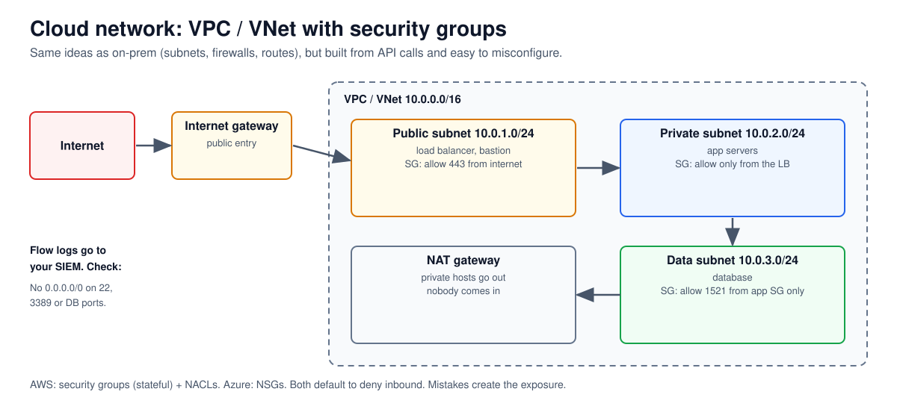

# Lesson 8: Cloud Networking (VPC / VNet, Security Groups / NSG)

> **Module:** 02 Networking · **Week:** 4 · **Time:** ~4 hours
> **You will:** read a cloud network diagram, explain subnets, route tables, gateways and security groups, and spot the usual misconfigurations.
> **Maps to:** CompTIA Network+ N10-009 domain 1 (cloud concepts) · Security+ SY0-701/801 (cloud security) · AZ-500 (network security) / AWS Security Specialty (VPC security)

*Service names change. Check the official AWS and Azure documentation for current limits and defaults.*

---

## 1. Why it matters in a SOC / cloud-security job

This is your new job. In the cloud, the network is code and settings. A single wrong rule (SSH or a database open to `0.0.0.0/0`) can expose a system within minutes of creation. Many cloud incidents start with an exposed management port or a public storage service. You will review **flow logs**, **security group** changes and **firewall** alerts every week.

## 2. Understand it



### 2.1 The building blocks

| Idea | AWS | Azure | Note |
|---|---|---|---|
| Private network | **VPC** | **VNet** | You choose the CIDR (for example `10.0.0.0/16`) |
| Subnet | Subnet (in one AZ) | Subnet | "Public" or "private" depends on the routes, not the name |
| Route table | Route table | Route table (UDR) | Decides where traffic goes |
| Internet entry/exit | Internet gateway (IGW) | Public IP / default outbound | |
| Outbound only for private hosts | **NAT gateway** | NAT gateway | Hosts can reach out; nobody can reach in |
| Instance-level firewall | **Security group** (stateful, allow rules only) | **NSG** (network security group; allow and deny, priority order) | |
| Subnet-level firewall | **Network ACL** (stateless, allow and deny) | NSG on subnet | |
| Private link to PaaS | VPC endpoint / PrivateLink | Private Endpoint / Service Endpoint | Keeps traffic off the internet |
| VNet to VNet | VPC peering, Transit Gateway | VNet peering, Virtual WAN | Do not overlap CIDRs |
| Hybrid link | Site-to-site VPN, Direct Connect | VPN Gateway, ExpressRoute | |
| Central firewall | AWS Network Firewall | Azure Firewall | |
| Web protection | AWS WAF | Azure WAF (Front Door / App Gateway) | |
| Network logs | **VPC Flow Logs** | **NSG flow logs** / VNet flow logs (check current feature status) | Metadata only, not content |

**Public vs private subnet:** a subnet is "public" when its route table sends `0.0.0.0/0` to an internet gateway *and* the instances have public IPs. A private subnet has no such route; outbound goes through a NAT gateway.

### 2.2 Security group and NSG rules

A rule has: direction, protocol, port range, source or destination (CIDR, or another security group), action.

Good practice:

- **Least privilege:** reference *another security group* as a source (for example "app SG may reach DB SG on 1521") instead of wide CIDRs.
- **Never** `0.0.0.0/0` for 22, 3389 or database ports. Use a bastion, VPN, AWS Systems Manager Session Manager or Azure Bastion.
- Separate tiers: web, app, data. Only the load balancer faces the internet.
- Egress rules: outbound is often "allow all". Restrict for sensitive tiers.
- Tag everything with an owner.

### 2.3 The usual misconfigurations

| Mistake | Risk | How you find it |
|---|---|---|
| Inbound 22/3389 from `0.0.0.0/0` | Brute force, ransomware | CSPM (cloud posture), Defender for Cloud, AWS Config, Security Hub |
| Database with a public IP or open SG | Data theft | Same tools, plus Shodan-like external scans |
| Default VPC/NSG used for production | Broad rules | Inventory |
| Overlapping CIDRs | VPN/peering failures | Design review |
| Flow logs off | No evidence | Policy check |
| Public storage with sensitive data | Breach | Storage policy checks |

### 2.4 Logging and detection

- **Flow logs** list accepted and rejected connections (source, destination, ports, bytes). Send them to a SIEM (Sentinel, Splunk). The same detections as the firewall lab apply: port scans, rejected spikes, unusual ports, large outbound transfers.
- **Control-plane logs** (AWS CloudTrail, Azure Activity Log) record who changed a security group. A rule changed to `0.0.0.0/0` is a high-priority alert.
- DNS logs (Route 53 Resolver logs, Azure DNS analytics) support the DNS detections from [Lesson 4](04-dns-dhcp-http-tls.md).

## 3. From DBA to security

| You know | Cloud security use |
|---|---|
| Oracle in a private subnet, app tier in front | Same tier design; SG-to-SG rules |
| Bastion host for DBA access | Bastion/Session Manager/Azure Bastion, with MFA and logs |
| `listener.ora` binding, `sqlnet.ora` allow-lists | Security group sources and private endpoints |
| Cross-region Data Guard / replication | Peering, VPN, and encryption in transit |
| Auditing who changed `init.ora` / DB parameters | CloudTrail / Activity Log for network and IAM changes |

## 4. Hands-on

1. **Reuse the lab:** a flow-log record is just a firewall line. Reformat three lines of the lab's firewall log into your own VPC flow-log style and run `detect_rare_ports` on them (see [Lesson 6](06-firewalls-nat-vpn-proxies-ids-ips.md#4-hands-on) for the commands and real output).
2. **Subnet plan on paper:** VPC `10.0.0.0/16`, three subnets per tier in two zones (6 subnets), using the `split_subnet` function from the subnet trainer:
   ```python
   import sys; sys.path.insert(0, "cybersecurity-track/02-networking/lab")
   import subnet_trainer as st
   print(st.split_subnet("10.0.0.0/16", 24)[:6])
   ```
3. **Free cloud practice (optional, set a budget alert first):** in an AWS or Azure free account, create a VPC/VNet with a public and a private subnet, launch the smallest VM, and try a security group that allows SSH from *your IP only* (`x.x.x.x/32`). Then delete everything.
4. Read one AWS **VPC Flow Log** record format page, and note the fields: version, account, interface, srcaddr, dstaddr, srcport, dstport, protocol, packets, bytes, start, end, action, log-status.

## 5. Practice platforms

- **TryHackMe:** search for cloud security rooms (AWS and Azure introductions). The *Cyber Security 101* path gives the networking base first.
- **HTB Academy:** search for cloud security modules and the "Introduction to Azure/AWS" style content (check the catalogue).
- **Provider training:** AWS Skill Builder (Security learning plan), Microsoft Learn (AZ-500 and SC-900 paths). Free.

## 6. Three realistic scenarios

1. **SSH open to the world.** A posture tool flags SG `sg-web` with 22 from `0.0.0.0/0`. *Investigate:* CloudTrail for who changed it and when, flow logs for outside sources that connected, auth.log on the instance. *Do:* remove the rule, rotate keys, review for compromise, move admin to Session Manager.
2. **Data exfiltration via NAT.** Flow logs show a private DB host sending 30 GB to an unknown IP. *Investigate:* host processes, IAM roles used, the destination. *Do:* isolate with a quarantine SG, snapshot disks, rotate credentials, report.
3. **Peering with overlapping CIDRs.** Two accounts both use `10.0.0.0/16` and peering fails. *Do:* re-plan with a central IP address plan (IPAM), and write it into your standards.

## 7. Common mistakes

- Assuming "private subnet" means "unreachable" (a bastion, VPN, or misrouted peering can reach it).
- Opening a port "temporarily" and forgetting. Use time-limited access.
- Not turning on flow logs and control-plane logs from day one.
- Using one security group for everything.
- Treating NACLs and security groups the same (NACLs are stateless; SGs are stateful).

## 8. Interview questions

<details><summary><b>Q1. What is a VPC / VNet?</b></summary>
A logically isolated virtual network in the cloud where you define the address range, subnets, routes and firewall rules.
</details>

<details><summary><b>Q2. Security group vs network ACL?</b></summary>
A security group is stateful, attached to an instance or network interface and has allow rules only. A network ACL is stateless, applies to a subnet, and has allow and deny rules with numbers.
</details>

<details><summary><b>Q3. What makes a subnet public?</b></summary>
A route to an internet gateway for `0.0.0.0/0`, plus public IPs on instances.
</details>

<details><summary><b>Q4. Why use a NAT gateway?</b></summary>
It lets private hosts reach the internet (for updates) without being reachable from it.
</details>

<details><summary><b>Q5. How should admins reach servers in private subnets?</b></summary>
Through a bastion host, a VPN, or managed services such as AWS Session Manager or Azure Bastion, with MFA and logging, not open SSH/RDP to the internet.
</details>

<details><summary><b>Q6. What do VPC flow logs contain?</b></summary>
Connection metadata (source, destination, ports, protocol, bytes, packets, action), not the packet content.
</details>

<details><summary><b>Q7. What is a VPC endpoint / private endpoint?</b></summary>
A private connection from your network to a cloud service so traffic does not cross the public internet.
</details>

<details><summary><b>Q8. Scenario: an alert says a database SG allows 1521 from 0.0.0.0/0. What do you do?</b></summary>
Check who changed it (control-plane log) and whether outside IPs connected (flow logs). Restrict the rule to the app SG, review DB audit logs, rotate credentials if needed, and add a preventive policy.
</details>

<details><summary><b>Q9. What is the shared responsibility for network security in IaaS?</b></summary>
The provider secures the physical network and hypervisor. You configure VPC/VNet, subnets, routes, security groups, firewalls and logs.
</details>

<details><summary><b>Q10. Which logs show who changed a firewall rule in the cloud?</b></summary>
AWS CloudTrail and the Azure Activity Log (control plane logs).
</details>

<details><summary><b>Q11. Why avoid overlapping CIDR ranges?</b></summary>
Peering and VPN need unique ranges to route correctly. Overlaps cause routing failures and outages.
</details>

## 9. Checklist

- [ ] I can draw a VPC with public, private and data subnets and say which SG rules go where.
- [ ] I know the AWS and Azure name for each building block.
- [ ] I can explain flow logs and control-plane logs.
- [ ] I split a `/16` into subnets with the lab function.
- [ ] I answered the questions without looking.

## 10. References

- AWS VPC User Guide; AWS Security Best Practices; Azure Virtual Network and NSG documentation (official docs sites)
- CIS Benchmarks for AWS and Azure: https://www.cisecurity.org/cis-benchmarks
- Course-library document *Cloud security engineer: 10 hands-on projects* (module 10 uses it)
- Next: [Packet analysis with Wireshark and tshark](09-packet-analysis-wireshark-tshark.md)
