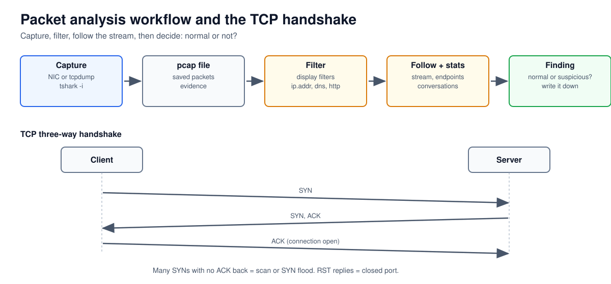

# Lesson 9: Packet Analysis with Wireshark and tshark

> **Module:** 02 Networking · **Week:** 4 · **Time:** ~4 hours
> **You will:** capture and read packets, use display filters, and decide whether traffic is normal or suspicious.
> **Maps to:** CompTIA Network+ N10-009 domain 5 (troubleshooting: protocol analyzers) · Security+ SY0-701/801 (tools to assess security) · SOC Level 1 skills (network evidence)

---

## 1. Why it matters in a SOC / cloud-security job

Logs say *what the device thought happened*. Packets show *what really crossed the wire*. When an alert is unclear (is this beacon real? what did the malware download?), a packet capture (**pcap**) is the ground truth. Many SOC training platforms and certification labs give you a pcap and ask questions about it. Network detection tools (Zeek, Suricata) are built on the same ideas.

## 2. Understand it



### 2.1 Tools

| Tool | What | Use |
|---|---|---|
| **Wireshark** | GUI analyzer | Explore a pcap, follow streams, colour rules |
| **tshark** | Wireshark on the command line | Scripts, servers, large files, automation |
| **tcpdump** | Light capture tool on Linux | Capture on servers; analyse later in Wireshark |
| **Zeek / Suricata** | Network security monitors | Turn traffic into logs and alerts at scale |

**Legal and privacy note:** capture only on networks and hosts you own or are authorised to monitor. Captures can contain passwords and personal data. Store them safely.

### 2.2 Capture filters vs display filters

- A **capture filter** (BPF syntax) decides what is *recorded*. It is fixed at capture time: `host 192.0.2.10 and port 443`.
- A **display filter** decides what is *shown* from what was recorded. It is flexible: `ip.addr == 192.0.2.10 && tcp.port == 443`.

| Goal | Display filter |
|---|---|
| One host | `ip.addr == 192.0.2.10` |
| Source or destination | `ip.src == ...`, `ip.dst == ...` |
| A port | `tcp.port == 443`, `udp.port == 53` |
| DNS only | `dns` |
| DNS failures | `dns.flags.rcode == 3` (NXDOMAIN) |
| HTTP requests | `http.request` |
| TLS hellos and server names | `tls.handshake.type == 1` and `tls.handshake.extensions_server_name` |
| TCP SYN without ACK (scan) | `tcp.flags.syn == 1 && tcp.flags.ack == 0` |
| Resets | `tcp.flags.reset == 1` |
| ARP | `arp` |
| Combine | `&&` and, `||` or, `!` not |

### 2.3 tshark commands you will use

```bash
tshark -D                                   # list interfaces
tshark -i 1 -c 100 -w sample.pcap           # capture 100 packets to a file
tshark -r sample.pcap -Y "dns"              # read a file, show DNS only
tshark -r sample.pcap -Y "http.request" -T fields -e ip.src -e http.host -e http.request.uri
tshark -r sample.pcap -q -z conv,tcp        # TCP conversations (who talked to whom, how much)
tshark -r sample.pcap -q -z endpoints,ip    # endpoint statistics
tshark -r sample.pcap -q -z io,phs          # protocol hierarchy
tshark -r sample.pcap -Y "dns.qry.name" -T fields -e dns.qry.name | sort | uniq -c | sort -rn | head
```

(`-i` interface, `-r` read, `-w` write, `-c` count, `-Y` display filter, `-f` capture filter, `-T fields -e` choose columns, `-z` statistics, `-q` quiet.)

### 2.4 What to look for

| Pattern | Possible meaning |
|---|---|
| Many SYN, few SYN-ACK, one source | Port scan or SYN flood |
| Regular small connections every N seconds | **Beaconing** (C2) |
| Long random DNS names, many TXT queries | DNS tunneling |
| HTTP with `User-Agent` of a hacking tool, or `POST` of large data to a new site | Exfiltration |
| Cleartext credentials (FTP, Telnet, HTTP basic) | Insecure protocol |
| Two MACs for one IP in ARP | ARP spoofing |
| TLS with expired or self-signed certificate to a rare IP | C2 or interception |
| Large outbound transfer at night | Data theft |

**Follow stream** (Wireshark: right click > Follow > TCP Stream) rebuilds one conversation so you can read it.

**Workflow:** (1) get statistics first (protocol hierarchy, conversations, endpoints); (2) find the odd one out; (3) filter to it; (4) follow the stream; (5) write down time, hosts, ports and your conclusion.

## 3. From DBA to security

| You know | Security use |
|---|---|
| SQL trace (10046), `tkprof` to see what the database really did | Packet capture to see what the network really did |
| `tnsping` slow, then SQL*Net trace | Same debug path: connect, handshake, data |
| Reading `listener.log` lines | Reading a flow of packets in order |
| "Measure first, then tune" | "Statistics first, then zoom in" |

## 4. Hands-on

1. **Wireshark on your laptop (free, optional):** install it, pick Wi-Fi, capture 60 seconds while you browse to one site and run `nslookup www.example`. Stop and apply: `dns`, `tcp.flags.syn == 1`, `tls.handshake.type == 1`. Use *Statistics > Conversations*.
2. **Sample captures:** the Wireshark wiki has a sample captures page. Other sources: the Malware-Traffic-Analysis site (training exercises with pcaps; handle them as potentially malicious files and open only in a VM). Treat any download as untrusted data.
3. **tshark in WSL:** `sudo apt install tshark`, then use the commands above on a pcap.
4. **Lab link:** your DNS and firewall analyzers do the same triage from *logs*. Compare the two: run `.venv/Scripts/python cybersecurity-track/02-networking/lab/demo.py` and find the packet filter you would use to confirm each alert:
   - port scan alert -> `tcp.flags.syn == 1 && tcp.flags.ack == 0 && ip.src == 203.0.113.9`
   - DNS tunneling alert -> `dns && ip.src == 192.0.2.50` and sort by `dns.qry.name` length
   - rare port alert -> `tcp.port == 4444`, then follow stream

(The lab data is synthetic and has no pcap. That is on purpose, so the lab runs offline with nothing to download.)

## 5. Practice platforms

- **TryHackMe:** *Wireshark: The Basics*, *Wireshark: Packet Operations*, *Wireshark: Traffic Analysis*, and the *tcpdump* and *Zeek* rooms. Search for them by name. They sit well before *SOC Level 1*.
- **HTB Academy:** modules on network traffic analysis and Wireshark in the SOC Analyst path (check names in the catalogue). **Sherlocks** often include a pcap.

## 6. Three realistic scenarios

1. **Beacon.** A workstation connects to `203.0.113.77:443` every 60 seconds with the same small size. *Investigate:* conversation list, certificate, JA3, the process on the host. *Do:* block the IP, isolate, collect.
2. **Cleartext password.** A capture shows `USER`/`PASS` on FTP. *Do:* identify the account and system, rotate the password, replace FTP.
3. **Slow application.** Capture shows many retransmissions and zero-window messages. *Investigate:* the server or a middle device. *Do:* a performance (not security) fix, but the method is the same. Good practice for a DBA.

## 7. Common mistakes

- Capturing on the wrong interface or with too narrow a capture filter.
- Reading packet by packet without statistics first.
- Forgetting that encrypted traffic hides content, so look at metadata.
- Not noting time zones and clock offsets.
- Opening a malware pcap on the host machine instead of a VM.
- Sharing a capture that contains passwords or personal data.

## 8. Interview questions

<details><summary><b>Q1. Capture filter vs display filter?</b></summary>
A capture filter (BPF) limits what is recorded. A display filter limits what is shown from a recorded file. You can change display filters at any time.
</details>

<details><summary><b>Q2. Which filter shows DNS failures?</b></summary>
`dns.flags.rcode == 3` shows NXDOMAIN answers.
</details>

<details><summary><b>Q3. How can you spot a port scan in a capture?</b></summary>
Many TCP SYN packets from one source to many ports with few completed handshakes, and many RST or no replies. Filter `tcp.flags.syn == 1 && tcp.flags.ack == 0`.
</details>

<details><summary><b>Q4. What is beaconing?</b></summary>
Malware contacting its controller at regular intervals. In packets: same destination, similar size, regular timing.
</details>

<details><summary><b>Q5. How do you rebuild one conversation?</b></summary>
Follow TCP stream in Wireshark, or use tshark `-z follow,tcp,ascii,<stream>`.
</details>

<details><summary><b>Q6. What can you see in HTTPS traffic without decrypting?</b></summary>
IP addresses, ports, TLS server name (SNI), certificate details, timing and sizes.
</details>

<details><summary><b>Q7. tshark options for reading a file and showing fields?</b></summary>
`tshark -r file.pcap -Y "<filter>" -T fields -e <field>`.
</details>

<details><summary><b>Q8. How do you find the biggest talkers in a pcap?</b></summary>
Wireshark Statistics > Conversations or Endpoints, or `tshark -r file -q -z conv,ip` and sort by bytes.
</details>

<details><summary><b>Q9. Scenario: an alert says "possible data exfiltration" from a server. How does a pcap help?</b></summary>
It shows destination, protocol, amount and, if unencrypted, content. Filter the host, check conversations by bytes, find the large flows, and follow them.
</details>

<details><summary><b>Q10. What are the legal and privacy points when capturing?</b></summary>
Only monitor networks you are authorised to monitor, limit capture to what is needed, protect and delete captures, and follow company policy and local law.
</details>

## 9. Checklist

- [ ] I can write 8 display filters from memory.
- [ ] I can run 4 tshark statistics commands.
- [ ] I can describe the TCP handshake and what a scan looks like.
- [ ] I mapped each lab alert to a packet filter.
- [ ] I answered the questions without looking.

## 10. References

- Wireshark User's Guide and display filter reference: https://www.wireshark.org/docs/
- tshark manual page: https://www.wireshark.org/docs/man-pages/tshark.html
- The *TShark guide* in the course library (command overview, statistics, output formats)
- Back to the [module README](README.md)
