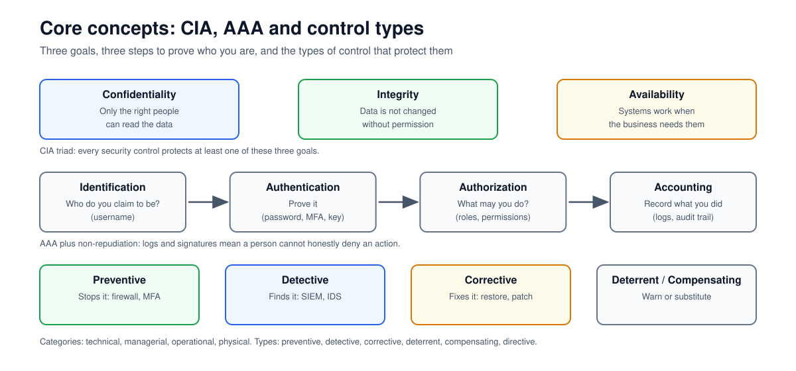

# 01 · Core security concepts

> **Module:** 03 Security Foundations · **Week:** 4 · **Time:** ~6 hours
> **You will:** explain CIA, AAA, non-repudiation, control types, defense in depth, least privilege and zero trust in simple words, and sort real controls into the right boxes.
> **Certification:** Security+ SY0-701/801 domain 1 (General Security Concepts) · ISC2 CC domain 1 (Security Principles)

---

## 1. Why it matters in a SOC / cloud-security job

Every alert you see, every ticket you write and every policy you read uses these words. If you mix them up, you will misread the situation.

- A SOC ticket says "loss of availability on the payment API". That is a CIA word. It tells you what was hurt.
- A cloud audit finding says "excessive permissions on a service role". That is a least-privilege word.
- A manager asks "is this a detective or a preventive control?" You need a clear, short answer.
- A vendor says "we are zero trust". You need to know what that should mean, so you can ask the right questions.

---

## 2. Understand it

### 2.1 The CIA triad (the three goals)

| Goal | Plain meaning | Attack that hurts it | Typical control |
|---|---|---|---|
| **Confidentiality** | Only the right people can read the data | Data theft, leaked backup | Encryption, access control |
| **Integrity** | Data is correct and not changed without permission | Tampering, SQL injection that edits rows | Hashing, digital signatures, change control |
| **Availability** | Systems and data work when needed | Ransomware, DDoS, disk failure | Backups, redundancy, patching |

Some people add more words: **authenticity** (the data really comes from who it says) and **non-repudiation** (see below).

### 2.2 AAA and non-repudiation

- **Identification:** you say who you are (a username).
- **Authentication:** you prove it. Three kinds of proof: something you **know** (password), something you **have** (phone, key), something you **are** (fingerprint). MFA (multi-factor authentication) means two or more *different* kinds.
- **Authorization:** the system decides what you may do.
- **Accounting (auditing):** the system records what you did.
- **Non-repudiation:** a person cannot honestly deny an action. It needs good logs plus something that proves identity, such as a digital signature. A shared admin password breaks non-repudiation: you cannot tell who used it.

### 2.3 Control categories and types

Two ways to group controls. Security+ asks about both.

| Category (what it is made of) | Examples |
|---|---|
| **Technical** | Firewall, encryption, EDR |
| **Managerial** (also "administrative") | Risk assessment, policy, security review |
| **Operational** | Training, shift procedures, patching routine |
| **Physical** | Lock, fence, camera, badge reader |

| Type (what it does) | Examples |
|---|---|
| **Preventive** | MFA, firewall rule, locked door |
| **Detective** | SIEM alert, IDS, camera, log review |
| **Corrective** | Restore from backup, patch, isolate a host |
| **Deterrent** | Warning banner, visible camera |
| **Compensating** | A different control when the ideal one is not possible (e.g. extra monitoring on a server that cannot be patched) |
| **Directive** | A policy or standard that tells people what to do |

One control can have several types. A camera is detective *and* deterrent.

### 2.4 Defense in depth

Use many different layers, so one failure does not mean a breach. Layers: people and policy, perimeter, network, host, application, data. Different layers should use *different* methods. Three firewalls from the same vendor with the same rules are one layer, not three.

### 2.5 Least privilege, need to know, separation of duties

- **Least privilege:** give only the access needed for the job, for the time needed.
- **Need to know:** even with clearance, you see data only if your task needs it.
- **Separation of duties:** no one person can complete a risky action alone (one person requests a payment, another approves it).
- **Job rotation and mandatory vacation:** other people see what you do, so fraud is easier to find.

### 2.6 Zero trust basics

Old idea: trust everything inside the office network. Zero trust says: **never trust, always verify**, for every request, wherever it comes from.

| Principle | What it means in practice |
|---|---|
| Verify explicitly | Check identity, device health, location and risk on every request |
| Least privilege | Small, time-limited access (just-in-time) |
| Assume breach | Segment the network, log everything, limit blast radius |

Parts of the model (NIST SP 800-207): a **policy decision point** decides, a **policy enforcement point** applies the decision, and the **data plane** carries the traffic.

> **From DBA to security**
> You already live by these ideas.
> - **Roles and grants** = authorization and least privilege. Giving `DBA` to an app account is a least-privilege failure.
> - **Audit trail** (`AUDIT`, unified auditing) = accounting. Turned on, it gives you non-repudiation for who ran `DROP TABLE`.
> - **Checksums and block corruption checks** = integrity.
> - **RMAN backups, Data Guard** = availability controls (corrective and detective: you run `VALIDATE`).
> - **Shared `SYS` password** = a non-repudiation problem you have probably seen.
> - **Listener ACLs, firewall rules for port 1521** = preventive controls and one layer of depth.

---

## 3. Hands-on

1. **Classify.** Take the table below, cover the right column, and classify each control by *category* and *type*. Compare.

| Control | Category | Type(s) |
|---|---|---|
| Door badge reader | Physical | Preventive |
| SIEM correlation rule | Technical | Detective |
| Security awareness course | Operational | Preventive (and deterrent) |
| Written password policy | Managerial | Directive |
| Restore from last night's backup | Technical | Corrective |
| "You are monitored" login banner | Technical | Deterrent |

2. **Map your own database.** For an Oracle (or any) database you know, write one control for each of C, I and A, and name its type. Example: "TDE tablespace encryption: confidentiality, preventive, technical".
3. **Optional free tool:** on Windows, open **Event Viewer → Windows Logs → Security**. Find a logon event. That is the accounting step of AAA in action.

*(The coding lab starts in lessons 02 and 03.)*

---

## 4. Practice platforms

- **TryHackMe:** the Cyber Security 101 path starts with these ideas. Search for "Security Principles" and "Defensive Security Intro".
- **ISC2:** the free *Certified in Cybersecurity* official self-paced material may still be available for study. Check the ISC2 site.
- **Flash cards:** make your own for control types. Writing them is the learning.

---

## 5. Three realistic scenarios

**1. The shared admin account.** *What happened:* a table was dropped on a reporting database. The audit log says `db_admin`. Five people know the password. *Investigate:* check session source IPs, jump-host logs and VPN logs to guess who. *Fix:* personal admin accounts, a vault with check-out records, and alerts on privileged use. This restores accountability (non-repudiation).

**2. "We have a firewall, so we are safe."** *What happened:* an employee opened a phishing attachment. Malware on the laptop reached the internal file server, because the inside was flat and trusted. *Investigate:* EDR timeline, SMB logs. *Fix:* defense in depth: email filtering, EDR, network segmentation, and least-privilege file permissions. This is the zero-trust "assume breach" idea.

**3. The compensating control.** *What happened:* a legacy system cannot be patched and has a critical flaw. *Investigate:* confirm what exposes it and who needs it. *Fix:* compensate: isolate it in its own segment, allow only needed ports, add extra logging, record an approved risk exception with an end date.

---

## 6. Common mistakes

- Saying "confidentiality" when the problem is integrity (a changed value is not a leak).
- Thinking one strong control is enough.
- Mixing up category and type. *Category* = what it is made of. *Type* = what it does.
- Calling MFA "two passwords". Two *different* factors are needed.
- Believing zero trust is a product you can buy. It is a design approach.

---

## 7. Interview questions

<b>Q1. What is the CIA triad?</b>

Confidentiality (only authorized people read data), Integrity (data stays correct), Availability (systems work when needed). Every control protects at least one.

<b>Q2. Ransomware hits a file server. Which CIA goals are affected?</b>

Availability first (files cannot be used). Often confidentiality too, because many groups also steal the data before encrypting. Integrity too, because files are altered.

<b>Q3. Explain AAA.</b>

Authentication proves who you are, authorization decides what you may do, accounting records what you did. Identification (claiming an identity) comes before authentication.

<b>Q4. What is non-repudiation and how do you get it?</b>

A person cannot credibly deny an action. You need unique accounts, protected logs, and for strong proof, digital signatures. Shared accounts destroy it.

<b>Q5. Give an example of each control type.</b>

Preventive: MFA. Detective: SIEM alert. Corrective: restore from backup. Deterrent: warning banner. Compensating: extra monitoring when patching is impossible. Directive: a policy.

<b>Q6. What is the difference between a control category and a control type?</b>

Category is what the control is made of: technical, managerial, operational, physical. Type is its job: preventive, detective, corrective, and so on.

<b>Q7. What is defense in depth?</b>

Several independent layers so a single failure does not cause a breach. Layers must be different in kind, for example email filter, EDR, segmentation, backups.

<b>Q8. Explain least privilege with a database example.</b>

An application account gets only `SELECT, INSERT, UPDATE` on its own schema, not `DBA` or `ANY` privileges. If the app is hacked, the damage is small.

<b>Q9. What is separation of duties?</b>

Splitting a sensitive task across people so one person cannot do it alone, such as one person creates a vendor and another approves payments.

<b>Q10. What does zero trust mean?</b>

Never trust a request because of its network location. Verify identity and device each time, give least privilege, and assume a breach has already happened.

<b>Q11. Scenario: a legacy server cannot be patched. What do you do?</b>

Use compensating controls: isolate it, limit ports, add monitoring, get a documented risk acceptance with an owner and expiry, and plan its replacement.

<b>Q12. Is a security camera preventive or detective?</b>

Mainly detective (records events) and deterrent (people see it). It does not physically stop anyone.

<b>Q13. Explain to a manager why we need MFA.</b>

Passwords are stolen or guessed all the time. MFA means a stolen password alone is not enough, so it blocks most account-takeover attempts at low cost.

---

## 8. Checklist

- [ ] I can say CIA, AAA and non-repudiation from memory, with one example each.
- [ ] I can sort 10 controls by category and type.
- [ ] I can explain least privilege with a database example.
- [ ] I can explain zero trust without using the word "product".

## 9. References

- CompTIA Security+ SY0-701 exam objectives (free PDF on the CompTIA site; check the official page for SY0-801 before booking).
- ISC2 Certified in Cybersecurity exam outline.
- NIST SP 800-207, *Zero Trust Architecture*.
- NIST SP 800-53 control families (for control language).
- Study aid: the library's Security+ notes (SY0-601 era, concepts still valid).

**Next:** [02 · Threats, vulnerabilities and attacks](02-threats-vulnerabilities-attacks.md)
