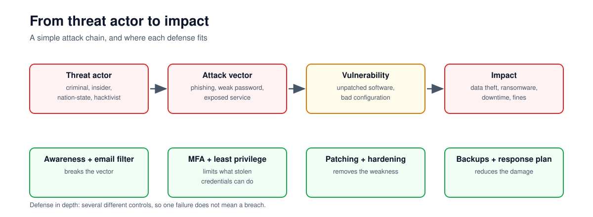

# 02 · Threats, vulnerabilities and attacks

> **Module:** 03 Security Foundations · **Week:** 5 · **Time:** ~8 hours
> **You will:** name the main attack types, tell threat actors apart, and analyze a phishing email by its headers with a small Python tool.
> **Certification:** Security+ SY0-701/801 domain 2 (Threats, Vulnerabilities and Mitigations) · ISC2 CC domains 1 and 5 (principles, security operations)

---

## 1. Why it matters in a SOC / cloud-security job

Most SOC alerts are one of a small set of attack types. Phishing is the most common way into a company. Learn to recognize the pattern fast, and you will triage faster.

- **Phishing and business email compromise (BEC):** the FBI's IC3 reports every year show BEC among the costliest cybercrime types. Read the latest IC3 report for numbers.
- **Credential attacks:** password spraying and stuffing against cloud sign-in pages show up daily in Microsoft Entra ID sign-in logs.
- **Ransomware:** it usually starts with a phishing email, an exposed remote service or stolen credentials.
- **Web attacks:** SQL injection and cross-site scripting (XSS) are in the OWASP Top 10 for a reason.

---

## 2. Understand it



**Words first.** A **threat** is something that can cause harm. A **vulnerability** is a weakness. An **attack** is a threat using a vulnerability. **Risk** is how likely and how bad that is (see module 04).

### 2.1 Threat actors

| Actor | Main goal | Skill / resources | Example behavior |
|---|---|---|---|
| Cybercriminal | Money | Medium to high, organized | Ransomware, BEC, selling stolen data |
| Nation-state / APT | Spying, disruption | High, patient | Long stealthy access, supply-chain attacks |
| Hacktivist | Message, attention | Low to medium | DDoS, defacement, leaks |
| Insider (malicious) | Money, revenge | Has legitimate access | Copying data before leaving |
| Insider (careless) | None | Has legitimate access | Sends data to the wrong person, misconfigures storage |
| Script kiddie | Fun, fame | Low, uses others' tools | Runs public scanners and exploits |
| Shadow IT | Convenience | n/a | Unapproved cloud apps that bypass controls |

### 2.2 Malware types

| Type | What it does |
|---|---|
| Virus / worm | Virus needs a host file. Worm spreads by itself over a network. |
| Trojan | Looks useful, hides bad code |
| Ransomware | Encrypts files, often steals first (double extortion), demands payment |
| Spyware / keylogger / infostealer | Collects passwords, cookies, keystrokes |
| RAT (remote access trojan) | Gives the attacker remote control |
| Rootkit | Hides itself deep in the OS |
| Fileless malware | Runs in memory using tools already on the host (PowerShell) |
| Logic bomb | Triggers on a condition or date |
| Botnet | Many infected machines under one controller |

### 2.3 Social engineering

| Technique | Meaning |
|---|---|
| Phishing | Fake email to steal data or run malware |
| Spear phishing / whaling | Aimed at one person / an executive |
| Smishing / vishing | By SMS / by phone |
| BEC | Impersonating a boss or vendor to move money |
| Pretexting | An invented story ("I am from IT support") |
| Tailgating | Following someone through a door |
| Quishing | A malicious QR code |
| MFA fatigue | Sending many approval prompts until the user taps "approve" |

Attackers use **urgency, authority, fear and curiosity**. Teach people to stop at those feelings.

### 2.4 Password attacks

| Attack | How it works | Best defense |
|---|---|---|
| Brute force | Try all combinations | Lockout, rate limits, long passwords |
| Dictionary | Try common passwords | Banned-password list, strong hashing |
| Password spraying | One common password against many accounts | MFA, detection of many accounts failing from one source |
| Credential stuffing | Reuse leaked username/password pairs | MFA, breached-password checks |
| Offline cracking | Crack stolen hashes | Salted, slow hashing (lesson 03) |
| Pass-the-hash / token theft | Reuse a captured hash or session token | Credential Guard, short sessions, phishing-resistant MFA |

### 2.5 Web and application attacks

- **SQL injection:** user input changes the SQL query. Defense: parameterized queries (bind variables). You know these from Oracle.
- **XSS (cross-site scripting):** script runs in another user's browser. Defense: output encoding, Content Security Policy.
- **CSRF:** tricks a logged-in browser into sending a request. Defense: anti-CSRF tokens, SameSite cookies.
- **Directory traversal, command injection, SSRF, broken access control:** all about unvalidated input or missing checks.
- **Buffer overflow, race condition, supply-chain attack:** weakness in code or dependencies.

### 2.6 Network attacks

| Attack | Short description |
|---|---|
| DoS / DDoS | Overload a service so it is unavailable |
| On-path (man-in-the-middle) | Attacker sits between two parties |
| ARP / DNS spoofing and poisoning | Fake address answers redirect traffic |
| Rogue access point / evil twin | Fake Wi-Fi |
| Replay | Resend captured valid messages |
| Port scanning and sniffing | Recon and eavesdropping |

### 2.7 Insider threats

Signs: odd-hours access, large downloads, access to data unrelated to the job, use of personal cloud storage, resignation plus data copying. Controls: least privilege, DLP (data loss prevention), user behavior analytics, separation of duties, a clean offboarding process.

### 2.8 Vulnerabilities

Software flaws, misconfiguration, default passwords, missing patches, weak crypto, unsupported systems, human error. Zero-day = no patch exists yet. Vulnerability management is its own module (08).

> **From DBA to security**
> - **SQL injection** is the one you will understand best. A bind variable keeps *data* separate from *code*.
> - **Password spraying** looks like thousands of `ORA-01017: invalid username/password` entries across many users from one host. You may have seen that in listener or audit logs.
> - **Insider threat** is a DBA topic: DBAs have the most powerful access in the company. Security teams watch privileged users, so expect it.
> - **Default accounts** (`SCOTT`, `SYSTEM` with old passwords) are classic vulnerability findings.
> - **Listener attacks** (exposed port 1521) map to network scanning and exposed services.

---

## 3. Hands-on

### Lab: phishing email header analyzer

The tool reads a synthetic `.eml` file and checks: SPF/DKIM/DMARC results, From vs Reply-To mismatch, From vs Return-Path mismatch, lookalike domains, and link text that shows one domain but goes to another. Three samples are in `lab/samples/`.

Short definitions:
- **SPF:** DNS record listing the servers allowed to send for a domain.
- **DKIM:** a signature on the email. It proves the content and domain were not changed.
- **DMARC:** a policy that says what to do when SPF/DKIM do not align with the visible From domain, and where to send reports.

From the repo root:

```bash
.venv/Scripts/python cybersecurity-track/03-security-foundations/lab/demo.py
```

Part 3 of the real output:

```text
--- legit.eml ---
Subject : Team lunch on Friday
From    : northwind.example
Auth    : spf=pass dkim=pass dmarc=pass
Score   : 0  -> CLEAN

--- phish_spoof.eml ---
Subject : URGENT wire transfer today
From    : northwind.example
Auth    : spf=fail dkim=none dmarc=fail
Score   : 100  -> PHISHING-LIKELY
  - [spf_fail] SPF result is 'fail'
  - [dkim_fail] DKIM result is 'none'
  - [dmarc_fail] DMARC result is 'fail'
  - [reply_to_mismatch] Reply-To domain freemail.example differs from From northwind.example
  - [return_path_mismatch] Return-Path domain mailer.badhost.example differs from From northwind.example

--- phish_lookalike.eml ---
Subject : Your password expires today
From    : northwlnd.example
Auth    : spf=pass dkim=pass dmarc=pass
Score   : 65  -> PHISHING-LIKELY
  - [lookalike_domain] northwlnd.example looks like trusted domain northwind.example
  - [link_mismatch] link text shows login.northwind.example but goes to login.northwlnd.example
```

**Read this carefully.** The third email passes SPF, DKIM and DMARC. The attacker registered `northwlnd.example` (an `l` instead of an `i`) and set it up correctly. Passing authentication only proves *the sender owns that domain*, not that the domain is trustworthy. That is why a lookalike check exists.

Run the tests:

```bash
.venv/Scripts/python -m pytest cybersecurity-track/03-security-foundations -v
```

**Break it yourself (predict, then run):**
1. Add `northwind-secure.example` to a copy of `legit.eml` as the From domain. Which finding appears?
2. Add a `Reply-To` header that matches the From domain. Does the score fall?
3. Add a new lookalike trick (`rn` for `m`) and extend `CONFUSABLES`. Write a test.

### Optional free tools

- **Google Admin Toolbox "Messageheader"** and **MXToolbox** header analyzer (use only with non-sensitive emails; never paste real internal mail into public sites).
- **VirusTotal / urlscan.io** to check a suspicious URL (do not upload private files).
- **CyberChef** (runs in the browser or offline) to decode Base64 in phishing payloads.
- **Windows Sandbox** (Windows 11 Pro) to open suspicious links safely. On Home, use a VM or leave it alone.

---

## 4. Practice platforms

- **TryHackMe:** Cyber Security 101 and SOC Level 1 include phishing analysis topics. Search for "Phishing" in the room list.
- **HTB Academy:** SOC Analyst job-role path covers attack types and triage.
- **Free:** PhishTank and OpenPhish list real phishing URLs for study. Never click them on your work machine.

---

## 5. Three realistic scenarios

**1. The CEO wire request.** *What happened:* the finance team receives "urgent wire" from `ceo@northwind.example`. *Investigate:* open the headers. SPF and DMARC fail, Reply-To goes to a free mail domain. *Do:* do not reply. Call the CEO on a known number. Report to the SOC, search the mailbox for the same sender/subject, block the sender domain, and notify finance to hold the payment.

**2. Many failed logins, one success.** *What happened:* 4,000 failed sign-ins across 900 accounts from one IP, then one success. *Investigate:* it looks like password spraying. Find the successful account, its sign-in history, MFA status, mailbox rules, and new devices. *Do:* reset the password, revoke sessions, block the IP, force MFA, and check the 900 accounts for other successes.

**3. A new "payroll" link.** *What happened:* the email shows `https://login.northwind.example` but the link goes to a different host. *Investigate:* hover or view the HTML; check domain age and certificate; search who else received it and who clicked (proxy and DNS logs). *Do:* block, purge from mailboxes, reset passwords for clickers who entered credentials.

---

## 6. Common mistakes

- Trusting the display name (`"CEO Office"`) instead of the real address.
- Believing "SPF/DKIM/DMARC pass" means "safe".
- Blaming the user. Phishing is designed to work. Make reporting easy and safe.
- Forgetting to search for *other recipients* after finding one phishing email.
- Mixing up spraying (one password, many users) and brute force (many passwords, one user).

---

## 7. Interview questions

<details><summary><b>Q1. What is the difference between a threat, a vulnerability and a risk?</b></summary>
A threat can cause harm. A vulnerability is a weakness it can use. Risk is the chance and the impact of that happening.
</details>

<details><summary><b>Q2. How do you recognize a phishing email?</b></summary>
Urgency, mismatched sender and reply address, lookalike domain, a link whose real target differs from its text, unexpected attachments, and failing SPF/DKIM/DMARC. No single sign is enough.
</details>

<details><summary><b>Q3. What are SPF, DKIM and DMARC?</b></summary>
SPF lists servers allowed to send for a domain. DKIM signs the message. DMARC says what to do when the visible From domain does not align with SPF or DKIM, and sends reports.
</details>

<details><summary><b>Q4. An email passes SPF, DKIM and DMARC but is phishing. How?</b></summary>
The attacker owns a lookalike domain and configured it correctly. Authentication proves domain ownership, not good intent. Check the domain name, age and link targets.
</details>

<details><summary><b>Q5. Password spraying vs credential stuffing?</b></summary>
Spraying: a few common passwords against many accounts. Stuffing: username and password pairs leaked from another site, tried here. MFA helps against both.
</details>

<details><summary><b>Q6. Virus vs worm vs trojan?</b></summary>
A virus attaches to a host file and needs a user action. A worm spreads by itself. A trojan pretends to be useful.
</details>

<details><summary><b>Q7. Explain SQL injection and its best fix.</b></summary>
User input becomes part of the SQL command. Fix: parameterized queries, plus least privilege for the DB account and input validation.
</details>

<details><summary><b>Q8. What is double extortion ransomware?</b></summary>
The attacker steals data first, then encrypts. They threaten to leak data if you refuse to pay, so restoring from backup alone does not end the problem.
</details>

<details><summary><b>Q9. What is a zero-day?</b></summary>
A vulnerability with no available patch, often already used by attackers. Defenses: layered controls, monitoring, virtual patching, and reducing exposure.
</details>

<details><summary><b>Q10. How do you spot an insider threat?</b></summary>
Unusual access hours or volume, access outside normal duties, copying to personal storage, and HR signals like resignation. Use DLP and user behavior baselines; involve HR and legal early.
</details>

<details><summary><b>Q11. Scenario: a user says they entered their password on a fake page. First steps?</b></summary>
Reset the password, revoke sessions and tokens, check sign-in logs, mailbox rules and MFA devices, find who else got the email, and block the URL/domain.
</details>

<details><summary><b>Q12. What is an on-path (man-in-the-middle) attack and how does TLS help?</b></summary>
The attacker sits between two parties and reads or changes traffic. TLS encrypts the traffic and verifies the server certificate, so the attacker cannot read or silently change it.
</details>

<details><summary><b>Q13. What is MFA fatigue and what do you do?</b></summary>
Spamming approval prompts until a user taps "approve". Use number matching, limit prompts, alert on repeated denials, and move to phishing-resistant methods (passkeys, FIDO2).
</details>

---

## 8. Checklist

- [ ] I can name 6 attack types and one defense for each.
- [ ] I can read email headers and explain SPF, DKIM and DMARC.
- [ ] I ran the lab, and I can explain why the lookalike email passed authentication.
- [ ] I can tell spraying from stuffing from brute force.

## 9. References

- CompTIA Security+ exam objectives, domain 2.
- OWASP Top 10 (current edition) and OWASP Cheat Sheet Series.
- MITRE ATT&CK, *Initial Access* and *Credential Access* tactics.
- CISA, *Phishing guidance*, and FBI IC3 annual reports.
- M3AAWG and dmarc.org for email authentication basics.
- Study aid: the library's Security+ notes, sections on social engineering and attack types.

**Next:** [03 · Cryptography and PKI](03-cryptography-and-pki.md)
