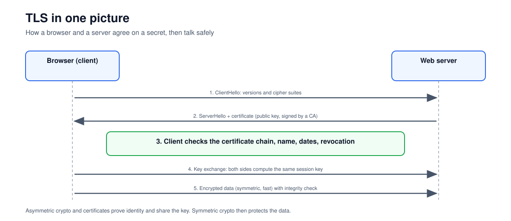

# 03 · Cryptography and PKI

> **Module:** 03 Security Foundations · **Week:** 6 · **Time:** ~8 hours
> **You will:** explain hashing, encryption, signatures, certificates and TLS, and prove with a lab why plain, unsalted MD5 and salted PBKDF2 passwords behave very differently.
> **Certification:** Security+ SY0-701/801 domain 1 (cryptographic solutions) and domain 3 · ISC2 CC domains 1 and 4

---

## 1. Why it matters in a SOC / cloud-security job

- Data breaches become much worse when passwords were stored badly. Weak hashing turns a stolen table into stolen passwords within hours.
- Cloud security is full of crypto choices: KMS keys, customer-managed keys, TLS versions, certificate expiry.
- A certificate that expires on a Sunday can take a service down. This is an availability failure caused by key management.
- In an alert, "SSL/TLS version 1.0 in use" or "self-signed certificate" needs a decision from you.

---

## 2. Understand it

### 2.1 Three tools, three jobs

| Tool | Reversible? | Key? | Used for | Examples |
|---|---|---|---|---|
| **Hashing** | No (one-way) | No | Integrity, password storage, fingerprints | SHA-256, SHA-3, bcrypt/Argon2 (password hashes) |
| **Symmetric encryption** | Yes | One shared key | Fast bulk data encryption | AES-128/256 (GCM mode) |
| **Asymmetric encryption** | Yes | Key pair: public + private | Key exchange, signatures, identity | RSA, ECDSA, Ed25519, ECDH |

Remember: **encryption = secrecy (confidentiality). Hashing = fingerprint (integrity). Signature = origin + integrity (non-repudiation).**

Old and broken for security use: MD5, SHA-1, DES, RC4. Do not use them for new designs.

### 2.2 Hashing and password storage

A good hash is deterministic, fast to compute, impossible to reverse in practice, and tiny changes in input give a totally different output. For *file integrity*, fast is good. For *passwords*, fast is bad, because attackers can try billions of guesses.

| Technique | What it adds |
|---|---|
| **Salt** | A random value per password, stored next to the hash. Same password gives a different hash for each user. Kills precomputed tables (rainbow tables) and hides duplicates. |
| **Slow / stretched hashing** | Many iterations or memory-hard steps. Makes each guess costly. Use Argon2id, bcrypt, scrypt, or PBKDF2 with a high iteration count. |
| **Pepper** | A secret value kept outside the database (e.g. in an HSM or KMS) and mixed into the hash. |
| **HMAC** | A hash with a secret key. Proves a message was made by someone holding the key. |

### 2.3 Symmetric vs asymmetric

- **Symmetric** is fast but both sides need the same secret key. How do you share it safely? That is the key distribution problem.
- **Asymmetric** solves sharing: anyone can use your public key to encrypt to you, and only your private key decrypts. But it is slow.
- **Real systems use both** (hybrid encryption). Asymmetric crypto agrees on a session key; symmetric crypto encrypts the data. That is TLS.

### 2.4 Digital signatures

The sender hashes the message, then signs the hash with their **private** key. Anyone can verify with the **public** key. This gives integrity, authenticity and non-repudiation. Used for code signing, signed emails, certificates and software updates.

### 2.5 Certificates and PKI

A **certificate** (X.509) ties a public key to a name (a domain or person), and it is signed by a **certificate authority (CA)**.



| Part of PKI | Role |
|---|---|
| Root CA | The trust anchor, stored in your OS/browser trust store. Kept offline. |
| Intermediate CA | Signs end certificates. Limits damage if compromised. |
| End-entity certificate | The website or user certificate |
| CSR | Certificate signing request. You send your public key and name to the CA. |
| CRL / OCSP | Ways to check if a certificate was revoked |
| Chain of trust | End cert is signed by an intermediate, which is signed by a root you trust |

A browser checks: the chain leads to a trusted root, the name matches, the dates are valid, and it is not revoked. **Self-signed** certificates have no CA behind them, so clients do not trust them by default.

### 2.6 TLS in practice

- Use **TLS 1.2 or 1.3**. Turn off SSL 2/3 and TLS 1.0/1.1.
- TLS 1.3 removes old weak options and gives forward secrecy by default. **Forward secrecy** means stealing the server's key later does not reveal old recorded traffic.
- **HSTS** tells browsers to always use HTTPS. **mTLS** (mutual TLS) means the client also presents a certificate (common between services).

### 2.7 Key management

Most real crypto failures are key failures, not algorithm failures.

- Generate keys with a good random source. Never hard-code keys in code or git.
- Store in a KMS / HSM / key vault. Limit who can use them. Log every use.
- Rotate on a schedule and after any suspicion. Plan for expiry and revocation.
- Separate keys by purpose and environment.
- Keep key backups protected and tested. Losing a key can mean losing the data (an availability problem).

> **From DBA to security**
> - **TDE (Transparent Data Encryption)** with the Oracle **wallet** is key management. The wallet is the key store. Lose it and the tablespaces are unreadable. Compare it to a cloud KMS.
> - Oracle password verifiers use salted hashing. You already know the user table must never hold passwords in clear text.
> - `DBMS_CRYPTO` and `DBMS_OBFUSCATION_TOOLKIT` (old) are exactly the "do not roll your own" lesson.
> - **Network encryption** for SQL*Net (native encryption or TLS with a wallet) is TLS for databases.
> - **Backup encryption** in RMAN needs the key to restore: key management in the DR plan.

---

## 3. Hands-on

### Lab: password storage wrong vs right

`lab/password_storage.py` stores the same synthetic passwords three ways and then runs a dictionary attack on the "stolen table". Everything is fake.

```bash
.venv/Scripts/python cybersecurity-track/03-security-foundations/lab/demo.py
```

Real output (Parts 1 and 2; salt and PBKDF2 values change on each run, and times depend on your CPU):

```text
=== Part 1: password storage ===
Stored value for user 'asha' (password 'welcome1'):
  plain : welcome1
  md5   : 201f00b5ca5d65a1c118e5e32431514c
  pbkdf2: 72091e4e2e59fd189a7f6c74ab3e3f28...  (salt bf2556ae..., 50000 iterations)
Users with the same stored value (leaks 'same password'):
  md5   : [['asha', 'ben']]
  pbkdf2: []

=== Part 2: dictionary attack (stolen table, 15-word list) ===
scheme   cracked  hashes computed  seconds 
plain      3/4    0                0.00    
md5        3/4    28               0.00    
pbkdf2     3/4    28               0.56    
md5 with a reusable precomputed table: 3/4 cracked, only 15 hashes computed
```

**What to learn from it:**

1. **Plain** and **MD5** show `asha` and `ben` have the same password because the stored values match.
2. **PBKDF2 does not stop a weak password.** `dragon` was still found. Slow hashing only raises the cost per guess. It cannot save `welcome1`. That is why you also need long passwords, a banned-password list, and MFA.
3. The strong password (`chen`) survived all three schemes, because it was not in the wordlist.
4. For MD5, the attacker hashes the wordlist **once** (15 hashes) and checks every user. With salted PBKDF2 they must redo the work for every user and each hash costs 50,000 rounds. In this tiny demo the gap is already about 0.56 seconds vs near zero. With millions of words and real iteration counts the gap becomes days and years.

Key code idea (from `store_pbkdf2`):

```python
digest = hashlib.pbkdf2_hmac("sha256", password.encode(), salt, iterations)
```

and the compare uses `hmac.compare_digest` so timing does not leak information.

**Break it yourself:**
1. Raise `DEFAULT_ITERATIONS` to 600,000 and re-run the demo. Predict the time first.
2. Add a user with a password that is in the wordlist plus a digit (`dragon1`). Is it found? Why?
3. Set a fixed salt for all users. Does `duplicate_hashes` start showing duplicates?

Run the tests (they check the attack results and that salts differ):

```bash
.venv/Scripts/python -m pytest cybersecurity-track/03-security-foundations -v
```

### Optional free tools

- `openssl` (in Git Bash or WSL): `echo -n "hello" | openssl dgst -sha256`
- `openssl s_client -connect example.org:443 -showcerts` to see a certificate chain (use a public site you may test, and read the output).
- **hashcat** or **John the Ripper**: only on your own lab hashes, never on others' data.
- Browser lock icon → certificate details. Find the issuer, expiry date and SAN names.

---

## 4. Practice platforms

- **TryHackMe:** Cyber Security 101 has cryptography content; search "Cryptography" and "Hashing" rooms. Also "Public Key Cryptography Basics".
- **HTB Academy:** modules on cryptography and attacking password hashes appear in various paths. Search "hash" and "cryptography".
- **CryptoHack** (free, beginner challenges).

---

## 5. Three realistic scenarios

**1. The leaked user table.** *What happened:* a breach notice says a company's passwords were "hashed with MD5". *Investigate:* ask: salted? Which algorithm? Do users reuse passwords? *Do:* force password reset, move to Argon2id/bcrypt, add MFA, check for credential stuffing on your own login page.

**2. The expired certificate.** *What happened:* at 02:00 an internal API fails with certificate errors. *Investigate:* `openssl s_client`, check `notAfter`. *Do:* renew and deploy; then fix the cause: a certificate inventory, expiry monitoring 30/14/7 days ahead, and automated renewal (ACME).

**3. The private key in git.** *What happened:* a secret scanner finds a TLS private key in a repository. *Investigate:* when was it pushed, who had access, is it in the history, is the certificate in use? *Do:* treat the key as compromised even after deleting the file. Revoke, reissue, rotate, and add a pre-commit scanner.

---

## 6. Common mistakes

- Saying "encrypted" when it is only hashed or encoded. **Base64 is encoding, not encryption.**
- Using a fast hash (SHA-256 alone, MD5) for passwords.
- Reusing one salt for all users, or hard-coding the key next to the data.
- Disabling certificate validation "to make it work".
- Forgetting certificate expiry dates.
- Rolling your own crypto.

---

## 7. Interview questions

<details><summary><b>Q1. Hashing vs encryption?</b></summary>
Hashing is one-way and has no key; it proves integrity or checks a password. Encryption is two-way and uses a key; it protects confidentiality.
</details>

<details><summary><b>Q2. Symmetric vs asymmetric?</b></summary>
Symmetric uses one shared key and is fast (AES). Asymmetric uses a public/private pair and is slower (RSA, ECC); it solves key sharing and enables signatures.
</details>

<details><summary><b>Q3. How should passwords be stored?</b></summary>
With a unique random salt and a slow, purpose-built hash (Argon2id, bcrypt, scrypt, or PBKDF2 with a high iteration count), compared in constant time. Optionally add a pepper kept outside the database.
</details>

<details><summary><b>Q4. What is a salt and what does it stop?</b></summary>
A random per-password value stored with the hash. It stops rainbow tables and makes identical passwords produce different hashes.
</details>

<details><summary><b>Q5. Why is MD5 bad for passwords?</b></summary>
It is extremely fast, so attackers test billions of guesses a second. It also has known collision weaknesses. Unsalted, it also allows reusable lookup tables.
</details>

<details><summary><b>Q6. How does a digital signature work?</b></summary>
Hash the message and encrypt the hash with the private key. Anyone verifies with the public key. It proves who signed and that nothing changed.
</details>

<details><summary><b>Q7. What happens in a TLS handshake?</b></summary>
Client and server agree on versions and ciphers, the server shows a certificate, the client validates it, they agree a shared session key, then switch to fast symmetric encryption.
</details>

<details><summary><b>Q8. What does a certificate contain?</b></summary>
The subject name(s), the public key, the issuer, validity dates, key usage, and the CA's signature.
</details>

<details><summary><b>Q9. How does a browser decide to trust a certificate?</b></summary>
It builds a chain from the site cert through intermediates to a root in its trust store, checks the name, the dates and revocation status.
</details>

<details><summary><b>Q10. What is forward secrecy?</b></summary>
Each session uses a temporary key, so a later theft of the server's long-term key does not decrypt old recorded sessions.
</details>

<details><summary><b>Q11. Where should keys be stored?</b></summary>
In a KMS, HSM or vault with access control and logging. Never in code, config files or git.
</details>

<details><summary><b>Q12. Scenario: a service uses a self-signed certificate in production. Is that a problem?</b></summary>
Usually yes. Clients cannot verify identity, so people click through warnings or disable validation. Use an internal CA or a public CA and automate renewal.
</details>

<details><summary><b>Q13. Explain to a manager why "we encrypt everything" is not enough.</b></summary>
Encryption is only as strong as key management and access. If everyone who can read the database can also use the key, or the key sits next to the data, the encryption gives little protection.
</details>

---

## 8. Checklist

- [ ] I can explain hashing vs encryption vs signing in one sentence each.
- [ ] I ran the password lab and can explain why salting and slow hashing matter, and why they still do not save weak passwords.
- [ ] I can walk through a TLS handshake.
- [ ] I can name three key-management rules.

## 9. References

- NIST SP 800-63B (digital identity, password guidance) and NIST SP 800-57 (key management).
- OWASP Password Storage Cheat Sheet.
- RFC 8446 (TLS 1.3).
- CompTIA Security+ objectives: cryptographic solutions and PKI.
- Study aid: the library's Security+ notes, section on cryptographic concepts and PKI.

**Next:** [04 · Identity and access management](04-identity-and-access-management.md)
