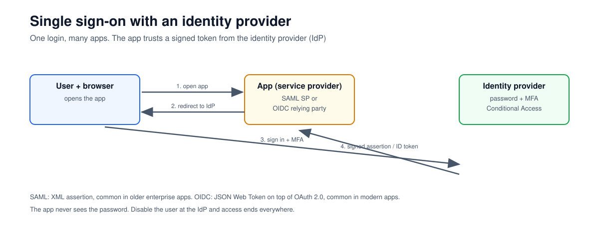

# 04 · Identity and access management (IAM)

> **Module:** 03 Security Foundations · **Weeks:** 6–7 · **Time:** ~7 hours
> **You will:** explain MFA, SSO, SAML and OIDC at a basic level, choose between RBAC and ABAC, and describe how privileged access is controlled.
> **Certification:** Security+ SY0-701/801 domain 4 (identity and access management) · ISC2 CC domain 3 (Access Control Concepts)

---

## 1. Why it matters in a SOC / cloud-security job

In the cloud there is no "inside the network". **Identity is the new perimeter.** Most cloud breaches involve a stolen credential, a stolen token, or a role with too many rights.

- A large share of your alerts will come from the identity provider: impossible travel, risky sign-in, new MFA method, new OAuth app consent.
- Attackers now steal the *session* after MFA (adversary-in-the-middle phishing). MFA alone is not the end of the story.
- Cloud privilege problems (an over-powered role, an old access key) are the top finding in most cloud reviews.

---

## 2. Understand it



### 2.1 Identity lifecycle (Joiner, Mover, Leaver)

| Stage | What should happen | Typical failure |
|---|---|---|
| Joiner | Account created from HR record, with a standard role | Manual, copied from a colleague (too much access) |
| Mover | Access changes with the new job | Old access kept (privilege creep) |
| Leaver | Account disabled the same day, sessions revoked | Ghost accounts that still work |

Regular **access reviews** (recertification) ask owners to confirm who should keep access.

### 2.2 Authentication factors and MFA

| Method | Strength | Note |
|---|---|---|
| SMS code | Weak | SIM swap, interception. Better than nothing. |
| App one-time code (TOTP) | Medium | Can be phished in real time |
| Push with number matching | Medium | Reduces MFA fatigue |
| FIDO2 / passkeys / security key | Strong | Bound to the real website, resists phishing |
| Certificate / smart card | Strong | Common in high-security setups |
| Biometrics | Varies | Usually unlocks a local key; not a secret you can rotate |

### 2.3 SSO and federation

**SSO (single sign-on):** log in once, use many apps. **Federation:** trust between separate organizations or systems, so the identity provider (IdP) of one party can vouch for users to another party's app (the service provider, SP, or relying party, RP).

| Protocol | What it is | Typical use | Token |
|---|---|---|---|
| **SAML 2.0** | XML-based sign-on | Older enterprise web apps, workforce SSO | Signed XML *assertion* |
| **OAuth 2.0** | *Authorization* framework ("let this app read my calendar") | API access | Access token |
| **OpenID Connect (OIDC)** | Identity layer on top of OAuth 2.0 | Modern web and mobile apps | ID token (JWT) |
| **Kerberos** | Ticket-based, inside a Windows domain | Active Directory | Tickets |
| **LDAP** | Directory lookup protocol | Directories, app logins | n/a |
| **RADIUS / TACACS+** | Network device authentication (AAA) | Wi-Fi, VPN, switches | n/a |

Easy memory rule: **OAuth = what you may access. OIDC = who you are. SAML = who you are (older, XML).**

Basic checks an app must do on a token: signature valid, issuer correct, audience is *this app*, not expired, and (for OIDC) the nonce/state matches. Most token bugs are missing one of these.

### 2.4 Access control models

| Model | Decision is based on | Good for | Weakness |
|---|---|---|---|
| **DAC** (discretionary) | Owner decides | File shares | Easy to over-share |
| **MAC** (mandatory) | Labels (secret, top secret) | Government, high-security | Rigid |
| **RBAC** (role-based) | The user's role | Most companies | "Role explosion", hard for fine rules |
| **ABAC** (attribute-based) | Attributes: user, resource, action, context (time, device, location) | Cloud, fine-grained, zero trust | More complex to design and test |
| **Rule-based** | Fixed rules (e.g. firewall ACL) | Network | Not per-user |

### 2.5 Privileged access management (PAM)

Admin accounts are the target. PAM controls them:

- **Separate admin accounts** from daily accounts.
- **Vault** the passwords/keys. Check-out with approval, auto-rotate after use.
- **Just-in-time (JIT)** elevation: rights last minutes or hours, not forever.
- **Session recording** and command logging for privileged sessions.
- **Break-glass** emergency account: sealed, monitored, alerts on any use.
- **Service accounts and API keys:** inventory, owner, rotation, least privilege. Often forgotten.

### 2.6 Conditional access and session risk

Rules like "allow sign-in only from a compliant device, block risky countries, require MFA for admin portals". This supports zero trust. Also: short session lifetimes and token revocation, so a stolen cookie is useful for a short time only.

> **From DBA to security**
> - **Roles and grants** (`CREATE ROLE`, `GRANT ... TO role`) are RBAC. You already know role explosion and `WITH ADMIN OPTION` risk.
> - **Oracle proxy authentication, Kerberos and external authentication** are federation ideas on a smaller scale.
> - **Fine-grained access control / Virtual Private Database (VPD)** is **ABAC**: a policy function decides row access from attributes of the session.
> - **`sudo` and "become DBA" procedures, `SYSDBA` access** map to PAM. Oracle Database Vault and Privileged Account Manager ideas are PAM in a database.
> - **Profiles** (password lifetime, failed-login limits) are authentication policy.
> - **Locked, unused accounts** = the leaver clean-up problem.

---

## 3. Hands-on

There is no code lab for this lesson. Do these exercises. They need no paid tools.

1. **Role matrix.** Write a small table for a sales database: roles `reader`, `analyst`, `dba`, and tables `customers`, `orders`, `audit_log`. Mark who gets SELECT/INSERT/UPDATE/DELETE. Check that no role has more than it needs.
2. **Decode a JWT.** In a browser, open the offline-capable CyberChef (or Python) and decode only the header and payload of a *sample* JWT from jwt.io's demo. Find `iss`, `aud`, `exp`. Never paste real company tokens into public sites.
3. **Try a passkey.** Turn on a passkey for one of your own accounts (GitHub, Google or Microsoft). Note how it differs from a password.
4. **Optional free tools:** Microsoft Entra free tier or an Okta developer tenant to see sign-in logs and Conditional Access basics. Keep to a trial/dev tenant, not your employer's.
5. **Python snippet:** this decodes (does *not* verify) a token payload so you can read claims.

```python
import base64, json
def claims(jwt: str) -> dict:
    payload = jwt.split(".")[1]
    payload += "=" * (-len(payload) % 4)
    return json.loads(base64.urlsafe_b64decode(payload))
```

Remember: reading claims is not validating the token. A real app must verify the signature.

---

## 4. Practice platforms

- **TryHackMe:** Cyber Security 101 covers authentication basics. Search "Authentication", "OAuth" and "Active Directory" rooms.
- **HTB Academy:** search for "Active Directory" and "Attacking Authentication" modules.
- **PortSwigger Web Security Academy** (free): "Authentication" and "OAuth" topics.
- **Library:** the IAM and zero-trust interview scenarios book is good for practice questions (paraphrase answers in your own words).

---

## 5. Three realistic scenarios

**1. MFA passed, but the account was taken over.** *What happened:* a user signed in via a fake login page that relayed the password and the MFA approval, and the attacker kept the session cookie. *Investigate:* sign-in logs show a normal MFA success, then the same session used from a hosting provider IP. Check mailbox rules, new devices and OAuth consents. *Do:* revoke sessions and refresh tokens, reset the password, remove malicious rules and apps, and move to phishing-resistant MFA (passkeys) plus compliant-device requirements.

**2. The leaver who still has access.** *What happened:* a contractor left 6 months ago. Their service account still logs in nightly. *Investigate:* last-sign-in report, owner lookup. *Do:* disable, rotate any secrets they knew, and fix the process: HR-driven offboarding, quarterly access reviews, an owner for every non-human account.

**3. Over-powered cloud role.** *What happened:* a developer role has `*:*` (all actions on all resources) "temporarily". *Investigate:* use the cloud's access-analyzer or last-used data to see which permissions were actually used. *Do:* reduce to the used set, add JIT for the rest, and monitor changes to IAM policies.

---

## 6. Common mistakes

- Thinking MFA makes an account unhackable.
- Confusing OAuth (authorization) with OIDC (authentication).
- Using the same admin account for email and administration.
- Forgetting service accounts, API keys and tokens in reviews.
- Building 400 roles instead of using groups plus attributes.
- Treating "SSO is enabled" as done, while local fallback passwords still work.

---

## 7. Interview questions

<details><summary><b>Q1. What are the three authentication factor types?</b></summary>
Something you know, something you have, something you are. MFA needs two or more different types.
</details>

<details><summary><b>Q2. Authentication vs authorization?</b></summary>
Authentication proves who you are. Authorization decides what you can do after that.
</details>

<details><summary><b>Q3. What is SSO and what is the main risk?</b></summary>
One login for many apps. Benefit: fewer passwords, central control. Risk: the IdP account becomes a single point of failure, so protect it with strong MFA and monitoring.
</details>

<details><summary><b>Q4. SAML vs OIDC vs OAuth?</b></summary>
SAML is XML-based sign-on for web apps. OIDC adds identity (an ID token) on top of OAuth 2.0 for modern apps. OAuth 2.0 itself is about delegated authorization to APIs.
</details>

<details><summary><b>Q5. RBAC vs ABAC?</b></summary>
RBAC grants by role, simple and common. ABAC decides using attributes of user, resource and context, so it is more flexible and fine-grained but harder to manage.
</details>

<details><summary><b>Q6. What is least privilege and how do you keep it over time?</b></summary>
Only the access needed. Keep it with joiner/mover/leaver processes, JIT access and regular access reviews.
</details>

<details><summary><b>Q7. What is PAM?</b></summary>
Privileged access management: vaulting admin credentials, check-out and rotation, just-in-time rights, and recorded sessions for powerful accounts.
</details>

<details><summary><b>Q8. What is a break-glass account?</b></summary>
An emergency admin account for when normal access fails. Its credentials are sealed, it bypasses some controls, and any use triggers alerts and review.
</details>

<details><summary><b>Q9. Which MFA methods resist phishing?</b></summary>
FIDO2 security keys and passkeys (they check the website's origin), and smart cards. One-time codes and push can be relayed by a phishing proxy.
</details>

<details><summary><b>Q10. What is an access review?</b></summary>
A periodic check where managers or owners confirm each person's access is still needed, and remove what is not.
</details>

<details><summary><b>Q11. Scenario: your IdP shows impossible travel for a user. Steps?</b></summary>
Check both sign-ins (IP, device, MFA result, app). Contact the user through a known channel. If suspicious, revoke sessions, reset credentials, inspect mailbox rules and recent actions.
</details>

<details><summary><b>Q12. What must an app check when it receives a JWT/ID token?</b></summary>
Signature, issuer, audience, expiry, and nonce or state. Skipping any lets an attacker replay or forge tokens.
</details>

<details><summary><b>Q13. How do you secure service accounts?</b></summary>
Inventory with an owner, least privilege, no interactive login, secrets in a vault with rotation, and alerts on unusual use. Prefer managed identities over long-lived keys in cloud.
</details>

---

## 8. Checklist

- [ ] I can explain MFA, SSO, SAML, OIDC and OAuth in one sentence each.
- [ ] I can choose RBAC or ABAC for a given case and explain why.
- [ ] I can describe joiner/mover/leaver and PAM.
- [ ] I can explain how an attacker beats MFA by stealing the session.

## 9. References

- NIST SP 800-63 (Digital Identity Guidelines).
- OpenID Connect Core 1.0 and OAuth 2.0 (RFC 6749) specs.
- Microsoft Learn: Entra ID, Conditional Access and PIM documentation.
- OWASP Authentication and Session Management Cheat Sheets.
- CompTIA Security+ objectives, identity and access management; ISC2 CC domain 3.

**Next:** [05 · Security architecture and operations](05-security-architecture-and-operations.md)
