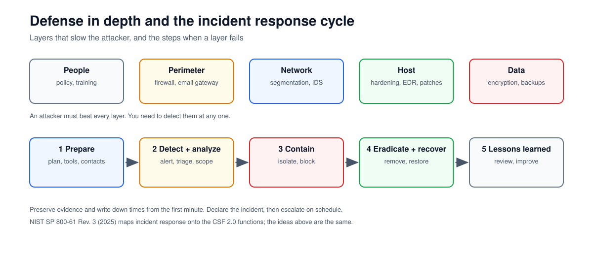

# 05 · Security architecture and operations basics

> **Module:** 03 Security Foundations · **Week:** 7 · **Time:** ~7 hours
> **You will:** explain segmentation, hardening, logging, backups, BC/DR and the basic incident response cycle, and recognize which one fits a given situation.
> **Certification:** Security+ SY0-701/801 domains 3 and 4 (security architecture, security operations) · ISC2 CC domains 2, 4 and 5

---

## 1. Why it matters in a SOC / cloud-security job

This lesson is the daily work. The SOC runs on logs, responds to incidents, and depends on good architecture and tested backups.

- Ransomware crews attack backups first. A backup that was never tested, or that sits on the same network, is not a backup.
- Flat networks let one infected laptop reach every server.
- No logs means no investigation. "We do not know what happened" is the worst incident report.
- Unhardened default configurations (open storage, default passwords) are the root cause of many cloud exposures.

---

## 2. Understand it

### 2.1 Segmentation and secure network design

Split the network into zones so a problem stays in one place.

| Idea | Meaning |
|---|---|
| VLAN / subnet | Logical network groups |
| DMZ | Zone for public-facing servers, separated from the internal network |
| Firewall (stateful, next-gen, WAF) | Allows or blocks by rule. A WAF understands web traffic. |
| Micro-segmentation | Rules per workload, common in cloud (security groups, NSGs) |
| Jump host / bastion | The only controlled way to reach admin ports |
| VPN / ZTNA | Remote access, ZTNA gives per-app access, not whole-network access |
| IDS / IPS | Detects / blocks suspicious traffic |
| Air gap | No network connection at all (rare, for high-security or offline backup) |

Basic rule: **deny by default, allow only what is needed, log the denies.**

Network details are in `../02-networking/`.

### 2.2 Hardening

Make a system harder to attack by removing what is not needed.

- Remove or disable unused services, ports, accounts and software.
- Change default passwords. Apply a **secure baseline** (CIS Benchmarks, vendor guides).
- Patch regularly, with a test-then-deploy process.
- Turn on disk encryption, host firewall, EDR and logging.
- Restrict admin rights. Use configuration management to keep it consistent, and detect **drift** (when a system moves away from its baseline).

### 2.3 Logging and monitoring

| Log source | Typical question it answers |
|---|---|
| Operating system (Windows Event Log, Linux auth log) | Who logged in? What ran? |
| Firewall / proxy / DNS | Where did traffic go? |
| Identity provider | Sign-in, MFA, role changes |
| Cloud audit log (control plane) | Who created or changed a resource? |
| Application and database audit | What data was accessed or changed? |
| EDR | What processes ran on endpoints? |

Good logging rules: **synchronize time (NTP)**, send logs off the host to a central place (SIEM) so an attacker cannot erase them, protect them from change, keep them long enough (legal and investigation needs), and know which events matter. A **SIEM** collects, normalizes and correlates logs and raises alerts. A baseline of "normal" lets you spot "odd".

### 2.4 Backups (and the 3-2-1 idea)

| Rule | Meaning |
|---|---|
| 3 copies | Production plus two backups |
| 2 media types | For example disk and tape or cloud object storage |
| 1 offsite | Different location, ideally offline or immutable (cannot be changed or deleted for a time) |

Also: encrypt backups, separate backup credentials from the domain, **test restores** and measure restore time.

### 2.5 BC and DR

- **BCP (business continuity plan):** keep the *business* running during a disruption.
- **DRP (disaster recovery plan):** restore *IT systems* after a disaster.
- **BIA (business impact analysis):** which processes matter most, and what does downtime cost?
- **RTO:** how fast we must be back. **RPO:** how much data loss is acceptable.
- Sites: hot (ready now), warm (partly ready), cold (empty space).
- Test with a tabletop exercise (talk through it), a walkthrough, a simulation, and a full failover.

More on BIA and RTO/RPO in module 04, lesson 04.

### 2.6 Incident response overview

Lifecycle: **Prepare → Detect and analyze → Contain → Eradicate and recover → Lessons learned.** NIST SP 800-61 Rev. 3 (April 2025) now ties incident response into the CSF 2.0 functions, so it is part of normal risk management, not a separate silo.

| Step | What you do | Example |
|---|---|---|
| Prepare | Plans, contacts, tools, training, logging | A written playbook for ransomware |
| Detect and analyze | Confirm it is real, find scope, set severity | Alert says 30 files renamed in 1 minute |
| Contain | Stop spread, keep evidence | Isolate the host with EDR |
| Eradicate and recover | Remove cause, restore, monitor | Rebuild from clean image, restore backup |
| Lessons learned | Review, fix the root cause | Blameless review within 1–2 weeks |

Evidence handling: record who, what, when. Keep a chain of custody for anything legal might need. Take memory and disk images before you wipe. Communication: use a separate channel if the main one may be compromised.

SOC detail is in module 05.

> **From DBA to security**
> - **RMAN backup, validate and restore tests, Data Guard** = backup and DR. A DBA who has done a full restore under pressure already knows RTO and RPO. Say that in interviews.
> - **Hardening an Oracle database** (CIS Benchmark for Oracle, remove sample schemas, lock default accounts, secure the listener) is the same hardening idea.
> - **Unified Audit and alert log** = the log sources. **AWR/ASH baselines** = a "normal" baseline, which is how anomaly detection works.
> - **Change control for patching (PSU/RU)** = patch management process.
> - **Standby on another site** = a warm or hot site.

---

## 3. Hands-on

No code lab. Use free tools and your own machine or VMs.

1. **Check your logs.** On Windows 11: Event Viewer → Security log. Find event ID 4624 (successful logon) and 4625 (failed logon). Note the fields (account, logon type, source).
2. **Harden a VM.** In a WSL Ubuntu or a throwaway VM: list listening ports with `ss -tulpn`, remove one service you do not need, enable the host firewall (`ufw`), and check `last` and `/var/log/auth.log`.
3. **Run a CIS-style check (optional).** `lynis audit system` on a Linux VM gives a hardening report. Read the top suggestions.
4. **Write a backup plan.** For a 50 GB Oracle database: say how you apply 3-2-1, the RPO, the RTO, who tests it and how often.
5. **Tabletop.** Read the incident-response steps above and write a one-page "what we do if ransomware hits the finance share" plan. Use the template in `../12-soft-skills/templates/incident-report.md` for the report part.

---

## 4. Practice platforms

- **TryHackMe:** Cyber Security 101 and SOC Level 1 cover logging, Windows event logs, and basic IR. Search "Windows Event Logs", "Linux Logging", "Incident Response".
- **HTB Academy:** the SOC Analyst job-role path has logs and detection modules.
- **HTB Sherlocks / LetsDefend content:** defensive investigations to practise log reading. (LetsDefend content is moving into HTB, so check the current site.)

---

## 5. Three realistic scenarios

**1. Backups encrypted too.** *What happened:* ransomware encrypted the file server and the backup server, because the backup server was domain-joined and reachable with the same admin credentials. *Investigate:* EDR timeline, when the backup service account was first used. *Do:* isolate, rebuild, restore from the offline or immutable copy, rotate all credentials. Long term: separate backup credentials, immutable storage, restore tests.

**2. The public storage bucket.** *What happened:* a cloud alert shows a storage bucket with public read. *Investigate:* what is in it, since when, who created it (cloud audit log), and any access from unknown IPs. *Do:* block public access, assess the data exposure, notify the owner and privacy team, add a preventive guardrail (policy that blocks public buckets).

**3. Missing logs.** *What happened:* during an investigation the web server logs only cover 3 days. *Investigate:* look at central SIEM copies, the load balancer logs and cloud logs for gaps. *Do:* complete the picture from other sources, then fix retention and forwarding as an action in the lessons-learned review.

---

## 6. Common mistakes

- Not testing restores.
- Keeping backups reachable from the same credentials as production.
- Logging everything but nobody reads it. Have use cases and alerts.
- Unsynchronized clocks, so log timelines do not match.
- Skipping containment because you want to "understand first". Isolate early, if the business can accept it.
- Writing a DR plan once and never testing it.

---

## 7. Interview questions

<b>Q1. What is network segmentation and why does it matter?</b>

Splitting the network into zones with controlled traffic between them. It limits how far an attacker can move and lets you apply different rules per zone.

<b>Q2. What is a DMZ?</b>

A separate zone for public-facing servers. If they are compromised, the attacker is still outside the internal network.

<b>Q3. What is hardening?</b>

Reducing the attack surface: remove unneeded services and accounts, change defaults, patch, apply a secure baseline such as CIS, and monitor drift.

<b>Q4. What does a SIEM do?</b>

Collects and normalizes logs, correlates events, raises alerts and supports search and investigation.

<b>Q5. Why send logs to a central server?</b>

Attackers delete local logs. A central, protected copy survives and also allows correlation across systems.

<b>Q6. Explain 3-2-1 backups.</b>

Three copies, on two media types, with one offsite. Add immutability and tested restores for ransomware resilience.

<b>Q7. RTO vs RPO?</b>

RTO is how long we can be down. RPO is how much data we can lose, measured in time since the last good copy.

<b>Q8. BCP vs DRP?</b>

The BCP keeps the whole business running. The DRP restores IT systems. The DRP is part of the BCP.

<b>Q9. List the incident response phases.</b>

Prepare, detect and analyze, contain, eradicate and recover, lessons learned.

<b>Q10. When do you contain and when do you investigate first?</b>

Contain quickly when the harm is spreading, and capture volatile evidence first if you can do it quickly. Use the playbook and the severity level. When in doubt, ask the incident lead.

<b>Q11. Scenario: an EDR alert says a laptop is talking to a known bad IP. First steps?</b>

Confirm the alert (process, user, time). Isolate the host with EDR if the evidence is strong. Collect evidence, check for other hosts contacting the IP, reset the user's credentials, and open an incident.

<b>Q12. What is a tabletop exercise?</b>

A discussion-based drill where the team walks through a scenario to test the plan, roles and communication, without touching real systems.

<b>Q13. How would you prove a backup is good?</b>

Restore it to an isolated environment, check data integrity and application function, and record the time taken against the RTO. Do it regularly.

---

## 8. Checklist

- [ ] I can describe segmentation, hardening, logging and 3-2-1 backups.
- [ ] I know the difference between BCP, DRP, BIA, RTO and RPO.
- [ ] I can list the incident response steps and what happens in each.
- [ ] I read a real Windows or Linux log and found a login event.

## 9. References

- NIST SP 800-61 Rev. 3, *Incident Response Recommendations and Considerations for Cybersecurity Risk Management* (2025).
- CIS Benchmarks and CIS Critical Security Controls.
- NIST SP 800-34 (contingency planning).
- CompTIA Security+ objectives, domains 3 and 4; ISC2 CC domains 2, 4 and 5.
- Microsoft Learn: Windows security auditing events.

**Next:** [06 · Certification map](06-cert-map.md)
