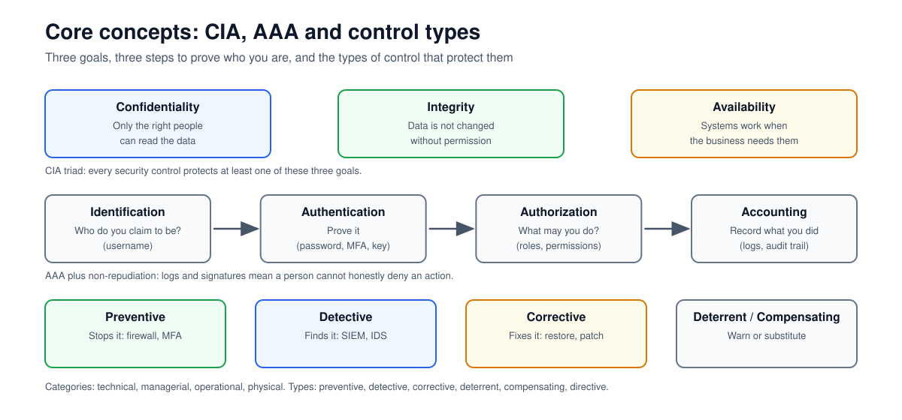

# Module 03 · Security Foundations

> **Weeks:** 4–7 · **Time:** ~36 hours · **Level:** CompTIA Security+ (SY0-701/801) and ISC2 CC
> **You will:** learn the language and the core ideas of security, so that alerts, policies and exam questions make sense. You will also build two small tools: a password-storage demo and a phishing header analyzer.

**Prerequisites:** modules 01 (IT fundamentals) and 02 (networking) help, but are not strictly needed to start.

## Learning path

| # | Lesson | Week | Certification objective |
|---|---|---|---|
| 01 | [Core concepts](01-core-concepts.md) | 4 | Security+ domain 1 · CC domain 1 |
| 02 | [Threats, vulnerabilities and attacks](02-threats-vulnerabilities-attacks.md) | 5 | Security+ domain 2 · CC domains 1, 5 |
| 03 | [Cryptography and PKI](03-cryptography-and-pki.md) | 6 | Security+ domains 1, 3 · CC domains 1, 4 |
| 04 | [Identity and access management](04-identity-and-access-management.md) | 6–7 | Security+ domain 4 · CC domain 3 |
| 05 | [Security architecture and operations](05-security-architecture-and-operations.md) | 7 | Security+ domains 3, 4 · CC domains 2, 4, 5 |
| 06 | [Certification map](06-cert-map.md) | 7 | Security+ and CC domain tables |

> Security+ **SY0-801 (V8) launched on 17 Nov 2026**. SY0-701 is still available until about June 2027. The core concepts are the same in both. Check the official CompTIA page before you book. The ISC2 CC exam is now paid (the free "One Million" program closed to new participants on 20 May 2026; verify the price on the ISC2 site).



## Key terms

| Term | Simple meaning |
|---|---|
| CIA triad | Confidentiality, Integrity, Availability |
| AAA | Authentication, Authorization, Accounting |
| Non-repudiation | A person cannot honestly deny an action |
| Control | Anything that reduces risk |
| Defense in depth | Many different layers of protection |
| Least privilege | Only the access needed to do the job |
| Zero trust | Never trust by location, always verify |
| Hash / salt | One-way fingerprint / random value added before hashing |
| PKI | System of certificates and authorities that vouch for public keys |
| MFA / SSO / IdP | Two+ factors / one login for many apps / the system that signs people in |
| RBAC / ABAC | Access by role / access by attributes |
| PAM | Controls for privileged (admin) accounts |
| SIEM | Central log collection and alerting |
| RTO / RPO | Time to be back / data loss allowed |

## How this connects to your job

In Cloud Security and SOC work, you will see these ideas every day: sign-in alerts (IAM), phishing reports (threats), certificate and key issues (crypto), and incident tickets (operations). Your DBA habits (roles, audits, backups, restores, careful changes) are real strengths here.

## Lab

[`lab/`](lab/) runs offline with no extra packages. From the repo root:

```bash
.venv/Scripts/python -m pytest cybersecurity-track/03-security-foundations -v
.venv/Scripts/python cybersecurity-track/03-security-foundations/lab/demo.py
```

| File | What it does |
|---|---|
| `lab/password_storage.py` | Stores passwords as plain text, unsalted MD5 and salted PBKDF2; runs a dictionary attack on synthetic hashes |
| `lab/phishing_analyzer.py` | Checks SPF/DKIM/DMARC results, Reply-To mismatch, lookalike domains and link mismatch in `.eml` text |
| `lab/samples/` | Synthetic emails and a small wordlist (`*.example` domains, documentation IP ranges) |
| `lab/demo.py` | Prints the results (the real output is shown in lessons 02 and 03) |
| `lab/test_security_foundations_lab.py` | 14 tests |

## Mini-project: "Is this email safe?" runbook (about 3 hours)

1. Write a one-page checklist for the SOC: which headers to read, in which order, and what verdict to give.
2. Add one new `.eml` sample (for example, a fake invoice with a Reply-To trick) and extend the analyzer with one new check. Add a test.
3. Write a 5-line ticket note using the template in [`../12-soft-skills/templates/incident-report.md`](../12-soft-skills/templates/incident-report.md).
4. Put the checklist and your new test in your portfolio (module 13).

## Practice on TryHackMe / HTB

- **TryHackMe:** Cyber Security 101, then SOC Level 1 (it builds on these topics). Search the room list for: Security Principles, Cryptography, Authentication, Phishing, Windows Event Logs.
- **HTB Academy:** SOC Analyst job-role path. Search modules on cryptography, Active Directory and web attacks.
- **Free quizzes:** CompTIA and ISC2 offer official sample questions. Use reputable practice exams and note your weak domains.

## Module interview questions

<details><summary><b>Q1. Explain the CIA triad with a database example.</b></summary>
Confidentiality: column encryption and access control on customer data. Integrity: constraints, checksums and audit of changes. Availability: backups, Data Guard and tested restores.
</details>

<details><summary><b>Q2. What is the difference between authentication and authorization?</b></summary>
Authentication proves who you are. Authorization decides what you may do.
</details>

<details><summary><b>Q3. How should a company store passwords?</b></summary>
Unique salt plus a slow hash such as Argon2id, bcrypt or high-iteration PBKDF2. Add MFA, and block known weak passwords.
</details>

<details><summary><b>Q4. A phishing email passes SPF, DKIM and DMARC. Is it safe?</b></summary>
No. The attacker may own a lookalike domain. Check the domain, links and content, not only authentication.
</details>

<details><summary><b>Q5. What is defense in depth?</b></summary>
Multiple different layers so one failure does not give full access.
</details>

<details><summary><b>Q6. Symmetric vs asymmetric encryption?</b></summary>
Symmetric: one shared key, fast. Asymmetric: key pair, slower, used for key exchange and signatures. TLS uses both.
</details>

<details><summary><b>Q7. What is SSO and what is its risk?</b></summary>
One login for many apps. The identity provider becomes a high-value target, so protect it strongly.
</details>

<details><summary><b>Q8. RBAC vs ABAC?</b></summary>
Role-based is simple. Attribute-based uses context (device, time, data label) and is more flexible but harder to manage.
</details>

<details><summary><b>Q9. What would you check in an incident first?</b></summary>
Scope, severity, affected systems and accounts, whether it is still spreading, and what evidence exists. Then contain, following the playbook.
</details>

<details><summary><b>Q10. Why do you test restores?</b></summary>
An untested backup is only a hope. A restore test proves the data is usable and measures real recovery time against the RTO.
</details>

## References

- CompTIA Security+ exam objectives (SY0-701 and SY0-801) on the CompTIA site.
- ISC2 Certified in Cybersecurity exam outline.
- NIST SP 800-53, 800-63, 800-61 Rev. 3, 800-207.
- OWASP Top 10 and Cheat Sheet Series; MITRE ATT&CK; CIS Controls.
- Library study aid: Security+ SY0-601 notes (older version; concepts still helpful).
