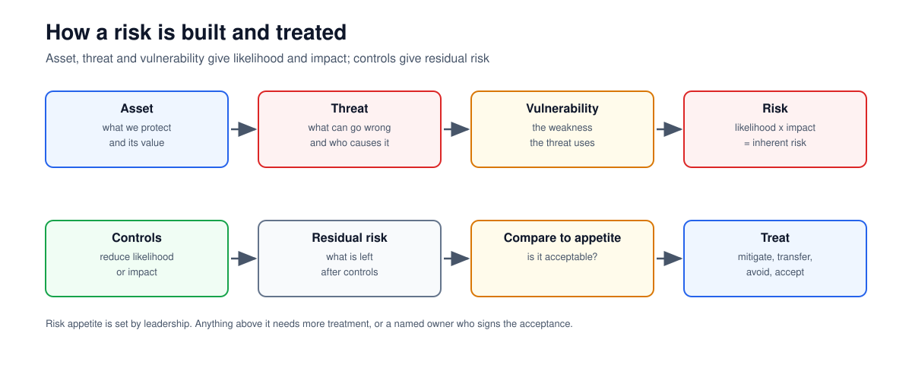

# 01 · Risk concepts

> **Module:** 04 Risk Management and ISO 27001 · **Week:** 7 · **Time:** ~6 hours
> **You will:** define asset, threat, vulnerability, likelihood, impact, inherent and residual risk, choose a treatment, and score a small risk register with a Python tool.
> **Certification:** Security+ SY0-701/801 domain 5 (Security Program Management and Oversight) · ISC2 CC domain 1 · groundwork for ISO/IEC 27001 clause 6

---

## 1. Why it matters in a SOC / cloud-security job

Risk is how a company decides *what to fix first*. You will meet it every day:

- A vulnerability scanner finds 4,000 issues. Risk tells you which 40 matter this week.
- A cloud finding asks for an "exception". Someone must accept the risk in writing.
- After an incident, the risk register is updated and leadership asks "is this risk now higher?"
- Auditors ask: "who owns this risk, and when was it last reviewed?"

---

## 2. Understand it



### 2.1 The words

| Term | Meaning | Example |
|---|---|---|
| **Asset** | Anything of value | Customer database, laptop, brand, a person |
| **Threat** | What can cause harm | Ransomware gang, insider, flood |
| **Vulnerability** | A weakness | No MFA, unpatched server |
| **Likelihood** | How probable | 1 (rare) to 5 (almost certain) |
| **Impact** | How bad it is | 1 (minor) to 5 (severe): money, law, safety, reputation |
| **Risk** | Likelihood x impact, for a threat using a vulnerability on an asset | "Phishing leads to ransomware on file server: 4 x 5" |
| **Control** | Something that reduces risk | MFA, backups, policy |
| **Inherent risk** | Risk with no controls | 20 |
| **Residual risk** | Risk left after controls | 8 |
| **Risk appetite** | How much risk leadership will accept to reach its goals | "No residual risk above 9 for customer data" |
| **Risk tolerance** | The allowed range around the appetite for a specific area | "Up to 12 for the marketing site" |
| **Risk owner** | The person accountable for a risk (not always the person who fixes it) | Head of Sales for a CRM risk |

### 2.2 Qualitative vs quantitative

- **Qualitative:** scales like Low/Medium/High or 1–5. Fast, subjective. This is what most registers use.
- **Quantitative:** money. **SLE** (single loss expectancy) = asset value x exposure factor. **ARO** (annual rate of occurrence). **ALE** (annual loss expectancy) = SLE x ARO. Useful to compare a control's cost with the loss it prevents.

Example: SLE = $200,000, ARO = 0.1 (once in 10 years). ALE = $20,000 per year. A control costing $5,000 a year that cuts ARO to 0.02 saves $16,000 a year in expected loss. That is a good buy.

### 2.3 Risk treatment options

| Option | Meaning | Example |
|---|---|---|
| **Mitigate** (reduce) | Add controls | Enable MFA |
| **Transfer** (share) | Move the financial impact | Cyber insurance, contract clauses, outsourcing |
| **Avoid** | Stop the activity | Retire the legacy system |
| **Accept** | Knowingly live with it | Low residual risk, documented and signed |

Insurance transfers the *money* loss, not the reputation loss or the legal duty.

### 2.4 The risk process

1. **Establish context** (scope, criteria, appetite).
2. **Identify** assets, threats, vulnerabilities, existing controls.
3. **Analyze** likelihood and impact. **Evaluate** against appetite.
4. **Treat** and record a plan with an owner and date.
5. **Monitor and review** on a schedule and after major change or incident.
6. **Communicate** to the people who decide.

### 2.5 NIST SP 800-30 at a high level

NIST SP 800-30 Rev. 1 is a guide to *conducting risk assessments*. It describes four steps: **prepare**, **conduct**, **communicate** and **maintain**. In *conduct*, you identify threat sources and events, identify vulnerabilities and predisposing conditions, determine likelihood, determine impact, and then determine risk. It works at three tiers: the organization, the mission/business process, and the information system. It gives example scales and tables. You do not need to memorize them; know the flow and the idea that the **same method can be used at different levels**. Its companion is NIST SP 800-39 (managing risk across the organization). ISO/IEC 27005 plays the same role for ISO/IEC 27001.

> **From DBA to security**
> - **Capacity and failure planning:** you already reason "how likely is a disk failure, and how bad?" That is the same thinking.
> - **RPO and RTO** in your backup design are impact decisions made together with the business.
> - **A risk register is like a change log with severity**: a row per issue, an owner, and a status.
> - **Baselines in AWR** show "normal", which helps estimate likelihood from facts instead of guesses.
> - When you said "we can live with this index missing until the next window", you accepted a risk. Now you will write it down and get it signed.

---

## 3. Hands-on

### Lab: risk register scorer

`lab/risk_register.py` loads a risk register from YAML or CSV and:

- scores inherent risk (likelihood x impact),
- applies the effect of controls to get residual risk,
- bands the score (Low 1–4, Medium 5–9, High 10–16, Critical 17–25),
- flags a missing owner, an overdue review, a residual score above appetite, a risk "accepted" above appetite, and controls that change nothing.

Data is a fictional company (Northwind Retail). From the repo root:

```bash
.venv/Scripts/python cybersecurity-track/04-risk-management-and-iso27001/lab/demo.py
```

Real output, Part 1 and 1b (review date fixed at 2026-11-18 so the result is stable):

```text
=== Part 1: risk register (YAML), appetite = residual 9, as of 2026-11-18 ===
ID     Asset                 Inh  Res Residual band  Owner    Issues
--------------------------------------------------------------------
R-003  Cloud storage bucket   15   15 High           -        no_owner, above_appetite
R-002  Employee laptops       16    9 Medium         it-ops   overdue_review
R-004  Office Wi-Fi            9    9 Medium         net-lead ok
R-005  Payroll supplier       12    9 Medium         procurem ok
R-001  Customer database (O   20    8 Medium         db-lead  ok
R-006  Admin accounts         15    4 Low            iam-lead ok
R-007  Old file server         6    4 Low            it-ops   ok
R-008  Marketing website       4    4 Low            web-lead controls_ineffective

=== Part 1b: risk register (CSV) ===
ID     Asset                 Inh  Res Residual band  Owner    Issues
--------------------------------------------------------------------
C-002  Vendor portal          12   12 High           -        no_owner, above_appetite
C-003  Test database          12    4 Low            db-lead  overdue_review
C-001  Laptop fleet           12    3 Low            it-ops   ok
```

**How to read it:**
- **R-001** has an inherent score of 20 (Critical). Parameterized queries cut likelihood by 2, and database activity monitoring cuts impact by 1: (4-2) x (5-1) = 8. This is the logic of a risk reduction story.
- **R-003** is the worst: no controls, no owner. A risk with no owner is a risk nobody manages.
- **R-002** has a good score but its review is overdue (last reviewed in May with a 90-day cycle). Stale risks are false comfort.
- **R-004** is "accepted" at 9. That is exactly at appetite, so it passes. If appetite were 8, the tool flags `accepted_above_appetite`.
- **R-008** lists a control that has zero effect. The control exists on paper only.

Run the tests (30 tests in the whole module):

```bash
.venv/Scripts/python -m pytest cybersecurity-track/04-risk-management-and-iso27001 -v
```

**Break it yourself:**
1. Change the appetite to 6 in `demo.py`. Predict which rows get `above_appetite`, then run.
2. Add a new risk about a database backup that was never restore-tested. Choose honest numbers.
3. Add a new check: any risk with treatment `accept` and `review_days` above 180 is flagged, because accepted risks need closer review. Add a test.

### Optional free tools

- A spreadsheet is the most common real register. Rebuild this register in Excel or Google Sheets with formulas.
- **Eramba Community** or **CISO Assistant** (open source GRC tools) can be run in Docker for exploration. They are heavier than the rest of this track, so use them only if your laptop is free.

---

## 4. Practice platforms

- **TryHackMe:** search for "Introduction to Risk" or "Security governance" content; the Cyber Security 101 and later paths include GRC topics.
- **HTB Academy:** has a few GRC-related modules; search "risk".
- **Free:** the NIST OLIR and CSF 2.0 Quick Start guides, and CISA's free resources, are good reading.

---

## 5. Three realistic scenarios

**1. The unpatched appliance.** *What happened:* a vendor box cannot be patched until a maintenance window in 4 months. *Investigate:* what is exposed, who can reach it, is there a known exploit? *Do:* record a risk with owner and expiry; apply compensating controls (segment, restrict, monitor); formal acceptance by the risk owner, with a review date.

**2. Everything is "High".** *What happened:* the register has 120 risks, 90 are High. Leadership ignores it. *Investigate:* check scales: are they defined with examples? Was impact set by the business? *Do:* recalibrate the scales, merge duplicates, rank by residual risk, and show the top 10.

**3. The accepted risk that was never reviewed.** *What happened:* two years ago a manager accepted a risk about an old VPN. A breach uses exactly that path. *Investigate:* acceptance record, owner, expiry. *Do:* acceptance must have an expiry date and a named owner. Add overdue-review alerts (like the lab does).

---

## 6. Common mistakes

- Confusing threat and vulnerability.
- Scoring with no defined scale, so "4" means different things to different people.
- Treating the risk register as a one-time document.
- Writing "the IT team" as owner. A risk owner is a named person with authority.
- Counting a *planned* control as if it already reduces risk. Only count implemented, tested controls.
- Mixing up appetite (leadership's choice) and tolerance (the allowed range).

---

## 7. Interview questions

<details><summary><b>Q1. Define risk in one sentence.</b></summary>
The chance that a threat uses a vulnerability to harm an asset, combined with how bad that harm would be.
</details>

<details><summary><b>Q2. Threat vs vulnerability vs risk?</b></summary>
A threat can cause harm, a vulnerability is a weakness, and risk is the likelihood and impact of the two meeting on an asset.
</details>

<details><summary><b>Q3. Inherent vs residual risk?</b></summary>
Inherent is before controls. Residual is what remains after the controls work.
</details>

<details><summary><b>Q4. Name the four risk treatment options.</b></summary>
Mitigate, transfer, avoid, accept.
</details>

<details><summary><b>Q5. What are SLE, ARO and ALE?</b></summary>
Single loss expectancy (cost of one event), annual rate of occurrence (events per year), annual loss expectancy = SLE x ARO.
</details>

<details><summary><b>Q6. What is risk appetite?</b></summary>
The amount and type of risk leadership accepts in pursuit of its goals. It guides which risks need treatment.
</details>

<details><summary><b>Q7. Who owns a risk?</b></summary>
A named business person with authority to decide on treatment and accept it. Security advises; the owner decides.
</details>

<details><summary><b>Q8. Qualitative vs quantitative analysis?</b></summary>
Qualitative uses ranked scales and is quick. Quantitative uses money and probabilities and supports cost-benefit decisions, but needs better data.
</details>

<details><summary><b>Q9. Does cyber insurance remove the risk?</b></summary>
No. It transfers part of the financial loss. Reputation, legal duties and downtime remain, and insurers require basic controls.
</details>

<details><summary><b>Q10. What is NIST SP 800-30?</b></summary>
A guide for conducting risk assessments: prepare, conduct, communicate, maintain, usable at organization, process and system levels.
</details>

<details><summary><b>Q11. Scenario: a manager wants to accept a Critical residual risk. What do you do?</b></summary>
Explain the impact in business terms, check it against appetite, propose cheaper controls, and if they still accept, record it formally with name, date, scope and an expiry, and escalate if above appetite.
</details>

<details><summary><b>Q12. How do you prioritize 4,000 vulnerabilities?</b></summary>
By risk: exploitability (for example whether it is in the CISA KEV list or has a high EPSS score), asset criticality, exposure to the internet, and compensating controls. Not by CVSS alone.
</details>

---

## 8. Checklist

- [ ] I can define the 10 terms in section 2.1 without notes.
- [ ] I can compute an ALE and a residual score.
- [ ] I ran the lab and can explain every flag it raised.
- [ ] I can describe the NIST SP 800-30 flow in four steps.

## 9. References

- NIST SP 800-30 Rev. 1, *Guide for Conducting Risk Assessments*; NIST SP 800-39.
- ISO/IEC 27005 (information security risk management) and ISO 31000.
- CompTIA Security+ objectives, domain 5.
- CISA Known Exploited Vulnerabilities (KEV) catalog and FIRST EPSS for prioritization.

**Next:** [02 · NIST CSF 2.0](02-nist-csf-2.md)
