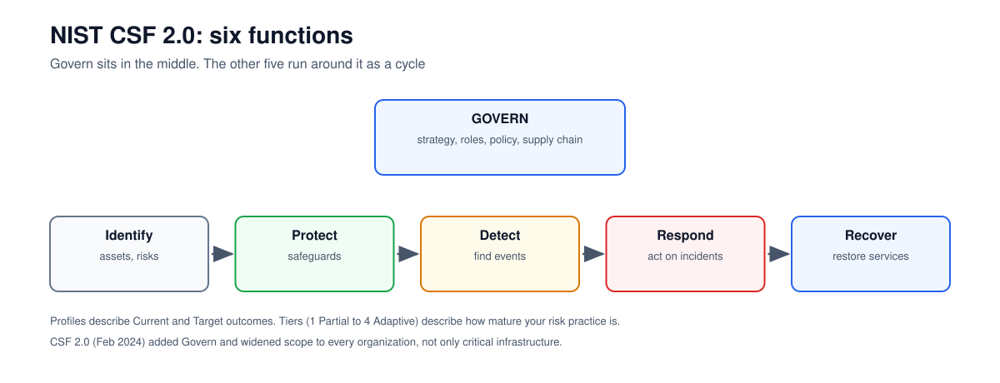

# 02 · NIST Cybersecurity Framework (CSF) 2.0

> **Module:** 04 Risk Management and ISO 27001 · **Week:** 7 · **Time:** ~5 hours
> **You will:** name the six CSF 2.0 functions (including the new Govern), explain profiles and tiers, and use the NIST ransomware profile as a worked example.
> **Certification:** Security+ SY0-701/801 domain 5 · ISC2 CC domains 1 and 2 · background for SC-200 and cloud security roles

---

## 1. Why it matters in a SOC / cloud-security job

The CSF is a common language. Many companies describe their security program, their gaps and their reports with its six function names. When a CISO says "we are weak in Detect and Recover", you should know what that covers.

- Cloud security posture tools and GRC platforms often map findings to CSF categories.
- NIST SP 800-61 Rev. 3 (April 2025) aligns incident response with the CSF 2.0 functions.
- Cyber insurers and customers often ask "which framework do you follow?" The CSF is a frequent answer. It is voluntary and free.

---

## 2. Understand it

NIST published **CSF 2.0 in February 2024**. It is for organizations of any size and sector (version 1.1 was aimed at critical infrastructure). The big change: a new **Govern** function, plus more help on supply chain risk and on using profiles.

### 2.1 The six functions

| Function | Question it answers | Example categories (paraphrased) | Example activity |
|---|---|---|---|
| **Govern (GV)** | How do we direct and oversee cyber risk? | Organizational context, risk strategy, roles and authority, policy, oversight, supply chain risk | Board approves risk appetite; policies have owners |
| **Identify (ID)** | What do we have and what are the risks? | Asset management, risk assessment, improvement | Asset inventory, vulnerability and risk assessment |
| **Protect (PR)** | How do we reduce the chance and impact? | Identity and access control, awareness and training, data security, platform security, infrastructure resilience | MFA, encryption, patching, training |
| **Detect (DE)** | How do we find bad events? | Continuous monitoring, adverse event analysis | SIEM and EDR alerts, log review |
| **Respond (RS)** | What do we do about an incident? | Incident management, analysis, reporting and communication, mitigation | Playbooks, containment, notifying regulators |
| **Recover (RC)** | How do we get back to normal? | Recovery plan execution, recovery communication | Restore from backup, post-incident communication |

**Govern** sits in the middle because it affects all the others. Identify, Protect, Detect, Respond and Recover run as a cycle around it.

### 2.2 Structure

Function → **Category** → **Subcategory** (a specific outcome) → optional **implementation examples** and **informative references** (links to other standards such as ISO/IEC 27001 and NIST SP 800-53). Outcomes say *what* to achieve, not *how*.

### 2.3 Profiles

A **profile** is your own picture of the framework, using the outcomes that matter to you.

- **Current profile:** what you achieve now.
- **Target profile:** what you want to achieve.
- **Gap:** the difference. It becomes your action plan.
- **Community profiles** are ready-made targets for a sector or a threat. CSF 2.0 introduced the idea of community profiles on purpose.

### 2.4 Tiers

Tiers describe *how* an organization manages cyber risk (not how many controls it has).

| Tier | Name | Meaning in short |
|---|---|---|
| 1 | Partial | Ad hoc, reactive, little awareness |
| 2 | Risk Informed | Risk-aware, approved practices but not organization-wide |
| 3 | Repeatable | Formal policy, regular updates, consistent across the organization |
| 4 | Adaptive | Continuous improvement, uses threat intelligence, learns from incidents |

Higher is not always better. Choose the tier your risk and budget justify.

### 2.5 Worked example: NIST ransomware profile (NIST IR 8374 Rev. 1)

NIST published a **community profile for ransomware risk management**, built on CSF 2.0 (revision 1 of IR 8374, approved in 2026, replacing the 2022 version). It selects the CSF outcomes that matter most for preventing, detecting, responding to and recovering from ransomware, so a team can use it as a ready-made *target profile*. Use it as a checklist and map your own controls to it.

Typical themes you will see when you apply it:

| Function | Ransomware focus (paraphrased) |
|---|---|
| Govern | Named owners, ransomware in the risk register, supplier expectations |
| Identify | Know critical systems and data, know your backup coverage |
| Protect | MFA, patching exposed services, restricted admin rights, protected and offline backups |
| Detect | Alerts on mass file changes, unusual admin tools, backup deletion attempts |
| Respond | Tested playbook, decision path on payment and law enforcement contact |
| Recover | Restore order of critical systems, tested clean rebuild process |

Read the document itself for the exact subcategory list.

### 2.6 CSF vs ISO/IEC 27001

| | NIST CSF 2.0 | ISO/IEC 27001:2022 |
|---|---|---|
| Nature | Framework of outcomes, voluntary | Certifiable management-system standard |
| Certification | No | Yes, by an accredited body |
| Cost | Free | Standard must be bought; audits cost money |
| Use together | Use CSF to assess and communicate; use ISO 27001 to build and prove a management system | Many control mappings exist |

> **From DBA to security**
> - Think of the CSF as a **health-check list for the whole security program**, like a database health check covers performance, backup, security and capacity.
> - **Identify** = your CMDB and inventory of instances. **Protect** = grants, encryption, patching. **Detect** = audit and alert monitoring. **Respond** = runbooks for a failed node. **Recover** = RMAN restore and failover.
> - **Govern** is what a DBA rarely sees: who approves the standards, who signs exceptions, and who is accountable.

---

## 3. Hands-on

No code lab in this lesson. Do the exercises below, then use the lab in lesson 01 and 03 for the register and the SoA.

1. **Current-profile mini assessment (1 hour).** Take your own team's work. For each of the six functions write 3 things your team does now, and 3 you do not. Score each function 1–4 (tiers).
2. **Gap plan.** Pick a target tier for each function, then list the five most valuable actions and an owner for each.
3. **Map the lab.** The risk register scorer is a Govern and Identify activity. The SoA gap checker supports Govern. Which functions do the SOC tools you will meet in modules 05–07 support?
4. **Read the ransomware profile.** Skim the NIST IR 8374 Rev. 1 table. Pick 5 outcomes you could test in your environment this month.
5. **Optional:** the NIST CSF 2.0 Reference Tool on the NIST website lets you browse and export the framework as a spreadsheet.

---

## 4. Practice platforms

- **TryHackMe:** search for "NIST", "Frameworks" or "Governance" rooms. SOC Level 1 also touches how detection and response fit a framework.
- **HTB Academy:** search "risk", "compliance", "frameworks".
- **Free:** NIST's CSF 2.0 Quick Start Guides and the Small Business Quick Start Guide.

---

## 5. Three realistic scenarios

**1. The board asks "are we secure?"** *What happened:* the CISO needs a one-page answer. *Do:* show current vs target tier per function, three biggest gaps, and what they cost. Use the CSF names as the headings (the executive summary template is in `../12-soft-skills/templates/`).

**2. Incident response has no owner.** *What happened:* in a real incident nobody knew who may shut down a system. *Investigate:* check roles under Govern and Respond. *Do:* name an incident commander and the authority to isolate systems; add it to the policy and the playbook.

**3. Customer questionnaire.** *What happened:* a big customer asks which framework you follow. *Do:* answer honestly: "we align with NIST CSF 2.0 and are working toward ISO/IEC 27001", and show the current profile and target profile. Do not claim certification you do not have.

---

## 6. Common mistakes

- Thinking the CSF is a checklist to "pass". It is a way to organize and improve.
- Calling it certifiable. There is no CSF certificate.
- Skipping Govern because it feels like paperwork.
- Chasing Tier 4 everywhere without a business reason.
- Using version 1.1 function names (five functions) in new documents.

---

## 7. Interview questions

<b>Q1. Name the six CSF 2.0 functions.</b>

Govern, Identify, Protect, Detect, Respond, Recover.

<b>Q2. What changed from CSF 1.1 to 2.0?</b>

A new Govern function, a broader audience (all organizations), more focus on supply chain risk, and more help with profiles and implementation examples.

<b>Q3. What does Govern cover?</b>

Context, risk strategy, roles and authority, policy, oversight and supply chain risk management. It sets direction for the other five functions.

<b>Q4. What is a profile?</b>

A selection of CSF outcomes describing your current or target cybersecurity posture. The gap between them is the plan.

<b>Q5. What are tiers?</b>

Four levels (Partial, Risk Informed, Repeatable, Adaptive) describing how mature your risk management practice is.

<b>Q6. Is the CSF a certification?</b>

No. It is a voluntary framework. ISO/IEC 27001 is the certifiable standard.

<b>Q7. Where would you put "SIEM alert triage" in the CSF?</b>

Detect (adverse event analysis), with parts in Respond once an incident is declared.

<b>Q8. Where do backups appear?</b>

Protect (resilience, data security) for making them, and Recover for using them. Identify also needs to know what is backed up.

<b>Q9. What is a community profile? Give an example.</b>

A shared profile for a sector or threat. NIST IR 8374 Rev. 1 is a ransomware community profile built on CSF 2.0.

<b>Q10. How does CSF relate to ISO 27001?</b>

They map to each other. The CSF is a flexible outcome framework. ISO 27001 is a management-system standard you can be certified against. Many companies use both.

<b>Q11. Scenario: you have to present a security gap plan to executives. How do you use the CSF?</b>

Assess current vs target per function, rank gaps by risk, propose 3–5 funded actions with owners, and show progress over time using the same function names.

---

## 8. Checklist

- [ ] I can list the six functions and give one example activity each.
- [ ] I can explain profiles and tiers in my own words.
- [ ] I skimmed the NIST ransomware profile and know what it is for.
- [ ] I can compare CSF and ISO 27001 in three sentences.

## 9. References

- NIST Cybersecurity Framework (CSF) 2.0 (February 2024), NIST CSWP 29, and the CSF 2.0 Reference Tool.
- NIST IR 8374 Rev. 1, *Ransomware Risk Management: A CSF 2.0 Community Profile*.
- NIST SP 800-61 Rev. 3 (incident response, April 2025).
- CompTIA Security+ objectives, domain 5.

**Next:** [03 · ISO/IEC 27001:2022](03-iso-27001-2022.md)
