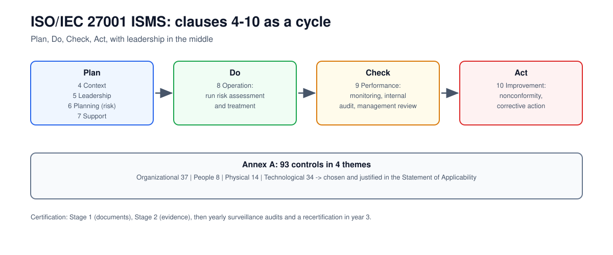

# 03 · ISO/IEC 27001:2022

> **Module:** 04 Risk Management and ISO 27001 · **Week:** 8 · **Time:** ~8 hours
> **You will:** explain the ISMS clauses 4–10, the 93 Annex A controls in four themes, the Statement of Applicability, internal audits and the certification path, and check an SoA for gaps with a Python tool.
> **Certification:** Security+ SY0-701/801 domain 5 · ISC2 CC domain 1 · the base for ISO/IEC 27001 Lead Implementer / Lead Auditor courses

> Everything here is paraphrased. The standard itself is sold by ISO and national bodies. Buy or borrow it before you implement or audit.

---

## 1. Why it matters in a SOC / cloud-security job

ISO/IEC 27001 is the best-known **certifiable** standard for information security. Customers ask for the certificate. Auditors ask for evidence. A SOC and a cloud team produce a lot of that evidence.

- "Show me your incident log and your last review" is an audit request that lands on the SOC.
- Cloud teams show configuration baselines, access reviews and backup test results as evidence for specific controls.
- The 2022 version added controls that are exactly SOC and cloud work: threat intelligence, monitoring activities, cloud service security, configuration management, web filtering and data leakage prevention.

---

## 2. Understand it



### 2.1 What is an ISMS?

An **ISMS (information security management system)** is a set of policies, processes, roles and records that a company uses to manage information security *continuously* by risk. ISO/IEC 27001 says what a good ISMS must contain. It does **not** say which technology to buy.

Related standards:

| Standard | Purpose |
|---|---|
| **ISO/IEC 27001:2022** | Requirements for an ISMS (clauses 4–10 plus Annex A). This is the certifiable one. |
| **ISO/IEC 27002:2022** | Guidance on how to implement each Annex A control, with attributes for each (type, concepts, domain). Not certifiable by itself. |
| **ISO/IEC 27005** | Guidance on information security risk management |
| **ISO/IEC 27017 / 27018** | Cloud security / personal data in public cloud (guidance) |
| **ISO/IEC 27701** | Privacy extension to 27001 |
| **ISO/IEC 42001** | AI management system (see "next step" below) |

The 2022 edition replaced the 2013 edition. The transition period for older certificates ended in October 2025, so new work should use the 2022 version.

### 2.2 The clauses (4–10)

Clauses 1–3 are scope, references and terms. **Clauses 4–10 are the mandatory requirements.** A company cannot skip any of them and still claim conformity.

| Clause | Name | What it asks for (paraphrased) |
|---|---|---|
| **4** | Context of the organization | Understand internal and external issues, interested parties and their needs, and define the **scope** of the ISMS |
| **5** | Leadership | Top management commits, sets the information security policy, assigns roles and authority |
| **6** | Planning | Assess and treat risks (6.1), choose controls and write the **Statement of Applicability**, set security objectives, plan changes |
| **7** | Support | Resources, competence, awareness, communication, and **documented information** (control of documents and records) |
| **8** | Operation | Run the risk assessment and treatment plan, and control the processes in operation |
| **9** | Performance evaluation | Monitor and measure, **internal audit**, **management review** |
| **10** | Improvement | Handle nonconformities, corrective action, continual improvement |

This is the Plan-Do-Check-Act cycle in practice: 4–7 plan, 8 do, 9 check, 10 act.

### 2.3 Annex A: 93 controls in 4 themes

The 2022 version has **93 controls** in **four themes** (the 2013 version had 114 controls in 14 domains). Controls were merged, and **11 were new**.

| Theme | IDs | Count | Examples (paraphrased) |
|---|---|---|---|
| **Organizational** | 5.1–5.37 | 37 | Policies, roles, supplier security, incident management, continuity, legal and compliance, threat intelligence (new), security for cloud services (new) |
| **People** | 6.1–6.8 | 8 | Screening, terms of employment, awareness and training, remote working, reporting events |
| **Physical** | 7.1–7.14 | 14 | Secure areas, clear desk, equipment protection, physical security monitoring (new) |
| **Technological** | 8.1–8.34 | 34 | Endpoint devices, privileged access, authentication, malware protection, backup, logging, monitoring activities (new), configuration management (new), data masking (new), DLP (new), web filtering (new), secure coding (new) |

The new controls (11 in total): threat intelligence, security for cloud services, ICT readiness for business continuity, physical security monitoring, configuration management, information deletion, data masking, data leakage prevention, monitoring activities, web filtering, and secure coding.

The 2022 standard also gives each control **attributes** in ISO/IEC 27002, such as control type (preventive, detective, corrective), security properties (confidentiality, integrity, availability), and cybersecurity concepts (aligned with the NIST CSF functions). That makes mapping easy.

### 2.4 Statement of Applicability (SoA)

The SoA is the key document that links risk to controls. Clause 6.1.3 requires you to:

1. Decide which controls you need, from your risk treatment, and compare them with Annex A so you do not miss a necessary one.
2. Produce an SoA that lists **every Annex A control** with: is it applicable, why (include or exclude), is it implemented, and (in practice) where the evidence is.

Rules of thumb:
- **Excluding a control needs a reason** (for example "no physical office").
- "Implemented" with no evidence is a classic audit finding.
- The SoA is usually reviewed at certification and at every surveillance audit.

### 2.5 Internal audit and management review

- **Internal audit (clause 9.2):** planned, by competent and impartial people (not auditing their own work). Produces findings: conformity, minor/major nonconformity, observation, opportunity for improvement.
- **Management review (9.3):** top management reviews results, risks, audit findings, incidents and resources, and records decisions.
- **Nonconformity (10.2):** react, fix, find the root cause, take corrective action, check it worked, keep records.

### 2.6 Certification path

| Step | What happens |
|---|---|
| Gap analysis and scope | Decide boundaries (sites, systems, teams) |
| Build the ISMS | Risk assessment, SoA, policies, awareness |
| Run it for a period | Evidence needs records over time (internal audit and management review done at least once before Stage 2) |
| **Stage 1 audit** | The certification body reviews your documents and readiness |
| **Stage 2 audit** | They check that the ISMS works, with evidence |
| Certificate | Valid for **3 years** |
| **Surveillance audits** | Yearly checks in years 1 and 2 |
| **Recertification** | A full audit in year 3 |

Only accredited certification bodies can issue valid certificates. Always check scope on a certificate: "ISO 27001 certified" may cover only one office or one product.

> **From DBA to security**
> - **Audit evidence** is like proving your backup strategy: not "we have backups" but "here is last month's restore test report".
> - The **SoA** is like a signed list of database standards: which settings apply to which environments and why a deviation was accepted.
> - **Change control and documented procedures** you already follow map to clauses 7 and 8.
> - A **successful internal audit** feels like a pre-go-live review: you want to find the problem before the external auditor.
> - **27002 control 8.13 (backup)**, **8.15 (logging)**, **8.5 (authentication)**, **8.3 (information access restriction)** and **8.24 (use of cryptography)** are controls where you can supply expert, practical evidence.

---

## 3. Hands-on

### Lab: SoA gap checker

`lab/soa_checker.py` knows the structure of Annex A (4 themes, 93 IDs) and reads an SoA from YAML. It reports:

| Gap type | Meaning |
|---|---|
| `missing_from_soa` | an expected control has no row |
| `excluded_no_reason` | marked not applicable with no justification |
| `not_implemented` | applicable, but status `no` or `planned` |
| `partial` | only partly implemented |
| `no_evidence` | marked implemented, but no evidence listed |
| `unknown_control` | a row uses an ID that is not in Annex A |

The sample `lab/samples/soa.yaml` is a fictional first-year scope. Titles are short paraphrases, not the standard's wording. From the repo root:

```bash
.venv/Scripts/python cybersecurity-track/04-risk-management-and-iso27001/lab/demo.py
```

Real output (Part 2):

```text
=== Part 2: SoA gap check (11 listed controls plus 2 expected but missing) ===
Control  Theme           Gap type             Detail
----------------------------------------------------------------------
7.4      Physical        excluded_no_reason   excluded without justification
5.7      Organizational  missing_from_soa     no SoA row
8.8      Technological   missing_from_soa     no SoA row
5.24     Organizational  no_evidence          implemented but no evidence recorded
5.30     Organizational  not_implemented      status is 'planned'
5.19     Organizational  partial              only partly implemented
8.15     Technological   partial              only partly implemented
8.99     Technological   unknown_control      not an Annex A control ID
Summary: {'expected': 13, 'clean': 6, 'gaps': 8, 'by_kind': {'excluded_no_reason': 1, 'missing_from_soa': 2, 'no_evidence': 1, 'not_implemented': 1, 'partial': 2, 'unknown_control': 1}}

Full Annex A has 93 controls. This SoA would leave 87 gaps against all 93 (plus 1 unknown-ID row).
```

**How to read it:**
- `7.4` excluded with an empty reason fails an audit. Compare `7.7`, which is excluded with a reason ("fully remote company") and is **not** a gap.
- `5.24` (incident management planning) is "implemented" but has no evidence. An auditor will ask for the plan, the contact list and an exercise record.
- `8.99` does not exist. Typos in control IDs happen in real SoAs.
- Against all 93 controls, this small SoA leaves most rows missing. A real SoA lists all 93.

Run the tests (they check the 93/37/8/14/34 counts and every gap type):

```bash
.venv/Scripts/python -m pytest cybersecurity-track/04-risk-management-and-iso27001 -v
```

**Break it yourself:**
1. Add `5.30` evidence and change its status to `implemented`. Does the gap disappear?
2. Add a row that excludes `8.28` (secure coding) with the reason "we do not write code". Is that a good reason for a company running a web store? What would an auditor say?
3. Make the tool read a CSV file as well as YAML.

### Optional free tools

- **ISO 27001 internal audit checklist** templates in a spreadsheet: build your own from the clauses above.
- **CISO Assistant** (open source) can model frameworks, including ISO 27001, in Docker. It needs more RAM than the rest of this track.

---

## 4. Practice platforms

- **TryHackMe / HTB:** these focus on technical skills. For ISO 27001, use the free overview courses from training providers and PECB/BSI/IRCA material. The course maps in the AI governance and compliance modules ([07](../../07-ai-governance/README.md), [08](../../08-ai-compliance/README.md)) may list some GRC courses.
- **Free reading:** ISO publishes a free preview of the standard's introduction; many national bodies and certification bodies publish plain-language guides.

---

## 5. Three realistic scenarios

**1. The auditor asks for backup evidence.** *What happened:* control 8.13 is "implemented", but the only proof is "we run RMAN jobs". *Do:* provide the backup policy, job reports, and a **restore test record with date, system, result and time taken**. Add a calendar for regular tests.

**2. The SoA says "implemented", the cloud says otherwise.** *What happened:* the SoA says control 8.9 (configuration management) is implemented, but a cloud scan shows hundreds of drifted resources. *Investigate:* compare the claim with real evidence (policy as code, drift reports). *Do:* correct the SoA status to `partial`, raise a nonconformity internally, and fix the root cause. An honest SoA is safer than an optimistic one.

**3. Scope creep before the audit.** *What happened:* a new product team launches in the cloud two months before Stage 2. *Do:* decide whether it is in scope, extend the risk assessment, update the SoA and evidence, and tell the certification body. Do not hide it.

---

## 6. Common mistakes

- Thinking "ISO 27001 = the 93 controls". The management system (clauses 4–10) is the core, and the controls come from the *risk treatment*.
- Marking controls "implemented" with no evidence.
- Writing 80 policies nobody reads. Keep documents few and used.
- Running internal audit as a tick box, or auditing your own work.
- Forgetting management review and objectives.
- Using the 2013 control numbering (A.5–A.18) in 2022 documents.
- Believing that certification means "secure". It means the management system is working and audited.

---

## 7. Interview questions

<details><summary><b>Q1. What is ISO/IEC 27001?</b></summary>
The international standard for an information security management system (ISMS). Companies can be certified against it by an accredited certification body.
</details>

<details><summary><b>Q2. What is an ISMS?</b></summary>
A risk-based management system: policies, roles, processes and records to manage information security continuously and improve it.
</details>

<details><summary><b>Q3. What are clauses 4 to 10?</b></summary>
Context, Leadership, Planning, Support, Operation, Performance evaluation, Improvement. They are mandatory requirements.
</details>

<details><summary><b>Q4. How many Annex A controls are there in 2022, and in which themes?</b></summary>
93 controls in four themes: Organizational (37), People (8), Physical (14), Technological (34).
</details>

<details><summary><b>Q5. What is the Statement of Applicability?</b></summary>
A document that lists every Annex A control, whether it is applicable, why, and whether it is implemented. It links risk treatment to controls.
</details>

<details><summary><b>Q6. Can you exclude an Annex A control?</b></summary>
Yes, if the risk assessment shows it is not needed, and you record the reason in the SoA. You cannot exclude it just because it is hard.
</details>

<details><summary><b>Q7. What is ISO/IEC 27002?</b></summary>
A guidance standard that explains how to implement each Annex A control. You are not certified against it.
</details>

<details><summary><b>Q8. What changed from the 2013 to the 2022 version?</b></summary>
Annex A went from 114 controls in 14 domains to 93 controls in 4 themes, with 11 new controls (such as threat intelligence, cloud services and monitoring activities), and minor clause updates.
</details>

<details><summary><b>Q9. Describe the certification process.</b></summary>
Scope and build the ISMS, run it, complete an internal audit and management review, pass Stage 1 (document review) and Stage 2 (effectiveness), receive a 3-year certificate with yearly surveillance audits and a recertification in year 3.
</details>

<details><summary><b>Q10. What is an internal audit for?</b></summary>
To check, by competent and impartial people, that the ISMS conforms to the standard and to your own rules, so you find and fix problems before the external audit.
</details>

<details><summary><b>Q11. Scenario: an auditor finds a major nonconformity. What now?</b></summary>
Understand it, contain the issue, find the root cause, agree a corrective action plan with owners and dates, show evidence of the fix. A major nonconformity can block certification until resolved.
</details>

<details><summary><b>Q12. How does the SOC support ISO 27001 evidence?</b></summary>
Incident records and reviews (5.24–5.28), monitoring and logging evidence (8.15, 8.16), threat intelligence use (5.7), and metrics for management review.
</details>

<details><summary><b>Q13. ISO 27001 vs SOC 2?</b></summary>
ISO 27001 certifies an ISMS against a fixed standard and is recognized worldwide. SOC 2 is an attestation report by a CPA firm against Trust Services Criteria, common for US SaaS. Many companies do both.
</details>

---

## 8. Checklist

- [ ] I can list clauses 4–10 and say what each requires.
- [ ] I know the 4 themes and 93 controls, and some new 2022 controls.
- [ ] I can explain why an SoA row needs a reason and evidence.
- [ ] I ran the SoA gap checker and can explain each gap type.
- [ ] I can describe Stage 1, Stage 2, surveillance and recertification.

## 9. References

- ISO/IEC 27001:2022 and ISO/IEC 27002:2022 (purchase from ISO or your national standards body).
- ISO/IEC 27005 (risk), ISO/IEC 27701 (privacy), ISO/IEC 42001 (AI management).
- NIST CSF 2.0 informative references (mappings to ISO/IEC 27001).
- ISO website pages on the 27001 family and certification.

**Next:** [04 · Third-party risk, BIA and BC/DR](04-third-party-risk-bia-bcdr.md)
