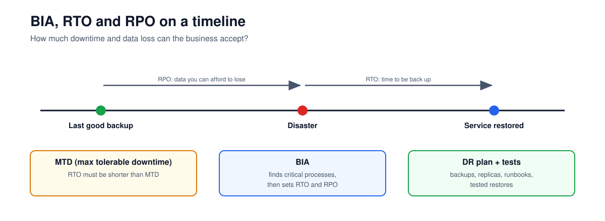

# 04 · Third-party risk, BIA and BC/DR

> **Module:** 04 Risk Management and ISO 27001 · **Week:** 8 · **Time:** ~6 hours
> **You will:** assess a supplier's risk, run a simple business impact analysis (BIA), set RTO and RPO, and explain how BCP and DRP fit together.
> **Certification:** Security+ SY0-701/801 domains 3 and 5 · ISC2 CC domain 2 · ISO/IEC 27001 controls 5.19–5.23 (suppliers), 5.29–5.30 (continuity), 8.13–8.14 (backup, redundancy)

---

## 1. Why it matters in a SOC / cloud-security job

Your company is only as secure as the vendors it trusts, and every cloud provider and SaaS tool is a vendor.

- A supplier with network or data access can become the way in. Supply-chain attacks are a major trend. Check the details of any case you quote in an interview, from a reliable source.
- Cloud outages are a reality. Even large providers have regional failures. Your continuity plan must assume it.
- After a ransomware attack, the question is: "how fast can we restore which systems?" That is the BIA and DR plan, answered under pressure.
- The **shared responsibility model** decides which risks belong to you and which to the provider.

---

## 2. Understand it

### 2.1 Third-party (vendor) risk

| Stage | What to do |
|---|---|
| **Inventory and tier** | List all vendors. Tier them: high (sensitive data, deep access, critical service) → low (office supplies) |
| **Due diligence** | Before signing: security questionnaire, certifications (ISO/IEC 27001 certificate with the right *scope*, SOC 2 report), pen test summary, financial and legal checks |
| **Contract** | Security requirements, breach notification time, audit rights, data location, subcontractors, exit and data return/deletion |
| **Ongoing monitoring** | Annual reassessment (more often for high tier), security ratings, news, incident notices |
| **Offboarding** | Remove access, collect or delete data, rotate shared secrets, record it |

Questions to ask any vendor: What data do you hold? Who can access it? Is it encrypted at rest and in transit? Do you have MFA for admins? How do you handle incidents and when will you tell us? What happens to our data when we leave?

Related terms: **SLA** (service level agreement), **MSA** (master services agreement), **DPA** (data processing agreement, where personal data is shared), **SBOM** (software bill of materials: a list of components in software, useful for supply-chain risk), **fourth party** (your vendor's vendor).

### 2.2 Shared responsibility in the cloud

| Layer | IaaS (VMs) | PaaS | SaaS |
|---|---|---|---|
| Physical, hardware | Provider | Provider | Provider |
| OS and runtime | **You** | Provider | Provider |
| Application | **You** | **You** | Provider |
| Identity, access, data | **You** | **You** | **You** |

Rule: **you are always responsible for your data, your identities and your configuration.** Most cloud incidents are customer misconfiguration.

### 2.3 Business impact analysis (BIA)

A BIA finds which business processes matter most and what happens when they stop.

1. List business processes (not systems) such as "take orders", "pay staff".
2. For each, estimate impact over time: money, customers, legal, safety, reputation.
3. Find the **maximum tolerable downtime (MTD)**: the point where the damage is unacceptable.
4. Set **RTO** (recovery time objective) *shorter* than MTD, and **RPO** (recovery point objective): the maximum data loss.
5. List dependencies: which systems, data, people, suppliers and sites each process needs.
6. Rank the processes. This gives the restore order.

| Term | Meaning | Example |
|---|---|---|
| MTD / MAO | Maximum tolerable downtime / outage | 24 hours for order taking |
| RTO | Target time to restore service | 4 hours |
| RPO | Target age of the latest usable data | 15 minutes |
| WRT | Work recovery time: time to catch up after systems return | 2 hours |
| MTTR / MTBF | Mean time to repair / between failures | Reliability metrics |

RTO + WRT should fit inside MTD.

RPO sets backup frequency. RPO of 15 minutes means you need log shipping or replication, not nightly backups.

### 2.4 BCP and DRP

| | BCP (business continuity plan) | DRP (disaster recovery plan) |
|---|---|---|
| Focus | Keep critical *business processes* going | Restore *IT systems and data* |
| Content | Alternate work sites, manual workarounds, communication, roles | Backup and restore steps, failover, system order, runbooks |
| Owner | Business leaders | IT / operations |

Recovery site types: **hot** (live copy, minutes), **warm** (equipment ready, data restored, hours), **cold** (empty space, days). Cloud gives extra options: multi-region, pilot light, backup and restore.

**Testing is the point.** Types: document review, tabletop (talk-through), walkthrough, simulation, parallel test (run the DR site beside production), and full failover. Record the actual recovery time and compare it with the RTO. Fix the plan after each test.

### 2.5 Ransomware and recovery

Backups should survive an attacker with admin rights: offline or **immutable** copies, separate credentials, tested restore of identity services (the directory) first, and a **clean room** to check restored systems before connecting them. The NIST ransomware profile (see lesson 02) lists the outcomes to aim for.

> **From DBA to security**
> This is your home ground.
> - **RTO/RPO:** you have set them for databases. Say so: "I have designed backup and standby strategies against agreed RPO and RTO."
> - **RMAN, Data Guard, Flashback, archived redo shipping:** each one is a recovery technique with a different RPO and RTO. Describe them that way.
> - **Restore tests:** if you have done a surprise restore at 3 a.m., you know why testing matters. Use that as a STAR story (module 12).
> - **Dependencies:** a database restore is useless without the network, storage, directory, application and DNS. A BIA asks the same.
> - **Vendors:** Oracle support, cloud providers, hosting. You already manage vendors. Now add the security questions.

---

## 3. Hands-on

No new code lab. Reuse and extend the risk register lab.

1. **Add vendor risks.** Add three vendor risks to `lab/samples/risks.yaml` (a payroll SaaS, a cloud hosting provider, an IT contractor with admin access). Give honest likelihood and impact, a treatment (transfer, mitigate) and an owner. Run the demo.
2. **Vendor questionnaire.** Write a 10-question security questionnaire for a SaaS vendor that will hold customer data. Mark which answers are red flags.
3. **Mini BIA (1 hour).** List 5 processes of a fictional shop (take orders, pay staff, ship goods, support customers, run the website). For each give MTD, RTO and RPO, and the systems that support it. Decide the restore order.
4. **RTO check.** For a 500 GB database, estimate the restore time from your backup tool and storage. Is it shorter than the RTO you wrote? If not, what changes (faster storage, standby, snapshots)?
5. **Optional free tools:** OpenSSF Scorecard and `pip-audit` / `npm audit` show the health of open-source dependencies (software supply chain). Use them on a small personal project.

---

## 4. Practice platforms

- **TryHackMe / HTB:** these cover recovery in incident response rooms and cloud labs. Search "Incident response", "Ransomware" and "Cloud shared responsibility".
- **Free:** ready-to-use templates from NIST (SP 800-34 contingency planning), and CISA's free tabletop exercise packages (CTEP).
- **Library:** the NIST ransomware profile (IR 8374 Rev. 1), and the incident response playbook documents in the library, are good for exercises.

---

## 5. Three realistic scenarios

**1. The supplier breach notice.** *What happened:* a payroll SaaS vendor reports a breach that may include employee data. *Investigate:* what data of ours, which period, was it encrypted, what did the contract promise? *Do:* open an incident, ask for the vendor's forensic summary, assess legal duties (privacy team and counsel decide on notification), rotate shared credentials and API keys, update the vendor's risk rating.

**2. DR plan versus reality.** *What happened:* the plan says RTO 4 hours for the order system. In a test, restore takes 11 hours because of the network and the directory. *Do:* record the real number, brief the business owner, and choose: faster technology, reduce scope, or accept the longer RTO formally.

**3. The cloud region problem.** *What happened:* a provider region has an outage and the main app is down. *Investigate:* what was single-region? What was not tested? *Do:* use the BCP to run manual workarounds and customer communication, then decide on multi-region design based on the BIA, not on fear.

---

## 6. Common mistakes

- Accepting an ISO certificate without checking the scope and the date.
- Questionnaires with no follow-up. A "no" needs an action.
- Setting RTO and RPO by guessing, instead of asking the business.
- A backup that nobody has restored.
- A DR plan stored only on the systems that fail.
- Planning for system loss only, forgetting people, buildings and suppliers.
- Assuming the cloud provider backs up your data for you, without checking.

---

## 7. Interview questions

<b>Q1. What is third-party risk management?</b>

Identifying, assessing, monitoring and managing the security risk that suppliers bring, from selection through contract, monitoring and exit.

<b>Q2. How do you assess a new SaaS vendor?</b>

Tier it by data sensitivity and access. Use a questionnaire, review its certificates (with scope) and reports, check the contract (breach notice, audit rights, data return), and set a review schedule.

<b>Q3. What is the cloud shared responsibility model?</b>

The provider secures the cloud infrastructure. The customer secures what they put in it: identities, data, configuration, and more of the stack the closer to IaaS they are.

<b>Q4. What is a BIA?</b>

A study of which business processes are critical, the impact of their downtime over time, and what recovery targets (RTO, RPO) and dependencies they need.

<b>Q5. RTO vs RPO?</b>

RTO: how quickly service must be back. RPO: how much recent data we can lose.

<b>Q6. What is MTD and how does it relate to RTO?</b>

Maximum tolerable downtime is the longest outage the business survives. RTO plus work recovery time must be less than MTD.

<b>Q7. BCP vs DRP?</b>

BCP keeps the business running. DRP restores IT. DRP is one part of BCP.

<b>Q8. Hot, warm and cold site?</b>

Hot: running copy, fast failover. Warm: hardware ready, data must be restored. Cold: space only, slowest and cheapest.

<b>Q9. How would you test a DR plan?</b>

Start with a tabletop, then walkthrough and simulation, and eventually an actual restore or failover in an isolated environment. Measure real times against RTO and RPO and fix gaps.

<b>Q10. How do you protect backups from ransomware?</b>

Immutable or offline copies, separate credentials, network isolation, monitoring of backup deletion, and regular tested restores.

<b>Q11. Scenario: your key vendor is breached. What do you do first?</b>

Get facts from the vendor, find what data and access of ours are involved, rotate credentials and tokens, increase monitoring on the integration, open an incident and involve legal and privacy as needed.

<b>Q12. How can a DBA's experience help in BC/DR?</b>

Practical backup, restore, standby and failover design against real RPO and RTO, plus restore testing discipline and knowledge of dependencies between systems.

---

## 8. Checklist

- [ ] I can describe a vendor risk process from onboarding to exit.
- [ ] I can explain shared responsibility for IaaS, PaaS and SaaS.
- [ ] I did a mini BIA and can state MTD, RTO and RPO for each process.
- [ ] I can explain why restore tests matter in numbers, not words.

## 9. References

- NIST SP 800-34 Rev. 1 (contingency planning) and NIST SP 800-161 Rev. 1 (supply chain risk management).
- ISO/IEC 27001:2022 controls 5.19–5.23 and 5.29–5.30; ISO 22301 (business continuity management).
- CISA Cybersecurity Tabletop Exercise Packages (CTEP).
- NIST IR 8374 Rev. 1 (ransomware profile).
- CompTIA Security+ objectives; ISC2 CC domain 2.

**Back to:** [Module 04 overview](README.md)
