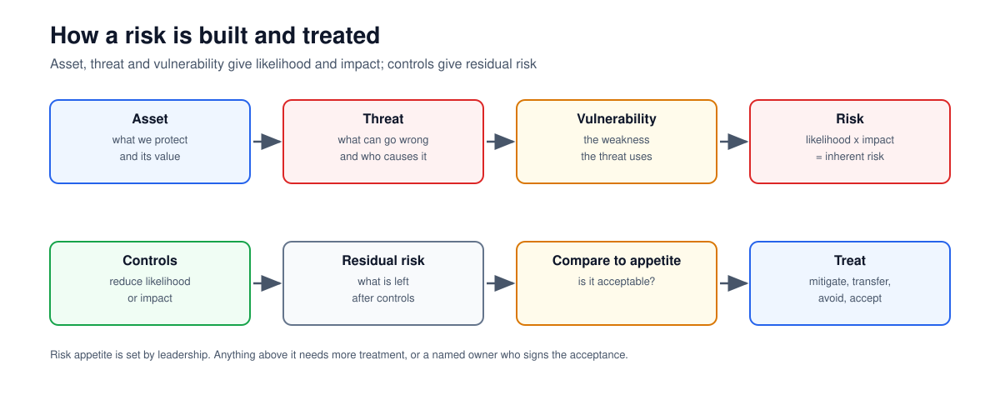

# Module 04 · Risk Management and ISO/IEC 27001

> **Weeks:** 7–8 · **Time:** ~30 hours · **Level:** Security+ domain 5 and ISO/IEC 27001 foundation
> **You will:** learn how companies decide what to protect first, how NIST CSF 2.0 and ISO/IEC 27001:2022 organize security, and how SOC and cloud work becomes audit evidence. You will build a risk register scorer and a Statement of Applicability (SoA) gap checker.

**A note on the name.** Your plan says "ISO 20007". There is no standard with that number in this field, so we take it to mean **ISO/IEC 27001**, the information security management system standard. If you meant a different one, tell your mentor.

**Prerequisites:** [Module 03](../03-security-foundations/) (core concepts, especially control types and IAM).

## Learning path

| # | Lesson | Week | Certification objective |
|---|---|---|---|
| 01 | [Risk concepts and NIST SP 800-30](01-risk-concepts.md) | 7 | Security+ domain 5 · CC domain 1 |
| 02 | [NIST CSF 2.0](02-nist-csf-2.md) | 7 | Security+ domain 5 · CC domains 1, 2 |
| 03 | [ISO/IEC 27001:2022](03-iso-27001-2022.md) | 8 | Security+ domain 5 · ISO 27001 foundation |
| 04 | [Third-party risk, BIA and BC/DR](04-third-party-risk-bia-bcdr.md) | 8 | Security+ domains 3, 5 · CC domain 2 |



## Key terms

| Term | Simple meaning |
|---|---|
| Asset / threat / vulnerability | Thing of value / what can hurt it / the weakness |
| Inherent / residual risk | Risk before / after controls |
| Risk appetite | How much risk leadership accepts |
| Risk treatment | Mitigate, transfer, avoid, accept |
| NIST CSF 2.0 | Six functions: Govern, Identify, Protect, Detect, Respond, Recover |
| ISMS | Information security management system |
| Annex A | 93 controls in 4 themes (ISO/IEC 27001:2022) |
| SoA | Statement of Applicability: which controls apply, why, and the status |
| BIA / RTO / RPO | Business impact analysis / time to restore / data loss allowed |
| Third party | A supplier or partner with access to your data or systems |

## How risk and compliance show up in daily SOC and cloud work

| Daily work | Risk and compliance link |
|---|---|
| Triage an alert | Severity comes from asset value and impact, which is risk scoring |
| Close an incident | Record, root cause and lessons learned feed the risk register and ISO controls 5.24-5.28 |
| Review a vulnerability scan | Prioritize by risk: exploit status, asset criticality, exposure |
| Request a cloud security exception | A risk acceptance with owner, expiry and compensating controls |
| Cloud posture finding (public bucket) | A misconfiguration risk, mapped to a control (for example ISO 5.23, 8.9) |
| Access review of admin roles | Evidence for access control (ISO 5.15, 5.18, 8.2) and least privilege |
| Backup and restore test | Evidence for BC/DR (ISO 8.13) and the BIA targets |
| Log source onboarding | Evidence for logging and monitoring (ISO 8.15, 8.16) |
| Onboard a SaaS vendor | Third-party risk assessment (ISO 5.19-5.23, CSF Govern supply chain) |
| Monthly report to management | Metrics for management review (ISO clause 9.3) and CSF tiers |

## Lab

[`lab/`](lab/) runs offline with `pyyaml` and the standard library. From the repo root:

```bash
.venv/Scripts/python -m pytest cybersecurity-track/04-risk-management-and-iso27001 -v
.venv/Scripts/python cybersecurity-track/04-risk-management-and-iso27001/lab/demo.py
```

| File | What it does |
|---|---|
| `lab/risk_register.py` | Likelihood x impact, residual risk after controls, owners, overdue reviews, appetite checks. Loads YAML or CSV |
| `lab/soa_checker.py` | Checks an SoA against Annex A (93 controls, 4 themes) and reports gaps |
| `lab/samples/` | Synthetic registers (`risks.yaml`, `risks.csv`) and a synthetic `soa.yaml` for a fictional company |
| `lab/demo.py` | Prints both reports (output shown in lessons 01 and 03) |
| `lab/test_risk_iso_lab.py` | 16 tests |

## Mini-project: a one-page security risk report (about 4 hours)

1. Take the sample register and add 5 risks from a database or cloud environment you know.
2. Run the scorer. Fix the flags (owner, review date, controls that do nothing).
3. Use the executive summary template in [`../12-soft-skills/templates/executive-summary.md`](../12-soft-skills/templates/executive-summary.md) to write the top 3 risks in business language.
4. Add 10 SoA rows for a real or fictional company and fix the gaps the checker finds.

## Practice on TryHackMe / HTB

Risk and ISO topics are mostly reading and writing, so TryHackMe and HTB have less here. Use them for the technical evidence side: SOC Level 1 (alert triage and reporting) and HTB Academy's SOC Analyst path. Search rooms and modules for "risk", "governance" and "frameworks". For ISO/IEC 27001 itself, use certification-body introductions and the standard.

## Module interview questions

<details><summary><b>Q1. What is the difference between inherent and residual risk?</b></summary>
Inherent risk exists before controls. Residual risk is what remains after controls are applied.
</details>

<details><summary><b>Q2. What are the four ways to treat a risk?</b></summary>
Mitigate, transfer, avoid, accept.
</details>

<details><summary><b>Q3. How do you explain risk appetite?</b></summary>
It is the level of risk leadership is willing to take to reach business goals. Risks above it need treatment or a formal, signed acceptance.
</details>

<details><summary><b>Q4. Name the six NIST CSF 2.0 functions.</b></summary>
Govern, Identify, Protect, Detect, Respond, Recover.
</details>

<details><summary><b>Q5. What is ISO/IEC 27001 and how is it different from the CSF?</b></summary>
ISO/IEC 27001 is a certifiable management-system standard. The CSF is a voluntary framework of outcomes with no certificate.
</details>

<details><summary><b>Q6. How many Annex A controls are in the 2022 version?</b></summary>
93, in four themes: Organizational, People, Physical, Technological.
</details>

<details><summary><b>Q7. What is a Statement of Applicability?</b></summary>
A document listing each Annex A control, whether it applies and why, and its implementation status. It is a core audit document.
</details>

<details><summary><b>Q8. What is a BIA?</b></summary>
It identifies critical business processes and sets RTO and RPO based on the impact of downtime.
</details>

<details><summary><b>Q9. How would you assess a vendor?</b></summary>
Tier by data and access, use a questionnaire and certificate review (check scope), review the contract, and monitor on a schedule. Plan the exit.
</details>

<details><summary><b>Q10. How does your work in a SOC help ISO 27001 compliance?</b></summary>
Incident records, monitoring and log evidence, access reviews and backup tests are direct evidence for Annex A controls and for management review.
</details>

## Next step: AI governance and compliance

Once you know this module, you can apply the same ideas to AI systems:

- [`07-ai-governance/`](../../07-ai-governance/README.md): AI inventory, roles and policies, AI risk management and the ISO/IEC 42001 AI management system (it follows the same management-system structure as ISO/IEC 27001).
- [`08-ai-compliance/`](../../08-ai-compliance/README.md): EU AI Act, privacy law, control mapping and evidence, audit readiness.

## References

- NIST SP 800-30 Rev. 1, NIST SP 800-39, NIST CSF 2.0 (Feb 2024), NIST IR 8374 Rev. 1.
- ISO/IEC 27001:2022, ISO/IEC 27002:2022, ISO/IEC 27005, ISO 22301.
- CompTIA Security+ exam objectives, domain 5; ISC2 CC exam outline.
- CISA resources and tabletop exercise packages.
