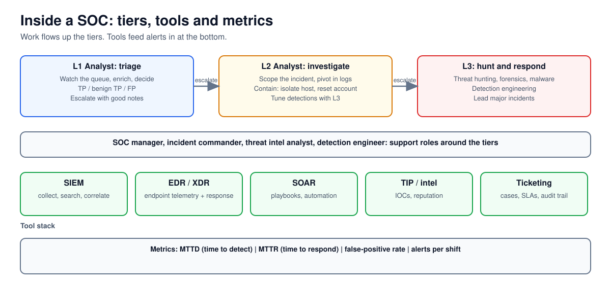

# 01 · What a SOC does

> **Module:** 05 · SOC Fundamentals · **Week:** 3 · **Time:** ~6 hours
> **You will:** explain what a Security Operations Center (SOC) does, name the tiers, tools and metrics, and read a synthetic alert queue like a Level 1 analyst.

| | |
|---|---|
| **Prerequisites** | Module 03 (security basics: CIA, logs, authentication) |
| **Lab** | [`lab/`](lab/): run `demo.py` to see a queue of 17 alerts |
| **Maps to** | Security+ SY0-701/801 domain 4 (security operations); CySA+ (verify the current exam code on the CompTIA page); Microsoft SC-200; TryHackMe SOC Level 1; HTB CDSA |

---

## 1. Why it matters in your SOC + cloud security job

Your new job starts with the SOC. Before you learn any tool, you must know **what the team is for and where you fit**.

- A SOC is the team that watches for attacks 24x7 and responds. It is a *people + process + tools* system. Tools alone do nothing.
- On day one, you will probably sit in the **L1 seat**: you receive alerts, decide "is this real?", and escalate or close.
- Managers judge you by a few numbers (speed, quality, noise). If you know these numbers, you know what "good" looks like.
- In cloud security, many alerts come from cloud services (Entra ID sign-ins, cloud audit logs). The method is the same.

Real situations you will see: a user reports a strange email; an EDR alert says "suspicious PowerShell"; a SIEM rule says "20 failed logins"; a cloud rule says "admin role added".

---

## 2. Understand it



### 2.1 What a SOC does (the five jobs)

| Job | Plain meaning | Example |
|---|---|---|
| **Monitor** | Watch logs and alerts all the time | Check the alert queue each shift |
| **Detect** | Write and tune rules that find bad activity | "Alert if 10 failed logins in 5 minutes" |
| **Triage and investigate** | Decide if an alert is real, find the scope | "Did the login succeed? Which other accounts?" |
| **Respond** | Contain and fix | Isolate a laptop, reset a password |
| **Improve** | Learn and tune | Fix a noisy rule, write a new playbook |

### 2.2 Tiers and roles

| Role | Main work | Typical skills |
|---|---|---|
| **L1 analyst (triage)** | Work the queue. Enrich the alert. Verdict. Escalate with notes. | Logs, ATT&CK basics, ticketing, clear writing |
| **L2 analyst (investigation)** | Deeper investigation. Pivot across logs. First containment steps. | KQL/SPL, EDR, email and identity logs |
| **L3 / threat hunter / IR** | Hunt for threats no rule found. Forensics. Lead big incidents. | Memory/disk forensics, malware basics, scripting |
| **Detection engineer** | Build, test and tune rules (see Module 06) | Sigma, KQL/SPL, git |
| **Threat intel analyst** | Collect and share intel (see lesson 04) | OSINT, STIX/TAXII |
| **SOC manager / incident commander** | Staffing, metrics, big-incident decisions | Communication, risk |

Some companies use other names (Tier 1/2/3, "analyst / senior analyst / engineer"). The idea is the same: **fast broad triage at the bottom, slow deep work at the top.**

### 2.3 Shifts and handover

A 24x7 SOC uses shifts (for example 3 x 8 hours or 12-hour rotations; some teams use "follow the sun" across regions). The **handover** is a critical moment: write what is open, what you are waiting for, and what the next person must do first. A good handover note is short, has ticket numbers, and says *why*.

### 2.4 The tooling stack

| Tool | Short for | What it gives you |
|---|---|---|
| **SIEM** | Security Information and Event Management | Collects logs, searches, correlates, raises alerts (Sentinel, Splunk, Elastic, QRadar, Wazuh) |
| **EDR / XDR** | Endpoint / Extended Detection and Response | Deep endpoint telemetry, process trees, isolate host (Defender, CrowdStrike, SentinelOne). See Module 07 |
| **SOAR** | Security Orchestration, Automation and Response | Runs playbooks: enrich IP, disable user, open ticket (Logic Apps, Splunk SOAR, XSOAR) |
| **TIP / intel feeds** | Threat Intelligence Platform | Known-bad IPs, domains, hashes, actor reports |
| **Ticketing** | | Case record, SLA clock, audit trail (ServiceNow, Jira) |
| **Others** | | Email security, proxy/DNS logs, vulnerability scanner, identity provider (Entra ID), cloud security posture tools |

### 2.5 Metrics (what managers measure)

| Metric | Meaning | Good direction |
|---|---|---|
| **MTTD** | Mean time to **detect**: from attack start to alert | Lower |
| **MTTA** | Mean time to **acknowledge** an alert | Lower |
| **MTTR** | Mean time to **respond / resolve** (define which one in your SOC) | Lower |
| **False-positive rate** | False alerts / all alerts | Lower |
| **Alert volume per analyst per shift** | Workload | Sustainable |
| **Escalation accuracy** | Escalated alerts that were really needed | Higher |

Warning: do not chase speed only. An analyst who closes 100 alerts in an hour without checking is *fast and wrong*. A false negative (a real attack closed as false) is the worst result.

Example calculation: 400 alerts last week, 320 were false positives. False-positive rate = 320 / 400 = **80%**. This is typical for a young SOC. The fix is **tuning**, not working harder.

### 2.6 How an alert reaches you

```text
log source -> collection -> SIEM/EDR rule -> alert -> queue (ticket) -> L1 triage -> close or escalate
```

### 2.7 From DBA to security

> **From DBA to security**
> - **Alert queue = your monitoring screen.** Like watching Oracle Enterprise Manager for incidents, but the "incidents" may be human attackers.
> - **Audit trail = logs.** Your DBA habit of reading `DBA_AUDIT_TRAIL`, `alert.log` and listener logs is exactly the log-reading skill a SOC needs.
> - **AWR baselines = detection baselines.** "Normal" load vs "abnormal" load is the same thinking as "normal sign-ins vs anomaly".
> - **On-call and runbooks = shifts and playbooks.** You already know the discipline of runbooks, handover and escalation paths.
> - **Change tickets = the way to tell benign from bad.** A DBA who sees a `DROP USER` asks "is there a change request?" A SOC analyst asks the same.

---

## 3. Hands-on

### 3.1 Repo lab: read a real queue

```bash
python cybersecurity-track/05-soc-fundamentals/lab/demo.py
```

Real output (the top of it):

```text
ID      RULE                   SCORE  VERDICT               ACTION                         ATT&CK
--------------------------------------------------------------------------------------------------------------
A-1003  success_after_failures   100  true_positive         escalate_L3_declare_incident   T1110,T1078
A-1002  password_spray            97  true_positive         escalate_L3_declare_incident   T1110.003
A-1006  encoded_powershell        85  true_positive         escalate_L3_declare_incident   T1059.001,T1027
A-1012  phishing_report           78  true_positive         escalate_L2                    T1566.002
A-1016  impossible_travel         73  true_positive         escalate_L2                    T1078
...
Summary: benign_true_positive=5, false_positive=3, needs_investigation=1, true_positive=8
```

Questions for you (answers are in the next lesson):
1. Which alert would you open first, and why?
2. Eight alerts out of 17 are true positives, which is unrealistically high. Why did we do that? (Hint: it is a teaching queue.)
3. How many alerts did the *rules* get wrong, and how many were fine but harmless?

### 3.2 Optional free tools
- A free ticket tool (Jira free tier or a plain text file) to practice writing case notes.
- Wazuh (open-source SIEM/XDR) in Docker, only if your laptop has spare RAM. It is heavy; use a small lab.

### 3.3 Practice platforms
- **TryHackMe:** *Cyber Security 101* path, then *SOC Level 1* (leads to the SAL1 certificate).
- **HTB Academy:** *SOC Analyst* job-role path (leads to HTB CDSA).
- **HTB Labs:** Sherlocks (short defensive investigations).

---

## 4. Real-world scenarios

**Scenario 1: the quiet night shift.** At 03:00 the queue shows 40 new "failed login" alerts from one IP. *Investigate:* group them by source IP, check if any login succeeded, look up the IP in intel. *Do:* if no success, block the IP and note it; if one success, escalate at once.

**Scenario 2: handover gone wrong.** The day shift leaves a ticket "looking at it". The night shift does not know the host was already isolated and un-isolates it during a test. *Fix:* handover notes must state **current state** (isolated: yes/no) and **next action**.

**Scenario 3: a manager asks "why is MTTR rising?"** You find the SOC added a new noisy rule that adds 200 alerts a day. *Do:* show the false-positive rate per rule, propose tuning. Metrics point to *causes*, not people.

---

## 5. Common mistakes

- Closing alerts quickly to make numbers look good.
- Treating "no intel hit" as "safe".
- Not writing notes ("it was fine" is not a note).
- Escalating everything (alert fatigue for L2) or nothing (missed incidents).
- Forgetting the time zone. Always work in UTC and write the zone in notes.

---

## 6. Interview questions

<details><summary><b>Q1. What is a SOC?</b></summary>
A team, with processes and tools, that monitors, detects, investigates and responds to security events, usually 24x7.
</details>

<details><summary><b>Q2. What is the difference between L1, L2 and L3?</b></summary>
L1 triages and escalates. L2 investigates deeper and does first containment. L3 hunts, does forensics and leads major incidents, and often helps with detection engineering.
</details>

<details><summary><b>Q3. What is a SIEM and what does SOAR add?</b></summary>
A SIEM collects and correlates logs and raises alerts. SOAR automates the response steps with playbooks (enrich, notify, disable account).
</details>

<details><summary><b>Q4. Define MTTD and MTTR.</b></summary>
Mean time to detect (attack start to detection) and mean time to respond or resolve. Lower is better, but quality must stay high.
</details>

<details><summary><b>Q5. Your false-positive rate is 85%. What do you do?</b></summary>
Find which rules create most of the noise, check why (threshold, missing allow-list, bad logic), tune them with a test, and track the rate per rule. Do not just close alerts faster.
</details>

<details><summary><b>Q6. What is the worst error in triage?</b></summary>
A false negative: a real attack closed as harmless. It means the attacker keeps access.
</details>

<details><summary><b>Q7. Why does a shift handover matter?</b></summary>
Open cases lose state between people. A good handover lists ticket IDs, current state, pending actions and deadlines.
</details>

<details><summary><b>Q8. What is the difference between EDR and SIEM?</b></summary>
EDR gives deep endpoint data and response actions (isolate host). The SIEM gathers many sources (network, cloud, identity) and correlates them. SOCs use both.
</details>

<details><summary><b>Q9. Scenario: you get 300 alerts in one hour from one rule. What first?</b></summary>
Check if it is a real event (attack burst) or a broken rule or a change (for example a new scanner). Look at the common fields. Tell L2 or the detection owner, and do not close all of them blind.
</details>

<details><summary><b>Q10. Explain to an executive why we need a SOC.</b></summary>
Attackers do not work office hours. A SOC finds and stops attacks early, which reduces damage and downtime, and gives evidence for audits and insurance.
</details>

---

## 7. Checklist

- [ ] I can draw the L1/L2/L3 flow and the tool stack from memory.
- [ ] I can define MTTD, MTTR, false-positive rate.
- [ ] I ran `demo.py` and read the queue.
- [ ] I wrote one handover note (5 lines) for the demo queue.

## 8. References

- NIST SP 800-61 Rev. 3 (incident response) and NIST CSF 2.0: https://csrc.nist.gov
- Microsoft Learn, SC-200 study guide: https://learn.microsoft.com/credentials/certifications/security-operations-analyst/
- MITRE ATT&CK: https://attack.mitre.org
- TryHackMe SOC Level 1 path and HTB Academy SOC Analyst path (check the platform pages for current content).
