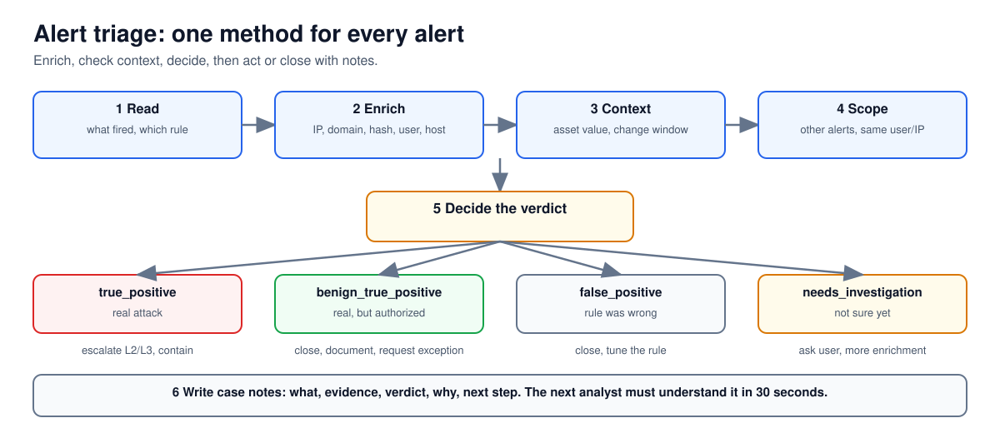

# 02 · The alert lifecycle and triage method

> **Module:** 05 · SOC Fundamentals · **Weeks:** 3-4 · **Time:** ~10 hours
> **You will:** triage an alert with a fixed checklist, choose between true positive, benign true positive and false positive, and write case notes that another analyst can use in 30 seconds.

| | |
|---|---|
| **Prerequisites** | Lesson 01 |
| **Lab** | [`lab/triage.py`](lab/triage.py), [`lab/demo.py`](lab/demo.py), [`lab/test_triage.py`](lab/test_triage.py) |
| **Maps to** | Security+ SY0-701/801 domain 4 (alerting, monitoring, incident handling); SC-200 (investigate incidents); TryHackMe SOC Level 1 |

---

## 1. Why it matters in a SOC / cloud-security job

Triage is **the** L1 skill. Your first interview, your first month and your first review will all be about it.

- A single wrong "false positive" decision can hide a real intrusion.
- A single wrong "true positive" decision wastes L2's time. A hundred of them make L2 stop trusting you.
- Cloud alerts (a new admin role, a login from a new country) look scary but are often a normal change. You must check **context**.

---

## 2. Understand it



### 2.1 The alert lifecycle

```text
generated -> queued -> acknowledged -> enriched -> verdict -> (escalated | closed) -> tuned
```

Every stage is timed by the ticket system. Acknowledge fast, but do not decide fast without evidence.

### 2.2 Four verdicts

| Verdict | Meaning | Action |
|---|---|---|
| **True positive (TP)** | Real malicious or policy-violating activity | Escalate, contain |
| **Benign true positive (BTP)** | The activity **happened**, as the rule says, but it is authorized or expected (a vulnerability scan, an approved change, a test file) | Close, document, ask for an exception or tuning |
| **False positive (FP)** | The rule was wrong: the event did not mean what the rule thinks (geo-IP error, below threshold, known-good file) | Close, tune the rule |
| **Needs investigation** | Evidence is not enough yet | Keep enriching, ask the user, ask L2 |

The difference between BTP and FP matters for tuning: a **BTP** says "the rule works, add an exception for this approved activity"; a **FP** says "the rule logic is weak".

### 2.3 The triage checklist (use it every time)

1. **Read the alert, not only the title.** Which rule? Which fields? What time (UTC)?
2. **What is the claim?** Write it in one sentence: "User X logged in from country A then B in 40 minutes."
3. **Enrich the observables.** IP, domain, URL, file hash, user, host.
   - Reputation (internal intel table first; then public tools with care, see lesson 04).
   - Who owns the host? Is it critical (domain controller, finance)? Is the user a VIP or an admin?
4. **Check context for a benign explanation.**
   - Change ticket or maintenance window? (Check **host + person + time**, not only the ticket number.)
   - Authorized scanner? Approved travel? Test machine?
5. **Scope.** Search the SIEM for the same IP, user, host, domain in the last 24 to 72 hours. Other alerts? Did a login **succeed**? What happened after?
6. **Decide the verdict** (section 2.2) and **write your reasons**.
7. **Act:** escalate with the right level, contain if your runbook allows it, or close.
8. **Write case notes** (section 2.5).
9. **Feedback:** if the alert was FP or BTP, record why so the rule can be tuned.

### 2.4 Enrichment, scoring and the "never excuse a malicious hit" rule

The lab scores each alert like this:

```text
score = rule base + intel + asset value + user value + off-hours + corroboration - benign context
```

| Signal | Points | Why |
|---|---|---|
| Rule severity | low 10, medium 25, high 40, critical 55 | The detection author's view of risk |
| Malicious intel hit | +35 x confidence | A known-bad indicator |
| Suspicious intel hit | +20 x confidence | Weaker signal |
| Asset criticality | 0 / 5 / 10 / 15 | A domain controller matters more than a test VM |
| VIP user | +5 | Impact if compromised |
| Off hours (UTC) | +5 | Attacks like quiet times |
| Corroboration | +10 per related strong alert (max 20) | Same user, IP or domain in another alert |
| Approved change | -50 | Only if **host, person and time** all match |
| Authorized scanner / approved travel / known-good file | -40 to -45 | Benign context |

Three design rules the tests enforce:

1. **A benign reason can never excuse a malicious intel hit.** An approved change window does not make a call to a known malware domain safe.
2. **Reputation is not intent.** A big file upload to a "benign" file-sharing site is still data exfiltration if the volume is 28 times the user's baseline.
3. **Low-count brute force with a success is not low.** Only dismiss "3 failures" if there was no success afterwards.

These are exactly the places where real analysts make mistakes.

### 2.5 Good case notes

A good note answers: **What fired, what evidence, what verdict and why, what next.** Use short lines and facts. Example (real output from the lab):

```text
CASE NOTES  A-1015  impossible_travel  2026-11-12T06:10:00Z
What fired: rule 'impossible_travel' on host=VPN-GW user=dave src_ip=192.0.2.150 domain=-
Details: {"from_country": "US", "minutes_between": 90, "to_country": "SG"}
Enrichment:
  - no intel hits (absence of intel is not proof of safety)
  - +25  rule severity: medium
  - +10  asset VPN-GW is high (vpn gateway)
  - -40  HR travel record explains the location (HR travel record: Singapore, 10-14 Nov)
Score: 0/100
ATT&CK: Initial Access / T1078 Valid Accounts
Verdict: benign_true_positive
Recommended action: close_benign_and_document
```

Bad note: "Looks fine, closed."

### 2.6 Escalation: what to include

Escalate with: the verdict, **why** (3 bullets), affected users and hosts, what you already did, what you want L2 to do, and the ticket link. Use the severity rules of your SOC. In the lab, a true positive goes to **L2** normally and to **L3 / declare an incident** when the score is 85 or higher or the host is critical.

### 2.7 From DBA to security

> **From DBA to security**
> - **Alert triage = a "is this ORA error a real outage?" check.** You look at context before you panic.
> - **Change tickets and maintenance windows** work the same: a `DROP TABLE` inside an approved window by the right person is normal. The same command at 03:00 from an unknown account is an incident.
> - **Baselines.** An AWR report tells you what is "normal". The upload that is 28 times a user's baseline is the same signal as a sudden 28x I/O spike.
> - **Audit evidence.** Case notes are your audit trail. Auditors and L2 will read them later.

---

## 3. Hands-on

### 3.1 Run the triage simulator

```bash
python cybersecurity-track/05-soc-fundamentals/lab/demo.py
```

Real output:

```text
ID      RULE                   SCORE  VERDICT               ACTION                         ATT&CK
--------------------------------------------------------------------------------------------------------------
A-1003  success_after_failures   100  true_positive         escalate_L3_declare_incident   T1110,T1078
A-1002  password_spray            97  true_positive         escalate_L3_declare_incident   T1110.003
A-1006  encoded_powershell        85  true_positive         escalate_L3_declare_incident   T1059.001,T1027
A-1012  phishing_report           78  true_positive         escalate_L2                    T1566.002
A-1016  impossible_travel         73  true_positive         escalate_L2                    T1078
A-1014  data_exfil_volume         65  true_positive         escalate_L2                    T1567.002
A-1009  new_admin_member          60  true_positive         escalate_L3_declare_incident   T1098
A-1011  brute_force               60  true_positive         escalate_L2                    T1110.001
A-1013  brute_force               55  needs_investigation   L1_continue_enrichment         T1110.001
A-1017  brute_force               15  false_positive        close_false_positive_and_tune  T1110.001
A-1005  encoded_powershell         5  benign_true_positive  close_benign_and_document      T1059.001,T1027
A-1010  new_admin_member          5  benign_true_positive  close_benign_and_document      T1098
A-1001  impossible_travel          0  false_positive        close_false_positive_and_tune  T1078
A-1004  port_scan                  0  benign_true_positive  close_benign_and_document      T1046
A-1007  av_detection               0  benign_true_positive  close_benign_and_document      T1204.002
A-1008  av_detection               0  false_positive        close_false_positive_and_tune  T1204.002
A-1015  impossible_travel          0  benign_true_positive  close_benign_and_document      T1078

Summary: benign_true_positive=5, false_positive=3, needs_investigation=1, true_positive=8
```

Read the **story** inside the queue:

- A-1002 + A-1003: a password spray from `203.0.113.50`, then a successful login for the VIP user `bob` with no MFA. This is an incident (score 97 and 100).
- A-1012 + A-1014 (user `carol`): a phishing click, then a 4.2 GB upload at 22:30, 28x her baseline. The destination site has a "benign" reputation, but the alert is still a true positive.
- A-1006 + A-1016 (user `erin`): Word spawns encoded PowerShell that contacts a malware domain, and later a sign-in from a Tor exit.

Tricky benign cases (the tests prove each one):

| Alert | Looks bad because | Really |
|---|---|---|
| A-1001 impossible travel | DE then BR in 40 minutes | The IP is the corporate VPN egress (geo-IP artefact): **FP** |
| A-1004 port scan on DC | 1024 ports on a domain controller | Authorized vulnerability scanner: **BTP** |
| A-1005 encoded PowerShell | `-enc` from a service account at 02:10 | Approved patch rollout CHG-4420 (host, actor and time match): **BTP** |
| A-1007 AV detection | "malware" quarantined | The EICAR test file on a test VM: **BTP** |
| A-1008 AV detection | heuristic alert on an installer | Known-good signed backup agent: **FP** |
| A-1010 admin group add | privileged group on a DC | Approved change CHG-4412: **BTP** |
| A-1015 impossible travel | US then SG in 90 minutes | HR travel record: **BTP** |
| A-1017 brute force | rule fired | Only 3 failures, no success: **FP** |

### 3.2 Break it yourself (predict, then run)

1. Open `alerts.json`, change the time of A-1005 to `2026-11-10T06:30:00Z` (after the change window). *Predict the verdict.* (Not benign: the test `test_encoded_powershell_is_benign_only_inside_the_approved_change` checks this.)
2. Give A-1015 (`dave`, approved travel) the IP `203.0.113.99` (a Tor exit in the intel table). *Predict.* It becomes a true positive.
3. Add your own rule in `triage.RULES` and your own alert. Write a test for it.

Run the tests (32 tests):

```bash
python -m pytest cybersecurity-track/05-soc-fundamentals
```

```text
collected 32 items
cybersecurity-track\05-soc-fundamentals\lab\test_triage.py ............. [ 40%]
...................                                                      [100%]
============================= 32 passed in 0.16s ==============================
```

### 3.3 Optional: practice on real platforms

- **TryHackMe:** *SOC Level 1* path (triage rooms and the SAL1 exam prep).
- **HTB Academy:** *SOC Analyst* job-role path.
- **HTB Labs:** Sherlocks. Write case notes for each one.

---

## 4. Real-world scenarios

**Scenario 1: "Impossible travel" on the CFO.** *What happened:* the CFO signs in from two countries 20 minutes apart. *Investigate:* IP reputation, ASN (is it a VPN or mobile carrier?), user agent, MFA result, device ID, did she approve a push? *Do:* if the device and MFA are normal and the IP is her phone carrier, close as FP and note it. If MFA was bypassed or a new device appeared, reset password, revoke sessions and escalate.

**Scenario 2: Encoded PowerShell at night.** *What happened:* service account runs `powershell -enc ...` at 02:10 on a finance PC. *Investigate:* decode the command offline, check the parent process (a deployment agent or Word?), change calendar, what the host contacted afterwards. *Do:* inside a matching change window with the right actor: BTP. Otherwise isolate the host and escalate.

**Scenario 3: Domain Admins add.** *What happened:* helpdesk adds a "contractor" to Domain Admins at 23:50. *Investigate:* ticket number, approver, call the helpdesk lead on a known number (not by replying to chat in the same session), see the logons by helpdesk1 before. *Do:* no ticket means treat as account takeover: remove the member, disable both accounts, escalate.

---

## 5. Common mistakes

- Trusting the alert title. Read the fields.
- Using the change ticket number alone. Verify who, where and when.
- Letting a good reputation hide bad behavior (reputation is not intent).
- Searching only the one host. Pivot on user, IP and domain.
- Writing "FP" with no reason. The next analyst cannot tune from that.
- Public sandbox upload of internal files (see lesson 04).
- Mixing time zones.

---

## 6. Interview questions

<details><summary><b>Q1. Define true positive, false positive, benign true positive and false negative.</b></summary>
TP: real bad activity detected. FP: alert fired but nothing bad. BTP: the activity is real but authorized. FN: real attack that no rule detected (or that was closed wrongly).
</details>

<details><summary><b>Q2. Walk me through how you triage an alert.</b></summary>
Read the rule and fields, state the claim, enrich observables, check context (asset, user, change window), scope in the SIEM, decide the verdict, escalate or close, write notes, and give tuning feedback.
</details>

<details><summary><b>Q3. Why separate BTP from FP?</b></summary>
They need different tuning. BTP says "rule is right, add a reviewed exception". FP says "rule logic is wrong or too broad".
</details>

<details><summary><b>Q4. An alert shows a login from a new country. What do you check?</b></summary>
Success or failure, MFA result, IP reputation and ASN (VPN or hosting provider?), device and user agent, travel record, other sign-ins nearby in time, and what the account did after.
</details>

<details><summary><b>Q5. The IP has a clean reputation. Is it safe?</b></summary>
No. A new attacker IP has no history. Absence of intel is not proof of safety. Judge behavior too.
</details>

<details><summary><b>Q6. What makes good case notes?</b></summary>
What fired, evidence with times in UTC, verdict and reason, actions taken, next step. Short and factual.
</details>

<details><summary><b>Q7. When do you escalate?</b></summary>
When the verdict is TP and impact is beyond your runbook: a successful compromise, a critical asset, privileged accounts, or data loss. Also escalate when you cannot decide and the risk is high.
</details>

<details><summary><b>Q8. 50 alerts from one rule in 10 minutes. What do you do?</b></summary>
Group by shared fields. Decide whether it is a real burst or a broken rule or a new tool. Triage one representative deeply, report the pattern to the rule owner, and do not bulk-close without checking.
</details>

<details><summary><b>Q9. A manager asks you to close an alert quickly because it is probably fine. What do you do?</b></summary>
Explain the risk, do the minimum checks (they are fast with a checklist), document the reason, and escalate the disagreement if needed. Never close without evidence.
</details>

<details><summary><b>Q10. How do you decide severity?</b></summary>
Impact (asset criticality, data, privileges) times confidence (evidence quality, intel, corroboration). The lab uses a score for this.
</details>

<details><summary><b>Q11. What is alert fatigue and how do you fight it?</b></summary>
Too many low-value alerts make analysts slow or blind. Fight it with tuning, exceptions with owners and expiry dates, grouping alerts into incidents, and automation for enrichment.
</details>

<details><summary><b>Q12. Scenario: password spray, then one success. What now?</b></summary>
Treat the successful account as compromised. Reset the password, revoke sessions and tokens, check MFA registrations and mailbox rules, search for the same IP elsewhere, block the IP, and open an incident.
</details>

---

## 7. Checklist

- [ ] I can state the four verdicts and the BTP vs FP difference.
- [ ] I followed the nine-step checklist on three alerts and wrote notes.
- [ ] I can explain why a malicious intel hit overrides a change window.
- [ ] `python -m pytest cybersecurity-track/05-soc-fundamentals` passes.
- [ ] I added one new alert and one test.

## 8. References

- NIST SP 800-61 Rev. 3: https://csrc.nist.gov/pubs/sp/800/61/r3/final
- MITRE ATT&CK: https://attack.mitre.org
- Microsoft Learn, "Investigate incidents in Microsoft Sentinel".
- CISA, "Incident Response Playbooks" (federal playbooks, free).
